# مقدمة شاملة في معمارية الـ RAG (Introduction to RAG)
### Architectural & Implementation Guide (`docs/00-rag-fundamentals/01-introduction-to-rag.md`)

تُمثل معمارية **الاسترجاع المعزز بالتوليد (`Retrieval-Augmented Generation - RAG`)** المعيار الصناعي المعتمد لبناء تطبيقات ذكاء اصطناعي قادرة على الإجابة من بيانات المؤسسات الخاصة والمعلومات المتغيرة لحظياً، دون الحاجة لتدريب النماذج اللغوية الكبيرة من الصفر أو إعادة ضبط أوزانها (`Fine-Tuning`).

---

## 1. التعريف والحدس الهندسي (Definition & Core Intuition)

> **الاسترجاع المعزز بالتوليد (`RAG`)**: هو نمط معماري يُدمج فيه نظام استرجاع معلومات (`Information Retrieval System`) مع نموذج لغوي توليدي (`Generative LLM`)؛ بحيث يبحث النظام أولاً في قاعدة معرفية خارجية عن أدق المستندات المتعلقة بسؤال المستخدم، ثم يحقن هذه المستندات داخل سياق الأوامر (`Prompt Context`) لتوجيه النموذج لصياغة إجابة دقيقة وموثقة.

### تشبيه الامتحان المفتوح والمغلق (Open-Book vs. Closed-Book Exam)
* **النموذج اللغوي الخام بدون RAG (Closed-Book Exam)**: يشبه طالباً يدخل قاعة الامتحان معتمداً فقط على حفظه أثناء فترة الدراسة (فترة التدريب المسبق `Pre-training`). إذا سُئل عن معلومة استجدت بعد تخرجه، أو عن سياسة داخلية لشركة معينة، فإنه إما سيعتذر أو سيؤلف إجابة تبدو مقنعة لكنها غير صحيحة، وهو ما يُعرف هندسياً بـ **الهلوسة (`Hallucination`)**.
* **نظام الـ RAG (Open-Book Exam)**: يشبه نفس الطالب ولكن سُمح له بدخول قاعة الامتحان ومعه أرشيف كامل وفهرس منظم. عند طرح السؤال، يبحث الطالب أولاً في الفهرس، يستخرج الصفحات المعنية بالمسألة، يقرأها بعناية، ثم يكتب الإجابة مستنداً إلى تلك الصفحات مع ذكر رقم الصفحة والمصدر.

---

## 2. تفكيك الحروف الثلاثة: R-A-G (Deconstructing the Triad)

```
        R                     A                    G
   [Retrieval]          [Augmentation]       [Generation]
  استرجاع المعرفة        تعزيز السياق         توليد الإجابة
(البحث في الفهارس)    (بناء الـ Prompt)    (صياغة الـ LLM)
```

1. **الاسترجاع (`Retrieval`)**: البحث في فهارس المتجهات أو الفهارس النصية لاستخراج أكثر $k$ مقاطع صلة بسؤال المستخدم.
2. **التعزيز (`Augmentation`)**: دمج المقاطع المسترجعة مع سؤال المستخدم والتعليمات الصارمة داخل قالب توجيه محكم (`Augmented Prompt Template`).
3. **التوليد (`Generation`)**: قيام النموذج اللغوي بقراءة السياق المعزز وتوليد إجابة طبيعية متسقة ومقيدة فقط بالحقائق الواردة في المقاطع المسترجعة (`Grounded Output`).

---

## 3. التدفق المعماري الشامل (End-to-End Architectural Flow)

تنقسم معمارية الـ RAG إلى مسارين زمنيين منفصلين:

```mermaid
flowchart TD
    subgraph OfflinePhase ["1. المسار غير المتزامن: التجهيز والفهرسة (Offline Ingestion)"]
        D1["وثائق المؤسسة (PDF, Word, Database)"] --> S1["تقطيع النصوص (Text Chunking)"]
        S1 --> E1["نموذج التضمين (Embedding Model)"]
        E1 --> VDB[("قاعدة بيانات المتجهات (Vector Database)")]
    end

    subgraph OnlinePhase ["2. المسار المتزامن: الاسترجاع والتوليد اللحظي (Online Serving)"]
        UQ["سؤال المستخدم (User Query)"] --> EQ["تضمين السؤال (Query Embedding)"]
        EQ --> Search["البحث الدلالي (Cosine Similarity / ANN)"]
        VDB -.->|استخراج Top-K| Search
        Search --> Context["المقاطع الأكثر صلة (Relevant Chunks)"]
        Context & UQ --> Prompt["بناء البرومبت المعزز (Augmented Prompt)"]
        Prompt --> LLM["النموذج اللغوي (LLM Generator)"]
        LLM --> Answer["إجابة موثقة بالمصادر (Grounded Answer)"]
    end

    style OfflinePhase fill:#1e272c,stroke:#34495e,stroke-width:1.5px
    style OnlinePhase fill:#14232c,stroke:#2980b9,stroke-width:1.5px
    style VDB fill:#2c1b3d,stroke:#8e44ad,stroke-width:2px
    style Answer fill:#14342b,stroke:#27ae60,stroke-width:2px
```



---

## 4. الكود التطبيقي الفعلي: بناء نظام RAG متكامل بالبايثون

الكود التالي يوضح تطبيق معمارية الـ RAG كاملة (تضمين البيانات، الفهرسة، البحث الدلالي بحساب جيب التمام، وحقن السياق في النموذج اللغوي) في مثال عملي متكامل وقابل للتشغيل:

```python
import numpy as np

# 1. Knowledge Base (قاعدة المستندات المعرفية)
corpus = [
    {"id": "doc_1", "text": "Annual leave policy: Employees receive 21 days of paid annual leave per calendar year."},
    {"id": "doc_2", "text": "Sick leave policy: Employees are eligible for up to 10 days of certified paid medical leave annually."},
    {"id": "doc_3", "text": "Remote work guidelines: Team members can work remotely up to 2 days per week with manager approval."},
    {"id": "doc_4", "text": "Hardware allowance: Engineers receive a $1,500 equipment stipend refreshed every 24 months."}
]

# 2. Mock Dense Embedding Function (تمثيل دلالي مبسط للمثال)
# في بيئة العمل الحقيقية نستخدم نماذج مثل sentence-transformers أو OpenAI embeddings
def mock_embed(text: str) -> np.ndarray:
    """Generate deterministic mock dense vector based on token frequencies."""
    keywords = ["leave", "annual", "sick", "remote", "hardware", "allowance", "days", "stipend"]
    vector = [text.lower().count(kw) for kw in keywords]
    norm = np.linalg.norm(vector)
    return np.array(vector) / norm if norm > 0 else np.zeros(len(keywords))

# 3. Offline Phase: Ingestion & Indexing
indexed_documents = []
for doc in corpus:
    vec = mock_embed(doc["text"])
    indexed_documents.append({"id": doc["id"], "text": doc["text"], "vector": vec})

# 4. Online Phase: Retrieval
def retrieve_top_k(query: str, index: list, top_k: int = 1) -> list:
    """Compute cosine similarity between query and stored document vectors."""
    query_vector = mock_embed(query)
    scores = []
    for item in index:
        # Cosine Similarity: dot(q, d) / (norm(q) * norm(d))
        dot_product = np.dot(query_vector, item["vector"])
        scores.append((dot_product, item))
    
    # Sort descending by similarity score
    scores.sort(key=lambda x: x[0], reverse=True)
    return [item for _, item in scores[:top_k]]

# 5. Online Phase: Augmentation (Prompt Construction)
def build_augmented_prompt(query: str, retrieved_docs: list) -> str:
    """Construct grounded prompt containing strictly retrieved facts."""
    context_text = "\n".join([f"- [{doc['id']}]: {doc['text']}" for doc in retrieved_docs])
    prompt = (
        "You are an enterprise HR assistant. Answer the user question strictly using "
        "the retrieved document snippets below. Do not assume or extrapolate.\n\n"
        f"Context:\n{context_text}\n\n"
        f"Question: {query}\n"
        "Answer:"
    )
    return prompt

# 6. Pipeline Execution
user_query = "How many days of annual vacation do employees get?"
retrieved = retrieve_top_k(user_query, indexed_documents, top_k=1)
augmented_prompt = build_augmented_prompt(user_query, retrieved)

print("--- Retrieved Context ---")
for r in retrieved:
    print(f"[{r['id']}] {r['text']}")

print("\n--- Final Augmented Prompt to LLM ---")
print(augmented_prompt)
```

### كيف يضمن هذا المسار دقة الإجابة؟
1. تم استبعاد التوليد العشوائي للنموذج.
2. حُصرت مدخلات النموذج في الوثيقة المسترجعة `doc_1`.
3. أصبح النموذج قادراً على الاستشهاد بالمعرّف المصدري `[doc_1]` في مخرجاته.

---

## 5. مصفوفة المقارنة: معمارية RAG مقابل البدائل (Architectural Trade-offs)

| معيار المقارنة | النموذج اللغوي الخام (`Vanilla LLM`) | ضبط الأوزان الدقيق (`Fine-Tuning`) | أنظمة الـ RAG (`RAG Architecture`) |
| :--- | :--- | :--- | :--- |
| **تحديث المعرفة** | متوقف عند تاريخ التدريب (`Cutoff`) | مكلف وبطيء ويتطلب إعادة تدريب | **لحظي بمجرد إضافة الوثيقة إلى قاعدة البيانات** |
| **التكلفة الحاسوبية** | منعدمة للتدريب، تكلفة استدلال فقط | عالية جداً (استهلاك GPUs) | **منخفضة (بحث متجهي + استدلال اعتيادي)** |
| **التوثيق والمصادر** | مستحيل (صندوق أسود `Black Box`) | لا يضمن مصدر المعلومة بدقة | **100% موثق برقم الوثيقة ورقم الصفحة والفقرة** |
| **معدل الهلوسة** | مرتفع في البيانات المؤسسية | متوسط، قد يهلوس بنبرة واثقة | **منخفض جداً ومحكوم بنطاق المستندات المسترجعة** |
| **صلاحيات الأمان (RBAC)** | مستحيل عزل البيانات للمستخدمين | خطيرة، لا يمكن منع النموذج من الإفصاح | **سهلة، تُدمج مرشحات الأمان أثناء خطوة البحث** |

---

## 6. أسئلة المقابلات الهندسية المتقدمة (Senior Interview Questions)

> **س1: ما هو الفرق الجوهري بين استخدام RAG واستخدام Fine-Tuning، ومتى ندمج بينهما؟**  
> **الإجابة الهندسية**:  
> الـ `Fine-Tuning` هو وسيلة لتعديل **الأسلوب، والنبرة، والمصطلحات التخصصية** (Form & Style)، بينما الـ `RAG` هو وسيلة لتزويد النموذج **بالحقائق والبيانات المحدثة** (Facts & Knowledge).  
> **حالة الدمج المؤسسي المثلى**: نقوم بعمل `Fine-Tuning` لنموذج صغير ليتعلم صياغة التقارير الطبية بلغة المستشفى المعتمدة، ثم نربطه بنظام `RAG` يسترجع سجلات المرضى اللحظية لملء التقرير بالحقائق الموثقة.

> **س2: ما هي المشكلات الثلاث الأكثر خطورة التي تواجه أنظمة الـ RAG البسيطة (`Naive RAG`) في بيئات الإنتاج؟**  
> **الإجابة الهندسية**:  
> 1. **فشل الاسترجاع (`Retrieval Failure`)**: استرجاع مقاطع غير ذات صلة نتيجة لقصور الاستعلام أو عيوب التقطيع.  
> 2. **معضلة الضياع في المنتصف (`Lost in the Middle`)**: عجز النموذج اللغوي عن الانتباه للمعلومات الحيوية إذا وُضعت في منتصف سياق طويل.  
> 3. **الهلوسة المفتوحة (`Extrapolation Hallucination`)**: قيام النموذج بتوليد معلومات من ذاكرته المسبقة متجاهلاً السياق المقيد.
