# مقدمة شاملة في معمارية الـ RAG (Introduction to RAG)
### Architectural Guide (`docs/00-rag-fundamentals/01-introduction-to-rag.md`)

تُمثل معمارية **الاسترجاع المعزز بالتوليد (`Retrieval-Augmented Generation - RAG`)** المعيار الذهبي المعتمد في هندسة الذكاء الاصطناعي لبناء تطبيقات معتمدة على نماذج اللغات الكبيرة (`LLMs`) قادرة على التعامل مع بيانات المؤسسات الخاصة والبيانات اللحظية المتغيرة، دون الحاجة لإعادة تدريب النماذج من الصفر.

---

## 1. التعريف والحدس الهندسي (Definition & Core Intuition)

> **الاسترجاع المعزز بالتوليد (`RAG`)**: هو نمط معماري يُدمج فيه محرك استرجاع للمعلومات (`Information Retrieval System`) مع نموذج لغوي توليدي (`Generative LLM`)؛ حيث يسترجع المحرك المقاطع الأكثر صلة من قاعدة معرفية خارجية (`External Knowledge Base`)، ثم يحقنها داخل سياق الأوامر (`Prompt Context`) لتوجيه النموذج اللغوي لإنتاج إجابة دقيقة وموثقة بالمصادر.

### تشبيه الامتحان المفتوح والمغلق (Open-Book vs. Closed-Book Exam)
* **النموذج اللغوي التقليدي (Closed-Book Exam)**: يشبه طالباً يدخل قاعة الامتحان معتمداً فقط على ما حفظه في ذاكرته أثناء المذاكرة (مرحلة التدريب المسبق `Pre-training`). إذا سُئل عن حدث وقع بعد تخرجه، أو عن سياسة داخلية لشركة لم يقرأ عنها، فإنه إما سيعتذر أو سيؤلف إجابة تبدو مقنعة لكنها خاطئة تماماً وهو ما يُعرف بـ **الهلوسة (`Hallucination`)**.
* **نظام الـ RAG (Open-Book Exam)**: يشبه نفس الطالب، ولكن سُمح له بالدخول ومعه مكتبة ضخمة وفهرس متقدم. عند طرح السؤال، يبحث الطالب أولاً في الفهرس، يستخرج الصفحات المعنية بالمسألة، يقرأها بعناية، ثم يكتب الإجابة مستنداً إلى تلك الصفحات مع ذكر رقم الصفحة والمصدر!

---

## 2. تفكيك الحروف الثلاثة: R-A-G (Deconstructing the Triad)

```
        R                     A                    G
   [Retrieval]          [Augmentation]       [Generation]
  استرجاع المعرفة        تعزيز السياق         توليد الإجابة
(البحث في الفهارس)    (بناء الـ Prompt)    (صياغة الـ LLM)
```

1. **الاسترجاع (`Retrieval`)**: البحث الحسابي في فهارس المتجهات (`Vector Stores`) أو الفهارس اللفظية (`Sparse Indices`) لاستخراج أفضل $k$ مقاطع نصية مرتبطة بسؤال المستخدم.
2. **التعزيز (`Augmentation`)**: هندسة ودمج المقاطع المسترجعة مع سؤال المستخدم، وبيانات الميتا-داتا، والتعليمات الصارمة داخل قالب توجيه محكم (`Augmented Prompt Template`).
3. **التوليد (`Generation`)**: قيام النموذج اللغوي (`LLM`) بقراءة السياق المعزز وتوليد إجابة طبيعية متسقة ومقيدة فقط بالحقائق الواردة في السياق (`Grounded Output`).

---

## 3. الصياغة الرياضية لمعمارية الـ RAG (Mathematical Formulation)

في النموذج التوليدي البسيط بدون RAG، يعتمد احتمال توليد النص $y$ على استعلام المستخدم $x$ فقط:

$$P(y \mid x) = \prod_{t=1}^{T} P(y_t \mid y_{<t}, x; \theta_{\text{LLM}})$$

أما في معمارية الـ RAG، يتم إدخال متغير وسيط يمثل الوثائق المسترجعة $z \in \mathcal{Z}$ من قاعدة المعرفة $\mathcal{D}$:

1. **مرحلة الاسترجاع (الاحتمال الشرطي للمستندات)**:
   يتم اختيار الوثائق $z$ التي تعظم التشابه الدلالي مع متجه الاستعلام $\mathbf{e}_x$:

$$P(z \mid x) = \frac{\exp(\cos(\mathbf{e}_x, \mathbf{e}_z) / \tau)}{\sum_{z' \in \text{Top-}k(\mathcal{D})} \exp(\cos(\mathbf{e}_x, \mathbf{e}_{z'}) / \tau)}$$

2. **مرحلة التوليد المشروط بالسياق (Marginalized Generation)**:
   تتولد الإجابة $y$ بالاعتماد المشترك على السؤال والسياق المسترجع:

$$P(y \mid x) = \sum_{z \in \text{Top-}k} P(z \mid x) \prod_{t=1}^{T} P(y_t \mid y_{<t}, x, z; \theta_{\text{LLM}})$$

تضمن هذه الصياغة الرياضية انخفاض الإنتروبيا والشك في التوليد، وتحجيم فضاء التوزيع الاحتمالي ليتركز حول حقائق الوثائق $z$.

---

## 4. المخطط المعماري الشامل (End-to-End Architectural Flow)

```mermaid
flowchart TD
    subgraph OfflinePhase ["المسار غير المتزامن: التجهيز والفهرسة (Offline Ingestion)"]
        D1["وثائق ومصادر المؤسسة\n(PDF, Word, Database)"] --> S1["تقطيع النصوص\n(Text Chunking)"]
        S1 --> E1["نموذج التضمين\n(Embedding Model)"]
        E1 --> VDB[("قاعدة بيانات المتجهات\n(Vector Database)")]
    end

    subgraph OnlinePhase ["المسار المتزامن: الاسترجاع والتوليد اللحظي (Online Inference)"]
        UQ["استعلام المستخدم (User Query)"] --> EQ["تضمين الاستعلام\n(Query Embedding)"]
        EQ --> Search["البحث الدلالي السريع\n(ANN Search / Cosine Similarity)"]
        VDB -.->|استخراج Top-K| Search
        Search --> Context["السياق المسترجع الموثق\n(Relevant Chunks)"]
        Context & UQ --> Prompt["بناء قالب الأوامر المعزز\n(Augmented Prompt)"]
        Prompt --> LLM["النموذج اللغوي الكبير\n(Target LLM)"]
        LLM --> Answer["إجابة موثقة مع ذكر المصادر\n(Grounded Factual Answer)"]
    end

    style OfflinePhase fill:#1e272c,stroke:#34495e,stroke-width:1.5px
    style OnlinePhase fill:#14232c,stroke:#2980b9,stroke-width:1.5px
    style VDB fill:#2c1b3d,stroke:#8e44ad,stroke-width:2px
    style Answer fill:#14342b,stroke:#27ae60,stroke-width:2px
```



---

## 5. مصفوفة المقارنة: معمارية RAG مقابل البدائل (Architectural Trade-offs)

| معيار المقارنة | النموذج اللغوي الخام (`Vanilla LLM`) | إعادة التدريب الدقيق (`Fine-Tuning`) | أنظمة الـ RAG (`RAG Architecture`) |
| :--- | :--- | :--- | :--- |
| **تحديث المعرفة** | متوقف عند تاريخ التدريب (`Cutoff`) | مكلف وبطيء ويتطلب إعادة تدريب | **فوري ولحظي بمجرد إضافة الوثيقة للفهرس** |
| **التكلفة الحاسوبية** | منعدمة للتدريب، استهلاك استدلال فقط | عالية جداً (GPU Clusters) | **منخفضة جداً (استرجاع متجهي + استدلال)** |
| **التوثيق وإسناد المصادر** | مستحيل (صندوق أسود `Black Box`) | مستحيل ولا يضمن مصدر المعلومة | **100% موثق برقم الصفحة والفقرة والرابط** |
| **معدل الهلوسة** | مرتفع في البيانات المتخصصة | متوسط، قد يهلوس بثقة أعلى | **منخفض جداً ومحكوم بالسياق المسترجع** |
| **الخصوصية وصلاحيات الوصول** | البيانات تصبح جزءاً من أوزان النموذج | خطيرة، يصعب تطبيق صلاحيات المستخدمين | **ممتازة، تدمج قيود الأمان (RBAC) وقت البحث** |

---

## 6. أسئلة المقابلات الهندسية المتقدمة (Senior Interview Deep Dive)

> **س1: ما هو الفرق الجوهري بين استخدام RAG واستخدام Fine-Tuning، ومتى ندمج بينهما؟**  
> **الإجابة الهندسية**:  
> الـ `Fine-Tuning` هو وسيلة لتعليم النموذج **الأسلوب، والنبرة، والقوالب اللغوية، والمصطلحات التخصصية** (Form & Style)، بينما الـ `RAG` هو وسيلة لتزويد النموذج **بالمعرفة والحقائق والبيانات المحدثة** (Facts & Knowledge).  
> **حالة الدمج المؤسسي المثلى**: نقوم بعمل `Fine-Tuning` لنموذج صغير (مثل Llama-3-8B) ليتعلم صياغة التقارير الطبية بلغة المستشفى، ثم نربطه بنظام `RAG` يسترجع ملفات المرضى وتاريخهم اللحظي لملء التقرير بدقة.

> **س2: ما هي المشكلات الثلاث الأكثر خطورة التي تواجه أنظمة الـ RAG البسيطة (`Naive RAG`) في بيئات الإنتاج؟**  
> **الإجابة الهندسية**:  
> 1. **فشل الاسترجاع (`Retrieval Failure`)**: استرجاع مقاطع غير ذات صلة نتيجة لقصور الاستعلام أو عيوب التقطيع.  
> 2. **معضلة الضياع في المنتصف (`Lost in the Middle`)**: عجز النموذج اللغوي عن الانتباه للمعلومات الحيوية إذا وُضعت في منتصف سياق طويل.  
> 3. **الهلوسة المفتوحة (`Extrapolation Hallucination`)**: قيام النموذج بتوليد معلومات من ذاكرته المسبقة متجاهلاً السياق المقيد.
