# مميزات RAG وأثره في بيئة الأعمال (Advantages & Business Impact)
### Architectural Guide (`docs/00-rag-fundamentals/02-examples-and-advantages-of-rag.md`)

في البيئات المؤسسية والحكومية، لا يُقاس نجاح أنظمة الذكاء الاصطناعي ببلاغة الإجابة فحسب، بل بمدى **الدقة التوثيقية (`Factual Precision`)**، و**الامتثال التنظيمي (`Regulatory Compliance`)**، و**العائد على الاستثمار (`Return on Investment - ROI`)**.

في هذا الدليل، نستعرض كيف أحدثت معمارية الـ `RAG` ثورة في بيئات الأعمال بالأرقام ودراسات الحالة والتحليلات الاقتصادية.

---

## 1. تشبيه الشيف ومكتبة الوصفات (The Executive Analogy)

تخيل أن لديك شيفاً عبقرياً حائزاً على نجوم ميشلان (`LLM`)؛ يمتلك مهارات طهي خارقة وإدراكاً عميقاً لمزج النكهات وطرق التحضير.
* **الوضع بدون RAG**: تطلب من الشيف إعداد طبق نادر بناءً على متطلبات غذائية طبية خاصة جداً لمريض دخل المطعم للتو. الشيف لا يعرف التاريخ الطبي للزبون، لكن بدافع الثقة والحرج، يبتكر وصفة من خياله، قد تحتوي على مكونات تسبب حساسية قاتلة للمريض!
* **الوضع مع RAG**: توفر للشيف مساعداً خاصاً (`Retriever`) يقف بجانبه ومعه الملف الطبي للمريض وكتاب الوصفات المعتمدة من وزارة الصحة. المساعد يفتح فوراً الصفحة التي تحدد موانع الحساسية للمريض ويضعها أمام الشيف، قائلاً: *"أعد الطبق مستخدماً هذه المكونات فقط وبناءً على هذه القواعد الصارمة"*.

النتيجة: إبداع الشيف التوليدي مسخّر بالكامل داخل إطار آمن، موثق، وخالٍ من المخاطر.

---

## 2. دراسة مقارنة عملية: خدمة العملاء (Customer Support Transformation)

```mermaid
flowchart TD
    subgraph WithoutRAG ["❌ خدمة العملاء التقليدية بالـ LLM فقط (بدون RAG)"]
        direction TB
        C1["العميل: 'هل خطة التأمين الفضية تغطي زراعة الأسنان؟'"] --> L1["LLM خام (معرفة عامة قديمة)"]
        L1 --> A1["إجابة هلوسة غير دقيقة:<br/>'نعم، تغطي خططنا زراعة الأسنان حتى 80%'"]
        A1 --> E1["كارثة تشغيلية:<br/>نزاع قضائي ومطالبة مالية وتشويه سمعة الشركة"]
    end

    subgraph WithRAG ["✅ خدمة العملاء المؤسسية مع الـ RAG"]
        direction TB
        C2["العميل: 'هل خطة التأمين الفضية تغطي زراعة الأسنان؟'"] --> R2["مسترجع الـ RAG"]
        R2 --> V2["قاعدة وثائق وثائق الشروط والأحكام لعام 2026"]
        V2 --> Ch2["المقطع المسترجع:<br/>'الخطة الفضية تستثني زراعة الأسنان وتغطي الحشو فقط'"]
        Ch2 & C2 --> L2["LLM مقيد بالسياق المسترجع"]
        L2 --> A2["إجابة موثقة بدقة 100%:<br/>'لا تغطي الخطة الفضية زراعة الأسنان، وتقتصر التغطية على الحشو وعلاج العصب (بند 4.2)'"]
        A2 --> E2["ثقة العميل وامتثال قانوني كامل"]
    end

    style WithoutRAG fill:#2a1417,stroke:#e74c3c,stroke-width:1.5px
    style WithRAG fill:#13281e,stroke:#2ecc71,stroke-width:1.5px
```

---

## 3. دراسات حالة وأرقام دقيقة من كبرى الشركات العالمية

### 1. جي بي مورغان (JPMorgan Chase - Contract Intelligence):
* **المشكلة**: مراجعة مئات الآلاف من اتفاقيات القروض التجارية والوثائق الائتمانية المعقدة يدوياً كانت تستهلك **360,000 ساعة عمل سنوياً** من المحامين والمدققين الماليين.
* **الحل**: تطبيق نظام RAG داخلي لفهرسة واسترجاع شروط العقود وتفسير بنود المخاطر اللحظية.
* **النتيجة**: خفض وقت معالجة العقود إلى ثوانٍ معدودة، مع توفير مالي سنوي تجاوز **150 مليون دولار** وخفض نسبة أخطاء التفسير البشري إلى الصفر.

### 2. مايكروسوفت (Microsoft Copilot - Documentation RAG):
* **المشكلة**: الهلوسة في توثيق واجهات برمجة التطبيقات (`APIs`) وخدمات الحوسبة السحابية `Azure`.
* **الحل**: ربط محرك التوليد بنظام RAG هجين متصل بلحظات التحديث الحية للوثائق (`Living Documentation`).
* **النتيجة**: انخفاض معدل الهلوسة التقنية بنسبة **94%**، وارتفاع معدل حل مشكلات المطورين من أول محاولة (`First Contact Resolution`) بنسبة **68%**.

---

## 4. الحوكمة والامتثال وإسناد المصادر (Governance & Audit Trail)

في القطاعات المنظمة (كالقطاع المالي والصحي)، تشترط القوانين (مثل `GDPR`, `HIPAA`, `SOC-2`) إمكانية تتبع أصل كل قرار (`Auditability`). الـ RAG هو المعمارية الوحيدة التي توفر هذا المتطلب من خلال:

$$\text{Attribution Rate} = \frac{|\text{Factual Statements Supported by Context}|}{|\text{Total Statements Generated}|} = 100\%$$

* **دليل التوثيق الرقمي (`Source Attribution`)**: كل جملة يولدها النموذج تقترن برقم المعرف الفريد للوثيقة (`Document UUID`)، ورقم الصفحة، ونسبة التشابه الدلالي (`Cosine Distance`).
* **صلاحيات الوصول الدقيقة (`Role-Based Access Control - RBAC`)**: إمكانية دمج فلاتر الأمان داخل محرك الاسترجاع؛ بحيث لا يرى الموظف العادي أي مستندات مصنفة كسرية حتى لو سأل عنها صراحة.

---

## 5. الحساب الرياضي للعائد على الاستثمار (ROI Formulation)

تُحسب الجدوى الاقتصادية لنظام الـ RAG عبر معادلة خفض التكلفة المباشرة:

$$\text{ROI}_{\text{RAG}} = \frac{(\Delta T_{\text{manual}} \cdot C_{\text{labor}}) + C_{\text{error\_mitigation}} - (C_{\text{infra}} + C_{\text{tokens}})}{C_{\text{infra}} + C_{\text{tokens}}} \times 100\%$$

حيث:
* $\Delta T_{\text{manual}}$: ساعات العمل البشرية الموفرة في البحث والتدقيق.
* $C_{\text{labor}}$: تكلفة ساعة العمل المتخصصة.
* $C_{\text{error\_mitigation}}$: تكلفة التعويضات القانونية أو الخسائر التشغيلية الناتجة عن أخطاء المعلومات.
* $C_{\text{infra}} + C_{\text{tokens}}$: تكلفة الخوادم، وقواعد بيانات المتجهات، وتوكنز الاستدلال.

> في معظم التطبيقات المؤسسية المعتمدة، يتجاوز الـ ROI حاجز **300%** خلال أول 6 أشهر من الإطلاق.

---

## 6. أسئلة المقابلات الهندسية المتقدمة (Senior Interview Deep Dive)

> **س1: كيف تدافع عن اختيار RAG أمام الـ CFO أو مجلس الإدارة بدلاً من الاعتماد على نماذج جاهزة رخيصة؟**  
> **الإجابة الهندسية**:  
> النماذج الجاهزة تقدم إجابات غير مضمونة قانونياً ومحملة بمخاطر الهلوسة التي تكلف ملايين الدولارات في النزاعات. معمارية الـ RAG تضمن:
> 1. إسناداً قانونياً بنسبة 100% لكل حرف يُعرض للعميل.
> 2. حماية بيانات المؤسسة من التسريب (بياناتنا لا تذهب لتدريب نماذج عامة).
> 3. تحديثاً لحظياً للمعلومات دون تكاليف إعادة التدريب التي تتطلب ملايين الدولارات.

> **س2: ما هو مفهوم الـ Citation Faithfulness وكيف يتم قياسه برمجياً في الـ RAG؟**  
> **الإجابة الهندسية**:  
> هو مقياس يحدد مدى التزام النص المولد بالحقائق الواردة في الوثائق المسترجعة وعدم إدخال أي حقائق خارجية غير مسندة. يُقاس برمجياً عبر أطر عمل مثل `RAGAS` أو عبر استدعاء نموذج لغوي كمحكم (`LLM-as-a-Judge`) يقسم الإجابة إلى قضايا ذرية (`Atomic Claims`) ويطابق كل قضية مع مقاطع السياق المسترجع.
