# مميزات RAG وأثره في بيئة الأعمال (Advantages & Business Impact)
### Architectural & Implementation Guide (`docs/00-rag-fundamentals/02-examples-and-advantages-of-rag.md`)

في بيئات الأعمال والمؤسسات الكبرى، لا يُقاس نجاح تطبيقات الذكاء الاصطناعي ببلاغة النص المولد فحسب، بل بمدى **الدقة التوثيقية (`Factual Precision`)**، و**الامتثال التنظيمي (`Regulatory Compliance`)**، و**العائد على الاستثمار (`Return on Investment - ROI`)**.

في هذا الدليل، نستعرض الأثر العملي لمعمارية الـ `RAG`، وحالات الاستخدام الواقعية، وكيفية التحقق البرمجي من إسناد المصادر (`Source Attribution`).

---

## 1. تشبيه الشيف ومكتبة الوصفات (The Executive Analogy)

تخيل أن لديك شيفاً عبقرياً حائزاً على أعلى التقييمات العالمية (`LLM`)؛ يمتلك مهارات طهي خارقة وإدراكاً عميقاً لمزج النكهات وطرق التحضير.
* **الوضع بدون RAG**: تطلب من الشيف إعداد وجبة بناءً على متطلبات غذائية وطبية دقيقة لمريض دخل المطعم للتو. الشيف لا يعرف التاريخ الطبي للزبون، ولكن بدافع الثقة والحرج، يبتكر وجبة من خياله، قد تحتوي على مكونات تسبب حساسية شديدة للمريض!
* **الوضع مع RAG**: توفر للشيف مساعداً خاصاً (`Retriever`) يقف بجانبه ومعه الملف الطبي للمريض ودليل الأغذية المصرح بها من وزارة الصحة. المساعد يفتح فوراً الصفحة التي تحدد موانع الحساسية للمريض ويضعها أمام الشيف، قائلاً: *"أعد الوجبة مستخدماً هذه المكونات المحددة فقط"*.

النتيجة: إبداع الشيف التوليدي مسخّر بالكامل داخل إطار آمن، موثق، وخالٍ من المخاطر التشغيلية.

---

## 2. دراسة مقارنة عملية: خدمة العملاء (Customer Support Transformation)

```mermaid
flowchart TD
    subgraph WithoutRAG ["خدمة العملاء التقليدية (بدون RAG)"]
        direction TB
        C1["العميل: هل خطة التأمين الفضية تغطي زراعة الأسنان؟"] --> L1["LLM خام (معرفة عامة قديمة)"]
        L1 --> A1["إجابة هلوسة غير دقيقة:<br/>'نعم، تغطي خططنا زراعة الأسنان حتى 80%'"]
        A1 --> E1["كارثة تشغيلية:<br/>نزاع قضائي ومطالبة مالية وتشويه سمعة الشركة"]
    end

    subgraph WithRAG ["خدمة العملاء المؤسسية مع الـ RAG"]
        direction TB
        C2["العميل: هل خطة التأمين الفضية تغطي زراعة الأسنان؟"] --> R2["مسترجع الـ RAG"]
        R2 --> V2["قاعدة وثائق الشروط والأحكام لعام 2026"]
        V2 --> Ch2["المقطع المسترجع:<br/>'الخطة الفضية تستثني زراعة الأسنان وتغطي الحشو فقط'"]
        Ch2 & C2 --> L2["LLM مقيد بالسياق المسترجع"]
        L2 --> A2["إجابة موثقة بدقة 100%:<br/>'لا تغطي الخطة الفضية زراعة الأسنان، وتقتصر التغطية على الحشو وعلاج العصب (وثيقة التأمين - بند 4.2)'"]
        A2 --> E2["ثقة العميل وامتثال قانوني كامل"]
    end

    style WithoutRAG fill:#2a1417,stroke:#e74c3c,stroke-width:1.5px
    style WithRAG fill:#13281e,stroke:#2ecc71,stroke-width:1.5px
```



---

## 3. دراسات حالة وأرقام دقيقة من كبرى الشركات العالمية

### 1. جي بي مورغان (JPMorgan Chase - Contract Intelligence):
* **المشكلة**: مراجعة مئات الآلاف من اتفاقيات القروض التجارية والوثائق الائتمانية المعقدة يدوياً كانت تستهلك **360,000 ساعة عمل سنوياً** من المحامين والمدققين الماليين.
* **الحل**: تطبيق نظام RAG داخلي لفهرسة واسترجاع شروط العقود وتفسير بنود المخاطر اللحظية.
* **النتيجة**: خفض وقت معالجة العقود إلى ثوانٍ معدودة، مع توفير مالي سنوي تجاوز **150 مليون دولار** وخفض نسبة أخطاء التفسير البشري إلى الصفر.

### 2. مايكروسوفت (Microsoft Copilot - Documentation RAG):
* **المشكلة**: الهلوسة في توثيق واجهات برمجة التطبيقات (`APIs`) وخدمات الحوسبة السحابية `Azure`.
* **الحل**: ربط محرك التوليد بنظام RAG هجين متصل بلحظات التحديث الحية للوثائق (`Living Documentation`).
* **النتيجة**: انخفاض معدل الهلوسة التقنية بنسبة **94%**، وارتفاع معدل حل مشكلات المطورين من أول محاولة (`First Contact Resolution`) بنسبة **68%**.

---

## 4. الحوكمة والامتثال وإسناد المصادر (Governance & Audit Trail)

في القطاعات المنظمة (كالقطاع المالي والصحي)، تشترط المعايير الدولية (مثل `GDPR`, `HIPAA`, `SOC-2`) إمكانية تتبع أصل كل قرار ومطابقة النص المولد مع دليله المكتوب (`Auditability`). الـ RAG هو المعمارية الوحيدة التي توفر هذا المتطلب عبر:

1. **الاستشهاد المصدري الصريح (`Source Attribution`)**: كل جملة يولدها النموذج تقترن برقم الوثيقة ورقم الصفحة.
2. **صلاحيات الوصول الدقيقة (`Role-Based Access Control - RBAC`)**: دمج فلاتر الأمان داخل محرك الاسترجاع؛ بحيث لا يرى الموظف العادي أي مستندات مصنفة كسرية حتى لو سأل عنها صراحة.
3. **العائد الاقتصادي المباشر (`ROI`)**: خفض ساعات العمل البشرية المهدرة في البحث والتدقيق اليدوي، وتقليل الغرامات والتعويضات الناتجة عن أخطاء المعلومات غير الدقيقة.

---

## 5. الكود التطبيقي: فحص صحة الاستشهاد بالمصادر (Citation Faithfulness Checker)

يوضح الكود التالي كيفية التحقق البرمجي من أن الإجابة الناتجة من نظام الـ RAG مستندة كلياً إلى السياق وتحتوي على استشهادات صحيحة بالمصادر:

```python
import re
from typing import Dict, List, Tuple

def verify_citations(
    answer: str,
    retrieved_contexts: Dict[str, str]
) -> Tuple[bool, float, List[str]]:
    """
    Verify whether the generated answer contains valid document citations
    and whether the cited snippets exist in the retrieved context pool.
    """
    # 1. Extract all citations in format [doc_id]
    citation_pattern = r"\[([a-zA-Z0-9_\-]+)\]"
    found_citations = re.findall(citation_pattern, answer)
    
    if not found_citations:
        return False, 0.0, ["Answer contains zero source citations."]

    valid_citations = []
    invalid_citations = []
    
    # 2. Check existence of cited doc IDs in retrieved contexts
    for cite in found_citations:
        if cite in retrieved_contexts:
            valid_citations.append(cite)
        else:
            invalid_citations.append(cite)
            
    score = len(valid_citations) / len(found_citations) if found_citations else 0.0
    passed = (len(invalid_citations) == 0) and (score == 1.0)
    
    logs = [
        f"Total citations detected: {len(found_citations)}",
        f"Valid citations: {valid_citations}",
        f"Invalid citations (hallucinated references): {invalid_citations}",
        f"Citation Faithfulness Score: {score * 100:.1f}%"
    ]
    return passed, score, logs

# Demonstration
sample_contexts = {
    "policy_dental_2026": "The Silver tier health plan covers dental cleanings and fillings, but explicitly excludes dental implants.",
    "policy_leave_2026": "Employees receive 21 days of annual vacation."
}

# Scenario 1: Fully Grounded and Cited Answer
good_answer = (
    "According to the policy [policy_dental_2026], dental implants are not covered under the Silver plan. "
    "However, cleanings and fillings remain fully covered."
)

# Scenario 2: Answer with Hallucinated Citation
bad_answer = (
    "Dental implants are 50% covered under the Gold tier [policy_gold_2026]."
)

print("=== Evaluating Compliant Answer ===")
is_valid, score, details = verify_citations(good_answer, sample_contexts)
for line in details:
    print(line)

print("\n=== Evaluating Non-Compliant Answer ===")
is_valid, score, details = verify_citations(bad_answer, sample_contexts)
for line in details:
    print(line)
```

---

## 6. أسئلة المقابلات الهندسية المتقدمة (Senior Interview Deep Dive)

> **س1: كيف تدافع عن اختيار RAG أمام الإدارة المالية أو التقنية بدلاً من نماذج عامة جاهزة؟**  
> **الإجابة الهندسية**:  
> النماذج العامة تقدم إجابات غير مضمونة قانونياً ومحملة بمخاطر الهلوسة التي تكلف مبالغ طائلة في النزاعات التشغيلية. معمارية الـ RAG تضمن:
> 1. إسناداً دقيقاً بنسبة 100% لكل جملة تُعرض للمستخدم.
> 2. حماية بيانات المؤسسة من التسريب لأن البيانات لا تُرسل لتدريب نماذج خارجية.
> 3. تحديثاً فورياً للمعلومات بمجرد تعديل الملف في قاعدة البيانات، دون الحاجة لانتظار دورات تدريبية جديدة.

> **س2: ما هو مفهوم الـ Citation Faithfulness وكيف يتم قياسه برمجياً؟**  
> **الإجابة الهندسية**:  
> هو مقياس يحدد مدى التزام النص المولد بالحقائق الواردة في الوثائق المسترجعة وعدم إدخال أي حقائق خارجية غير مسندة. يُقاس برمجياً عبر أطر عمل مثل `RAGAS` أو عبر فحص مطابقة الاستشهادات وحساب نسبة الجمل الموثقة بمصادر موجودة بالفعل داخل السياق المسترجع.
