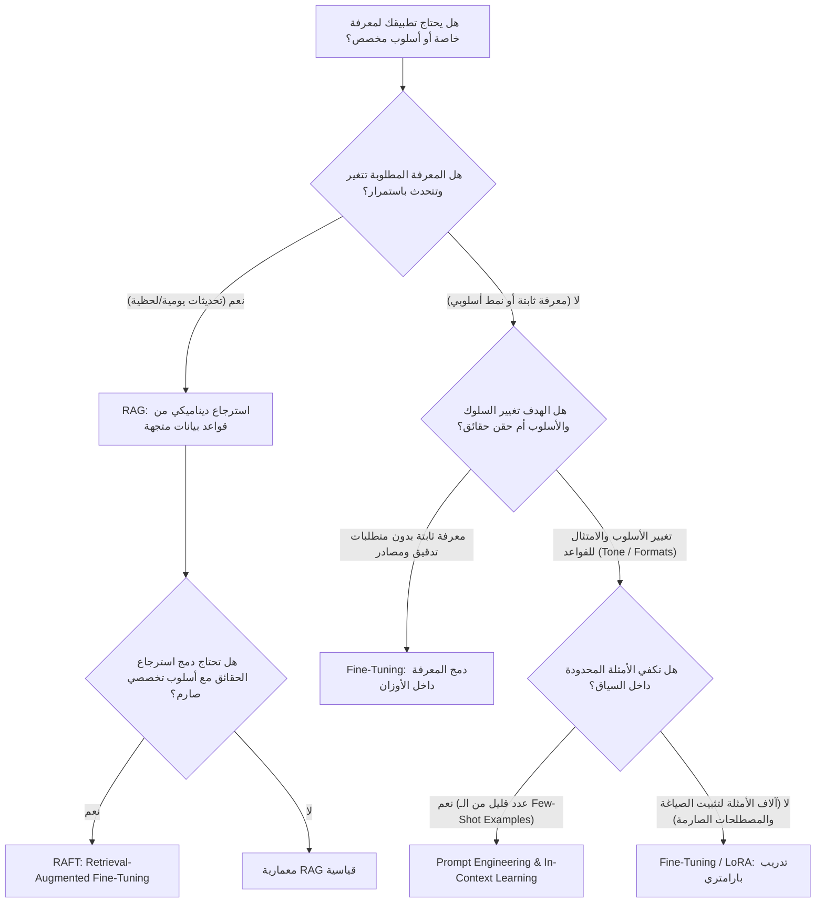
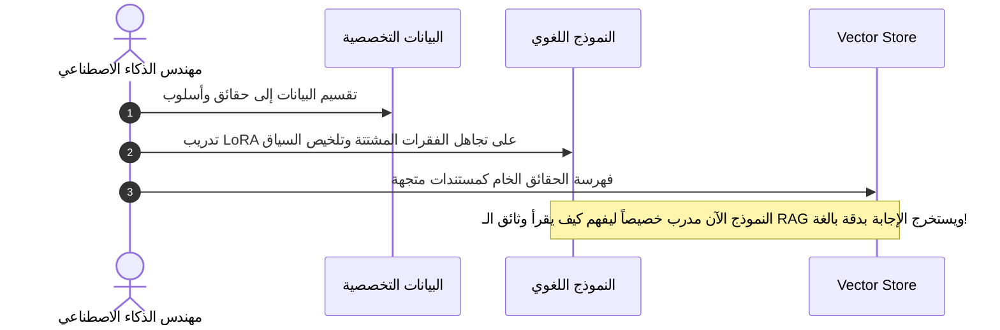

# 03 - المقارنة الثلاثية: Prompt Engineering vs Fine-Tuning vs RAG

عند بناء تطبيقات الذكاء الاصطناعي التوليدي المؤسسية (`Enterprise LLM Applications`)، يواجه مهندسو الذكاء الاصطناعي ومعماريو الأنظمة السؤال الجوهري الأهم: **ما هي التقنية المثلى لتكييف النماذج اللغوية الضخمة لخدمة متطلبات الأعمال وتزويدها بالمعرفة المطلوبة؟**

تتوفر أمامنا ثلاثة مسارات تكنولوجية رئيسية: **هندسة الأوامر (`Prompt Engineering`)**، **إعادة التدريب الدقيق (`Fine-Tuning`)**، و**التوليد المعزز بالاسترجاع (`Retrieval-Augmented Generation - RAG`)**. يخلط الكثيرون بين هذه المسارات أو يفترضون أنها بدائل متنافسة تقضي إحداها على الأخرى، بينما هي في الواقع أدوات متكاملة لكل منها نطاق عمل وتكلفة ومحددات معمارية دقيقة.

---

## 1. شجرة اتخاذ القرار المعمارية (Architectural Decision Tree)

يوضح المخطط الانسيابي التالي المسار المعياري لاتخاذ القرار الهندسي بناءً على طبيعة المتطلبات:

---

## 2. تفكيك المسارات الثلاثة: المفهوم وآلية العمل

### أ. هندسة الأوامر والتعلم داخل السياق (Prompt Engineering & In-Context Learning)
* **المفهوم**: توجيه النموذج اللغوي لاستخراج أفضل إجابة ممكنة دون تغيير أي وزن من أوزانه (`Zero Weight Updates`)، بالاعتماد الكلي على نافذة السياق (`Context Window`).
* **الذاكرة**: ذاكرة عمل مؤقتة غير مستقرة (`Volatile Working Memory`) تنتهي بانتهاء الاستدعاء الفردي.
* **التقنيات الشائعة**: 
  * التعلم من أمثلة قليلة (`Few-Shot Prompting`).
  * سلسلة الأفكار (`Chain-of-Thought - CoT`).
  * التوجيه الهيكلي (`Structured Outputs / Pydantic Prompts`).
* **الميزة التنافسية**: سرعة إطلاق لا تتجاوز دقائق، صفر تكلفة تدريب أولية.
* **نقطة الضعف**: محدودية نافذة السياق، استهلاك رموز مرتفع في كل طلب (`High Token Costs per Query`)، وحساسية مفرطة لتفاصيل الصياغة (`Prompt Brittleness`).

### ب. إعادة التدريب الدقيق (Fine-Tuning)
* **المفهوم**: تدريب النموذج الأساسي على مجموعة بيانات مخصصة لتحديث أوزانه الداخلية (`Parametric Memory Update`).
* **النوع الحديث المهيمن**: ضبط المعاملات الفعالة (`Parameter-Efficient Fine-Tuning - PEFT`) عبر تقنيات التكيف منخفض الرتبة (`Low-Rank Adaptation - LoRA` و `QLoRA`).
  
  رياضياً، بدل تحديث مصفوفة الأوزان الكاملة $W \in \mathbb{R}^{d \times k}$، يتم تمثيل التحديث كحاصل ضرب مصفوفتين منخفضتي الرتبة $A \in \mathbb{R}^{d \times r}$ و $B \in \mathbb{R}^{r \times k}$ حيث الرتبة $r \ll \min(d, k)$:
  $$\Delta W = B \cdot A$$
  $$h = W_0 x + \Delta W x = W_0 x + \frac{\alpha}{r} (B \cdot A) x$$
* **الميزة التنافسية**: تعليم النموذج أسلوباً لغوياً خاصاً (`Domain Vocabulary & Tone`)، وإلغاء الحاجة لكتابة برومبت طويل بكل تفاصيله، وتقليل زمن الاستجابة في الاستدلال.
* **نقطة الضعف**: "النسيان الكارثي" (`Catastrophic Forgetting`)، عدم القدرة على تقديم مراجع موثوقة (`No Audit Trail`)، والجمود التام أمام المعلومات التي تتغير بعد انتهاء التدريب.

### ج. التوليد المعزز بالاسترجاع (Retrieval-Augmented Generation - RAG)
* **المفهوم**: فصل الذاكرة المعرفية (`Non-Parametric Knowledge`) في قاعدة بيانات خارجية، واسترجاع الفقرات المحددة ديناميكياً وحقنها في نافذة سياق النموذج لحظة الاستعلام.
* **الميزة التنافسية**:
  1. تحديث المعرفة في الوقت الفعلي (`Real-time Updates`) دون الحاجة لإعادة تدريب.
  2. توثيق المصادر وتوفير مسار تدقيق صارم (`100% Traceability & Citation`).
  3. حماية بيانات الخصوصية والصلاحيات على مستوى المستخدم (`Document-Level Access Control`).
* **نقطة الضعف**: تعقيد البنية التحتية البرمجية (فهارس، تقطيع نصوص، نماذج تضمين، وخدمات بحث متجهة).

---

## 3. مصفوفة المقارنة الهندسية الشاملة (Engineering Trade-Off Matrix)

| المعيار الهندسي | هندسة الأوامر (`Prompt Engineering`) | التدريب الدقيق (`Fine-Tuning`) | منظومة `RAG` |
| :--- | :--- | :--- | :--- |
| **تحديث أوزان النموذج** | لا يوجد نهائياً ($\Delta W = 0$) | نعم، تحديث جزئي أو كلي ($\Delta W \neq 0$) | لا يوجد ($\Delta W = 0$) |
| **نوع الذاكرة** | مؤقتة لحظية (`Ephemeral Context`) | بارامترية داخلية (`Parametric Memory`) | غير بارامترية خارجية (`Non-Parametric Memory`) |
| **حداثة البيانات (`Data Freshness`)** | لحظية (إذا مررتها في البرومبت) | ثابتة عند تاريخ انتهاء التدريب (`Cut-off`) | فورية ولحظية بمجرد الفهرسة |
| **توثيق المصادر والتحقق** | يعتمد على ما ذكر في البرومبت | مستحيل برمجياً (`Black Box Weights`) | ممتاز مع تحديد اسم المستند والفقرة |
| **خطر الهلوسة (`Hallucination Risk`)** | متوسط إلى مرتفع | مرتفع جداً في تفاصيل الأرقام والوقائع | منخفض جداً إذا تم تقييد النموذج بالسياق |
| **تكلفة الإعداد الأولي (`Upfront Cost`)** | شبه منعدمة ($\approx \$0$) | مرتفعة (جمع وتنسيق البيانات وحسابات GPU) | متوسطة (إعداد فهارس المتجهات وقنوات البيانات) |
| **تكلفة التشغيل المتكرر (`Inference Cost`)** | مرتفعة (بسبب تكرار إرسال السياق) | منخفضة جداً (استعلامات قصيرة مباشرة) | متوسطة إلى مرتفعة (بحث متجه + سياق مدمج) |
| **زمن استجابة الاستدلال (`Latency`)** | $500\text{ms} - 2\text{s}$ | $200\text{ms} - 800\text{ms}$ | $600\text{ms} - 2.5\text{s}$ (تشمل زمن الـ Vector Search) |
| **التحكم بالصلاحيات (`Access Control`)** | يدوي عبر مدخلات المستخدم | مستحيل (المعرفة مشاعة لجميع مستخدمي النموذج) | سهل ومثالي عبر تصفية الميتا-داتا (`Metadata Filtering`) |

---

## 4. المقارنة الرياضية بين الذاكرة البارامترية واللا بارامترية

في النموذج اللغوي القياسي المدرب بدقة، يتم حساب احتمالية الكلمة التالية استناداً للأوزان الداخلية المشفرة $\theta$:

$$P(y_t \mid y_{<t}, x; \theta)$$

حيث تتوزع الحقائق عبر مليارات المعاملات، مما يتسبب فيما يسمى بالتشويش الاسترجاعي وعجز النموذج عن التمييز بين المعرفة الصادقة والاحتمالية التوليدية، وهو السبب الرياضي الأول لحدوث الهلوسة.

أما في معمارية الـ RAG، تصبح الاحتمالية مشروطة بمتغير عشوائي خفي يمثل الوثائق المسترجعة $z \in \mathcal{Z}$ من مستودع خارجي:

$$P(y_t \mid y_{<t}, x, \mathcal{Z}) = \sum_{z \in \mathcal{Z}} P(z \mid x; \phi) \cdot P(y_t \mid y_{<t}, x, z; \theta)$$

حيث:
* $\phi$: معاملات نموذج الاسترجاع (الـ Retriever) الذي يبحث في الفضاء الدلالي.
* $\theta$: معاملات نموذج التوليد (الـ Generator) المقيد بالسياق $z$.

هذا الفصل الرياضي بين طبقة الاسترجاع وطبقة التوليد هو الضمان الحقيقي لعزل المعرفة عن قدرة الصياغة المنطقية.

---

## 5. المعمارية الهجينة: دمج RAG مع Fine-Tuning (تقنية RAFT)

في الأنظمة المتقدمة، لا يتم الاختيار الحصري بين المسارين، بل يتم دمجهما عبر ما يعرف بـ **`Retrieval-Augmented Fine-Tuning (RAFT)`**:

* **متى نلجأ للمسار الهجين؟**
  1. عندما تستخدم المؤسسة مصطلحات طبية أو قانونية معقدة لا يفهمها الـ LLM العام، وفي الوقت نفسه تتغير لوائحها وأنظمتها أسبوعياً.
  2. عندما نريد تدريب النموذج على استخراج المعلومات من وثائق RAG بصيغ محددة (كإخراج جداول JSON موحدة متوافقة مع أنظمة داخلية).

---

## 6. القاعدة الذهبية للاختيار المؤسسي (The Golden Rule)

> [!TIP]
> **قاعدة أندريه كارباثي ومعماريي الذكاء الاصطناعي:**
> 1. **ابدأ دائماً بـ `Prompt Engineering`**: تحقق من إمكانية حل المشكلة ببساطة وبدون أي تعقيد هندسي.
> 2. **إذا كانت المشكلة "نقص المعرفة والحقائق والوثائق" ➔ اتجه فوراً إلى `RAG`**: لأن تدريب الأوزان أداة سيئة وغير موثوقة لحفظ الحقائق الصارمة والأرقام والتواريخ.
> 3. **إذا كانت المشكلة "الأسلوب واللغة وتنسيق المخرجات" ➔ اتجه إلى `Fine-Tuning`**: لتعليم النموذج كيف يفكر وكيف يصيغ، وليس ماذا يعلم.
> 4. **ادمج الاثنين (`RAG + Fine-Tuning`) فقط عندما تثبت المعمارية المستقلة عجزها عن تلبية متطلبات دقة بالغة التخصص**.

---

## 7. أسئلة المقابلات الهندسية (Senior AI Interview Questions)

### س1: لماذا يعتبر استخدام Fine-Tuning كبديل لقواعد المعرفة في RAG خطأ معمارياً فادحاً في التطبيقات المالية والقانونية؟
**الإجابة:** 
1. **انعدام الشفافية ومسار التدقيق (`No Audit Trail`)**: النماذج المدربة دقيقة تمثل "صندوقاً أسود"، ولا يمكنها تقديم دليل قاطع أو رقم الفقرة التي استندت إليها في استخراج الأرقام المالية.
2. **النسيان والخلط الاحتمالي**: التوليد من الأوزان استنتاجي احتمالي، وقد يدمج النموذج تواريخ أو مبالغ من سنتين ماليتين مختلفتين دون أدنى تنبيه بالخطأ.
3. **تكلفة واستحالة التحديث اللحظي**: تتغير أسعار الأسهم واللوائح القانونية لحظياً، ولا يمكن إعادة تدريب النموذج مع كل تعديل.

### س2: كيف تتصرف إذا كانت ميزانية الاستدلال (`Inference Cost`) عالية جداً بسبب إرسال سياق RAG ضخم في كل استعلام؟
**الإجابة:**
1. استخدام نماذج تصفية وإعادة ترتيب (`Reranking via Cross-Encoder`) لتقليص عدد الفقرات المرسلة من 20 إلى 3 فقط.
2. ضغط السياق (`Context Compression / LLMLingua`) لإزالة الكلمات الزائدة قبل حقنها في البرومبت.
3. تطبيق التخزين المؤقت الدلالي (`Semantic Caching`) لتخزين استجابات الأسئلة المتشابهة دون استدعاء الـ LLM مجدداً.
4. تدريب نموذج صغير عبر `Fine-Tuning` لفهم اختصارات مؤسسية محددة مما يقلل حجم التعليمات المطلوبة في الـ Prompt.
