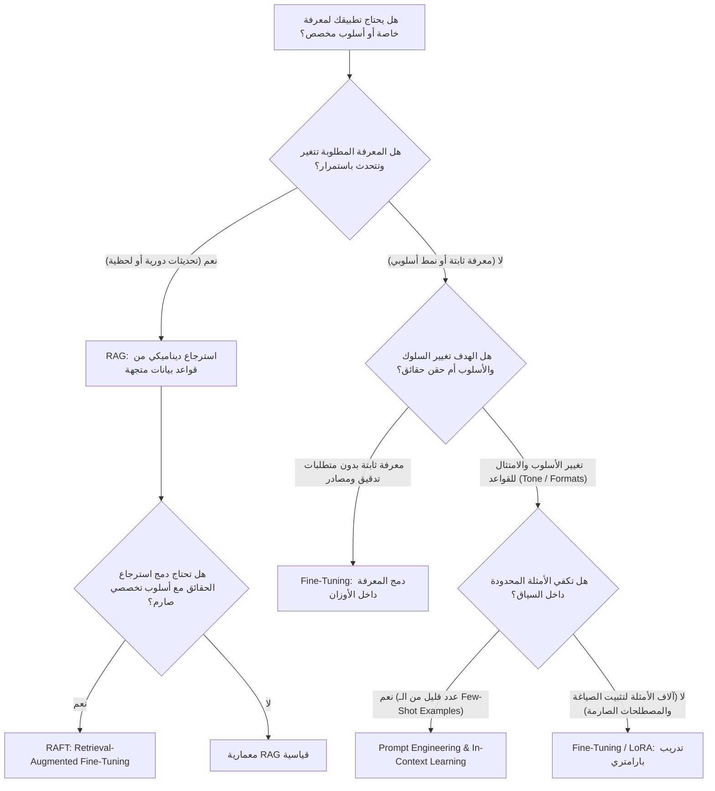

# المقارنة الثلاثية: Prompt Engineering vs Fine-Tuning vs RAG
### Architectural & Implementation Guide (`docs/00-rag-fundamentals/03-prompt-engineering-vs-finetuning-vs-rag.md`)

عند بناء تطبيقات الذكاء الاصطناعي المؤسسية (`Enterprise LLM Applications`)، يواجه مهندسو الذكاء الاصطناعي ومعماريو الأنظمة السؤال الجوهري الأهم: **ما هي التقنية المثلى لتكييف النماذج اللغوية الضخمة لخدمة متطلبات الأعمال وتزويدها بالمعرفة المطلوبة؟**

تتوفر أمامنا ثلاثة مسارات تكنولوجية رئيسية: **هندسة الأوامر (`Prompt Engineering`)**، **إعادة التدريب الدقيق (`Fine-Tuning`)**، و**التوليد المعزز بالاسترجاع (`Retrieval-Augmented Generation - RAG`)**. يخلط الكثيرون بين هذه المسارات أو يفترضون أنها بدائل متنافسة، بينما هي في الواقع أدوات متكاملة لكل منها نطاق عمل وتكلفة ومحددات معمارية دقيقة.

---

## 1. شجرة اتخاذ القرار المعمارية (Architectural Decision Tree)

يوضح المخطط الانسيابي التالي المسار المعياري لاتخاذ القرار الهندسي بناءً على طبيعة المتطلبات:



---

## 2. تفكيك المسارات الثلاثة: المفهوم وآلية العمل

### أ. هندسة الأوامر (Prompt Engineering & In-Context Learning)
* **المفهوم**: توجيه النموذج اللغوي لاستخراج أفضل إجابة ممكنة دون تغيير أي وزن من أوزانه الداخلية، بالاعتماد الكلي على نافذة السياق (`Context Window`).
* **الذاكرة**: ذاكرة عمل مؤقتة تنتهي بانتهاء الاستدعاء الفردي.
* **التقنيات الشائعة**: 
  * التعلم من أمثلة قليلة (`Few-Shot Prompting`).
  * سلسلة الأفكار (`Chain-of-Thought - CoT`).
  * القوالب المنظمة (`Structured Outputs / Pydantic Schemas`).
* **الميزة التنافسية**: سرعة إطلاق لا تتجاوز دقائق، صفر تكلفة تدريب أولية.
* **نقطة الضعف**: محدودية نافذة السياق، استهلاك رموز مرتفع في كل طلب، وحساسية مفرطة لتفاصيل الصياغة.

### ب. التدريب الدقيق وتكييف الأوزان (Fine-Tuning)
* **المفهوم**: تدريب النموذج الأساسي على مجموعة بيانات مخصصة لتحديث أوزانه الداخلية (`Parametric Memory Update`).
* **الأسلوب الحديث السائد**: تكييف المعاملات منخفضة الرتبة (`LoRA / QLoRA`)، حيث يتم تجميد أوزان النموذج الأصلية وتدريب مصفوفات تعديل صغيرة وخفيفة تمثل السلوك والأسلوب المطلوب.
* **الميزة التنافسية**: تعليم النموذج أسلوباً لغوياً فريداً ومصطلحات تخصصية صارمة، وتقليل طول البرومبت في كل استدعاء.
* **نقطة الضعف**: الجمود التام أمام المعلومات الجديدة بعد انتهاء التدريب، والافتقار إلى إسناد المصادر الدقيقة.

### ج. التوليد المعزز بالاسترجاع (Retrieval-Augmented Generation - RAG)
* **المفهوم**: فصل الذاكرة المعرفية في قاعدة بيانات خارجية، واسترجاع المقاطع الأكثر صلة لحظة الاستعلام وحقنها في نافذة سياق النموذج.
* **الميزة التنافسية**:
  1. تحديث المعرفة لحظياً دون الحاجة لأي تدريب إضافي.
  2. توثيق المصادر وتوفير مسار تدقيق صارم (`100% Traceability & Citation`).
  3. حماية بيانات الخصوصية والصلاحيات على مستوى المستخدم (`Document-Level Access Control`).
* **نقطة الضعف**: تتطلب بنية تحتية برمجية لإدارة المستندات وفهارس المتجهات.

---

## 3. مصفوفة المقارنة الهندسية الشاملة (Engineering Trade-Off Matrix)

| المعيار الهندسي | هندسة الأوامر (`Prompt Engineering`) | التدريب الدقيق (`Fine-Tuning`) | منظومة `RAG` |
| :--- | :--- | :--- | :--- |
| **تحديث أوزان النموذج** | لا يوجد نهائياً | نعم، تحديث أوزان محددة (LoRA) | لا يوجد نهائياً |
| **نوع الذاكرة** | مؤقتة لحظية (`Working Context`) | بارامترية داخل الأوزان | خارجية غير بارامترية (`Vector DB`) |
| **القدرة على التحديث اللحظي** | محدودة بطول البرومبت | بطيئة ومكلفة (تتطلب إعادة تدريب) | **فورية بمجرد تحديث قاعدة البيانات** |
| **إسناد المصادر والشفافية** | تعتمد على دقة ما تم تضمينه بالأمر | منعدمة (صندوق أسود) | **دقيقة ومسنودة بالمستند ورقم الفقرة** |
| **التحكم بصلاحيات المستخدمين** | غير عملي على مستوى كم هائل | مستحيل فصل الصلاحيات داخل الأوزان | **ممتاز، يُفلتر أثناء خطوة الاسترجاع** |
| **الاستخدام المثالي** | النماذج الأولية والتوجيهات العامة | تخصيص الأسلوب، النبرة، والمخرجات المنظمة | **الحقائق المتغيرة وبيانات الشركات والأبحاث** |

---

## 4. الكود التطبيقي: مقارنة عملية بالبايثون بين الأساليب الثلاثة

يوضح الكود التالي كيف يتعامل كل مسار مع متطلب عمل حقيقي (الاستعلام عن سياسة شركة متغيرة):

```python
from typing import Dict, Any

# 1. Approach A: Pure Prompt Engineering (Few-Shot)
def run_prompt_engineering(query: str) -> Dict[str, Any]:
    """
    Relies purely on instructions and in-context examples.
    Fails when corporate facts are dynamic or outside the context window.
    """
    system_prompt = (
        "You are an enterprise assistant. Answer concisely.\n"
        "Example Q: What is our work week? -> A: Monday to Friday, 9am-5pm.\n"
    )
    user_prompt = f"Question: {query}"
    return {
        "approach": "Prompt Engineering",
        "prompt_sent": f"{system_prompt}\n{user_prompt}",
        "risk": "Hallucination if factual policy is unknown to the model's pretraining."
    }

# 2. Approach B: Fine-Tuned Model Simulation
def run_fine_tuned_inference(query: str) -> Dict[str, Any]:
    """
    Simulates calling a specialized model with domain style baked into weights.
    Knowledge is fixed at training cutoff.
    """
    # Weights implicitly know the internal format and tone
    return {
        "approach": "Fine-Tuning (Parametric)",
        "input": query,
        "style_adapted": True,
        "limitation": "Cannot reference the exact page or date of latest updated policy."
    }

# 3. Approach C: Retrieval-Augmented Generation (RAG)
def run_rag_pipeline(query: str, external_store: Dict[str, str]) -> Dict[str, Any]:
    """
    Dynamically fetches verified source document and injects it into context.
    Provides verifiable, real-time grounded facts.
    """
    # Fast retrieval step
    matched_doc_id = "hr_doc_v2_2026"
    retrieved_text = external_store.get(matched_doc_id, "")
    
    augmented_prompt = (
        "Answer the question strictly using the provided context snippet.\n"
        f"Verified Source [{matched_doc_id}]: {retrieved_text}\n"
        f"Question: {query}\n"
        "Grounded Answer:"
    )
    return {
        "approach": "RAG (Non-Parametric)",
        "source_used": matched_doc_id,
        "prompt_sent": augmented_prompt,
        "traceability": "100% cited with source document ID"
    }

# Execution Comparison
dynamic_knowledge_base = {
    "hr_doc_v2_2026": "Effective March 2026, parental leave is extended to 16 weeks fully paid."
}

query = "What is the updated parental leave duration?"

pe_result = run_prompt_engineering(query)
rag_result = run_rag_pipeline(query, dynamic_knowledge_base)

print(f"[{pe_result['approach']}] -> Risk: {pe_result['risk']}")
print(f"[{rag_result['approach']}] -> Source: {rag_result['source_used']} | {rag_result['traceability']}")
```

---

## 5. القاعدة الذهبية للاختيار المعماري

> **القاعدة الذهبية (The Golden Rule)**:
> - إذا كان التحدي هو **"كيف يتحدث النموذج"** (How it speaks: الأسلوب، النبرة، لغة المجال، أو هيكل الإخراج البرمجي) ➔ اختر **Fine-Tuning**.
> - إذا كان التحدي هو **"ماذا يعرف النموذج"** (What it knows: الحقائق، اللوائح، التحديثات اللحظية، وبيانات المؤسسات) ➔ اختر **RAG**.
> - إذا كنت بحاجة للاثنين معاً (مثل: تلخيص عقود قانونية بأسلوب مكاتب المحاماة المعتمد بناءً على وثائق العميل اللحظية) ➔ اختر **Hybrid: RAG + Fine-Tuning (RAFT)**.
