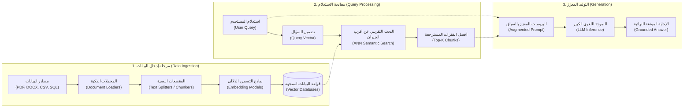

# 04 - المكونات الأساسية للـ RAG ومرحلة إدخال البيانات (Data Ingestion & Preprocessing)

يمثل خط إدخال ومعالجة البيانات (`Data Ingestion & Preprocessing Pipeline`) البنية التحتية والعمود الفقري لأي منظومة `RAG` إنتاجية. وكما هو معروف في هندسة البيانات: *"القمامة في المدخلات تعني قمامة في المخرجات"* (`Garbage In, Garbage Out`). إذا تم تقطيع المستندات بشكل عشوائي أو تضمينها بنماذج ضعيفة، فلن يستطيع أي نموذج لغوي خارق (مهما كان ذكاؤه) تقديم إجابة دقيقة.

---

## 1. المعمارية الهيكلية الشاملة لمنظومة RAG (System Architecture)

تنقسم منظومة الـ RAG إلى ثلاث مراحل رئيسية متعاقبة ومترابطة:



---

## 2. تفكيك مرحلة إدخال ومعالجة البيانات (Data Ingestion Pipeline)

تتم هذه المرحلة في الخلفية مسبقاً (`Offline / Asynchronous Indexing`)، وتتكون من 4 خطوات رئيسية:

### الخطوة الأولى: استخراج البيانات والمحملات (`Document Loaders`)
المستندات المؤسسية لا تأتي كنصوص نقية، بل تتوزع عبر تنسيقات شديدة التنوع:
* **المستندات غير المهيكلة (`Unstructured`)**: ملفات `PDF`، مستندات `Word (DOCX)`، والعروض التقديمية `PPTX`.
* **المستندات شبه المهيكلة (`Semi-Structured`)**: سجلات `JSON`، صفحات `HTML`، وملفات `Markdown`.
* **البيانات المهيكلة (`Structured`)**: جداول `CSV`، مستندات `Excel`، وقواعد بيانات `SQL`.

> [!IMPORTANT]
> **الحفاظ على البيانات الوصفية (`Metadata Extraction`)**:
> لا يقتصر دور المحمل (`Loader`) على استخراج النص الخام فقط، بل يجب عليه استخراج وتثبيت الميتا-داتا الحيوية المرتبطة بكل جزء:
> * `source`: المسار الكامل للمستند الأصلي.
> * `page_number`: رقم الصفحة الدقيق لتمكين الاستشهاد والمراجعة.
> * `created_at / department / security_tier`: تصنيفات الصلاحيات والتواريخ لحوكمة البيانات.

---

### الخطوة الثانية: التقطيع النصي الذكي (`Text Splitting & Chunking`)

#### لماذا التقطيع النصي إلزامي وحتمي في RAG؟
1. **محدودية نافذة السياق (`Context Window Limits`)**: حتى مع وجود نماذج ذات نوافذ مليونية، فإن إرسال كتاب كامل يستهلك تكلفة باهظة ويزيد زمن الاستجابة.
2. **عجز نماذج التضمين (`Embedding Dilution`)**: نماذج التضمين لها حد أقصى للمدخلات (عادة 512 أو 8192 توكن). إذا حاولت تضمين مستند مكون من 100 صفحة في متجه واحد، ستتلاشى كل التفاصيل الدقيقة ويصبح المتجه مجرد متوسط هلامي لا يعبر عن أي تفصيلة دقيقة.
3. **نسبة الإشارة إلى الضوضاء (`Signal-to-Noise Ratio - SNR`)**: إذا كان استفسار المستخدم عن رقم مالي في الصفحة 12، فإن استرجاع فقرة محددة مكونة من 300 كلمة يوفر للنموذج تركيزاً بنسبة 100% دون تشتيت انتباهه بـ 50 صفحة أخرى غير ذات صلة.

#### الرياضيات الحاكمة للتقطيع (Chunk Size & Overlap):
يتم تعريف عملية التقطيع بمعاملين رئيسيين:
* **حجم القطعة (`Chunk Size - $C_s$`)**: عدد الأحرف أو الرموز في كل قطعة.
* **التداخل (`Chunk Overlap - $C_o$`)**: عدد الأحرف أو الرموز المشتركة بين القطع المتتالية.

تحسب الإزاحة الخطية (`Stride - $S$`) بين بداية كل قطعة والتالية بالمعادلة:
$$S = C_s - C_o$$

ويحسب العدد الإجمالي التقريبي للقطع $N$ لمستند طوله الإجمالي $L$ بالمعادلة:
$$N = \left\lceil \frac{L - C_o}{C_s - C_o} \right\rceil$$

```
[--- Chunk 1 (Size = 500) ---]
                [--- Chunk 2 (Size = 500) ---]
                                [--- Chunk 3 (Size = 500) ---]
|<-- Stride -->|
        |<- Overlap ->|
```

> **وظيفة التداخل (`Overlap`)**: منع بتر الجمل والأفكار المترابطة عند الحدود الفاصلة للقطع، مما يضمن احتفاظ المتجه بالمعنى السياقي الكامل.

---

### الخطوة الثالثة: نماذج التضمين الدلالي (`Embedding Models`)

نموذج التضمين هو دالة رياضية تحول النص البشري من فضاء لغوي منفصل إلى فضاء متجهات مستمر عالي الأبعاد:
$$f_{\text{embed}}: \text{Text} \longrightarrow \mathbb{R}^d$$

حيث يمثل $d$ عدد أبعاد المتجه (مثل $d = 384$ في `all-MiniLM-L6-v2` أو $d = 1536$ في `text-embedding-3-small`).

في هذا الفضاء، تكون المسافة الزاوية أو المسافة الإقليدية دالة مباشرة على التقارب الدلالي في المعنى، بغض النظر عن تطابق الكلمات الحرفية (`Semantic Closeness vs Lexical Match`):

$$\text{Cosine Similarity}(u, v) = \frac{u \cdot v}{\|u\| \|v\|} = \frac{\sum_{i=1}^d u_i v_i}{\sqrt{\sum_{i=1}^d u_i^2} \sqrt{\sum_{i=1}^d v_i^2}}$$

#### مقارنة بين فئات نماذج التضمين:
* **نماذج محلية مفتوحة المصدر (`Local Hugging Face Models`)**: مثل `sentence-transformers/all-MiniLM-L6-v2` و `BAAI/bge-large-en-v1.5`. توفر أماناً وخصوصية تامة، وتعمل على خوادمك دون تكاليف API أو مخاطر انقطاع خدمة.
* **نماذج سحابية مدارة (`Cloud API Models`)**: مثل `OpenAI text-embedding-3-large` و `Cohere Embed v3`. تقدم أبعاداً عالية ودعماً لتعدد اللغات، لكنها تتطلب إرسال البيانات عبر الإنترنت وتخضع لرسوم لكل مليون رمز.

---

### الخطوة الرابعة: قواعد البيانات المتجهة ومؤشرات الفهرسة (`Vector Stores & Indexing`)

تخزين واسترجاع ملايين المتجهات بكفاءة يتطلب تقنيات فهرسة متخصصة لأن البحث الخطي المباشر (`Exact k-NN Search`) يستغرق تعقيداً زمنياً $\mathcal{O}(N \cdot d)$، وهو بطيء جداً في قواعد البيانات الضخمة.

لذلك تعتمد قواعد البيانات المتجهة على **خوارزميات البحث التقريبي عن أقرب الجيران (`Approximate Nearest Neighbors - ANN`)**:

1. **`HNSW (Hierarchical Navigable Small World)`**:
   * الفهرس الأكثر شيوعاً وكفاءة في بيئات الإنتاج.
   * يبني شبكة رسومية هرمية متعددة الطبقات شبيهة بقوائم التخطي (`Skip Lists`).
   * تعقيد البحث الزمني: $\mathcal{O}(\log N)$.
   * الدقة (`Recall`): أعلى من 95-98%.
2. **`IVF (Inverted File Index)`**:
   * تقسيم الفضاء إلى عناقيد (`Voronoi Cells`) عبر خوارزمية $k$-means.
   * تقليل عدد المتجهات التي يتم فحصها بشكل هائل، مع استهلاك ذاكرة أقل من `HNSW`.
3. **`Flat Index`**:
   * بحث خطي شامل دقيق بنسبة 100% دون أي تقريب.
   * مناسب لقواعد البيانات الصغيرة (أقل من 10,000 متجه).

#### تصنيف أشهر قواعد البيانات المتجهة في الإنتاج:
* **محلية للتطوير والاختبار**: `Chroma`، `FAISS` (مكتبة خفيفة الوزن من Meta).
* **سحابية مدارة وموزعة للأعمال الضخمة**: `Pinecone`، `Weaviate`، `Qdrant`، و `DataStax AstraDB`.

---

## 3. مصفوفة المفاضلة في إعداد التقطيع والتضمين (Engineering Trade-Offs)

| المعيار | قطع صغيرة (`Small Chunks: 128 - 256 tokens`) | قطع متوسطة (`Medium Chunks: 512 - 1024 tokens`) | قطع كبيرة (`Large Chunks: 2048+ tokens`) |
| :--- | :--- | :--- | :--- |
| **الدقة الدلالية للمتجه (`Vector Precision`)** | عالية جداً (تركيز نقي على الفكرة المحددة) | متوازنة ومثالية لمعظم التطبيقات | منخفضة (المعنى الدقيق يضيع في سياق عام) |
| **اكتمال السياق عند التوليد** | منخفض (قد يفتقد التفاصيل السابقة أو اللاحقة) | ممتاز (يوفر سياقاً متكاملاً للـ LLM) | ممتاز لكنه قد يحتوي على أجزاء مشتتة |
| **استهلاك الذاكرة والرمز** | متجهات كثيرة وتكلفة تخزين وفهرسة أكبر | استهلاك متزن ومثالي للإنتاج | متجهات قليلة وتكلفة استدلال عالية للـ LLM |
| **أفضل سيناريو استخدام** | الأسئلة المباشرة المحددة (`Factoid Q&A`) | المقالات والوثائق الفنية والأدلة | التلخيص والتحليل الشامل للوثائق (`Summarization`) |

---

## 4. أسئلة المقابلات المتقدمة (Senior AI Interview Questions)

### س1: ما هو تأثير الـ Chunk Overlap على دقة الاسترجاع، وما عواقب زيادته بشكل مبالغ فيه؟
**الإجابة:** 
* **الفائدة الأساسية**: يضمن عدم بتر الكيانات المسماة (`Named Entities`) والمصطلحات القانونية أو التقنية التي قد تقع بالصدفة عند حد القطع، مما يحافظ على التماسك الدلالي للفقرة.
* **عواقب الزيادة المفرطة**: إذا زاد الـ Overlap عن 30-40%، يؤدي ذلك إلى مضاعفة حجم قاعدة البيانات المتجهة، وتكرار استرجاع نفس الجمل في عدة قطع مختلفة (`Redundancy`)، مما يهدر مساحة نافذة سياق الـ LLM دون تقديم معلومات جديدة حقيقية.

### س2: كيف تختار حجم القطعة (`Chunk Size`) عند بناء نظام RAG للوثائق القانونية أو الأكاديمية؟
**الإجابة:**
الوثائق القانونية تتسم بفقرات مترابطة طويلاً وبنود تشريعية تتطلب قراءة الشرط مع استثناءاته. لذلك:
1. تجنب التقطيع العشوائي بالأحرف الثابتة (`Fixed Character Splitting`).
2. استخدام التقطيع الهيكلي أو المتكرر (`Recursive Character Splitting`) بالاعتماد على الفواصل المنطقية للمستند (الفصول `\n\n`، ثم الفقرات `\n`، ثم الجمل `. `).
3. اختيار حجم قطعة متوسط إلى كبير (بين 800 إلى 1200 توكن) مع تداخل 150 توكن لضمان بقاء الاستثناءات القانونية مرتبطة بالقواعد الأصلية التي تتبعها.
