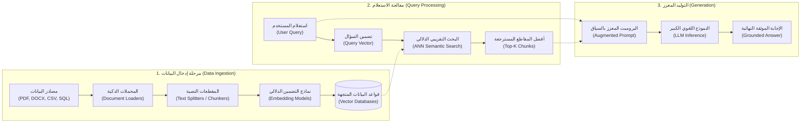

# المكونات الأساسية للـ RAG ومرحلة إدخال البيانات (Data Ingestion Pipeline)
### Architectural & Implementation Guide (`docs/00-rag-fundamentals/04-data-ingestion-and-preprocessing.md`)

يمثل خط إدخال ومعالجة البيانات (`Data Ingestion Pipeline`) العمود الفقري لأي منظومة `RAG` إنتاجية. وكما هو معروف في هندسة البيانات: *"القمامة في المدخلات تعني قمامة في المخرجات"* (`Garbage In, Garbage Out`). إذا تم تقطيع المستندات بشكل عشوائي أو تضمينها بنماذج ضعيفة، فلن يستطيع أي نموذج لغوي متقدم تقديم إجابة دقيقة.

---

## 1. المعمارية الهيكلية الشاملة لمنظومة RAG (System Architecture)

تنقسم منظومة الـ RAG إلى ثلاث مراحل رئيسية متعاقبة ومترابطة:



---

## 2. تفكيك مرحلة إدخال ومعالجة البيانات (Data Ingestion Steps)

تتم هذه المرحلة مسبقاً في الخلفية (`Offline / Asynchronous Ingestion`)، وتتكون من 4 خطوات أساسية:

### الخطوة الأولى: استخراج البيانات والمحملات (`Document Loaders`)
المستندات المؤسسية لا تأتي كنصوص نقية، بل تتوزع عبر تنسيقات متنوعة:
* **غير مهيكلة (`Unstructured`)**: ملفات `PDF`، مستندات `Word (DOCX)`، وعروض `PPTX`.
* **شبه مهيكلة (`Semi-Structured`)**: ملفات `JSON`، صفحات `HTML`، وملفات `Markdown`.
* **مهيكلة (`Structured`)**: جداول `CSV`، مستندات `Excel`، وقواعد بيانات `SQL`.

> [!IMPORTANT]
> **الحفاظ على البيانات الوصفية (`Metadata Extraction`)**:
> لا يقتصر دور المحمل على استخراج النص الخام فقط، بل يجب استخراج وتثبيت الميتاداتا الحيوية المرتبطة بكل جزء:
> * `source`: اسم ومسار المستند الأصلي لضمان التوثيق.
> * `page_number`: رقم الصفحة الدقيق لتمكين المراجعة البشرية.
> * `category / department`: تصنيف السياسة لتطبيق فلاتر الأمان والصلاحيات لاحقاً.

---

### الخطوة الثانية: التقطيع النصي الذكي (`Text Splitting & Chunking`)

#### لماذا التقطيع النصي إلزامي في RAG؟
1. **تجنب تلاشي المعنى (`Embedding Dilution`)**: نماذج التضمين لها سعة محددة (عادة 512 إلى 8192 توكن). إذا حاولت تضمين مستند كامل من 50 صفحة في متجه واحد، ستتلاشى الأرقام والتفاصيل الدقيقة ويصبح المتجه مجرد متوسط هلامي لا يعبر عن شيء محدد.
2. **رفع نسبة الإشارة إلى الضوضاء (`Signal-to-Noise Ratio`)**: استرجاع مقطع دقيق من 200 كلمة يحتوي على الإجابة مباشرة يوفر للنموذج تركيزاً تاماً دون تشتيته بعشرات الصفحات غير ذات الصلة.
3. **التحكم في التكلفة والـ Latency**: تقليل عدد التوكنز المرسلة للنموذج في كل استعلام.

#### فكرة التداخل (`Chunk Overlap`):
يتم تحديد التقطيع بمعاملين رئيسيين:
* **حجم المقطع (`Chunk Size`)**: عدد الأحرف أو التوكنز في كل مقطع.
* **التداخل (`Overlap`)**: عدد الأحرف المشتركة بين المقطع والمقطع الذي يليه.

```
[--- المقطع الأول (500 حرف) ---]
                [--- المقطع الثاني (500 حرف) ---]
                                [--- المقطع الثالث (500 حرف) ---]
|<-- خطوة الانتقال -->|
        |<-- التداخل (60 حرف) -->|
```

> **وظيفة التداخل**: منع بتر الجمل والأفكار المترابطة عند الحدود الفاصلة للقطع، مما يضمن احتفاظ المتجه بالمعنى السياقي الكامل.

---

### الخطوة الثالثة: نماذج التضمين الدلالي (`Embedding Models`)
نموذج التضمين هو نموذج ذكاء اصطناعي يحول النص البشري إلى متجه عددي عالي الأبعاد (`Dense Vector`). في هذا الفضاء المتجهي، تكون المتجهات القريبة من بعضها دلالة مباشرة على تقارب المعنى في سياق الحديث، حتى لو اختلفت الكلمات الحرفية تماماً (مثل: *"سيارة"* و *"مركبة"*).

* **نماذج محلية مفتوحة المصدر (`Local Models`)**: مثل `sentence-transformers/all-MiniLM-L6-v2` و `BAAI/bge-small-en-v1.5`. توفر أماناً وخصوصية تامة، وتعمل على جهازك دون تكاليف API أو مخاطر انقطاع خدمة.
* **نماذج سحابية مدارة (`Cloud APIs`)**: مثل `OpenAI text-embedding-3-small` و `Cohere Embed v3`.

---

### الخطوة الرابعة: قواعد البيانات المتجهة والفهرسة (`Vector Databases`)
تخزين ملايين المتجهات واسترجاعها في أجزاء من الثانية يتطلب قواعد بيانات متخصصة (مثل `Qdrant`, `Chroma`, `Milvus`, `Pinecone`).
* تعتمد هذه القواعد على خوارزميات **البحث التقريبي عن أقرب الجيران (`Approximate Nearest Neighbors - ANN`)** مثل `HNSW` للبحث فائق السرعة.
* تخزن المتجهات جنباً إلى جنب مع النص الأصلي والبيانات الوصفية (`Payload`) لتمكين الفلترة الهجينة.

---

## 3. الكود التطبيقي: خط أنابيب Ingestion كامل بالبايثون

يوضح الكود التالي خط معالجة وتجهيز نصوص متكامل يشمل: استخراج النصوص، التقطيع بحجم وتداخل محدد، الحفاظ على الميتاداتا، وتوليد الفهارس:

```python
import hashlib
from typing import List, Dict, Any

class SimpleTextChunker:
    """Sliding-window character chunker preserving sentence context and metadata."""
    def __init__(self, chunk_size: int = 200, overlap: int = 40):
        self.chunk_size = chunk_size
        self.overlap = overlap
        self.stride = chunk_size - overlap

    def split_text(self, text: str, metadata: Dict[str, Any]) -> List[Dict[str, Any]]:
        chunks = []
        start = 0
        text_len = len(text)
        chunk_index = 0

        while start < text_len:
            end = min(start + self.chunk_size, text_len)
            chunk_content = text[start:end].strip()

            if chunk_content:
                # Deterministic chunk ID based on source and content hash
                content_hash = hashlib.md5(chunk_content.encode("utf-8")).hexdigest()[:8]
                chunk_id = f"{metadata.get('doc_id', 'doc')}_chk_{chunk_index}_{content_hash}"

                chunks.append({
                    "chunk_id": chunk_id,
                    "content": chunk_content,
                    "metadata": {
                        **metadata,
                        "chunk_index": chunk_index,
                        "char_start": start,
                        "char_end": end,
                    }
                })
                chunk_index += 1

            if end == text_len:
                break
            start += self.stride

        return chunks


class InMemoryVectorStore:
    """Lightweight in-memory vector store demonstrating payload indexing."""
    def __init__(self):
        self.storage = []

    def add_records(self, records: List[Dict[str, Any]]) -> None:
        """Ingest chunk records with metadata payloads."""
        for r in records:
            # Mock dense vector representation based on simple token hashes
            mock_vector = [ord(c) % 50 for c in r["content"][:10]]
            self.storage.append({
                "id": r["chunk_id"],
                "content": r["content"],
                "metadata": r["metadata"],
                "vector": mock_vector
            })
        print(f"[*] Successfully ingested {len(records)} chunks into vector store.")


# Pipeline Execution Demonstration
raw_documents = [
    {
        "doc_id": "hr_policy_01",
        "title": "Corporate Health & Safety Standards 2026",
        "category": "Health & Safety",
        "text": (
            "All enterprise employees must complete workplace safety orientation within 30 days of onboarding. "
            "Ergonomic assessments are provided by the Facilities team upon request. Emergency evacuation drills "
            "are conducted semi-annually across all regional headquarters."
        )
    }
]

chunker = SimpleTextChunker(chunk_size=120, overlap=30)
vector_db = InMemoryVectorStore()

# 1. Processing and Chunking
all_chunks = []
for doc in raw_documents:
    doc_meta = {"doc_id": doc["doc_id"], "title": doc["title"], "category": doc["category"]}
    chunks = chunker.split_text(doc["text"], doc_meta)
    all_chunks.extend(chunks)

# 2. Ingestion into Vector Store
vector_db.add_records(all_chunks)

# 3. Inspecting the indexed chunks
print("\n--- Indexed Chunks Inspection ---")
for chk in vector_db.storage:
    print(f"ID: {chk['id']}")
    print(f"Text: '{chk['content']}'")
    print(f"Payload Category: {chk['metadata']['category']} | Start: {chk['metadata']['char_start']}\n")
```

---

## 4. الممارسات الهندسية الفضلى في بيئات الإنتاج

1. **اعتماد مبدأ Parse Once to JSON**: لا تقم باستخراج وتفريغ الـ PDFs كل مرة يعمل فيها خط الـ Ingestion؛ استخرج النصوص مرة واحدة واحفظها بصيغة هيكلية نظيفة (`JSON / JSONL`) لتسريع إعادة الفهرسة.
2. **توليد معرّفات حتمية ثابتة (`Deterministic UUID5`)**: استخدام خوارزميات مثل UUID5 المبنية على اسم المستند ورقم المقطع يضمن خاصية الـ `Idempotency`؛ بحيث لو أعدت تشغيل خط الـ Ingestion، يتم تحديث النقاط دون تكرارها.
3. **فهرسة حقول الحمولة (`Payload Indexing`)**: في قواعد بيانات المتجهات مثل Qdrant، أنشئ دائماً فهارس على الحقول المستخدمة في الفلترة (مثل `category` أو `department`) لضمان سرعة البحث أثناء تطبيق صلاحيات الوصول.
