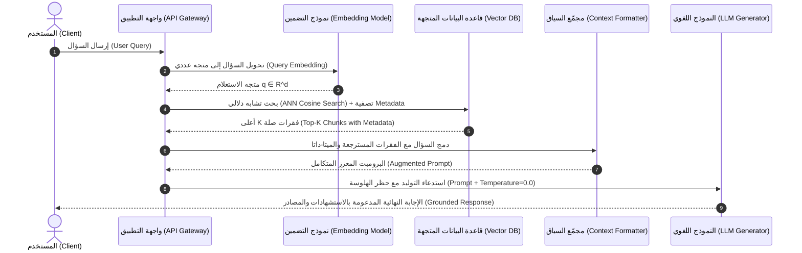

# 05 - معالجة الاستعلام والتوليد (Query Processing & Generation)

بعد إتمام مرحلة إدخال البيانات وفهرستها في قواعد البيانات المتجهة (`Offline Ingestion Phase`)، تبدأ المرحلة الحية التفاعلية مع المستخدم في الوقت الفعلي (`Real-Time / Online Serving Phase`). تتولى هذه المرحلة استلام سؤال المستخدم، وتحليله، واسترجاع أدق الفقرات المطابقة دلالياً، ثم صياغة الـ `Prompt` المعزز وحث النموذج اللغوي الكبير (`LLM`) على توليد إجابة دقيقة وموثقة.

---

## 1. مخطط التسلسل الزمني لرحلة الاستعلام (Query Execution Lifecycle)

يوضح المخطط التالي دورة حياة استعلام المستخدم من لحظة إدخاله وحتى استلام الإجابة النهائية الموثقة:



---

## 2. تفكيك المرحلة الأولى: معالجة الاستعلام والاسترجاع (Query Processing & Retrieval)

### أ. تضمين السؤال في الفضاء الدلالي (`Query Embedding`)
* **الشرط الحتمي**: يجب استخدام **نفس نموذج التضمين** المستخدم في مرحلة إدخال البيانات.
* إذا استخدمت `all-MiniLM-L6-v2` لفهرسة الوثائق، فيجب استخدامه بعينه لتضمين استعلام المستخدم $q$:
  $$\mathbf{q} = f_{\text{embed}}(\text{Query})$$
* أي اختلاف في النموذج ينتج عنه عدم توافق في فضاء المتجهات والأبعاد، مما يدمر نتائج البحث تماماً.

### ب. البحث الدلالي وحساب التشابه (`Top-k Semantic Retrieval`)
تقوم قاعدة البيانات المتجهة بحساب التشابه بين متجه السؤال $\mathbf{q}$ وجميع متجهات القطع المخزنة $\mathbf{d}_i \in \mathcal{D}$، واختيار أفضل $k$ فقرات ذات أعلى درجات تشابه:

$$\text{Top-}k = \operatorname*{arg\,max}_{\mathcal{S} \subset \mathcal{D}, |\mathcal{S}|=k} \sum_{\mathbf{d}_i \in \mathcal{S}} \text{CosineSimilarity}(\mathbf{q}, \mathbf{d}_i)$$

* **العتبة التشابهية (`Similarity Thresholding`)**:
  في بيئات الإنتاج، لا نكتفي بطلب $k$ فقرات عمياء؛ فلو سأل المستخدم سؤالاً خارج سياق قاعدة البيانات تماماً، فإن $k$-NN سيرجع أقرب الفقرات حتى لو كان التشابه ضعيفاً جداً. لذلك نضع شرط العتبة الدنيا:
  $$\text{Filter: } \text{Score}(\mathbf{q}, \mathbf{d}_i) \ge \tau \quad (\text{e.g., } \tau = 0.70)$$

### ج. تصفية البيانات الوصفية قبل/أثناء البحث (`Metadata Pre-filtering`)
لضمان الأمان وحوكمة البيانات، يتم تطبيق فلاتر الميتا-داتا مع استعلام البحث المتجه:
```json
{
  "$and": [
    { "department": { "$eq": "Finance" } },
    { "security_clearance": { "$in": ["Confidential", "Public"] } },
    { "created_year": { "$gte": 2024 } }
  ]
}
```
هذا يضمن أن المستخدم يرى فقط المستندات المصرح له بالاطلاع عليها دون استهلاك مساحة البحث في وثائق محجوبة.

---

## 3. تفكيك المرحلة الثانية: إثراء السياق وبناء الأوامر (Context Augmentation)

بعد استرجاع أفضل $k$ فقرات، يتم تجميعها وبناء "البرومبت المعزز" (`Augmented Prompt`). البرومبت الإنتاجي لا يكتفي بإلقاء النصوص كيفما اتفق، بل يصاغ بهيكل صارم:

```
[System Instructions]
أنت مساعد ذكاء اصطناعي مؤسسي فائق الدقة. مهمتك الإجابة عن سؤال المستخدم بالاعتماد حصرياً وصارمًا على السياق المرفق أدناه.
القواعد الصارمة:
1. إذا لم تجد الإجابة مذكورة نصاً في السياق، أجب بـ: "المعلومات المطلوبة غير متوفرة في الوثائق المرفقة"، ولا تحاول التخمين نهائياً.
2. اذكر مصدر كل معلومة باستخدام رقم المستند واسمه [Doc-ID: X].
3. التزم بالحياد والموضوعية التامة.

[Retrieved Context]
---
المصدر: سياسة_الموارد_البشرية_2024.pdf (صفحة 14)
القطعة 1: "يحق للموظف إجازة سنوية مدفوعة الأجر قدرها 30 يوماً بعد إتمام فترة التجربة المحددة بـ 90 يوماً عمل."
---
المصدر: لائحة_العمل_الداخلية.pdf (صفحة 3)
القطعة 2: "تحسب إجازات الأعياد الرسمية بشكل منفصل ولا تخصم من رصيد الإجازات السنوية."

[User Question]
كم عدد أيام الإجازة السنوية للموظف الجديد، وهل تخصم منها إجازات الأعياد؟

[Answer]
```

---

## 4. تفكيك المرحلة الثالثة: التوليد المنضبط عبر الـ LLM (Generation Phase)

في هذه المرحلة، يتم تمرير البرومبت المعزز إلى النموذج اللغوي الكبير المختار (`Groq / Llama-3`, `OpenAI GPT-4o`, `Google Gemini`).

### المعاملات الحرجة لضبط التوليد في بيئات الإنتاج:
1. **درجة الحرارة (`Temperature = 0.0`)**: 
   في أنظمة الـ RAG، يجب ضبط درجة الحرارة على $0.0$ أو أقرب ما يكون للصفر لتقليل العشوائية وضمان الحتمية الدقيقة (`Greedy Decoding`)، ومنع النموذج من إضافة أي افتراضات إبداعية.
2. **عقوبة التكرار (`Frequency / Presence Penalty`)**:
   تضبط على قيم معتدلة لتجنب تكرار نفس الجمل المسترجعة نصياً بصورة ركيكة.
3. **الدفق اللحظي (`Streaming Response`)**:
   في التطبيقات الإنتاجية، لا ينتظر المستخدم 4 ثوانٍ لظهور النص دفعة واحدة، بل يتم تفعيل ميزة الـ `Server-Sent Events (SSE)` أو الـ `Streaming Generator` لعرض الكلمات لحظة توليدها في واجهة المستخدم، مما يحسن تجربة المستخدم (`Perceived Latency`).

---

## 5. مصفوفة مقارنة نماذج التوليد لخدمة RAG

| النموذج اللغوي (`LLM`) | مزود الخدمة | سرعة التوليد (`Tokens/sec`) | تكلفة الاستدلال | نافذة السياق (`Context`) | نقاط القوة الرئيسية |
| :--- | :--- | :--- | :--- | :--- | :--- |
| **`Llama-3.3-70B / Qwen`** | `Groq (LPU Inference)` | فائقة جداً ($250 - 300\text{ tps}$) | منخفضة للغاية | $8k - 128k$ توكن | سرعة استجابة مذهلة تجعل الـ RAG يعمل في الزمن الحقيقي |
| **`GPT-4o`** | `OpenAI` | متوسطة ($60 - 80\text{ tps}$) | متوسطة إلى مرتفعة | $128k$ توكن | قدرات استدلال منطقي فائقة في قراءة الجداول المعقدة |
| **`Gemini 1.5 Pro`** | `Google Cloud` | جيدة ($50 - 70\text{ tps}$) | اقتصادية | تصل إلى $2,000,000$ توكن | نافذة سياق ضخمة جداً لتحليل مستندات وكتب بأكملها |

---

## 6. ملخص معمارية RAG والانتقال للمرحلة العملية

| المكون | وظيفته في المنظومة | ما سنتعلمه في المراحل القادمة |
| :--- | :--- | :--- |
| **`Ingestion`** | تحميل وتنظيف وتقطيع المستندات | دراسة تفصيلية لجميع أنواع الملفات في المرحلة `01-ingestion` |
| **`Embeddings`** | تحويل النصوص إلى متجهات دلالية | دراسة أبعاد المسافات والرياضيات في المرحلة `02-vector-embeddings` |
| **`Vector Stores`** | تخزين وفهرسة المتجهات والبحث السريع | بناء قواعد بيانات متجهة وفهارس HNSW في المرحلة `03-vector-stores` |
| **`Retrievers`** | خوارزميات الاسترجاع الهجين والفلترة | الاسترجاع الكثيف والهجين في المرحلة `05-retrieval` |
| **`Generation`** | دمج السياق والتحكم بمخرجات الـ LLM | معالجة الاستعلامات المتقدمة وإعادة الصياغة في المرحلة `06-query-enhancement` |

---

## 7. أسئلة المقابلات الهندسية (Senior AI Interview Questions)

### س1: ماذا يحدث إذا أعاد محرك البحث متجهات ذات صلة ضعيفة بالسؤال، وكيف نحمي النموذج من توليد إجابات مضللة؟
**الإجابة:**
1. **وضع عتبة تشابه دنيا (`Minimum Relevance Score Threshold`)**: إذا كانت أعلى قطعة لا تتجاوز تشابهاً مقداره $0.65$ مثلاً، يتم إيقاف خط المعالجة قبل استدعاء الـ LLM، وتوجيه المستخدم مباشرة بـ "لم نجد معلومات متعلقة بهذا السؤال".
2. **صياغة برومبت صارم سلبي (`Strict Negative Prompting`)**: تعليم النموذج صراحة بأن "عدم الإجابة عند غياب المعلومة في السياق أفضل بمليون مرة من الإجابة بمعلومات من خارج السياق".
3. **التقييم المستمر لموثوقية الإجابة (`Hallucination Detection / Ragas Groundedness`)**: تطبيق فحص لاحق يقارن ادعاءات الإجابة بالفقرات المسترجعة للتأكد من أن كل جملة مدعومة بدليل.

### س2: ما هي مشكلة "Lost in the Middle" عند حقن عدة قطع مسترجعة في نافذة سياق الـ LLM، وكيف نتغلب عليها؟
**الإجابة:**
* **المشكلة**: أثبتت الأبحاث الأكاديمية (مثل بحث Liu et al., 2023) أن النماذج اللغوية تركز انتباهها (`Attention Weights`) على المعلومات الموجودة في **بداية** نافذة السياق وفي **نهايتها**، بينما تتجاهل أو تنسى التفاصيل الواقعة في المنتصف.
* **الحل الهندسي**:
  1. ترتيب الفقرات المسترجعة بحيث توضع الفقرة الأكثر أهمية وتطابقاً في بداية السياق مباشرة، والفقرة الثانية في نهايته، بينما توضع الفقرات الأقل أهمية في المنتصف.
  2. تقليل عدد الـ Chunks إلى الحد الأدنى المفيد (مثلاً 3 إلى 5 فقرات فائقة الدقة بدل 15 فقرة متوسطة).
  3. استخدام تقنيات إعادة الترتيب الدقيقة (`Cross-Encoder Reranking`) لفرز النتائج قبل حقنها في السياق.
