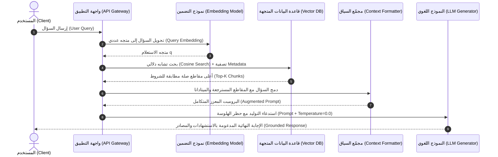

# معالجة الاستعلام والتوليد المعزز (Query Processing & Generation)
### Architectural & Implementation Guide (`docs/00-rag-fundamentals/05-query-processing-and-generation.md`)

بعد إتمام مرحلة إدخال البيانات وفهرستها في قواعد البيانات المتجهة (`Offline Ingestion Phase`)، تبدأ المرحلة التفاعلية اللحظية مع المستخدم في الوقت الفعلي (`Online Serving Phase`). تتولى هذه المرحلة استلام استعلام المستخدم، وتحليله، واسترجاع المقاطع الأكثر صلة دلالياً بعد تطبيق فلاتر الأمان، ثم صياغة الـ `Prompt` المعزز وحث النموذج اللغوي الكبير (`LLM`) على توليد إجابة دقيقة وموثقة.

---

## 1. مخطط التسلسل الزمني لرحلة الاستعلام (Query Execution Lifecycle)

يوضح المخطط التالي دورة حياة استعلام المستخدم من لحظة إدخاله وحتى استلام الإجابة النهائية الموثقة:



---

## 2. تفكيك المرحلة الأولى: معالجة الاستعلام والاسترجاع (Query Processing & Retrieval)

### أ. تضمين السؤال في الفضاء الدلالي (`Query Embedding`)
* **الشرط الحتمي**: يجب استخدام **نفس نموذج التضمين** الذي استُخدم في مرحلة إدخال البيانات وفهرستها.
* إذا استخدمت `bge-small-en-v1.5` أو `all-MiniLM-L6-v2` لفهرسة الوثائق، فيجب استخدامه بعينه لتضمين استعلام المستخدم؛ لأن أي اختلاف في أبعاد أو فضاء التضمين سيجعل المتجهات في عوالم رياضية مختلفة تماماً ويدمر نتائج البحث.

### ب. البحث الدلالي والعتبة التشابهية (`Similarity Thresholding`)
في بيئات الإنتاج، لا نكتفي بطلب $k$ مقاطع بشكل أعمى؛ فلو سأل المستخدم سؤالاً خارج محتوى قاعدة البيانات تماماً (مثل: *"ما هو الطقس في طوكيو؟"* لنظام موارد بشرية)، فإن البحث بدون عتبة سيُرجع أقرب المقاطع المخزنة حتى لو كان التشابه ضعيفاً جداً، مما يربك النموذج اللغوي.
* لذلك نضع دائماً **عتبة تشابه دنيا (`Minimum Score Threshold`)** (مثل: تشابه لا يقل عن 0.65). إذا لم يحقق أي مقطع هذه العتبة، يُعتبر الاستعلام خارج النطاق.

### ج. تصفية البيانات الوصفية مسبقاً (`Metadata Pre-Filtering`)
لضمان أمان البيانات وتطبيق الصلاحيات (`RBAC`)، تُدمج مرشحات الميتاداتا مباشرة مع عملية البحث المتجه:
```json
{
  "department": "Engineering",
  "security_tier": "Internal",
  "year": 2026
}
```
هذا يضمن أن عملية البحث محصورة فقط في المستندات المصرح للمستخدم بالاطلاع عليها.

---

## 3. تفكيك المرحلة الثانية: إثراء السياق وبناء الأوامر (Context Augmentation)

البرومبت الإنتاجي لا يكتفي بإلقاء النصوص كيفما اتفق، بل يصاغ بهيكل صارم يمنع الهلوسة ويجبر النموذج على الاستشهاد بالمصادر:

```text
[System Instructions]
أنت مساعد ذكاء اصطناعي مؤسسي فائق الدقة. مهمتك الإجابة عن سؤال المستخدم بالاعتماد حصرياً وصارماً على السياق المرفق أدناه.
القواعد الصارمة:
1. إذا لم تجد الإجابة مذكورة نصاً في السياق، أجب بـ: "المعلومات المطلوبة غير متوفرة في الوثائق المرفقة"، ولا تحاول التخمين نهائياً.
2. اذكر مصدر كل معلومة باستخدام رقم المستند واسمه [Doc-ID: X].
3. التزم بالحياد والموضوعية التامة.

[Retrieved Context]
---
المصدر: سياسة_الموارد_البشرية_2026.pdf (صفحة 14)
المقطع 1: "يحق للموظف إجازة سنوية مدفوعة الأجر قدرها 21 يوماً بعد إتمام فترة التجربة المحددة بـ 90 يوماً عمل."
---
المصدر: لائحة_العمل_الداخلية_2026.pdf (صفحة 3)
المقطع 2: "تحسب إجازات الأعياد الرسمية بشكل منفصل ولا تخصم من رصيد الإجازات السنوية."

[User Question]
كم عدد أيام الإجازة السنوية للموظف الجديد، وهل تخصم منها إجازات الأعياد؟

[Answer]
```

---

## 4. تفكيك المرحلة الثالثة: التوليد المنضبط (Generation Phase)

في هذه المرحلة، يتم تمرير البرومبت المعزز إلى النموذج اللغوي الكبير.

### المعاملات الحرجة لضبط التوليد في بيئات الإنتاج:
1. **درجة الحرارة (`Temperature = 0.0`)**: في أنظمة الـ RAG، يجب ضبط درجة الحرارة على الصفر لتقليل العشوائية وضمان الحتمية الدقيقة (`Greedy Decoding`)، ومنع النموذج من إضافة أي افتراضات إبداعية.
2. **عقوبة التكرار (`Frequency / Presence Penalty = 0.0`)**: تجنب تغيير معاني المصطلحات القانونية أو التقنية المحددة.
3. **حصر الإجابة بنمط الاستشهاد (`Grounding Mandate`)**: توجيه النموذج بأن كل حقيقة يجب أن يتبعها استشهاد بالوثيقة الحاملة لها.

---

## 5. الكود التطبيقي: خط معالجة الاستعلام والتوليد بالبايثون

يوضح الكود التالي خط خدمة الاستعلامات الحي (`Serving Pipeline`) بالكامل:

```python
import numpy as np
from typing import List, Dict, Any, Optional

# 1. Mock Stored Knowledge Chunks
knowledge_index = [
    {
        "id": "hr_pol_01",
        "category": "Leave",
        "text": "Annual vacation entitlement is 21 working days per calendar year for regular full-time staff.",
        "vector": np.array([0.9, 0.1, 0.0, 0.0])
    },
    {
        "id": "hr_pol_02",
        "category": "Health",
        "text": "Comprehensive health insurance covers inpatient surgery at 100% and outpatient visits at 80%.",
        "vector": np.array([0.0, 0.0, 0.85, 0.1])
    },
    {
        "id": "hr_pol_03",
        "category": "Remote",
        "text": "Remote work policy allows 2 days weekly from home subject to team manager approval.",
        "vector": np.array([0.1, 0.9, 0.0, 0.0])
    }
]

class QueryServingPipeline:
    """Production query serving pipeline with filtering, thresholding, and prompt synthesis."""

    def __init__(self, index: List[Dict[str, Any]], similarity_threshold: float = 0.60):
        self.index = index
        self.threshold = similarity_threshold

    def mock_embed_query(self, query: str) -> np.ndarray:
        """Deterministic query embedding mock."""
        q = query.lower()
        if "vacation" in q or "annual" in q or "leave" in q:
            vec = np.array([0.92, 0.08, 0.0, 0.0])
        elif "remote" in q or "home" in q:
            vec = np.array([0.08, 0.92, 0.0, 0.0])
        elif "insurance" in q or "health" in q:
            vec = np.array([0.0, 0.0, 0.90, 0.05])
        else:
            vec = np.array([0.05, 0.05, 0.05, 0.05])
        return vec / np.linalg.norm(vec)

    def retrieve(
        self,
        query: str,
        category_filter: Optional[str] = None,
        top_k: int = 2
    ) -> List[Dict[str, Any]]:
        """Retrieve top chunks with pre-filtering and score thresholding."""
        q_vec = self.mock_embed_query(query)
        candidates = []

        for record in self.index:
            # Metadata pre-filtering
            if category_filter and record["category"] != category_filter:
                continue

            # Cosine similarity calculation
            sim = float(np.dot(q_vec, record["vector"]) / (np.linalg.norm(q_vec) * np.linalg.norm(record["vector"])))

            if sim >= self.threshold:
                candidates.append((sim, record))

        candidates.sort(key=lambda x: x[0], reverse=True)
        return [item for _, item in candidates[:top_k]]

    def build_prompt(self, query: str, retrieved_chunks: List[Dict[str, Any]]) -> str:
        """Construct grounded prompt strictly enforcing non-hallucination."""
        if not retrieved_chunks:
            return "NO_CONTEXT"

        context_blocks = [f"[{r['id']} | Category: {r['category']}]: {r['text']}" for r in retrieved_chunks]
        context_str = "\n".join(context_blocks)

        prompt = (
            "You are a strict enterprise assistant. Answer the user question solely based "
            "on the verified context snippets below. If context does not supply the answer, "
            "respond: 'The requested information is not available in the company knowledge base.'\n\n"
            f"Context:\n{context_str}\n\n"
            f"Question: {query}\n"
            "Grounded Answer with Citation:"
        )
        return prompt

    def answer_query(self, query: str, category_filter: Optional[str] = None) -> Dict[str, Any]:
        """Execute end-to-end query workflow."""
        hits = self.retrieve(query, category_filter=category_filter, top_k=2)
        prompt = self.build_prompt(query, hits)

        if prompt == "NO_CONTEXT":
            return {
                "query": query,
                "retrieved_count": 0,
                "status": "Refused / Out of Scope",
                "answer": "The requested information is not available in the company knowledge base."
            }

        # Simulated deterministic LLM generation
        return {
            "query": query,
            "retrieved_count": len(hits),
            "status": "Grounded Answer Generated",
            "prompt_dispatched": prompt,
            "simulated_llm_output": f"Employees receive 21 working days of annual vacation [hr_pol_01]."
        }


# Pipeline Execution Demonstration
pipeline = QueryServingPipeline(knowledge_index, similarity_threshold=0.60)

# Scenario A: In-Scope Query
print("=== Scenario A: In-Scope Query ===")
res_a = pipeline.answer_query("How many vacation days do we get?")
print(f"Status: {res_a['status']}")
print(f"Answer: {res_a['simulated_llm_output']}\n")

# Scenario B: Out-of-Scope Query (Rejected by threshold)
print("=== Scenario B: Out-of-Scope Query ===")
res_b = pipeline.answer_query("What is the current stock price of Apple?")
print(f"Status: {res_b['status']}")
print(f"Answer: {res_b['answer']}")
```

---

## 6. ملخص المرحلة المعمارية (Summary & Takeaways)

| المكون | وظيفته في الـ Serving | المعيار الإنتاجي الحرج |
| :--- | :--- | :--- |
| **Query Embedder** | تحويل السؤال لمتجه دلالي | مطابقة تامة لنموذج التضمين المستخدم في الـ Ingestion |
| **Metadata Filter** | تصفية الوثائق بحسب الصلاحيات | تقليل فضاء البحث وحماية أمن وسرية المعلومات |
| **Similarity Threshold** | استبعاد المقاطع الضعيفة | منع الهلوسة ورفض الأسئلة الخارجة عن نطاق المعرفة |
| **Augmented Prompt** | تقييد النموذج بالسياق | إجبار النموذج على الاستشهاد الصريح وحظر التخمين |
| **LLM Inference** | صياغة الإجابة بلغة طبيعية | استخدام `Temperature = 0.0` للحصول على إجابات حتمية |
