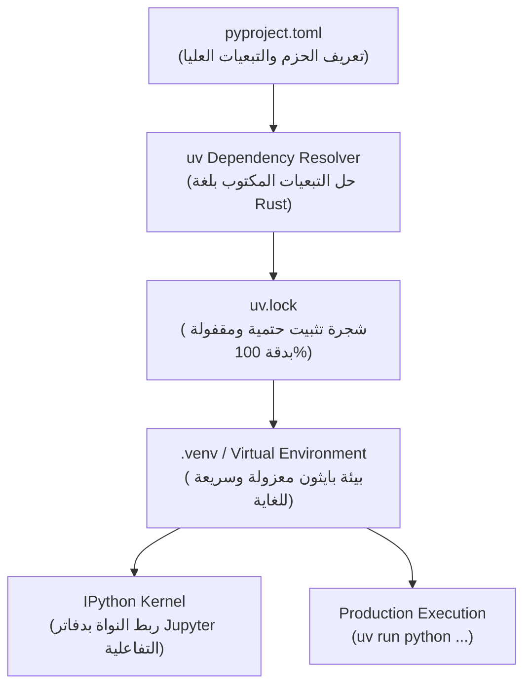

# 01 - إعداد بيئة العمل والتحكم في الاعتماديات (Environment Setup & uv)

يمثل إعداد بيئة التطوير الأساس المتين لأي مشروع ذكاء اصطناعي إنتاجي. في تطبيقات الـ RAG، نتعامل مع منظومة مكتبات سريعة التطور وكثيفة التبعيات (`LangChain`, `PyMuPDF`, `HuggingFace`, `ChromaDB`, `Torch`). يؤدي الاعتماد على مديري الحزم التقليديين مثل `pip` و `virtualenv` إلى مشكلات مزمنة تتعلق ببطء التثبيت وتضارب التبعيات (`Dependency Hell`).

في هذا الدليل، نعتمد أداة **`uv`** الحديثة المطورة بلغة Rust من شركة Astral، والتي أحدثت ثورة في إدارة بيئات بايثون.

---

## 1. المعمارية الهندسية لإدارة البيئة عبر uv



---

## 2. أهم الفروق الهندسية بين uv وأدوات بايثون التقليدية

| المعيار | أداة `pip + virtualenv` | أداة `Conda / Mamba` | أداة `uv` (المعتمدة في المشروع) |
| :--- | :--- | :--- | :--- |
| **لغة البناء** | بايثون (`Python`) | بايثون و C++ | رست (`Rust`) فائق السرعة والأمان |
| **سرعة حل التبعيات** | بطيئة ($30\text{s} - 120\text{s}$) | متوسطة ($20\text{s} - 60\text{s}$) | فائقة جداً ($0.5\text{s} - 2\text{s}$) |
| **سرعة تثبيت الحزم من الكاش** | بطيئة (إعادة فك الضغط) | متوسطة | لحظية عبر الروابط المادية (`Hardlinks`) |
| **الملف الحتمي (`Lockfile`)** | غير مدعوم افتراضياً (`requirements.txt` يدوي) | `environment.yml` غير حتمي تماماً | `uv.lock` دقيق 100% ومشفر ببصمات SHA256 |
| **استهلاك القرص الصلب** | نسخ مكررة في كل بيئة | نسخ مكررة في مجلد pkgs | كاش مركزي موحد بروابط صلبة (`Global Cache`) |

---

## 3. خطوات التنفيذ العملي خطوة بخطوة

### أ. إنشاء المشروع وتهيئة الملفات
```bash
# إنشاء مشروع بايثون جديد مهيكل بنظام pyproject.toml
uv init rag-mastery
cd rag-mastery
```

### ب. إضافة الحزم الأساسية لمنظومة الـ RAG
```bash
# إضافة مكتبات استيعاب البيانات ومعالجة النصوص
uv add langchain langchain-community langchain-core
uv add pypdf pymupdf pandas openpyxl python-docx
uv add ipykernel jupyterlab
```

### ج. تسجيل نواة Jupyter للمشروع
لضمان عمل دفاتر الملاحظات (`Jupyter Notebooks`) داخل البيئة المنعزلة دون التداخل مع بايثون العام للنظام:
```bash
uv run python -m ipykernel install --user --name rag-mastery --display-name "Python (RAG Mastery)"
```

### د. تشغيل الأكواد والاسكربتات عبر `uv run`
الميزة الاستثنائية لـ `uv` هي إمكانية تنفيذ أي اسكربت داخل البيئة المنعزلة مباشرة دون الحاجة لتفعيل البيئة يدوياً (`source .venv/bin/activate`):
```bash
uv run python main.py
```

---

## 4. بنية ملف `pyproject.toml` المعتمدة

```toml
[project]
name = "rag-mastery"
version = "0.1.0"
description = "Production-grade RAG Curriculum from Scratch"
readme = "README.md"
requires-python = ">=3.11"
dependencies = [
    "langchain>=0.2.0",
    "langchain-community>=0.2.0",
    "langchain-core>=0.2.0",
    "pymupdf>=1.24.0",
    "pypdf>=4.0.0",
    "pandas>=2.2.0",
    "openpyxl>=3.1.0",
    "python-docx>=1.1.0",
]
```

---

## 5. أسئلة المقابلات الهندسية (Senior AI Interview Questions)

### س1: ما الفارق الجوهري بين `requirements.txt` وملف `uv.lock` في بيئات الإنتاج للـ LLM؟
**الإجابة:** 
* `requirements.txt` يسجل غالباً الحزم العليا فقط، أو يسجل أسماء الحزم مع تثبيت جزئي للإصدارات (`langchain>=0.2.0`). عندما تتحدث حزمة فرعية تابعة (`Transitive Dependency`)، قد ينهار التطبيق فجأة في بيئة الإنتاج (`Production Drift`).
* `uv.lock` يخزن شجرة التبعيات المحلولة بالكامل حتى آخر حزمة فرعية، موثقة ببصمات تجزئة مشفرة (`Cryptographic Hashes`). هذا يضمن تطابق البيئة 100% بين جهاز مهندس الذكاء الاصطناعي وخادم الاستدلال السحابي وخطوط الـ CI/CD.

### س2: كيف تسهم ميزة Hardlinks في `uv` في توفير مساحة التخزين أثناء تجربة نماذج متعددة؟
**الإجابة:** 
عند بناء عشرات البيئات الافتراضية لاختبار مكتبات مختلفة (مثل إصدارات مختلفة من PyTorch و Transformers)، يقوم `pip` بتحميل ونسخ كل مكتبة بحجم عدة جيجابايت في كل بيئة على حدة. في المقابل، يقوم `uv` بتحميل الحزمة مرة واحدة فقط في الكاش المركزي للنظام (`Global Cache`)، ثم ينشئ روابط مادية صلبة (`Hardlinks`) تشير إلى نفس كتل البيانات على القرص دون استهلاك أي مساحة إضافية.
