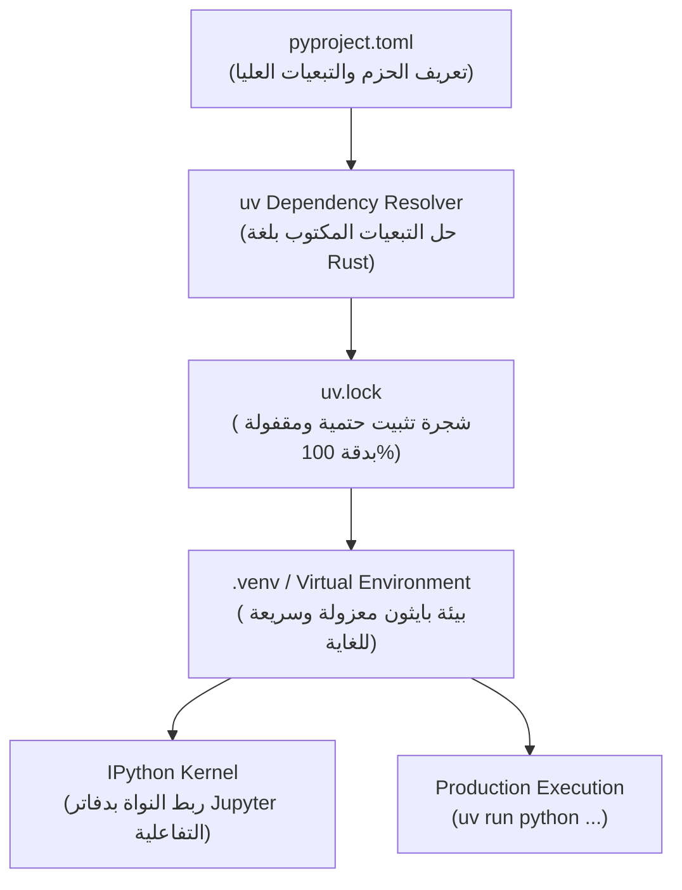

# إدارة بيئة العمل والتحكم في الاعتماديات عبر UV (Modern Python Dependency Architecture)
### Architectural & Implementation Guide (`docs/01-ingestion/01-environment-setup.md`)

يمثل إعداد بيئة التطوير الأساس المتين لأي مشروع ذكاء اصطناعي إنتاجي. في تطبيقات الـ RAG، نتعامل مع منظومة مكتبات سريعة التطور وكثيفة التبعيات (`LangChain`, `PyMuPDF`, `HuggingFace`, `ChromaDB`, `Torch`). يؤدي الاعتماد على مديري الحزم التقليديين مثل `pip` و `virtualenv` إلى مشكلات مزمنة تتعلق ببطء التثبيت وتضارب التبعيات (`Dependency Hell`).

في هذا الدليل، نعتمد أداة **`uv`** الحديثة المطورة بلغة Rust من شركة Astral، والتي أحدثت ثورة في إدارة بيئات بايثون وحل التبعيات الحتمية.

---

## 1. المعمارية الهندسية لإدارة البيئة عبر uv



---

## 2. أهم الفروق الهندسية بين uv وأدوات بايثون التقليدية

| المعيار | أداة `pip + virtualenv` | أداة `Conda / Mamba` | أداة `uv` (المعتمدة في المشروع) |
| :--- | :--- | :--- | :--- |
| **لغة البناء** | بايثون (`Python`) | بايثون و C++ | رست (`Rust`) فائق السرعة والأمان |
| **سرعة حل التبعيات** | بطيئة (30 إلى 120 ثانية) | متوسطة (20 إلى 60 ثانية) | فائقة جداً (أقل من ثانية إلى ثانيتين) |
| **سرعة تثبيت الحزم من الكاش** | بطيئة (إعادة فك الضغط) | متوسطة | لحظية عبر الروابط المادية (`Hardlinks`) |
| **الملف الحتمي (`Lockfile`)** | غير مدعوم افتراضياً | `environment.yml` غير حتمي تماماً | `uv.lock` دقيق 100% ومشفر ببصمات SHA256 |
| **استهلاك القرص الصلب** | نسخ مكررة في كل بيئة | نسخ مكررة في مجلد pkgs | كاش مركزي موحد بروابط صلبة (`Global Cache`) |

---

## 3. خطوات التنفيذ العملي خطوة بخطوة

### أ. إنشاء المشروع وتهيئة الملفات
```bash
# إنشاء مشروع بايثون جديد مهيكل بنظام pyproject.toml
uv init rag-mastery
cd rag-mastery
```

### ب. إضافة الحزم الأساسية لمنظومة الـ RAG
```bash
# إضافة مكتبات استيعاب البيانات ومعالجة النصوص
uv add langchain langchain-community langchain-core
uv add pypdf pymupdf pandas openpyxl python-docx
uv add ipykernel jupyterlab
```

### ج. تسجيل نواة Jupyter للمشروع
لضمان عمل دفاتر الملاحظات (`Jupyter Notebooks`) داخل البيئة المنعزلة دون التداخل مع بايثون العام للنظام:
```bash
uv run python -m ipykernel install --user --name rag-mastery --display-name "Python (RAG Mastery)"
```

### د. تشغيل الأكواد والاسكربتات عبر `uv run`
الميزة الاستثنائية لـ `uv` هي إمكانية تنفيذ أي اسكربت داخل البيئة المنعزلة مباشرة دون الحاجة لتفعيل البيئة يدوياً:
```bash
uv run python main.py
```

---

## 4. الكود التطبيقي: أداة فحص والتحقق من صحة بيئة الـ RAG (Environment Diagnostics)

يوضح الكود التالي أداة فحص برمجية متكاملة للتحقق من سلامة البيئة، إصدار بايثون، وتوافر جميع مكتبات استيعاب البيانات الضرورية قبل بدء تشغيل خطوط الإنتاج:

```python
import importlib
import platform
import sys
from typing import Dict, List, Tuple

def check_rag_environment() -> Dict[str, Any]:
    """Inspect local Python runtime and verify core RAG dependencies."""
    required_packages = [
        "langchain_core",
        "langchain_community",
        "fitz",          # PyMuPDF
        "pypdf",
        "docx",          # python-docx
        "pandas",
        "openpyxl"
    ]
    
    status_report = {
        "python_version": sys.version.split()[0],
        "os_platform": platform.platform(),
        "packages": {},
        "missing_packages": []
    }
    
    for pkg in required_packages:
        try:
            mod = importlib.import_module(pkg)
            version = getattr(mod, "__version__", "installed (no __version__)")
            status_report["packages"][pkg] = {"status": "available", "version": version}
        except ImportError:
            status_report["packages"][pkg] = {"status": "missing", "version": None}
            status_report["missing_packages"].append(pkg)
            
    status_report["is_ready"] = len(status_report["missing_packages"]) == 0
    return status_report

if __name__ == "__main__":
    report = check_rag_environment()
    print("=== RAG Runtime Diagnostics Report ===")
    print(f"OS Platform: {report['os_platform']}")
    print(f"Python Version: {report['python_version']}")
    print(f"Environment Status: {'READY' if report['is_ready'] else 'INCOMPLETE'}\n")
    
    for pkg, info in report["packages"].items():
        state = "[OK]" if info["status"] == "available" else "[FAILED]"
        print(f"  {state} {pkg:<20}: {info['version']}")
        
    if report["missing_packages"]:
        print(f"\nMissing dependencies: {report['missing_packages']}")
        print(f"Run: uv add {' '.join(report['missing_packages'])}")
```

---

## 5. أفضل الممارسات الهندسية لإدارة البيئة

1. **الالتزام بملف `uv.lock` في مستودع Git**: احرص دائماً على إضافة `uv.lock` لـ Git لضمان أن كل مهندس أو خادم CI/CD يقوم ببناء نفس شجرة التبعيات بدقة بايت-ببايت.
2. **استخدام مسارات نسبية داخل المشروع**: تجنب وضع مسارات مطلقة (`Hardcoded Absolute Paths`) في الأكواد؛ استخدم دائماً مكتبة `pathlib.Path` نسبة إلى جذر المشروع.
3. **تحديث الكاش بانتظام**: استخدم `uv cache clean` دورياً إذا قمت بحذف حزم تجريبية كبيرة لتحرير مساحة القرص.
