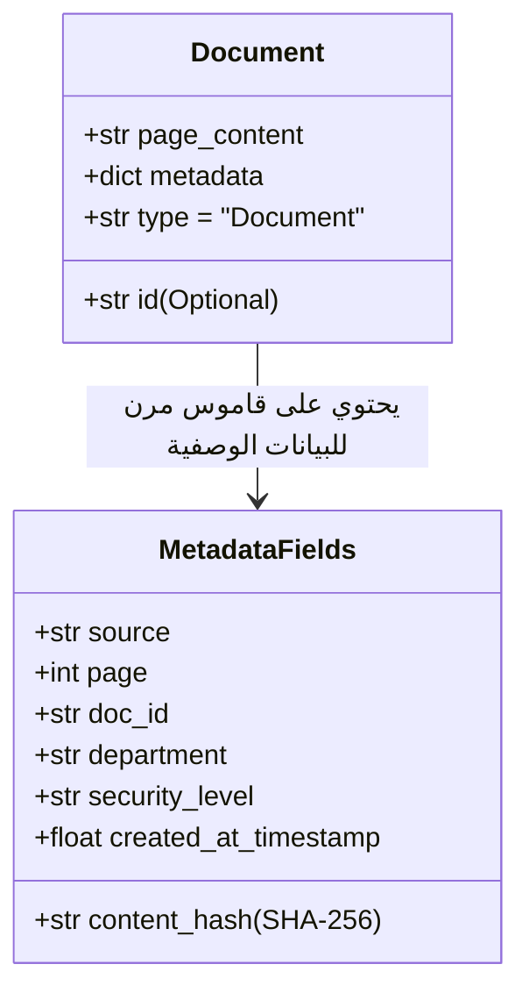

# بنية كائن المستند وهندسة البيانات الوصفية (Unified Document Object & Metadata Engineering)
### Architectural & Implementation Guide (`docs/01-ingestion/02-document-structure.md`)

في معمارية `LangChain` ومنظومات الـ RAG المتقدمة، يُعد كائن المستند (**`Document`**) حجر الزاوية والوحدة القياسية الموحدة التي تتدفق عبر كافة مراحل النظام، بدءاً من المحملات (`Loaders`) والتقطيع (`Splitters`)، مروراً بنماذج التضمين (`Embeddings`) وقواعد البيانات المتجهة، وانتهاءً بمرحلة التوليد عبر الـ LLM.

---

## 1. التشريح البرمجي لكائن `Document`

يتكون كائن المستند القياسي من حقلين جوهريين:



### بنية كائن المستند في بايثون:
```python
from langchain_core.documents import Document

document = Document(
    page_content="أعلنت الشركة عن صافي أرباح قدره 45 مليون دولار للربع الثالث من عام 2026...",
    metadata={
        "source": "data/pdf/financial_report_q3_2026.pdf",
        "doc_id": "fin_rep_2026_q3",
        "page": 12,
        "author": "Financial Audit Committee",
        "department": "Finance",
        "security_clearance": "Confidential",
        "created_at": "2026-10-15T09:30:00Z",
        "content_hash": "e3b0c44298fc1c149afbf4c8996fb92427ae41e4649b934ca495991b7852b855"
    }
)
```

---

## 2. وظائف وأهمية البيانات الوصفية (Metadata Engineering)

تمثل الـ `metadata` نصف قوة نظام الـ RAG للأسباب الهندسية التالية:

### أ. التصفية المسبقة في قواعد البيانات المتجهة (`Pre-filtering & Hybrid Search`)
بدلاً من البحث في ملايين المتجهات بشكل عشوائي، تسمح الـ `metadata` بتقييد فضاء البحث في أجزاء من الثانية:
```python
# استرجاع الوثائق الخاصة بالقسم المالي والمصرح بها فقط
filter_conditions = {
    "$and": [
        {"department": {"$eq": "Finance"}},
        {"security_clearance": {"$in": ["Public", "Internal"]}}
    ]
}
```

### ب. سلسلة التتبع والمصدرية الصارمة (`Audit Trail & Provenance`)
عندما يجيب الـ LLM في بيئة مصرفية أو طبية، يجب أن يرفق دليلاً حاسماً يربط الجملة بمصدرها المباشر:
`Citation: metadata["source"] (Page metadata["page"])`
بدون الميتاداتا، يعجز النظام عن إثبات مصدر المعلومة ويفقد ثقة المستخدمين.

### ج. التحكم في الصلاحيات (`Role-Based Access Control - RBAC`)
منع تسريب البيانات الحساسة (`Data Leakage`) يتم بحجب الوثائق التي تتجاوز صلاحية المستخدم في مرحلة الاسترجاع، وقبل وصول أي توكن منها إلى نافذة سياق النموذج اللغوي.

---

## 3. معايير هندسة وتصميم الميتاداتا في الإنتاج

| حقل البيانات الوصفية | النوع البرمجي | الغرض الهندسي | أثر غيابه على النظام |
| :--- | :--- | :--- | :--- |
| `source` | `str` (Path or URL) | تحديد الملف الأصلي الذي استخرجت منه القطعة | عجز النموذج والمستخدم عن مراجعة الوثيقة الأصلية |
| `page` / `row_index` | `int` | تحديد الإحداثي الدقيق داخل الوثيقة | صعوبة التوثيق في الملفات الطويلة (100+ صفحة) |
| `doc_id` / `chunk_id` | `str` (UUID) | تعريف فريد لكل قطعة نصية | صعوبة تتبع القطع وتحديثها أو حذفها لاحقاً |
| `content_hash` | `str` (SHA-256) | بصمة رقمية لمحتوى القطعة | إدخال فقرات مكررة في قاعدة المتجهات وهدر الذاكرة |
| `access_tier` | `str` / `list` | تحديد الصلاحيات الأمنية المطلوبة للاطلاع | خطر تسريب البيانات السرية للموظفين غير المخولين |

---

## 4. الكود التطبيقي: نظام إدارة وتأكيد جودة الميتاداتا (Metadata Validation & Pre-filtering)

يوضح الكود التالي بناء كائنات المستندات مع التحقق الصارم من الحقول المطلوبة وحساب بصمة المحتوى (`SHA-256`) ومحاكاة المقارنة بين الفلترة المسبقة واللاحقة:

```python
import hashlib
from typing import Dict, Any, List, Optional
from langchain_core.documents import Document

class MetadataEnrichedDocumentBuilder:
    """Builder enforcing mandatory schema validation and content hashing."""
    REQUIRED_FIELDS = ["source", "doc_id", "department", "security_tier"]

    @staticmethod
    def compute_sha256(text: str) -> str:
        """Generate deterministic cryptographic hash for deduplication."""
        return hashlib.sha256(text.encode("utf-8")).hexdigest()

    @classmethod
    def create(cls, page_content: str, metadata: Dict[str, Any]) -> Document:
        """Validate metadata schema and construct standardized Document."""
        for field in cls.REQUIRED_FIELDS:
            if field not in metadata or not metadata[field]:
                raise ValueError(f"Missing mandatory metadata field: '{field}'")

        # Auto-compute deduplication hash
        enriched_metadata = {
            **metadata,
            "content_hash": cls.compute_sha256(page_content)
        }
        return Document(page_content=page_content.strip(), metadata=enriched_metadata)


# Demonstration: Pre-filtering vs Post-filtering Simulation
corpus = [
    MetadataEnrichedDocumentBuilder.create(
        "Quarterly budget for HR department: 2.5 million USD.",
        {"source": "budget_hr.pdf", "doc_id": "b_01", "department": "HR", "security_tier": "Internal"}
    ),
    MetadataEnrichedDocumentBuilder.create(
        "Strategic acquisition plan for competitor X in Q4.",
        {"source": "m_and_a.pdf", "doc_id": "ma_02", "department": "Executive", "security_tier": "Strictly_Confidential"}
    ),
    MetadataEnrichedDocumentBuilder.create(
        "Engineering compute cluster capacity metrics and GPU count.",
        {"source": "infra.pdf", "doc_id": "inf_03", "department": "Engineering", "security_tier": "Internal"}
    )
]

def simulate_pre_filter(docs: List[Document], allowed_departments: List[str]) -> List[Document]:
    """Pre-filtering: Narrow down candidate set BEFORE search."""
    return [doc for doc in docs if doc.metadata["department"] in allowed_departments]

print("=== Built Documents with Cryptographic Hashes ===")
for d in corpus:
    print(f"[{d.metadata['doc_id']}] Department: {d.metadata['department']} | Hash: {d.metadata['content_hash'][:12]}...")

print("\n=== Pre-Filtered Results for HR & Engineering ===")
filtered_docs = simulate_pre_filter(corpus, allowed_departments=["HR", "Engineering"])
for fd in filtered_docs:
    print(f"Allowed: [{fd.metadata['doc_id']}] {fd.page_content}")
```

---

## 5. أسئلة المقابلات الهندسية المتقدمة (Senior AI Interview Questions)

> **س1: ما الفارق في الأداء والكفاءة بين الـ Pre-filtering والـ Post-filtering للبيانات الوصفية في قواعد المتجهات؟**  
> **الإجابة الهندسية:** 
> * **`Post-filtering` (الفلترة اللاحقة)**: تبحث قاعدة البيانات عن أعلى $k$ متجهات مطابقة دلالياً أولاً، ثم تفحص الميتاداتا وتستبعد الوثائق غير المطابقة لشروط الصلاحية. إذا طلبنا $k=5$ واستبعد الفلتر 4 وثائق لعدم توفر الصلاحية، سيتبقى للمستخدم وثيقة واحدة فقط، مما يدمر جودة الاسترجاع.
> * **`Pre-filtering` (الفلترة المسبقة)**: تطبق قاعدة المتجهات شرط الميتاداتا أولاً (مثل تصفية وثائق قسم الموارد البشرية فقط)، ثم تجري بحث الجيران الأقرب ($k$-NN) حصرياً داخل تلك المجموعة الفرعية، مما يضمن الحصول على كامل العدد المطلوب $k$ بأقصى دقة.

> **س2: كيف نمنع تضخم حجم قاعدة البيانات المتجهة (`Vector DB Bloat`) بسبب حقول الميتاداتا الكبيرة؟**  
> **الإجابة الهندسية:**
> 1. تخزين الحقول المفهرسة للبحث فقط (مثل المعرفات، الأقسام، والتواريخ) كحقول مبوبة داخل مؤشرات الفهرسة (`Indexed Payload Fields`).
> 2. تجنب تخزين نصوص كاملة أو بيانات ثنائية ضخمة داخل الميتاداتا، والاعتماد بدلاً من ذلك على معرف المستند `doc_id` لجلب النص الأصلي من مخزن كائنات خارجي مثل `Amazon S3` أو قاعدة بيانات `PostgreSQL` عبر نمط **`Parent Document Retrieval`**.
