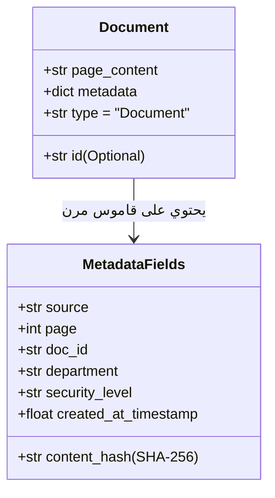

# 02 - بنية كائن المستند وهندسة البيانات الوصفية (Document Structure & Metadata)

في معمارية `LangChain` ومنظومات الـ RAG المتقدمة، يُعد كائن المستند (**`Document`**) حجر الزاوية والوحدة القياسية الموحدة التي تتدفق عبر كافة مراحل النظام، بدءاً من المحملات (`Loaders`) والتقطيع (`Splitters`)، مروراً بنماذج التضمين (`Embeddings`) وقواعد البيانات المتجهة، وانتهاءً بمرحلة التوليد عبر الـ LLM.

---

## 1. التشريح البرمجي لكائن `Document`

يتكون كائن المستند في `langchain_core.documents` من حقلين جوهريين فقط:



### البنية البرمجية لكائن المستند:
```python
from langchain_core.documents import Document

document = Document(
    page_content="أعلنت الشركة عن صافي أرباح قدره 45 مليون دولار للربع الثالث من عام 2024...",
    metadata={
        "source": "data/pdf/financial_report_q3_2024.pdf",
        "doc_id": "fin_rep_2024_q3",
        "page": 12,
        "author": "Financial Audit Committee",
        "department": "Finance",
        "security_clearance": "Confidential",
        "created_at": "2024-10-15T09:30:00Z",
        "content_hash": "e3b0c44298fc1c149afbf4c8996fb92427ae41e4649b934ca495991b7852b855"
    }
)
```

---

## 2. وظائف وأهمية البيانات الوصفية (Metadata Engineering)

يظن المبتدئون أن `page_content` هو الجزء الوحيد المهم في الـ RAG، ولكن في البيئات الإنتاجية، تمثل الـ `metadata` نصف قوة النظام للأسباب التالية:

### أ. التصفية المسبقة في قواعد البيانات المتجهة (`Pre-filtering & Hybrid Search`)
بدلاً من البحث في ملايين المتجهات بشكل عشوائي، تسمح الـ `metadata` بتقييد نطاق البحث في أجزاء من الثانية:
```python
# استرجاع الوثائق الخاصة بالقسم المالي والمصرح بها فقط
retriever = vectorstore.as_retriever(
    search_kwargs={
        "filter": {
            "$and": [
                {"department": {"$eq": "Finance"}},
                {"security_clearance": {"$in": ["Public", "Internal"]}}
            ]
        },
        "k": 5
    }
)
```

### ب. سلسلة التتبع والمصدرية الصارمة (`Audit Trail & Provenance`)
عندما يجيب الـ LLM في بيئة أعمال مصرفية أو طبية، يجب أن يرفق دليلاً حاسماً:
$$\text{Citation} = \text{metadata}["\text{source}"] + \text{" (Page "} + \text{metadata}["\text{page}"] + \text{")"}$$
بدون الميتا-داتا، يعجز النظام عن إثبات مصدر المعلومة.

### ج. التحكم في الصلاحيات بحسب المستخدم (`Role-Based Access Control - RBAC`)
منع تسريب البيانات الحساسة (`Data Leakage`) يتم بحجب الوثائق التي تتجاوز صلاحية المستخدم في مرحلة الاسترجاع، وقبل وصول أي رمز منها إلى نافذة سياق النموذج اللغوي.

---

## 3. معايير هندسة وتصميم الميتا-داتا في الإنتاج

| حقل البيانات الوصفية | النوع البرمجي | الغرض الهندسي | أثر غيابه على النظام |
| :--- | :--- | :--- | :--- |
| `source` | `str` (Path or URL) | تحديد الملف الأصلي الذي استخرجت منه القطعة | عجز النموذج والمستخدم عن مراجعة الوثيقة الأصلية |
| `page` / `row_index` | `int` | تحديد الإحداثي الدقيق داخل الوثيقة | صعوبة التوثيق في الملفات الطويلة (100+ صفحة) |
| `doc_id` / `chunk_id` | `str` (UUID) | تعريف فريد لكل قطعة نصية | صعوبة تتبع القطع وتحديثها أو حذفها لاحقاً |
| `content_hash` | `str` (SHA-256) | بصمة رقمية لمحتوى القطعة | إدخال فقرات مكررة في قاعدة المتجهات وهدر الذاكرة |
| `access_tier` | `str` / `list` | تحديد الصلاحيات الأمنية المطلوبة للاطلاع | خطر تسريب البيانات السرية للموظفين غير المخولين |

---

## 4. أسئلة المقابلات الهندسية (Senior AI Interview Questions)

### س1: ما الفارق في الأداء والكفاءة بين الـ Pre-filtering والـ Post-filtering للبيانات الوصفية في قواعد المتجهات؟
**الإجابة:** 
* **`Post-filtering` (الفلترة اللاحقة)**: تبحث قاعدة البيانات عن أعلى $k$ متجهات مطابقة دلالياً أولاً، ثم تقوم بفحص الميتا-داتا واستبعاد الوثائق غير المطابقة لشروط الأمان أو القسم. 
  * *المشكلة*: إذا طلبنا $k=5$ واستبعد الفلتر 4 وثائق لعدم توفر الصلاحية، سيتبقى للمستخدم وثيقة واحدة فقط، مما يدمر دقة الاسترجاع.
* **`Pre-filtering` (الفلترة المسبقة)**: تقوم قاعدة المتجهات بتطبيق شرط الميتا-داتا أولاً (مثل تصفية وثائق قسم المالية فقط)، ثم تجري بحث الجيران الأقرب ($k$-NN) حصرياً داخل تلك المجموعة الفرعية، مما يضمن الحصول على كامل العدد المطلوب $k$ بأقصى دقة.

### س2: كيف نمنع تضخم حجم قاعدة البيانات المتجهة (`Vector DB Bloat`) بسبب حقول الميتا-داتا الكبيرة؟
**الإجابة:**
1. تخزين الحقول المفهرسة للبحث فقط (مثل المعرفات، الأقسام، والتواريخ) كحقول مبوبة داخل مؤشرات الفهرسة (`Indexed Fields`).
2. تجنب تخزين نصوص كاملة أو بيانات ثنائية ضخمة داخل الميتا-داتا، والاعتماد بدلاً من ذلك على معرف المستند `doc_id` لجلب النص الأصلي من مخزن كائنات خارجي مثل `Amazon S3` أو قاعدة بيانات `PostgreSQL` عبر نمط **`Parent Document Retrieval`**.
