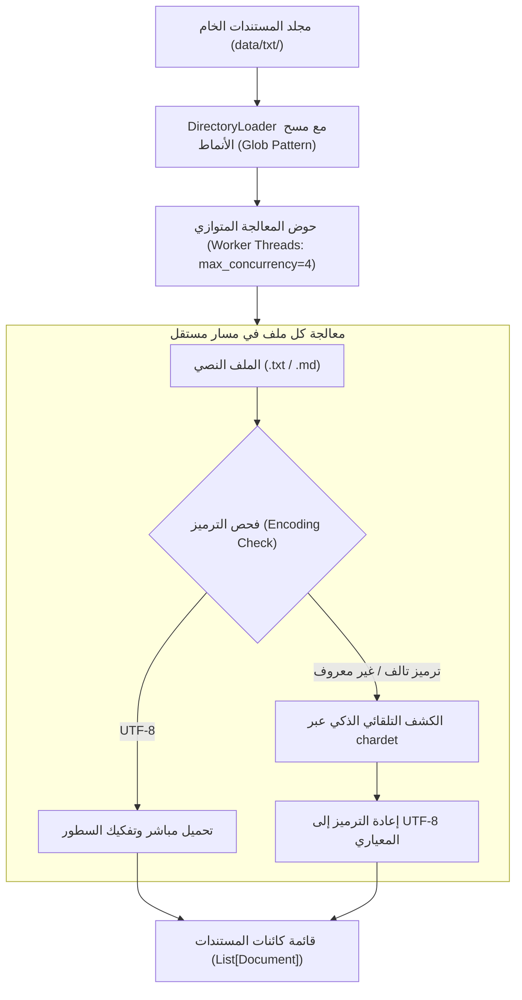

# قراءة الملفات النصية واستراتيجيات الترميز (Text Loaders & Robust Encoding Strategies)
### Architectural & Implementation Guide (`docs/01-ingestion/03-text-loaders.md`)

تُعد الملفات النصية الصريحة (`Plain Text Files: .txt, .md, .log`) أسهل وأبسط مصادر البيانات عند البدء، ولكنها في بيئات الإنتاج الفعلية تخفي مصائد تقنية معقدة تتعلق باختلاف ترميزات الحروف (`Encoding Pitfalls`)، ومشاكل الرموز ثنائية البايت، وبطء المعالجة التسلسلية عند التعامل مع آلاف المستندات.

---

## 1. مخطط تدفق قراءة وفهرسة الملفات النصية المتعددة



---

## 2. معضلة ترميز النصوص (`The Encoding Trap`)

في بيئات الأعمال متعددة اللغات (خصوصاً العربية واللغات الشرقية)، غالباً ما تنهار خطوط الإدخال مع ظهور الخطأ الشهير:
`UnicodeDecodeError: 'utf-8' codec can't decode byte 0xc3 in position ...`

### أسباب حدوث الخطأ:
1. تصدير الملفات النصية من أنظمة تشغيل Windows القديمة بترميزات غير قياسية مثل `cp1256` (Windows-1256 للأبجدية العربية) أو `latin-1`.
2. وجود علامة ترتيب البايتات (`Byte Order Mark - BOM: \ufeff`) في بداية ملفات `UTF-8-SIG`.

---

## 3. مصفوفة المفاضلة في إعدادات قراءة النصوص

| المعيار | القراءة التسلسلية الفردية (`Single TextLoader`) | القراءة المتوازية للمجلدات (`DirectoryLoader`) | القراءة الكسولة (`Lazy Loading`) |
| :--- | :--- | :--- | :--- |
| **استهلاك الذاكرة (RAM)** | منخفض وثابت لكل ملف | يرتفع طردياً مع عدد الملفات المحملة دفعة واحدة | **منخفض جداً ومستقر عبر المولدات (Generators)** |
| **الإنتاجية الزمنية (Throughput)** | بطيئة مع المجلدات الضخمة | **فائقة وتستغل جميع أنوية المعالج المتوفرة** | متوازنة ومستمرة |
| **التعامل مع الملفات التالفة** | يتوقف الخط فوراً بانهيار البرنامج | يمكن تخطي الملفات التالفة مع تسجيل تنبيه | يمكن عزل الخطأ أثناء الدوران |
| **أفضل سيناريو استخدام** | ملفات فردية محددة أو نصوص قصيرة | الفهرسة المجمعة الأولية لمستودعات المعرفة | **خطوط المعالجة المستمرة لملفات تفوق سعة الرام** |

---

## 4. الكود التطبيقي: محمل نصوص ذكي بنظام Fallback وقراءة كسولة (Resilient Text Loader)

يوضح الكود التالي تطبيق محمل نصوص احترافي يتنقل تلقائياً بين الترميزات الشائعة، وينظف النصوص من الرموز العشوائية، ويدعم التحميل الكسول (`Lazy Load`) لمنع أخطاء نفاد الذاكرة:

```python
import os
import re
from pathlib import Path
from typing import Generator, List, Dict, Any
from langchain_core.documents import Document

class ResilientTextLoader:
    """Robust text loader with multi-tier encoding fallback and stream processing."""
    
    ENCODING_CASCADE = ["utf-8", "utf-8-sig", "cp1256", "latin-1"]
    
    def __init__(self, file_path: str):
        self.file_path = Path(file_path)

    @staticmethod
    def clean_text(raw_text: str) -> str:
        """Strip ANSI escape sequences and non-printable control characters."""
        ansi_regex = r"\x1B(?:[@-Z\\-_]|\[[0-?]*[ -/]*[@-~])"
        text_no_ansi = re.sub(ansi_regex, "", raw_text)
        # Normalize excessive blank lines
        return re.sub(r"\n{3,}", "\n\n", text_no_ansi).strip()

    def lazy_load(self) -> Generator[Document, None, None]:
        """Memory-efficient generator yielding Document without loading all at once."""
        content = None
        used_encoding = None

        for enc in self.ENCODING_CASCADE:
            try:
                with open(self.file_path, "r", encoding=enc) as f:
                    content = f.read()
                    used_encoding = enc
                    break
            except UnicodeDecodeError:
                continue

        # Ultimate fallback with character replacement
        if content is None:
            with open(self.file_path, "r", encoding="utf-8", errors="replace") as f:
                content = f.read()
                used_encoding = "utf-8 (lossy replace)"

        cleaned_content = self.clean_text(content)
        metadata = {
            "source": str(self.file_path),
            "filename": self.file_path.name,
            "detected_encoding": used_encoding,
            "char_count": len(cleaned_content)
        }
        yield Document(page_content=cleaned_content, metadata=metadata)

    def load(self) -> List[Document]:
        """Eager loader loading the entire document into memory."""
        return list(self.lazy_load())


# Demonstration of Resilient Text Loading
demo_file = "sample_arabic_policy.txt"
with open(demo_file, "w", encoding="utf-8") as f:
    f.write("سياسة العمل عن بعد لعام 2026: يُسمح للموظف بالعمل يومين أسبوعياً من المنزل بعد موافقة المدير المباشر.")

loader = ResilientTextLoader(demo_file)
docs = loader.load()

for d in docs:
    print(f"Loaded Source: {d.metadata['source']}")
    print(f"Encoding Used: {d.metadata['detected_encoding']}")
    print(f"Content: {d.page_content}")

if os.path.exists(demo_file):
    os.remove(demo_file)
```

---

## 5. أسئلة المقابلات الهندسية المتقدمة (Senior AI Interview Questions)

> **س1: ما الفارق البرمجي والتشغيلي بين `loader.load()` و `loader.lazy_load()`؟**  
> **الإجابة:** 
> * `loader.load()`: تقرأ كافة الملفات وتخزن كائنات المستندات بالكامل داخل ذاكرة الرام (`RAM`) دفعة واحدة وتُرجعها كقائمة `List[Document]`. في مجموعات البيانات الضخمة (مئات آلاف الملفات)، يتسبب ذلك في انهيار خادم التطبيق بنفاد الذاكرة (`OOM: Out-Of-Memory Error`).
> * `loader.lazy_load()`: تُرجع مولد بايثون (`Generator`) يقرأ المستند ملفاً بملف أو صفحة بصفحة، ويمرره إلى خط التقطيع والتضمين التالي، ثم يفرغه من الذاكرة فوراً، مما يحافظ على استقرار استهلاك الذاكرة عند حد أدنى ثابت مهما تضخم حجم الأرشيف.

> **س2: كيف تتعامل مع ملفات السجلات (`Log Files`) المليئة بالأكواد غير النصية والأحرف الخاصة المشوهة؟**  
> **الإجابة:**
> 1. فتح الملف باستخدام `errors="replace"` لتجنب توقف المعالجة، مع استبدال البايتات التالفة برمز الاستبدال القياسي `\ufffd`.
> 2. تطبيق مرحلة تنظيف بالتعابير النمطية (`Regex Filtering`) لإزالة أكواد الـ ANSI الملونة وتسلسلات التحكم الخاصة بأنظمة التشغيل (`Escape Codes`) قبل بناء كائن `Document`.
