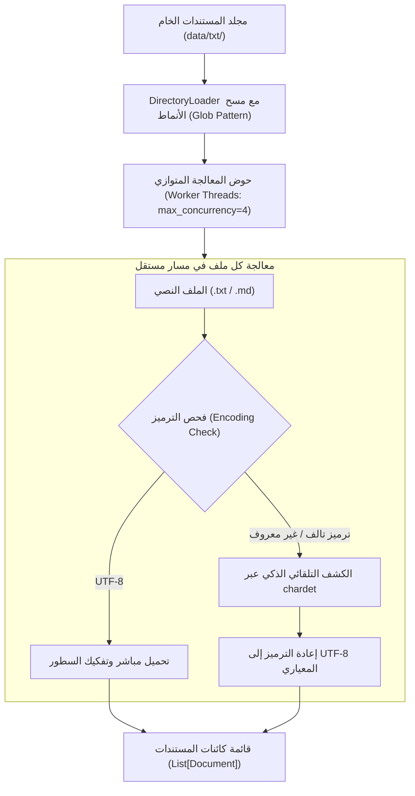

# 03 - قراءة الملفات النصية واستراتيجيات الترميز (Text Loaders & Encoding)

تُعد الملفات النصية الصريحة (`Plain Text Files: .txt, .md, .log`) أسهل وأبسط مصادر البيانات عند البدء، ولكنها في بيئات الإنتاج الفعلية تخفي مصائد تقنية معقدة تتعلق باختلاف ترميزات الحروف (`Encoding Pitfalls`)، ومشاكل الرموز ثنائية البايت، وبطء المعالجة التسلسلية عند التعامل مع آلاف المستندات.

---

## 1. مخطط تدفق قراءة وفهرسة الملفات النصية المتعددة



---

## 2. معضلة ترميز النصوص (`The Encoding Trap`)

في بيئات الأعمال متعددة اللغات (خصوصاً العربية واللغات الشرقية)، غالباً ما تنهار خطوط الإدخال مع ظهور الخطأ الشهير:
`UnicodeDecodeError: 'utf-8' codec can't decode byte 0xc3 in position ...`

### أسباب حدوث الخطأ:
1. تصدير الملفات النصية من أنظمة تشغيل Windows القديمة بترميزات غير قياسية مثل `cp1256` (Windows-1256 للأبجدية العربية) أو `latin-1`.
2. وجود علامة ترتيب البايتات (`Byte Order Mark - BOM: \ufeff`) في بداية ملفات `UTF-8-SIG`.

### الحلول البرمجية المعتمدة:
* **التحديد الصريح للترميز القياسي**:
  ```python
  from langchain_community.document_loaders import TextLoader

  loader = TextLoader("data/txt/article_arabic.txt", encoding="utf-8")
  documents = loader.load()
  ```
* **تفعيل الكشف التلقائي الذكي (`Auto-detection via chardet`)**:
  إذا كانت الملفات مجمعة من مصادر مجهولة الترميز، نقوم بتفعيل الكشف التلقائي:
  ```python
  loader = TextLoader(
      "data/txt/legacy_notes.txt",
      autodetect_encoding=True
  )
  ```

---

## 3. القراءة المجمعة والمتوازية للمجلدات (`DirectoryLoader`)

عند التعامل مع آلاف الملفات النصية، يصبح استخدام حلقة `for` تسلسلية بطيئاً جداً. يوفر كائن `DirectoryLoader` في LangChain إمكانية القراءة الموازية (`Multithreading`) وتصفية الملفات بـ `Glob Patterns`:

```python
from langchain_community.document_loaders import DirectoryLoader, TextLoader

directory_loader = DirectoryLoader(
    path="data/txt",
    glob="**/*.txt",
    loader_cls=TextLoader,
    loader_kwargs={"encoding": "utf-8", "autodetect_encoding": True},
    show_progress=True,
    use_multithreading=True,
    max_concurrency=4
)

documents = directory_loader.load()
print(f"تم تحميل {len(documents)} مستند نصي بنجاح.")
```

---

## 4. مصفوفة المفاضلة في إعدادات قراءة النصوص

| المعيار | القراءة التسلسلية الفردية (`Single TextLoader`) | القراءة المتوازية للمجلدات (`DirectoryLoader`) | القراءة الكسولة (`Lazy Loading / load_and_split`) |
| :--- | :--- | :--- | :--- |
| **استهلاك الذاكرة (RAM)** | منخفض جداً ($\mathcal{O}(1)$ لكل ملف) | يرتفع طردياً مع عدد الملفات المحملة دفعة واحدة | ممتاز ومنخفض جداً عبر المولدات (`Generators`) |
| **الإنتاجية الزمنية (Throughput)** | بطيئة مع المجلدات الضخمة | فائقة وتستغل جميع أنوية المعالج المتوفرة | متوازنة ومستمرة |
| **التعامل مع الملفات التالفة** | يتوقف الخط فوراً بانهيار البرنامج | يمكن تخطي الملفات التالفة مع تسجيل تنبيه (`Silent Skip`) | يمكن عزل الخطأ أثناء الدوران |
| **أفضل سيناريو استخدام** | ملفات فردية محددة أو نصوص قصيرة | الفهرسة المجمعة الأولية لمستودعات المعرفة | خطوط المعالجة المستمرة لملفات تزيد عن 50GB |

---

## 5. أسئلة المقابلات الهندسية (Senior AI Interview Questions)

### س1: ما الفارق البرمجي بين `loader.load()` و `loader.lazy_load()` في LangChain؟
**الإجابة:** 
* `loader.load()`: تقوم بقراءة كافة الملفات وتخزين نصوصها وكائنات المستندات بالكامل داخل ذاكرة الرام (`RAM`) دفعة واحدة وإرجاعها كقائمة `List[Document]`. في مجموعات البيانات الضخمة (مئات آلاف الملفات)، قد يتسبب ذلك في انهيار خادم التطبيق بنفاد الذاكرة (`OOM: Out-Of-Memory Error`).
* `loader.lazy_load()`: تقوم بإرجاع مولد بايثون (`Python Generator / Iterator`) يقرأ المستند صفحة بصفحة أو ملفاً بملف ويعالجه ثم يفرغه من الذاكرة فور تسليمه للخط التالي، مما يحافظ على استقرار استهلاك الذاكرة عند حد أدنى ثابت مهما تضخم حجم البيانات.

### س2: كيف تتصرف مع ملفات السجلات (`Log Files`) المليئة بالأكواد غير النصية والأحرف الخاصة المشوهة؟
**الإجابة:**
1. استخدام بارامتر `errors="ignore"` أو `errors="replace"` عند فتح الملف لتجنب توقف المعالجة، مع استبدال البايتات التالفة برمز الاستبدال القياسي `\ufffd`.
2. تطبيق مرحلة تنظيف بالتعابير النمطية (`Regex Filtering`) لإزالة أكواد الـ ANSI الملونة وتسلسلات التحكم الخاصة بأنظمة التشغيل (`Escape Codes`) قبل حقنها في كائن `Document`.
