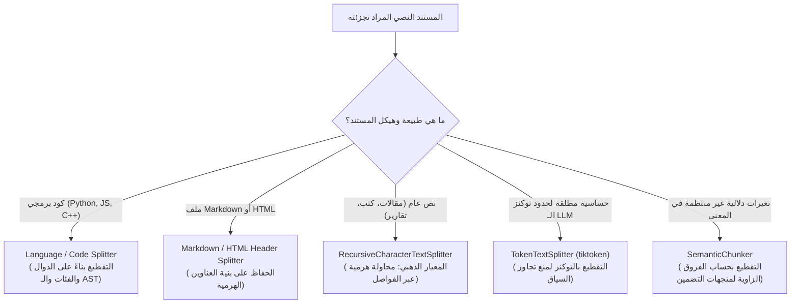

# 04 - تقنيات تجزئة وتقطيع النصوص (Text Splitting & Chunking Strategies)

يمثل تقطيع النصوص وتجزئتها (**`Text Splitting / Chunking`**) أحد أكثر القرارات الهندسية حساسية وتأثيراً على جودة منظومة الـ RAG برمتها. إن حجم وجودة القطعة النصية المسترجعة هما العامل الحاكم الذي يحدد:
1. هل يحصل النموذج اللغوي (`LLM`) على السياق الكافي والمترابط للإجابة؟
2. أم يتم إغراقه بتفاصيل مشتتة وضوضاء (`Context Noise`) تؤدي إلى الهلوسة وفقدان المعلومة الجوهرية؟

---

## 1. شجرة اتخاذ القرار لاختيار استراتيجية التقطيع



---

## 2. تفكيك أشهر استراتيجيات التقطيع في LangChain

### أ. التقطيع المتكرر الهرمي (`RecursiveCharacterTextSplitter`) - المعيار الذهبي
* **آلية العمل**: يحاول تقسيم النص بناءً على قائمة مرتبة هرمياً من الفواصل الطبيعية:
  ```python
  separators = ["\n\n", "\n", " ", ""]
  ```
* يبدأ بالبحث عن الفواصل الأكبر (الفقرات `\n\n`). إذا كانت الفقرة أكبر من `chunk_size`، ينتقل إلى الفاصل التالي (السطور `\n`)، ثم الجمل، ثم الكلمات، وصولاً إلى الأحرف الفردية كملاذ أخير.
* **النتيجة**: الحفاظ على تماسك الفقرات والجمل الكاملة قدر الإمكان دون بتر المعنى.

```python
from langchain_text_splitters import RecursiveCharacterTextSplitter

text_splitter = RecursiveCharacterTextSplitter(
    chunk_size=500,
    chunk_overlap=100,
    separators=["\n\n", "\n", " ", ""],
    length_function=len,
    is_separator_regex=False
)

chunks = text_splitter.split_documents(documents)
```

---

### ب. التقطيع بالأحرف الثابتة (`CharacterTextSplitter`)
* **آلية العمل**: يعتمد على فاصل وحيد ثابت (غالباً `\n\n`).
* **المشكلة الخطيرة**: إذا كانت هناك فقرة طويلة جداً تتجاوز `chunk_size` ولا تحتوي على الفاصل المحدد، فإن هذا المقطع يتركها بحجمها الضخم متجاوزاً الحد المطلوب، مما قد يؤدي لاحقاً لكسر حد التوكنز في نموذج التضمين.
* **الاستخدام**: مناسب فقط للنصوص المهيكلة بانتظام تام كالسجلات (`Logs`).

---

### ج. التقطيع بالرموز (`TokenTextSplitter`)
* **آلية العمل**: يقيس الحجم بالرموز (`Tokens`) بناءً على نظام الترميز الخاص بالنموذج (مثل `cl100k_base` الخاص بـ GPT-4 أو `o200k_base` الخاص بـ GPT-4o) بدلاً من عدد الأحرف الخام.
* **المعادلة التقريبية**: في النصوص الإنجليزية، الكلمة الواحدة تعادل تقريباً $1.3$ توكن. أما في اللغة العربية، فقد تستهلك الكلمة الواحدة من $2$ إلى $4$ توكن بسبب الرموز ثنائية البايت.
* **الميزة**: التزام هندسي صارم بعدم تجاوز ميزانية الرموز لنافذة السياق.

---

### د. التقطيع الدلالي الذكي (`Semantic Chunker`)
* **آلية العمل**: لا يعتمد على عدد الأحرف أو التوكنز إطلاقاً، بل يقوم بتمرير الجمل المتتالية إلى نموذج تضمين، وحساب المسافة الدلالية (`Cosine Distance`) بين الجملة $S_i$ والجملة التالية $S_{i+1}$.
* عندما يتجاوز الفرق الدلالي عتبة إحصائية معينة (مثل الانحراف المعياري لدرجات التشابه $\mu + 2\sigma$)، يعتبر أن الفكرة انتهت ويبدأ قطعة جديدة:
  $$\text{Split when: } \text{Distance}(E(S_i), E(S_{i+1})) > \text{Threshold}$$
* **الميزة**: كل قطعة تحتوي على فكرة دلالية موحدة ومتماسكة 100%.
* **العيب**: تكلفة وزمن حسابي مرتفع جداً بسبب الحاجة لتضمين كل جملة على حدة أثناء التقطيع.

---

## 3. هندسة التداخل (`Chunk Overlap Architecture`)

يعمل الـ `chunk_overlap` كنافذة منزلقة تمنع ظاهرة "انكسار السياق" (`Context Fracture`):

```
المستند الأصلي: "تأسست شركة ألفا عام 2010. حققت الشركة مبيعات قياسية في عامها الأول بلغت 5 ملايين دولار."

التقطيع بدون Overlap (Size = 35):
القطعة 1: "تأسست شركة ألفا عام 2010. حققت"
القطعة 2: "الشركة مبيعات قياسية في عامها الأول"
(النتيجة: فقدان الربط بين اسم الشركة والمبيعات في القطعة 2!)

التقطيع مع Overlap (Size = 35, Overlap = 15):
القطعة 1: "تأسست شركة ألفا عام 2010. حققت"
القطعة 2: "عام 2010. حققت الشركة مبيعات قياسية في عامها الأول"
(النتيجة: احتفاظ كل قطعة بالسياق الكامل المترابط!)
```

---

## 4. مصفوفة المقارنة الشاملة لأساليب التقطيع

| التقنية | الكفاءة الحسابية | الحفاظ على الدلالة | ثبات حجم الرموز | متى نختارها في الإنتاج؟ |
| :--- | :--- | :--- | :--- | :--- |
| **`RecursiveCharacter`** | فائقة جداً ($\mathcal{O}(L)$) | ممتاز جداً | تقريبي ومقبول | **الخيار الافتراضي العام (90% من الحالات)** |
| **`CharacterSplitter`** | فائقة ($\mathcal{O}(L)$) | متوسط | ضعيف وغير منضبط | ملفات السجلات والأكواد ذات الفواصل الصارمة |
| **`TokenTextSplitter`** | سريعة ($\mathcal{O}(L)$) | جيد | قطعي 100% | عندما تكون ميزانية الـ Tokens محدودة بدقة |
| **`SemanticChunker`** | بطيئة وتتطلب GPU | استثنائي ومثالي | متغير وغير منتظم | الكتب الفلسفية والمقالات البحثية المعقدة |

---

## 5. أسئلة المقابلات الهندسية (Senior AI Interview Questions)

### س1: ما المعادلة التي تتبعها لاختيار النسبة المثلى لـ `chunk_overlap` بالنسبة لـ `chunk_size`؟
**الإجابة:** 
المعيار الذهبي المعتمد في الصناعة هو أن يتراوح الـ `chunk_overlap` بين **10% إلى 20%** من حجم الـ `chunk_size`:
$$0.10 \times C_s \le C_o \le 0.20 \times C_s$$
* إذا كان $C_s = 500$ حرفاً، يكون $C_o = 50 - 100$ حرفاً (ما يعادل جملة أو سطرين).
* إذا كان $C_s = 1000$ توكن، يكون $C_o = 100 - 150$ توكن.
* تجاوز نسبة 25% يؤدي إلى تضخم فهرس المتجهات دون مكاسب إضافية في الدقة، وهبوطه تحت 5% يزيد احتمالية فقدان المصطلحات الحيوية عند الحواف.

### س2: كيف يؤثر التقطيع النصي للغة العربية مقارنة باللغة الإنجليزية عند استخدام `TokenTextSplitter`؟
**الإجابة:**
معظم المرمزات اللغوية الحديثة (مثل `tiktoken` لـ OpenAI) تم تدريبها على نصوص يغلب عليها الحرف اللاتيني. ونتيجة لذلك:
* الكلمة الإنجليزية الشائعة تمثل توكناً واحداً فقط.
* الكلمة العربية الواحدة قد تنكسر إلى 3 أو 4 توكنز لأن المرمز يفكك الحروف المشكلة والبادئات واللواحق إلى بايتات منفصلة (`Byte-Pair Encoding fragmentation`).
* **الإجراء الهندسي الواجب**: عند ضبط `chunk_size` للنصوص العربية بالتوكنز، يجب مضاعفة الحد بمقدار $2\times$ إلى $3\times$، أو الأفضل من ذلك: استخدام التقطيع بناءً على الأحرف والكلمات (`RecursiveCharacterTextSplitter`) مع دالة قياس باللغة العربية قبل التضمين.
