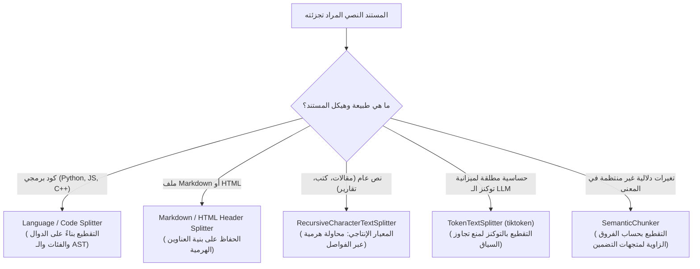

# استراتيجيات تقطيع النصوص وهندسة التداخل (Text Splitting & Chunk Overlap Architecture)
### Architectural & Implementation Guide (`docs/01-ingestion/04-text-splitting.md`)

يمثل تقطيع النصوص وتجزئتها (**`Text Splitting / Chunking`**) أحد أكثر القرارات الهندسية حساسية وتأثيراً على جودة منظومة الـ RAG برمتها. إن حجم وجودة المقطع النصي المسترجع هما العامل الحاكم الذي يحدد:
1. هل يحصل النموذج اللغوي (`LLM`) على السياق الكافي والمترابط للإجابة؟
2. أم يتم إغراقه بتفاصيل مشتتة وضوضاء (`Context Noise`) تؤدي إلى الهلوسة وفقدان المعلومة الجوهرية؟

---

## 1. شجرة اتخاذ القرار لاختيار استراتيجية التقطيع



---

## 2. تفكيك أشهر استراتيجيات التقطيع في LangChain

### أ. التقطيع المتكرر الهرمي (`RecursiveCharacterTextSplitter`) - المعيار الإنتاجي
* **آلية العمل**: يحاول تقسيم النص بناءً على قائمة مرتبة هرمياً من الفواصل الطبيعية:
  ```python
  separators = ["\n\n", "\n", " ", ""]
  ```
* يبدأ بالبحث عن الفواصل الأكبر (الفقرات `\n\n`). إذا كانت الفقرة أكبر من `chunk_size`، ينتقل إلى الفاصل التالي (السطور `\n`)، ثم الجمل، ثم الكلمات، وصولاً إلى الأحرف الفردية كملاذ أخير.
* **النتيجة**: الحفاظ على تماسك الفقرات والجمل الكاملة قدر الإمكان دون بتر المعنى.

### ب. التقطيع بالأحرف الثابتة (`CharacterTextSplitter`)
* **آلية العمل**: يعتمد على فاصل وحيد ثابت (غالباً `\n\n`).
* **المشكلة الخطيرة**: إذا كانت هناك فقرة طويلة تتجاوز `chunk_size` ولا تحتوي على الفاصل المحدد، يتركها بحجمها الضخم، مما قد يؤدي لاحقاً لكسر حد التوكنز في نموذج التضمين.
* **الاستخدام**: مناسب فقط للنصوص المهيكلة بانتظام تام كالسجلات (`Logs`).

### ج. التقطيع بالرموز (`TokenTextSplitter`)
* **آلية العمل**: يقيس الحجم بالرموز (`Tokens`) بناءً على نظام الترميز الخاص بالنموذج (مثل `tiktoken` لـ OpenAI) بدلاً من عدد الأحرف الخام.
* **الميزة**: التزام هندسي صارم بعدم تجاوز ميزانية الرموز لنافذة السياق.

---

## 3. هندسة التداخل ومكافحة انكسار السياق (`Chunk Overlap Architecture`)

يعمل الـ `chunk_overlap` كنافذة منزلقة تمنع ظاهرة "انكسار السياق" (`Context Fracture`):

```
المستند الأصلي: "تأسست شركة ألفا عام 2010. حققت الشركة مبيعات قياسية في عامها الأول بلغت 5 ملايين دولار."

التقطيع بدون Overlap (Size = 35):
القطعة 1: "تأسست شركة ألفا عام 2010. حققت"
القطعة 2: "الشركة مبيعات قياسية في عامها الأول"
(النتيجة: فقدان الربط بين اسم الشركة والمبيعات في القطعة 2!)

التقطيع مع Overlap (Size = 35, Overlap = 15):
القطعة 1: "تأسست شركة ألفا عام 2010. حققت"
القطعة 2: "عام 2010. حققت الشركة مبيعات قياسية في عامها الأول"
(النتيجة: احتفاظ كل قطعة بالسياق الكامل المترابط!)
```

---

## 4. الكود التطبيقي: مقارنة عملية بالبايثون بين أساليب التقطيع

يوضح الكود التالي كيفية عمل التقطيع الهرمي والتقطيع مع التداخل لمنع انكسار السياق:

```python
from typing import List
from langchain_text_splitters import RecursiveCharacterTextSplitter, CharacterTextSplitter
from langchain_core.documents import Document

sample_policy_text = (
    "Section 1: Work Hours and Flexibility.\n\n"
    "Standard working hours are 9:00 AM to 5:00 PM, Monday through Friday. "
    "Core collaboration hours are 10:00 AM to 3:00 PM. All team members are expected "
    "to be available on Slack and email during core hours.\n\n"
    "Section 2: Annual Leave Entitlements.\n\n"
    "Employees accrue 1.75 days of paid annual vacation per completed month of service, "
    "equating to 21 days annually. Vacation requests exceeding 5 consecutive days require "
    "two weeks advance written notice to the department lead."
)

raw_doc = Document(page_content=sample_policy_text, metadata={"source": "employee_handbook.txt"})

# 1. Recursive Character Text Splitter (Standard)
recursive_splitter = RecursiveCharacterTextSplitter(
    chunk_size=180,
    chunk_overlap=40,
    separators=["\n\n", "\n", ". ", " "]
)
recursive_chunks = recursive_splitter.split_documents([raw_doc])

print(f"=== Recursive Splitter ({len(recursive_chunks)} Chunks) ===")
for idx, c in enumerate(recursive_chunks, 1):
    print(f"Chunk {idx} ({len(c.page_content)} chars):")
    print(f"  '{c.page_content}'\n")

# 2. Strict Character Splitter Demonstration
char_splitter = CharacterTextSplitter(
    separator="\n\n",
    chunk_size=180,
    chunk_overlap=0
)
char_chunks = char_splitter.split_documents([raw_doc])
print(f"=== Character Splitter ({len(char_chunks)} Chunks) ===")
for idx, c in enumerate(char_chunks, 1):
    print(f"Chunk {idx}: '{c.page_content[:60]}...' (Total length: {len(c.page_content)})")
```

---

## 5. مصفوفة المقارنة الشاملة لأساليب التقطيع

| التقنية | الكفاءة الحسابية | الحفاظ على الدلالة | ثبات حجم الرموز | متى نختارها في الإنتاج؟ |
| :--- | :--- | :--- | :--- | :--- |
| **`RecursiveCharacter`** | فائقة جداً | **ممتاز جداً** | تقريبي ومقبول | **الخيار الافتراضي العام (90% من الحالات)** |
| **`CharacterSplitter`** | فائقة | متوسط | ضعيف وغير منضبط | ملفات السجلات والأكواد ذات الفواصل الصارمة |
| **`TokenTextSplitter`** | سريعة | جيد | **قطعي 100%** | عندما تكون ميزانية الـ Tokens محدودة بدقة |
| **`SemanticChunker`** | بطيئة وتتطلب GPU | استثنائي | متغير وغير منتظم | الكتب الفلسفية والمقالات البحثية المعقدة |

---

## 6. أسئلة المقابلات الهندسية المتقدمة (Senior AI Interview Questions)

> **س1: ما القاعدة الهندسية لاختيار النسبة المثلى لـ `chunk_overlap` بالنسبة لـ `chunk_size`؟**  
> **الإجابة:**  
> المعيار الهندسي المعتمد في الصناعة هو أن يتراوح الـ `chunk_overlap` بين **10% إلى 20%** من حجم الـ `chunk_size`.
> * إذا كان `chunk_size = 500` حرفاً، يكون التداخل بين `50` إلى `100` حرف (ما يعادل جملة إلى جملتين).
> * تجاوز نسبة 25% يؤدي إلى تضخم فهرس المتجهات دون مكاسب إضافية في الدقة، وهبوطه تحت 5% يزيد احتمالية فقدان المصطلحات الحيوية عند الحواف.

> **س2: كيف يؤثر التقطيع النصي للغة العربية مقارنة باللغة الإنجليزية عند استخدام `TokenTextSplitter`؟**  
> **الإجابة:**  
> معظم المرمزات اللغوية الحديثة (مثل `tiktoken`) تم تدريبها على نصوص يغلب عليها الحرف اللاتيني؛ لذلك فإن الكلمة العربية الواحدة قد تنكسر إلى 2 أو 3 توكنز بسبب البايتات الإضافية والتشكيل.  
> **الإجراء الهندسي الواجب**: عند ضبط `chunk_size` بالتوكنز للنصوص العربية، يجب مراعاة مضاعفة الحد بمقدار $2\times$ تقريباً، أو الاعتماد على التقطيع بالأحرف والكلمات (`RecursiveCharacterTextSplitter`) لضمان عدم تجزئة الكلمة العربية الواحدة.
