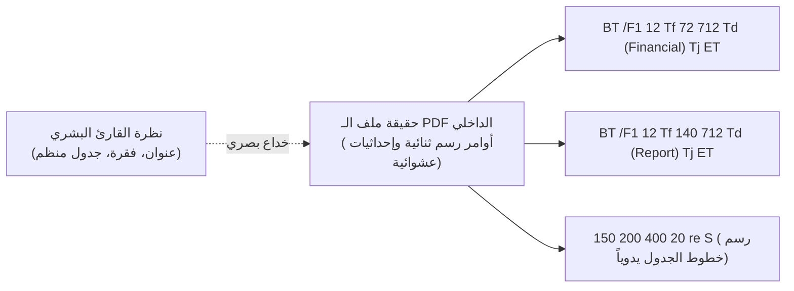

# أساسيات قراءة ملفات الـ PDF والمقارنة الهندسية للمحملات (PDF Parsing Foundations & Engine Comparison)
### Architectural & Implementation Guide (`docs/01-ingestion/05-pdf-parsing.md`)

تشكل ملفات الـ `PDF (Portable Document Format)` أكثر من 70% إلى 80% من حجم البيانات غير المهيكلة داخل المؤسسات والشركات (التقارير المالية، السياسات، العقود، والأوراق البحثية). ومع ذلك، فإن ملفات الـ PDF تمثل أحد أكبر تحديات مهندسي الـ RAG، نظراً لأن صيغة PDF لم تُصمم أصلاً لتخزين النصوص الدلالية، بل صُممت لتوجيه الطابعات وشاشات العرض لعرض الأحرف والخطوط بدقة بصرية ثابتة (`Visual Presentation`).

---

## 1. الطبيعة الداخلية لملفات الـ PDF: لماذا تفشل الأدوات البسيطة؟



* لا يحتوي ملف الـ PDF الأصلي على مفهوم الكلمات المفصولة، الفقرات، أو الجداول؛ بل يحتوي على أوامر رسم ثنائية (`PostScript operators`) تحدد إحداثيات رسم كل حرف $(x, y)$ على الصفحة.
* إذا رسم المحرر الجدول برسم الخطوط أولاً ثم وضع الأرقام في إحداثيات متفرقة، فقد تقرأ أدوات الاستخراج البسيطة الأرقام عمودياً بدلاً من أفقياً، مما يخلط صفوف الجداول ويشوه المعنى تماماً.

---

## 2. المقارنة الهندسية الشاملة بين أشهر محملات الـ PDF في بايثون

| محمل الـ PDF | المحرك الأساسي | السرعة والإنتاجية | استهلاك الذاكرة | دقة قراءة الجداول | متى نختاره؟ |
| :--- | :--- | :--- | :--- | :--- | :--- |
| **`PyPDFLoader`** | Pure Python (`pypdf`) | بطيئة ($1\times$) | معتدل | ضعيفة جداً | البيئات المقيدة التي تمنع ترجمة مكتبات C |
| **`PyMuPDFLoader` (fitz)** | C++ Engine (`MuPDF`) | **فائقة ($15\times - 25\times$)** | **منخفض جداً** | جيدة جداً للنصوص المنظمة | **الخيار الإنتاجي الافتراضي العام** |
| **`pdfplumber`** | Python + `pdfminer.six` | بطيئة نسبياً ($0.5\times$) | مرتفع | **ممتازة في تفكيك الجداول** | المستندات التي يغلب عليها الطابع الجدولي الصارم |
| **`UnstructuredPDFLoader`** | OCR + Layout Models | بطيئة جداً ($0.1\times$) | مرتفع جداً | استثنائية (رؤية حاسوبية) | المستندات الممسوحة ضوئياً (`Scanned / OCR`) |

---

## 3. الكود التطبيقي: مقارنة عملية بين محركات استخراج الـ PDF

يوضح الكود التالي كيفية استخراج النصوص والبيانات الوصفية باستخدام محرك `PyMuPDF` (المعيار الإنتاجي المعتمد لسرعته الفائقة) ومحرك `pypdf`:

```python
import time
from typing import Dict, Any, List
from langchain_community.document_loaders import PyPDFLoader, PyMuPDFLoader
from langchain_core.documents import Document

def compare_pdf_extractors(pdf_path: str) -> Dict[str, Any]:
    """Benchmark extraction time and extracted text metrics between PyPDF and PyMuPDF."""
    results = {}

    # 1. Benchmark PyMuPDF (fitz C++ engine)
    start_time = time.time()
    try:
        pymupdf_loader = PyMuPDFLoader(pdf_path)
        pymupdf_docs = pymupdf_loader.load()
        pymupdf_time = time.time() - start_time
        total_chars = sum(len(d.page_content) for d in pymupdf_docs)
        results["PyMuPDF"] = {
            "status": "Success",
            "time_seconds": round(pymupdf_time, 4),
            "pages_count": len(pymupdf_docs),
            "total_chars": total_chars
        }
    except Exception as e:
        results["PyMuPDF"] = {"status": f"Failed: {e}"}

    # 2. Benchmark PyPDF (Pure Python engine)
    start_time = time.time()
    try:
        pypdf_loader = PyPDFLoader(pdf_path)
        pypdf_docs = pypdf_loader.load()
        pypdf_time = time.time() - start_time
        total_chars = sum(len(d.page_content) for d in pypdf_docs)
        results["PyPDF"] = {
            "status": "Success",
            "time_seconds": round(pypdf_time, 4),
            "pages_count": len(pypdf_docs),
            "total_chars": total_chars
        }
    except Exception as e:
        results["PyPDF"] = {"status": f"Failed: {e}"}

    return results

# Example Execution
if __name__ == "__main__":
    sample_pdf = "sample_financial_report.pdf"
    # To run this script, provide any existing PDF document path
    print(f"[*] Comparing PDF Loaders for: {sample_pdf}")
    # benchmark_results = compare_pdf_extractors(sample_pdf)
    # print(benchmark_results)
```

---

## 4. الممارسات الهندسية الفضلى لاختيار محمل الـ PDF

1. **الاعتماد على PyMuPDF للمستندات النصية العامة**: يمنحك سرعة تفوق مكتبات بايثون النقية بـ 15 إلى 25 ضعفاً، مما يوفر ساعات طويلة في معالجة آلاف المستندات.
2. **عزل مستندات الجداول إلى `pdfplumber`**: إذا كان المستند عبارة عن قوائم مالية معقدة متعددة الأعمدة والحدود، استخدم `pdfplumber` لاستخراج الجداول بصيغة جداول بيانات بدلاً من قراءتها كنص خام مشوه.
3. **اعتماد نمط Parse-Once**: احفظ مخرجات الاستخراج بصيغة `JSON / JSONL` مع رقم الصفحة والميتاداتا، ولا تعد استخراج الملف الأصلي في كل مرة تحتاج فيها لإعادة الفهرسة.
