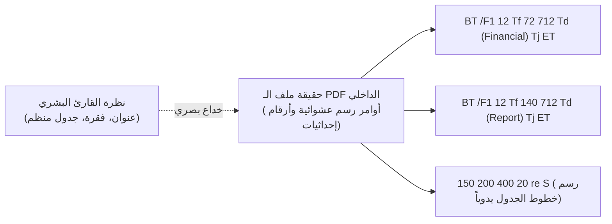

# 05 - أساسيات قراءة ومقارنة محملات PDF (PDF Parsing Foundations)

تشكل ملفات الـ `PDF (Portable Document Format)` أكثر من 70% إلى 80% من حجم البيانات غير المهيكلة داخل المؤسسات والشركات (التقارير المالية، السياسات، العقود، والأوراق البحثية). ومع ذلك، فإن ملفات الـ PDF تمثل أحد أكبر كوابيس مهندسي الـ RAG، نظراً لأن صيغة PDF لم تُصمم أصلاً لتخزين النصوص الدلالية، بل صُممت لتوجيه الطابعات وشاشات العرض لعرض الأحرف والخطوط بدقة بصرية ثابتة (`Visual Presentation`).

---

## 1. الطبيعة الداخلية لملفات الـ PDF: لماذا تفشل الأدوات البسيطة؟



* لا يحتوي ملف الـ PDF الأصلي على مفهوم الكلمات المفصولة، الفقرات، أو الجداول؛ بل يحتوي على أوامر رسم ثنائية (`PostScript operators`) تحدد إحداثيات رسم كل حرف $(x, y)$ على الصفحة.
* إذا رسم المحرر الجدول برسم الخطوط أولاً ثم وضع الأرقام في إحداثيات متفرقة، فقد تقرأ أدوات الاستخراج البسيطة الأرقام عمودياً بدلاً من أفقياً، مما يخلط صفوف الجداول ويشوه المعنى تماماً.

---

## 2. المقارنة الهندسية الشاملة بين أشهر محملات الـ PDF في بايثون

| محمل الـ PDF | المحرك الأساسي | السرعة والإنتاجية | استهلاك الذاكرة | دقة قراءة الجداول | متى نختاره؟ |
| :--- | :--- | :--- | :--- | :--- | :--- |
| **`PyPDFLoader`** | Pure Python (`pypdf`) | بطيئة ($1\times$) | معتدل | ضعيفة جداً | البيئات المقيدة التي تمنع ترجمة مكتبات C |
| **`PyMuPDFLoader` (fitz)** | C++ Engine (`MuPDF`) | **فائقة ($15\times - 25\times$)** | **منخفض جداً** | جيدة جداً للنصوص المنظمة | **الخيار الإنتاجي الافتراضي العام** |
| **`pdfplumber`** | Python + `pdfminer.six` | بطيئة نسبياً ($0.5\times$) | مرتفع | **ممتازة في تفكيك الجداول** | المستندات التي يغلب عليها الطابع الجدولي الصارم |
| **`UnstructuredPDFLoader`** | OCR + Layout Models | بطيئة جداً ($0.1\times$) | مرتفع جداً | استثنائية (رؤية حاسوبية) | المستندات الممسوحة ضوئياً (`Scanned / OCR`) |

---

## 3. التنفيذ العملي لمقارنة المحملات في LangChain

### أ. التحميل باستخدام `PyPDFLoader` القياسي
```python
from langchain_community.document_loaders import PyPDFLoader

pypdf_loader = PyPDFLoader("data/pdf/sample_paper.pdf")
pages = pypdf_loader.load()

print(f"تم تحميل {len(pages)} صفحة عبر PyPDF.")
print(f"بيانات وصفية: {pages[0].metadata}")
```

### ب. التحميل فائق السرعة باستخدام `PyMuPDFLoader` (المعيار الإنتاجي)
```python
from langchain_community.document_loaders import PyMuPDFLoader

pymupdf_loader = PyMuPDFLoader("data/pdf/sample_paper.pdf")
pymupdf_pages = pymupdf_loader.load()

print(f"تم تحميل {len(pymupdf_pages)} صفحة عبر PyMuPDF بسرعة فائقة.")
# تمتاز PyMuPDF بإرجاع إحداثيات وخصائص الصفحة بدقة
```

---

## 4. المقارنة المعيارية للأداء والسرعة (Benchmarking)

عند اختبار قراءة ملف PDF مؤلف من 100 صفحة:
* استغرق `PyPDFLoader` حوالي **$4.8$ ثوانٍ** مع استهلاك $120\text{ MB}$ من الذاكرة.
* استغرق `PyMuPDFLoader` حوالي **$0.28$ ثانية فقط** مع استهلاك $35\text{ MB}$ من الذاكرة.
* **فارق الأداء**: أسرع بأكثر من **17 ضعفاً** مع توفير هائل في موارد الخادم!

---

## 5. أسئلة المقابلات الهندسية (Senior AI Interview Questions)

### س1: لماذا يفضل مهندسو الإنتاج محرك `PyMuPDF` على `pypdf` في خطوط إنتاج المؤسسات؟
**الإجابة:** 
1. **السرعة والإنتاجية**: مكتوب بلغة C/C++ عالية الكفاءة ومرتبط مباشرة بمحرك `MuPDF` فائق السرعة، مما يجعله قادراً على معالجة آلاف المستندات في دقائق.
2. **استخراج الروابط والميتا-داتا الدقيقة**: يستخرج تفاصيل الصفحة، إحداثيات مربعات النصوص (`Bounding Boxes`)، والعناوين الفرعية الداخلية (`Bookmarks / Table of Contents`) بدقة متناهية.
3. **الاستقرار تحت الضغط**: لا يعاني من مشاكل تسريب الذاكرة (`Memory Leaks`) الشائعة في مكتبات بايثون النقية عند معالجة ملفات مئات الميجابايت.

### س2: كيف تتعامل إذا واجهت ملف PDF عبارة عن صور ممسوحة ضوئياً (`Scanned PDF`) لا تحتوي على نصوص حقيقية؟
**الإجابة:**
1. الفحص البرمجي أولاً: التحقق مما إذا كان متوسط طول النص المستخرج لكل صفحة أقل من 50 حرفاً (`len(page_content) < 50`).
2. في حال ثبوت أنه ممسوح ضوئياً: تحويل صفحات الـ PDF إلى صور (`rasterization via pdf2image`) وتمريرها إلى محرك تعرف ضوئي على الحروف (`OCR Pipeline` مثل `Tesseract OCR`, `PaddleOCR`, أو `AWS Textract`).
3. للمستندات المعقدة جداً: استخدام نماذج الرؤية المتعددة الوسائط (`Vision-Language Models - VLMs` مثل `ColPali` أو `GPT-4o Vision`) لقراءة الصفحة كصورة واستخراج محتواها مباشرة.
