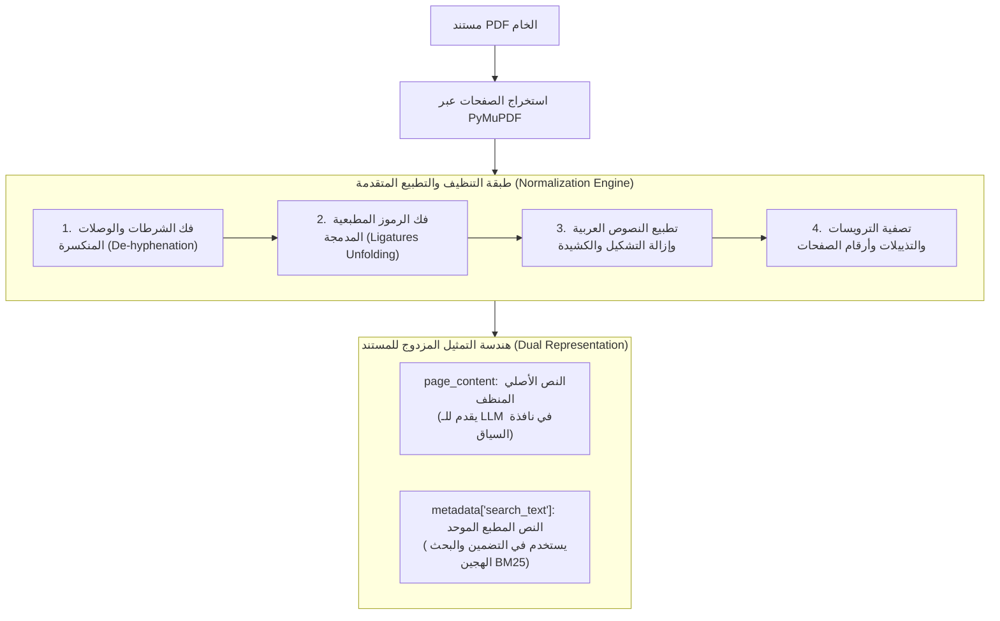

# معالجة التحديات المتقدمة في الـ PDF وتنظيف النصوص والجداول (Advanced PDF Engineering)
### Architectural & Implementation Guide (`docs/01-ingestion/06-pdf-advanced-issues.md`)

في بيئات الإنتاج الحقيقية، مجرد استخراج النص الخام من ملف الـ PDF لا يتجاوز 30% من المهمة. الـ 70% المتبقية تتمثل في **تنظيف وتطبيع النصوص (`Data Cleaning & Normalization`)** لمعالجة التشوهات المطبعية واللغوية التي تدمر تشابه المتجهات الدلالية وتضلل نماذج الـ LLM.

---

## 1. المعمارية الهندسية لخط المعالجة المتقدم (Production PDF Pipeline)



---

## 2. المشكلات الحرجة وحلولها البرمجية

### 1. الوصلات والشرطات المنكسرة في نهايات الأسطر (`De-hyphenation`)
* **المشكلة**: عند تنسيق النصوص في أعمدة، تنكسر الكلمات الطويلة عند نهاية السطر بوضع شرطة (`infor-\nmation`).
* **الأثر**: يبحث المستخدم عن كلمة `information` فلا يجدها نموذج التضمين أو البحث المعجمي لأنها تحولت لكلمتين مشوهتين.
* **الحل بالتعابير النمطية**:
  ```python
  text = re.sub(r'(\w+)-\n(\w+)', r'\1\2', text)
  ```

### 2. فك الرموز المطبعية المدمجة (`Ligatures`)
* **المشكلة**: برامج التصميم تدمج حرفين متجاورين في رمز مطبعي واحد خاص لتجميل الخط (مثل: `fi` بدلاً من `fi`، و `fl` بدلاً من `fl`).
* **الحل**: استبدال الرموز المدمجة بالحروف المنفصلة القياسية.

### 3. تطبيع النصوص العربية (`Arabic Text Normalization`)
* **المشكلة**: تنوع رسم الحروف (أ، إ، آ، ا)، واستخدام التشكيل، وعلامات الكشيدة (`ـ`)، والتاء المربوطة والهاء.
* **الحل**: إزالة التشكيل والكشيدة، وتوحيد الألف والياء في نص البحث لضمان تطابق الاستعلام مع الوثائق.

### 4. استخراج الجداول وتحويلها إلى Markdown
* **المشكلة**: قراءة الجداول ككتلة نصية عادية تسقط حدود الأعمدة وتفصل رؤوس الجداول عن أرقامها.
* **الحل**: استخراج الجداول بهيكلها وتحويلها إلى صيغة Markdown Table لتمكين الـ LLM من فهم العلاقات الأفقية والعمودية بين الخلايا.

---

## 3. الكود التطبيقي: محرك تنظيف وتطبيع نصوص الـ PDF (Advanced Text Normalizer)

يوضح الكود التالي خط معالجة عملي ينفذ فك الوصلات، فك الرموز المدمجة، تطبيع الأبجدية العربية، واستخراج الجداول:

```python
import re
from typing import Dict, Any

class AdvancedDocumentCleaner:
    """Enterprise text normalization engine resolving PDF typographic artifacts."""

    LIGATURES_MAP = {
        "fi": "fi",
        "fl": "fl",
        "ff": "ff",
        "ffi": "ffi",
        "ffl": "ffl",
        "ſt": "ft",
        "st": "st"
    }

    @classmethod
    def dehyphenate(cls, text: str) -> str:
        """Merge words broken across linebreaks with hyphens."""
        return re.sub(r"(\w+)-\n(\w+)", r"\1\2", text)

    @classmethod
    def unfold_ligatures(cls, text: str) -> str:
        """Replace typographic ligatures with standard distinct character pairs."""
        for lig, repl in cls.LIGATURES_MAP.items():
            text = text.replace(lig, repl)
        return text

    @classmethod
    def normalize_arabic(cls, text: str) -> str:
        """Strip Arabic diacritics (tashkeel), tatweel, and normalize letter variants."""
        # Remove Arabic tatweel / kashida (\u0640)
        text = re.sub(r"\u0640", "", text)
        # Remove Arabic diacritics / harakat (range: 064B to 0652)
        text = re.sub(r"[\u064B-\u0652]", "", text)
        # Normalize alef variants to bare alef
        text = re.sub(r"[إأآا]", "ا", text)
        # Normalize final yaa
        text = re.sub(r"[ىي]", "ي", text)
        # Normalize taa marbuta to haa for search indexing
        text = re.sub(r"ة", "ه", text)
        return text

    @classmethod
    def clean_pipeline(cls, raw_text: str) -> Dict[str, str]:
        """Produce dual representation: clean for LLM context, normalized for embeddings."""
        # 1. Unfold ligatures and dehyphenate
        step1 = cls.unfold_ligatures(raw_text)
        step2 = cls.dehyphenate(step1)
        
        # 2. Page Content representation (clean, preserving original language tone)
        llm_context = re.sub(r"\n{3,}", "\n\n", step2).strip()
        
        # 3. Search Text representation (normalized for Arabic and keyword matching)
        search_repr = cls.normalize_arabic(llm_context.lower())
        
        return {
            "page_content": llm_context,
            "search_text": search_repr
        }


# Demonstration
raw_sample = (
    "The financial infor-\nmation reflects significant profit growth.\n"
    "تـطـبـيـقـاتُ الذكاءِ الاصْطِناعِيّ تُعَزِّزُ إِنْتاجِيَّةَ الشَّرِكَةِ."
)

cleaner = AdvancedDocumentCleaner()
cleaned = cleaner.clean_pipeline(raw_sample)

print("=== Raw Text ===")
print(raw_sample)

print("\n=== Cleaned for LLM Context (De-hyphenated & Unfolded) ===")
print(cleaned["page_content"])

print("\n=== Normalized Search Text (No Tashkeel / Normalized Arabic) ===")
print(cleaned["search_text"])
```

---

## 4. الممارسات الهندسية الفضلى

1. **اعتماد مبدأ التمثيل المزدوج (`Dual Representation`)**: احفظ النص المنظف الطبيعي في `page_content` ليقرأه النموذج اللغوي بسلاسة، واحفظ النص المطبع والمخفف في `metadata["search_text"]` لاستخدامه في البحث المعجمي (`BM25`) لضمان العثور على الكلمات العربية مهما اختلف رسم الهمزات.
2. **إزالة ترويسات وتذييلات الصفحات (`Headers & Footers`)**: تكرار جملة مثل *"تقرير الشركة السري - صفحة 5"* في كل مقطع يشتت نماذج التضمين ويهدر سياق الـ LLM؛ لذلك يجب حذف النصوص المتكررة في أعلى وأسفل الصفحات برمجياً.
