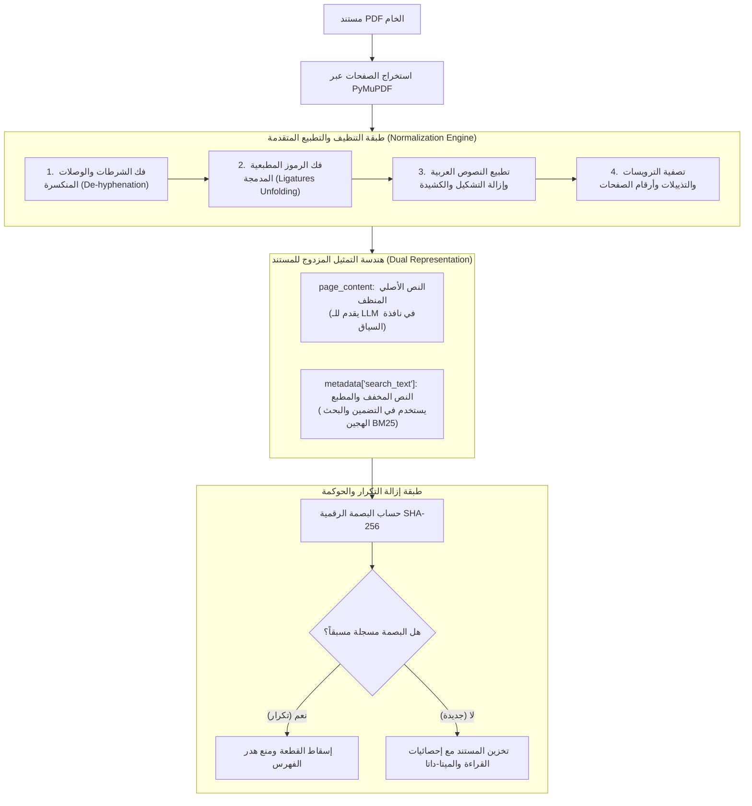

# 06 - حل المشكلات المعقدة في الـ PDF وتنظيف النصوص (Advanced PDF Engineering)

في بيئات الإنتاج الحقيقية، مجرد استخراج النص الخام من ملف الـ PDF لا يتجاوز 30% من المهمة. الـ 70% المتبقية تتمثل في **تنظيف وتطبيع النصوص (`Data Cleaning & Normalization`)** لمعالجة التشوهات المطبعية واللغوية التي تدمر تشابه المتجهات الدلالية (`Cosine Similarity`) وتخدع نماذج الـ LLM.

يقدم هذا الدليل المعمارية الكاملة لخط المعالجة المتقدم **`SmartPDFProcessor`** المطبق في المشروع.

---

## 1. المعمارية الهندسية لخط المعالجة المتقدم (Production PDF Pipeline)



---

## 2. المشكلات السبع الحرجة وحلولها البرمجية

### المشكلة 1: الوصلات والشرطات المنكسرة في نهايات الأسطر (`De-hyphenation`)
* **المشكلة**: عند تنسيق النصوص الإنجليزية في أعمدة، تنكسر الكلمات الطويلة عند نهاية السطر بوضع شرطة (`infor-\nmation`).
* **الأثر الكارثي**: يبحث المستخدم عن كلمة `information` فلا يجدها نموذج التضمين أو البحث المعجمي لأنها أصبحت كلمتين مشوهتين (`infor` و `mation`).
* **الحل بالتعابير النمطية (`Regex`)**:
  ```python
  import re
  text = re.sub(r'(\w+)-\n(\w+)', r'\1\2', text)
  ```

### المشكلة 2: فك الرموز المطبعية المدمجة (`Ligatures`)
* **المشكلة**: تقوم برامج التصميم بدمج حرفين متجاورين في رمز مطبعي واحد خاص لتجميل الخط (مثل: `fi` بدلاً من `fi`، و `fl` بدلاً من `fl`).
* **الحل**: استبدال الرموز المدمجة بالحروف اللاتينية المنفصلة القياسية:
  ```python
  LIGATURES = {
      'fi': 'fi', 'fl': 'fl', 'ff': 'ff',
      'ffi': 'ffi', 'ffl': 'ffl', 'ſt': 'ft'
  }
  for lig, repl in LIGATURES.items():
      text = text.replace(lig, repl)
  ```

### المشكلة 3: التطبيع الهندسي للغة العربية (`Arabic Text Normalization`)
تحتوي اللغة العربية على تنوع هائل في أشكال الحروف التي تؤدي لتشتيت نماذج البحث الدلالي والمعجمي:
1. **توحيد الهمزات والألفات**: تحويل (`أ, إ, آ`) إلى ألف مجردة (`ا`).
2. **إزالة التشكيل (الحركات)**: إزالة الفتحة، الضمة، الكسرة، التنوين، والسكون:
   ```python
   arabic_diacritics = re.compile(r'[\u064B-\u0652]')
   text = re.sub(arabic_diacritics, '', text)
   ```
3. **إزالة التطويل والكشيدة (`Tatweel`)**: إزالة رمز المد التجميلي `ـ` (`\u0640`).
4. **توحيد الياء المقصورة والتاء المربوطة**: توحيد (`ى` $\to$ `ي`) و (`ة` $\to$ `ه`) في نص البحث.

### المشكلة 4: تصفية الترويسات والتذييلات المتكررة (`Header & Footer Stripping`)
* تكرار اسم الشركة ورقم الصفحة في أعلى وأسفل كل صفحة يؤدي إلى:
  * تلوث متجه التضمين بكلمات عامة لا علاقة لها بموضوع الصفحة.
  * استرجاع تذييلات الصفحات المكررة وإهدار نافذة سياق الـ LLM.
* **الحل**: حساب الأسطر المتكررة عبر كل الصفحات وحذفها بناءً على إحداثياتها الرأسية أو تردد ظهورها.

### المشكلة 5: التمثيل المزدوج للمستند (`Dual-Representation Strategy`)
في بيئات الإنتاج، لا نستخدم نصاً واحداً لكل الأغراض:
* **`page_content`**: يحتفظ بالنص الأصلي المنظف (مع الهمزات والتشكيل الخفيف وعلامات الترقيم) ليقرأه النموذج اللغوي ويصيغ منه إجابة لغوية فصيحة.
* **`metadata["search_text"]`**: النص المطبع بالكامل والمجرد من الحركات والموحد الهمزات ليستخدمه محرك التضمين والبحث الهجين `BM25`.

### المشكلة 6: إزالة التكرار عبر البصمات المشفرة (`SHA-256 Deduplication`)
حساب بصمة رقمية لمحتوى كل قطعة لمنع تكرار فهرسة نفس الفقرات عند وجود صفحات مكررة أو تذييلات عامة:
```python
import hashlib
content_hash = hashlib.sha256(cleaned_text.encode('utf-8')).hexdigest()
```

### المشكلة 7: مؤشرات وإحصائيات القراءة المتقدمة (`Content Metrics`)
تضمين حقول إحصائية تفيد في ترتيب النتائج وتحليل أداء الاسترجاع:
* `word_count`: عدد الكلمات الفعلي.
* `reading_time_minutes`: الوقت المقدر لقراءة الفقرة ($\text{words} / 200$).

---

## 3. أسئلة المقابلات الهندسية (Senior AI Interview Questions)

### س1: لماذا يعتبر تطبيق الـ Normalization مباشرة على `page_content` ممارسة سيئة في تطبيقات الإنتاج؟
**الإجابة:** 
إذا جردنا `page_content` من الهمزات والتشكيل وعلامات الترقيم واستبدلنا التاء المربوطة بالهاء، فسوف يستلم النموذج اللغوي الكبير (`LLM`) نصاً مشوهاً وركيكاً لغوياً، مما يجعله يولد إجابات ذات جودة لغوية منخفضة ومليئة بالأخطاء الإملائية.  
لذلك فإن الحل الهندسي المعتمد هو **التمثيل المزدوج (`Dual Representation`)**: يترك `page_content` سليماً وفصيحاً ليغذي الـ LLM، بينما يتم تخزين النسخة المطبعة داخل `metadata["search_text"]` لمحركات الفهرسة والبحث فقط.

### س2: كيف تكتشف الترويسات والتذييلات (`Headers & Footers`) في ملف PDF دون الاعتماد على قواعد نصية ثابتة؟
**الإجابة:**
1. **التحليل المكاني بالإحداثيات (`Spatial Coordinate Analysis`)**: فحص السطور التي تقع في أعلى 5% أو أسفل 5% من ارتفاع الصفحة البصري (`y-coordinates` عبر PyMuPDF).
2. **التحليل الترددي الإحصائي (`Statistical Frequency Analysis`)**: فحص السطور التي تتكرر بنفس النص بالضبط في أكثر من 80% من صفحات المستند (مثل أسماء الفصول أو اسم المؤسسة)، وتصنيفها برمجياً كـ Running Headers وتصفيتها تلقائياً.
