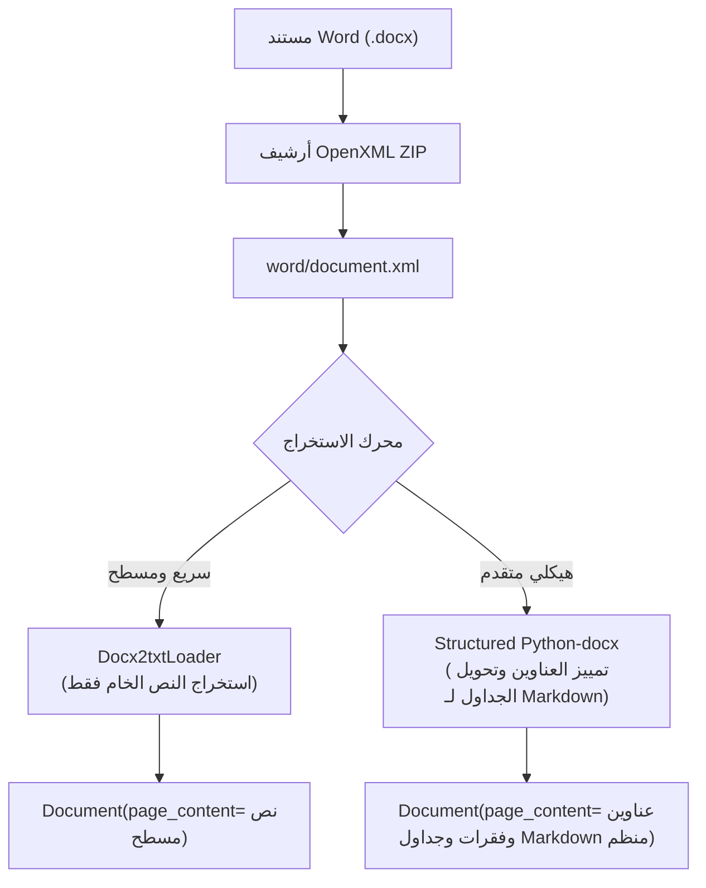

# معالجة مستندات الأوفيس: وورد وعروض الباوربوينت (Office Documents Parsing: DOCX & PPTX)
### Architectural & Implementation Guide (`docs/01-ingestion/07-word-documents.md`)

تُعد مستندات مايكروسوفت وورد (`.docx`) وعروض الباوربوينت (`.pptx`) المعيار الفعلي لمسودات العقود، مقترحات المشاريع، واستراتيجيات الشركات. على عكس ملفات PDF، تتميز مستندات الأوفيس الحديثة بأنها مبنية على معيار `Office Open XML (OOXML)`، وهو عبارة عن أرشيف مضغوط (`ZIP`) يحتوي على شجرة ملفات `XML` تصف البنية الدلالية للنصوص والعناوين والجداول بدقة.

---

## 1. البنية الداخلية لمستندات DOCX وتدفق الاستخراج



---

## 2. المقارنة الهندسية لمحملات مستندات Office

| المحمل البرمجي | استخراج الجداول | الحفاظ على العناوين الهرمية | استخراج ملاحظات العرض (Notes) | متى نختاره؟ |
| :--- | :--- | :--- | :--- | :--- |
| **`Docx2txtLoader`** | يدمج الخلايا كنصوص عادية | ضعيف (يفقد مستويات العناوين) | غير متاح | النصوص البسيطة والسريعة |
| **`python-docx` مخصص** | **يحول الجداول إلى Markdown** | **يميز بدقة العناوين (H1, H2, H3)** | غير متاح | **المعيار الإنتاجي لمستندات Word** |
| **`python-pptx` مخصص** | يستخرج الجداول من الشرائح | يستخرج عناوين الشرائح كـ Metadata | **يستخرج Speaker Notes بدقة** | **المعيار الإنتاجي لعروض PPTX** |

---

## 3. الكود التطبيقي: محرك استخراج مستندات وورد وباوربوينت متقدم (Office Parser)

يوضح الكود التالي كيفية استخراج مستندات Word مع تحويل الجداول إلى جداول Markdown، بالإضافة لاستخراج عروض الباوربوينت شريحة بشريحة مع تضمين ملاحظات المتحدث (`Speaker Notes`):

```python
from pathlib import Path
from typing import List, Dict, Any
from langchain_core.documents import Document

class OfficeDocumentParser:
    """Enterprise parser for Word (.docx) and PowerPoint (.pptx) documents."""

    @staticmethod
    def parse_docx(file_path: str) -> List[Document]:
        """Extract paragraphs, preserve heading structure, and convert tables to Markdown."""
        try:
            import docx
        except ImportError:
            raise ImportError("Please install python-docx via: uv add python-docx")

        doc = docx.Document(file_path)
        content_blocks = []

        # 1. Extract paragraphs and headings
        for p in doc.paragraphs:
            text = p.text.strip()
            if not text:
                continue
            if p.style.name.startswith("Heading"):
                content_blocks.append(f"\n### {text}\n")
            else:
                content_blocks.append(text)

        # 2. Extract and format tables into Markdown
        for t_idx, table in enumerate(doc.tables, 1):
            if not table.rows:
                continue
            content_blocks.append(f"\n[Table {t_idx}]")
            headers = [cell.text.strip().replace("\n", " ") for cell in table.rows[0].cells]
            content_blocks.append("| " + " | ".join(headers) + " |")
            content_blocks.append("| " + " | ".join(["---"] * len(headers)) + " |")
            
            for row in table.rows[1:]:
                row_vals = [cell.text.strip().replace("\n", " ") for cell in row.cells]
                content_blocks.append("| " + " | ".join(row_vals) + " |")
            content_blocks.append("\n")

        full_text = "\n".join(content_blocks).strip()
        metadata = {
            "source": str(file_path),
            "doc_type": "docx",
            "table_count": len(doc.tables)
        }
        return [Document(page_content=full_text, metadata=metadata)]

    @staticmethod
    def parse_pptx(file_path: str) -> List[Document]:
        """Extract slides individually with slide title, body shapes, and speaker notes."""
        try:
            import pptx
        except ImportError:
            raise ImportError("Please install python-pptx via: uv add python-pptx")

        prs = pptx.Presentation(file_path)
        documents = []

        for slide_idx, slide in enumerate(prs.slides, 1):
            slide_texts = []
            
            # Extract shape text
            for shape in slide.shapes:
                if shape.has_text_frame:
                    for paragraph in shape.text_frame.paragraphs:
                        text = paragraph.text.strip()
                        if text:
                            slide_texts.append(text)

            # Extract speaker notes if available
            notes_text = ""
            if slide.has_notes_slide and slide.notes_slide.notes_text_frame:
                notes_text = slide.notes_slide.notes_text_frame.text.strip()

            content = "\n".join(slide_texts).strip()
            metadata = {
                "source": str(file_path),
                "doc_type": "pptx",
                "slide_number": slide_idx,
                "has_notes": bool(notes_text),
                "speaker_notes": notes_text
            }
            documents.append(Document(page_content=content, metadata=metadata))

        return documents


# Demonstration execution
if __name__ == "__main__":
    print("[*] OfficeDocumentParser ready for DOCX and PPTX processing.")
```

---

## 4. الممارسات الهندسية الفضلى

1. **التعامل مع الشريحة كوحدة مستند مستقلة (`Slide as Document`)**: في عروض الباوربوينت، لا تدمج كامل العرض في نص واحد؛ كل شريحة تمثل فكرة بصرية مستقلة ويجب أن تُعامل ككائن `Document` منفصل مع رقم الشريحة وملاحظات المتحدث في الميتاداتا.
2. **تحويل الجداول إلى Markdown**: لا تترك جداول Word لتُستخرج كنص مسطح مشوش؛ يضمن تحويلها إلى Markdown فهم النموذج اللغوي لعلاقات الصفوف والأعمدة بدقة 100%.
