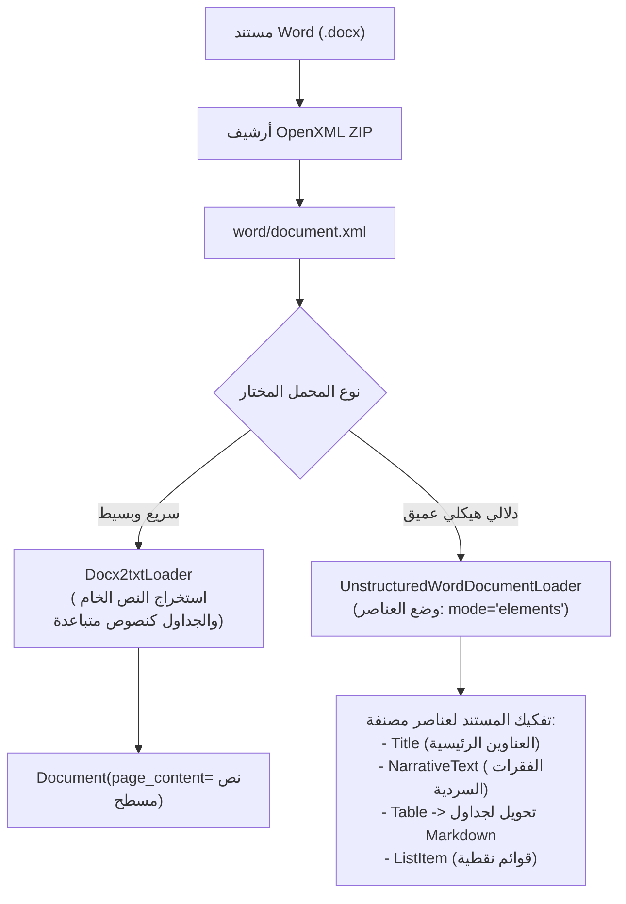

# 07 - قراءة وتحليل مستندات وورد (Word DOCX Documents Parsing)

تُعد مستندات مايكروسوفت وورد (`Microsoft Word: .docx`) المعيار الفعلي لإعداد مسودات العقود، مقترحات المشاريع (`Proposals`)، ومستندات السياسات الداخلية في معظم المؤسسات والشركات. على عكس ملفات PDF، تتميز ملفات DOCX بأنها مبنية داخلياً على صيغة `Office Open XML (OOXML)`، وهي عبارة عن أرشيف مضغوط (`ZIP`) يحتوي على شجرة ملفات `XML` تصف البنية الدلالية للنص بدقة.

---

## 1. البنية الداخلية لمستندات DOCX وتدفق الاستخراج



---

## 2. المقارنة الهندسية بين أشهر محملات DOCX

| المحمل البرمجي | التبعيات الخارجية | استخراج الجداول | الحفاظ على البنية الهرمية | السرعة والإنتاجية |
| :--- | :--- | :--- | :--- | :--- |
| **`Docx2txtLoader`** | مكتبة `docx2txt` خفيفة | يدمج الخلايا كنصوص عادية | ضعيف (يفقد مستويات العناوين) | فائقة جداً ومناسبة للنصوص السريعة |
| **`UnstructuredWordDocumentLoader`** | مكتبة `unstructured` + `python-docx` | **يحول الجداول إلى كائنات وجداول Markdown** | **استثنائي (يميز H1, H2, الفقرات والقوائم)** | متوسطة وتتطلب موارد حوسبة أكبر |

---

## 3. التنفيذ البرمجي لاستخراج مستندات Word في LangChain

### أ. الاستخراج البسيط والسريع عبر `Docx2txtLoader`
```python
from langchain_community.document_loaders import Docx2txtLoader

loader = Docx2txtLoader("data/docx/proposal.docx")
documents = loader.load()

print(f"تم تحميل المستند، الطول الكلي: {len(documents[0].page_content)} حرفاً.")
```

### ب. الاستخراج الهيكلي المتقدم وتحويل الجداول إلى Markdown
في أنظمة الـ RAG، قراءة الجدول كنص مسطح بدون فواصل الأعمدة يدمر قدرة الـ LLM على فهم العلاقات بين الصفوف ورؤوس الأعمدة. لذلك نقوم بتحويل الجداول البرمجية داخل المستند إلى صيغة `Markdown Table`:

```python
import docx

def docx_table_to_markdown(table: docx.table.Table) -> str:
    """تحويل جدول وورد إلى جدول ماركداون قياسي يفهمه الـ LLM بدقة."""
    md_rows = []
    headers = [cell.text.strip().replace("\n", " ") for cell in table.rows[0].cells]
    md_rows.append("| " + " | ".join(headers) + " |")
    md_rows.append("| " + " | ".join(["---"] * len(headers)) + " |")
    
    for row in table.rows[1:]:
        row_cells = [cell.text.strip().replace("\n", " ") for cell in row.cells]
        md_rows.append("| " + " | ".join(row_cells) + " |")
        
    return "\n".join(md_rows)
```

---

## 4. أسئلة المقابلات الهندسية (Senior AI Interview Questions)

### س1: لماذا يفضل تحويل الجداول في مستندات Word إلى Markdown بدلاً من تركها كنصوص مفصولة بمسافات؟
**الإجابة:** 
نماذج التوليد اللغوي الكبيرة (مثل GPT-4 و Llama-3) تم تدريبها بكثافة على ملايين المستودعات البرمجية ومستندات الويب التي تستخدم صيغة **Markdown**.  
عند تمثيل الجدول بهيكل Markdown (`| Column 1 | Column 2 |`)، يستطيع الـ Attention Mechanism الخاص بالنموذج الربط الحتمي بين رأس العمود والخلية المقابلة في أي صف، بينما تؤدي المسافات أو الفواصل العشوائية إلى خلط البيانات وضياع العلاقة الإحصائية بين القيم.

### س2: كيف تستغل مستويات العناوين (`Heading 1`, `Heading 2`) في مستندات Word لتحسين تقسيم النصوص؟
**الإجابة:**
بدلاً من التقطيع الأعمى بعدد الأحرف، نقوم بتطبيق استراتيجية **`Header-Based Chunking`**:
1. قراءة أنماط الفقرات (`paragraph.style.name`).
2. عندما يكون النمط `Heading 1` أو `Heading 2`، يتم بدء قطعة جديدة وتخزين نص العنوان في `metadata["section_title"]`.
3. هذا يضمن أن كل قطعة تظل محتفظة بالسياق الموضوعي للقسم الذي تنتمي إليه، مما يرفع دقة الاسترجاع الدلالي بنسبة كبيرة.
