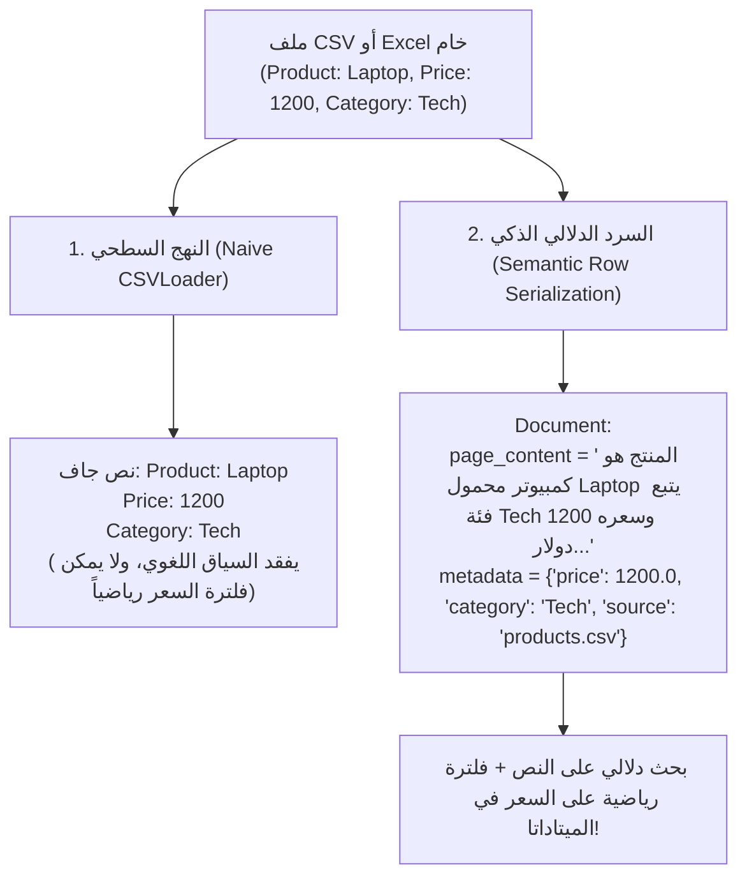

# معالجة البيانات الجدولية: ملفات CSV وإكسل (Tabular Data Ingestion: CSV & Excel)
### Architectural & Implementation Guide (`docs/01-ingestion/08-csv-excel.md`)

تُعد البيانات الجدولية (`Tabular Data: .csv, .xlsx`) من أكثر أنواع البيانات انتشاراً في الشركات، حيث تُخزن فيها سجلات المنتجات، الفواتير، أسعار الخدمات، ومعلومات العملاء. ومع ذلك، فإن إدخال الجداول في منظومات الـ RAG يمثل تحدياً معمارياً خاصاً: **نماذج التضمين الدلالي (`Embedding Models`) مدربة على فهم الجمل والنصوص الطبيعية المترابطة، وليست مدربة على فهم مصفوفات الأرقام والصفوف المعزولة.**

---

## 1. التحدي المعماري: القراءة السطحية مقابل السرد الدلالي الذكي



---

## 2. تفكيك النهجين البرمجيين في استيعاب البيانات الجدولية

### أ. النهج الأول: استخدام `CSVLoader` التقليدي
يقوم `CSVLoader` في LangChain بقراءة كل صف وتحويله إلى صيغة نصية بسيطة بسطور مفصولة:
* **العيوب**: يعامل الأرقام كنصوص ميتة، مما يجعل من المستحيل تطبيق فلاتر مقارنة في قاعدة البيانات مثل: البحث عن المنتجات التي يقل سعرها عن 1000 دولار (`price < 1000`).

### ب. النهج الثاني: السرد الدلالي وهندسة الميتاداتا (المعيار الإنتاجي)
في البيئات الاحترافية، نقوم بتحويل كل صف إلى:
1. **سرد دلالي مترابط (`Natural Language Summary`)** يسهل على نماذج التضمين فهمه ومطابقته مع استفسارات المستخدمين البشرية.
2. **بيانات وصفية رقمية وتصنيفية مهيكلة (`Typed Metadata`)** لتمكين الفلاتر المركبة في قواعد المتجهات.

---

## 3. الكود التطبيقي: محرك تحويل الجداول إلى وثائق ذكية (Tabular Semantic Serializer)

يوضح الكود التالي كيفية قراءة ملفات CSV وجداول Excel متعددة الأوراق (`Multi-Sheet`)، وتحويل كل صف لسرد دلالي مدعوم ببيانات وصفية رقمية:

```python
from pathlib import Path
from typing import List, Dict, Any
import pandas as pd
from langchain_core.documents import Document

class TabularDocumentSerializer:
    """Production processor converting tabular rows into narrative documents with typed metadata."""

    @staticmethod
    def process_csv(csv_path: str) -> List[Document]:
        """Convert CSV rows to semantic documents."""
        df = pd.read_csv(csv_path)
        documents = []

        for idx, row in df.iterrows():
            # Build natural language narrative for embeddings
            narrative = (
                f"Product: {row.get('product_name', 'Unknown')}. "
                f"Category: {row.get('category', 'General')}. "
                f"Price: ${float(row.get('price', 0.0)):,.2f}. "
                f"Description: {row.get('description', 'No details available.')}"
            )

            # Store typed numerical values in metadata for range filtering
            metadata = {
                "source": str(csv_path),
                "row_index": idx,
                "product_id": str(row.get("product_id", f"row_{idx}")),
                "category": str(row.get("category", "")),
                "price": float(row.get("price", 0.0)),
                "in_stock": bool(row.get("in_stock", True))
            }
            documents.append(Document(page_content=narrative, metadata=metadata))

        return documents

    @staticmethod
    def process_excel(xlsx_path: str) -> List[Document]:
        """Process multi-sheet Excel workbooks preserving sheet context."""
        xls = pd.ExcelFile(xlsx_path)
        documents = []

        for sheet_name in xls.sheet_names:
            df = pd.read_excel(xls, sheet_name=sheet_name)
            for idx, row in df.iterrows():
                row_dict = row.dropna().to_dict()
                narrative_items = [f"{col}: {val}" for col, val in row_dict.items()]
                content = f"Sheet: {sheet_name} | " + ", ".join(narrative_items)

                metadata = {
                    "source": str(xlsx_path),
                    "sheet_name": sheet_name,
                    "row_index": idx
                }
                documents.append(Document(page_content=content, metadata=metadata))

        return documents


# Demonstration
if __name__ == "__main__":
    sample_df = pd.DataFrame([
        {"product_id": "P101", "product_name": "ThinkPad X1", "category": "Laptops", "price": 1450.0, "in_stock": True, "description": "High performance ultrabook."},
        {"product_id": "P102", "product_name": "Dell UltraSharp", "category": "Monitors", "price": 550.0, "in_stock": False, "description": "4K professional color monitor."}
    ])
    sample_df.to_csv("test_products.csv", index=False)

    docs = TabularDocumentSerializer.process_csv("test_products.csv")
    for d in docs:
        print(f"Content: {d.page_content}")
        print(f"Metadata: {d.metadata}\n")

    import os
    if os.path.exists("test_products.csv"):
        os.remove("test_products.csv")
```

---

## 4. الممارسات الهندسية الفضلى

1. **التحويل الرقمي الصريح في الميتاداتا (`Type Casting`)**: تأكد دائماً من تحويل أرقام الأسعار والمخزون إلى `float` و `int` داخل الميتاداتا حتى تتمكن من تطبيق استعلامات المدى (`$gte`, `$lte`) في قاعدة المتجهات.
2. **الجمع بين السرد الطبيعي والـ Markdown**: إذا كان الجدول يحتوي على علاقات أفقية معقدة بين أعمدة متعددة، يمكن تمثيل الجدول بالكامل كجدول Markdown في كائن `Document` واحد، أو تمثيل كل صف كوثيقة مستقلة في جداول الكتالوجات والمنتجات.
