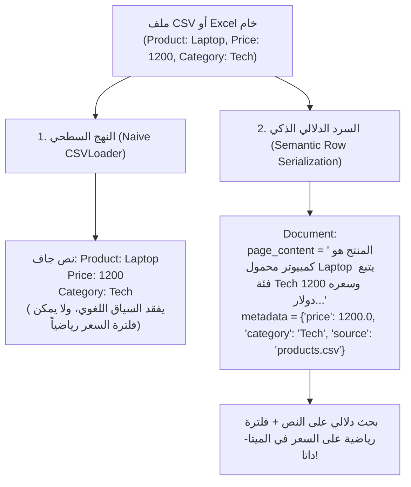

# 08 - معالجة ملفات الجداول CSV و Excel (Tabular Data Ingestion)

تُعد البيانات الجدولية (`Tabular Data: .csv, .xlsx`) من أكثر أنواع البيانات انتشاراً في الشركات، حيث تُخزن فيها سجلات المنتجات، الفواتير، أسعار الخدمات، ومعلومات العملاء. ومع ذلك، فإن إدخال الجداول في منظومات الـ RAG يمثل تحدياً معمارياً خاصاً: **نماذج التضمين الدلالي (`Embedding Models`) مدربة على فهم الجمل والنصوص الطبيعية المترابطة، وليست مدربة على فهم مصفوفات الأرقام والصفوف المعزولة.**

---

## 1. التحدي المعماري: القراءة السطحية مقابل السرد الدلالي الذكي



---

## 2. تفكيك النهجين البرمجيين في استيعاب البيانات الجدولية

### أ. النهج الأول: استخدام `CSVLoader` التقليدي
يقوم `CSVLoader` في LangChain بقراءة كل صف وتحويله إلى صيغة نصية بسيطة:
```python
from langchain_community.document_loaders import CSVLoader

loader = CSVLoader(
    file_path="data/tabular/products.csv",
    source_column="product",
    encoding="utf-8"
)
docs = loader.load()
```
* **العيوب**: يعامل الأرقام كنصوص ميتة، مما يجعل من المستحيل تطبيق فلاتر مقارنة في قاعدة البيانات مثل: البحث عن المنتجات التي يقل سعرها عن 1000 دولار (`price < 1000`).

---

### ب. النهج الثاني: السرد الدلالي وهندسة الميتا-داتا (المعيار الإنتاجي)
في البيئات الاحترافية، نستخدم مكتبة `Pandas` لتحويل كل صف إلى:
1. **سرد دلالي مترابط (`Natural Language Summary`)** يسهل على نماذج التضمين فهمه ومطابقته مع استفسارات المستخدمين البشرية.
2. **بيانات وصفية رقمية وتصنيفية مهيكلة (`Typed Metadata`)** لتمكين الفلاتر المركبة في قواعد المتجهات.

```python
import pandas as pd
from langchain_core.documents import Document
from typing import List

def serialize_tabular_data(csv_path: str) -> List[Document]:
    df = pd.read_csv(csv_path)
    documents = []
    
    for idx, row in df.iterrows():
        # صياغة النص كسرد طبيعي مترابط
        content = (
            f"اسم المنتج: {row['product']}. "
            f"الفئة التصنيفية: {row['category']}. "
            f"السعر الرسمي: ${row['price']:.2f}. "
            f"المواصفات والمميزات: {row['description']}."
        )
        
        # حفظ الحقول الرقمية والتصنيفية كبيانات وصفية منضبطة الأنواع
        metadata = {
            "source": csv_path,
            "row_index": int(idx),
            "product_name": str(row["product"]),
            "category": str(row["category"]),
            "price": float(row["price"])
        }
        
        documents.append(Document(page_content=content, metadata=metadata))
        
    return documents
```

---

## 3. التعامل مع ملفات Excel متعددة أوراق العمل (`Multi-Sheet Excel`)

ملفات Excel تحتوي غالباً على صفحات متعددة (`Sheets`) تمثل كل منها قسماً مختلفاً (مثل المبيعات، المخزون، والعملاء). نقوم بمعالجتها هيكلياً عبر كائن `ExcelFile`:

```python
excel_path = "data/tabular/inventory.xlsx"
excel_file = pd.ExcelFile(excel_path)

all_excel_docs = []
for sheet in excel_file.sheet_names:
    sheet_df = pd.read_excel(excel_file, sheet_name=sheet)
    for idx, row in sheet_df.iterrows():
        # توثيق اسم ورقة العمل في الميتا-داتا لتمكين الفلترة لاحقاً
        doc = Document(
            page_content=f"سجل مخزون: {row.to_dict()}",
            metadata={"source": excel_path, "sheet_name": sheet, "row_index": idx}
        )
        all_excel_docs.append(doc)
```

---

## 4. المقارنة المعمارية: متى نستخدم RAG ومتى نستخدم Text-to-SQL / Pandas Agent؟

| المعيار | أسلوب RAG للبيانات الجدولية (`Tabular RAG`) | وكيل التحليل البرمجي (`Text-to-SQL / Pandas Agent`) |
| :--- | :--- | :--- |
| **طبيعة الأسئلة** | أسئلة نوعية ووصفية ("ما هي مميزات لابتوب ديل؟") | أسئلة حسابية وإحصائية ("ما هو متوسط مبيعات شهر مارس؟") |
| **سرعة الاستجابة** | فائقة جداً (استرجاع متجه مباشر $\approx 50\text{ms}$) | أبطأ (كتابة كود بايثون أو SQL وتشغيله $\approx 2 - 5\text{s}$) |
| **دقة العمليات الرياضية** | غير دقيقة (الـ LLM يهلوس في جمع ومقارنة آلاف الأرقام) | **دقيقة 100% لأن الحساب ينفذه محرك بايثون أو SQL** |
| **أفضل سيناريو** | كتالوجات المنتجات، أدلة الخدمات، والأسعار الاسترشادية | التقارير المحاسبية، كشوف الحسابات، وتحليل البيانات الكبرى |

---

## 5. أسئلة المقابلات الهندسية (Senior AI Interview Questions)

### س1: لماذا يفشل الـ RAG الدلالي في الإجابة عن سؤال: "ما هو إجمالي مبيعات عام 2024" من ملف CSV؟
**الإجابة:** 
لأن استرجاع المتجهات يعتمد على اختيار أفضل $k$ فقرات دلالية (مثلاً 5 أو 10 صفوف). لحساب إجمالي المبيعات، يحتاج النظام إلى **قراءة كل الصفوف في الملف وتطبيق دالة تجميع رياضية (`SUM`)**.  
إذا تم تمرير 5 صفوف فقط للـ LLM، فإنه سيحسب إجمالي تلك الصفوف الخمسة ويدعي كذباً أنه إجمالي العام بأكمله (هلوسة كارثية). لذلك، يجب توجيه مثل هذه الأسئلة إلى وكيل تحليلي (`Code Interpreter / Text-to-SQL Agent`) وليس إلى مسار RAG متجهات.

### س2: كيف تستغل الفلترة بالميتا-داتا مع استفسار المستخدم الهجين: "أريد حاسوب محمول للألعاب بسعر أقل من 1000 دولار"؟
**الإجابة:**
1. استخدام مرحلة استخراج الكيانات وتصنيف الاستعلام (`Query Parsing / Self-Querying Retriever`) لاستخراج:
   * النص الدلالي للبحث: `"حاسوب محمول للألعاب"`.
   * شرط الفلترة العددي: `{"price": {"$lt": 1000.0}}`.
2. إرسال الشرط لقاعدة المتجهات لتصفية المنتجات التي يقل سعرها عن 1000 أولاً (`Pre-filtering`)، ثم إجراء البحث الدلالي عن أجهزة الألعاب حصرياً داخل تلك القائمة المفلترة.
