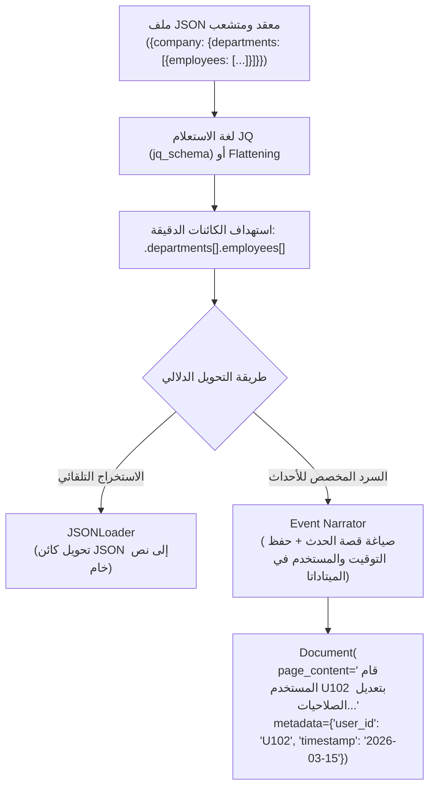

# معالجة بيانات JSON شبه المهيكلة (Semi-Structured JSON Processing & Schemas)
### Architectural & Implementation Guide (`docs/01-ingestion/09-json-processing.md`)

تُعد صيغة `JSON (JavaScript Object Notation)` اللغة المشتركة للإنترنت وواجهات برمجة التطبيقات (`REST APIs`) وسجلات الخوادم (`System & Audit Logs`). تتميز بيانات JSON بأنها **شبه مهيكلة (`Semi-Structured`)**؛ فهي تحتوي على كائنات متداخلة (`Nested Objects`)، ومصفوفات (`Arrays`)، ومفاتيح ديناميكية قد تختلف من سجل لآخر.

---

## 1. التحدي المعماري لاستيعاب ملفات الـ JSON في الـ RAG



---

## 2. تقنيات تسطيح وتحويل هياكل الـ JSON المتداخلة

عند التعامل مع هياكل JSON معقدة، هناك استراتيجيتان رئيسيتان:
1. **استهداف مسار محدد (`JQ Schema Target`)**: استخراج قائمة كائنات فرعية محددة (مثل قائمة الموظفين فقط) ومعاملة كل كائن كمستند مستقل.
2. **التسطيح التكراري للمفاتيح (`Recursive Key Flattening`)**: تحويل الكائنات المتداخلة مثل `{"user": {"profile": {"city": "Cairo"}}}` إلى مفتاح مسطح `user.profile.city: Cairo` لضمان عدم ضياع التبعية الهرمية عند التضمين.

---

## 3. الكود التطبيقي: محول ومسطح هياكل الـ JSON المتقدم (JSON Semantic Flattener)

يوضح الكود التالي كيفية تسطيح كائنات JSON المتداخلة وتحويل سجلات الأحداث (`Audit Logs`) لسرد لغوي متماسك مع الاحتفاظ ببيانات التتبع الوصفية:

```python
import json
from typing import Dict, Any, List
from langchain_core.documents import Document

class JSONSemanticFlattener:
    """Processor for nested JSON schemas and audit event logs."""

    @classmethod
    def flatten_dict(cls, data: Dict[str, Any], prefix: str = "") -> Dict[str, Any]:
        """Recursively flatten nested dictionary into dot-separated keys."""
        items = {}
        for k, v in data.items():
            new_key = f"{prefix}.{k}" if prefix else k
            if isinstance(v, dict):
                items.update(cls.flatten_dict(v, new_key))
            elif isinstance(v, list):
                # Flatten list elements or join if primitive
                if all(isinstance(i, (str, int, float, bool)) for i in v):
                    items[new_key] = ", ".join(str(i) for i in v)
                else:
                    for idx, elem in enumerate(v):
                        if isinstance(elem, dict):
                            items.update(cls.flatten_dict(elem, f"{new_key}[{idx}]"))
                        else:
                            items[f"{new_key}[{idx}]"] = elem
            else:
                items[new_key] = v
        return items

    @classmethod
    def convert_event_to_document(cls, event: Dict[str, Any], source: str) -> Document:
        """Convert a security/audit event JSON into a natural language narrative."""
        event_type = event.get("event_type", "UNKNOWN_EVENT")
        actor = event.get("actor", "system")
        timestamp = event.get("timestamp", "unknown_time")
        status = event.get("status", "SUCCESS")
        details = event.get("details", {})

        narrative = (
            f"Audit Event Log: Action '{event_type}' was performed by user '{actor}' "
            f"at {timestamp} with status '{status}'. Details: {json.dumps(details)}"
        )

        metadata = {
            "source": source,
            "event_type": event_type,
            "actor": actor,
            "status": status,
            "timestamp": timestamp
        }
        return Document(page_content=narrative, metadata=metadata)


# Demonstration
if __name__ == "__main__":
    nested_sample = {
        "user_id": "usr_9941",
        "profile": {
            "full_name": "Sarah Connor",
            "department": "Security Operations",
            "roles": ["Admin", "Auditor"]
        },
        "preferences": {
            "notifications": {"email": True, "sms": False}
        }
    }

    flattened = JSONSemanticFlattener.flatten_dict(nested_sample)
    print("=== Flattened JSON Keys ===")
    for k, v in flattened.items():
        print(f"  {k}: {v}")

    sample_event = {
        "event_type": "ACCESS_POLICY_UPDATE",
        "actor": "admin_ali",
        "timestamp": "2026-03-10T14:22:00Z",
        "status": "APPROVED",
        "details": {"resource": "hr_database", "granted_role": "READ_ONLY"}
    }
    doc = JSONSemanticFlattener.convert_event_to_document(sample_event, "audit_events.json")
    print(f"\nNarrative Document: {doc.page_content}")
    print(f"Metadata: {doc.metadata}")
```

---

## 4. الممارسات الهندسية الفضلى

1. **تجنب حفظ JSON الخام بدون شرح**: نماذج التضمين تفهم الجمل الطبيعية بشكل أفضل بكثير من الأقواس المعقوفة والمفاتيح البرمجية؛ لذلك فإن تحويل الحدث إلى جملة سردية يزيد دقة البحث الدلالي بنسبة ملحوظة.
2. **استخراج المفاتيح الحرجة إلى الميتاداتا**: تأكد من استخراج معرّف المستخدم، نوع الحدث، والختم الزمني إلى حقول الميتاداتا لتمكين الفلترة التاريخية السريعة في قاعدة المتجهات.
