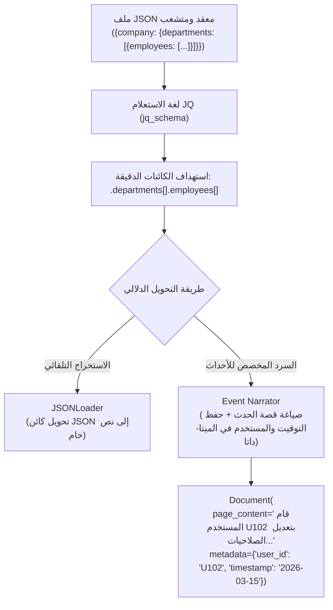

# 09 - معالجة بيانات JSON شبه المهيكلة (JSON & JQ Schemas)

تُعد صيغة `JSON (JavaScript Object Notation)` اللغة المشتركة للإنترنت وواجهات برمجة التطبيقات (`REST APIs`)، وسجلات الخوادم (`System & Audit Logs`). تتميز بيانات JSON بأنها **شبه مهيكلة (`Semi-Structured`)**؛ فهي تحتوي على كائنات متداخلة (`Nested Objects`)، ومصفوفات (`Arrays`)، ومفاتيح ديناميكية قد تختلف من سجل لآخر.

---

## 1. التحدي المعماري لاستيعاب ملفات الـ JSON في الـ RAG



---

## 2. استخراج الكائنات المتداخلة باستخدام `JSONLoader` ولغة `jq`

تعتمد LangChain على محرك `jq` (وهو معيار صناعي لمعالجة JSON في أنظمة Linux) لتحديد المسارات بدقة دون الحاجة لكتابة كود بايثون معقد:

```python
from langchain_community.document_loaders import JSONLoader

# استخراج كل موظف ككائن Document مستقل من داخل هيكل الشركة المتشعب
loader = JSONLoader(
    file_path="data/json/company_data.json",
    jq_schema=".departments[].employees[]",
    text_content=False  # تحويل الحقول النصية والرقمية معاً إلى نص المستند
)

employee_docs = loader.load()
print(f"تم استخراج {len(employee_docs)} موظف كوثائق بحثية مستقلة.")
```

---

## 3. معالجة سجلات الأحداث والتدقيق (`Audit Logs & Event Narration`)

في ملفات سجلات النظام (مثل `events.json`)، تخزين كائن الـ JSON كما هو (`{"event": "AUTH_FAILED", "ip": "192.168.1.1"}`) يجعل من الصعب على المستخدمين العاديين البحث بالأسئلة الطبيعية.

الحل الهندسي يكمن في بناء **محول سردي للأحداث (`Event Narrator`)**:

```python
import json
from langchain_core.documents import Document
from typing import List

def parse_audit_events(json_path: str) -> List[Document]:
    with open(json_path, "r", encoding="utf-8") as f:
        events = json.load(f)
        
    documents = []
    for event in events:
        # تحويل السجل إلى نص سردي إخباري كامل
        content = (
            f"في تاريخ {event['timestamp']}، تم تسجيل حدث أمني من نوع '{event['event_type']}'. "
            f"المستخدم المتأثر: {event['user_email']} من خلال عنوان IP: {event['ip_address']}. "
            f"حالة الحدث: {event['status']}. التفاصيل: {event['details']}."
        )
        
        # حفظ الحقول الزمنية والتعريفية في الميتا-داتا للبحث المفلتر
        metadata = {
            "source": json_path,
            "event_id": event["event_id"],
            "event_type": event["event_type"],
            "user_id": event["user_id"],
            "timestamp": event["timestamp"],
            "status": event["status"]
        }
        
        documents.append(Document(page_content=content, metadata=metadata))
        
    return documents
```

---

## 4. مصفوفة مقارنة استراتيجيات معالجة JSON

| الاستراتيجية | سهولة الإعداد | جودة التضمين الدلالي | دعم الفلترة الدقيقة | متى نستخدمها؟ |
| :--- | :--- | :--- | :--- | :--- |
| **التسطيح العام (`JSON Stringify`)** | فائقة (كود من سطر واحد) | ضعيفة جداً (أقواس وفواصل كثيرة) | منعدمة | الاختبارات السريعة الأولية |
| **استعلامات `jq` عبر `JSONLoader`** | متوسطة (تتطلب معرفة بصيغ jq) | جيدة جداً للكائنات المتكررة | جيدة (عبر كائنات محددة) | استخراج الكيانات من مصفوفات الـ APIs |
| **السرد المخصص (`Custom Event Narration`)** | تتطلب كتابة كود مخصص | **استثنائية ومثالية للفهم البشري** | **كاملة مع حقول فلترة دقيقة** | أنظمة تدقيق الأمان وسجلات العمليات الحساسة |

---

## 5. أسئلة المقابلات الهندسية (Senior AI Interview Questions)

### س1: لماذا يعد تضمين ملفات الـ JSON كنصوص خام (`json.dumps(obj)`) مباشراً ممارسة سيئة في RAG؟
**الإجابة:** 
1. **هدر الرموز بالضوضاء الهيكلية (`Syntactic Noise`)**: تكرار المفاتيح الإنجليزية، الأقواس المعقوفة `{}`، والفواصل `,` يستهلك مساحة نافذة التضمين دون إضافة قيمة دلالية حقيقية.
2. **ضعف التطابق الدلالي**: عندما يسأل المستخدم: *"من حاول تسجيل الدخول وفشل أمس؟"*، فإن متجه السؤال يبحث عن معانٍ لغوية، بينما المتجه الخام يحتوي على `{"status": 401, "event": "ERR_AUTH"}`، مما يخلق فجوة دلالية بين السؤال والوثيقة (`Vocabulary & Modality Mismatch`).

### س2: كيف تتعامل مع ملف JSON ضخم جداً (حجمه 5 جيجابايت) لا يتسع في ذاكرة الرام (`RAM`)؟
**الإجابة:**
بدلاً من استخدام دالة `json.load()` التي تحاول قراءة الملف كاملاً في الذاكرة:
1. استخدام مكتبات المعالجة الدفقية التكرارية (`Streaming JSON Parsers`) مثل **`ijson`**.
2. تتيح مكتبة `ijson` قراءة الكائنات واحداً تلو الآخر عبر تيار البيانات (`Streaming Iterator`)، وتحويل كل كائن إلى كائن `Document` وتضمينه في قاعدة المتجهات ثم إفراغه فوراً من الذاكرة، مما يضمن ثبات استهلاك الذاكرة تحت $50\text{ MB}$ دائماً.
