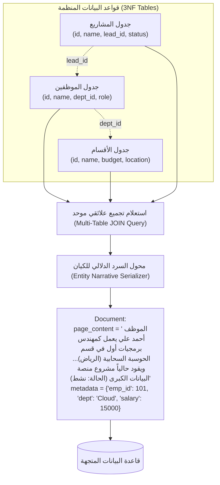

# 10 - ربط واستخراج قواعد البيانات العلائقية (Relational SQL Databases Ingestion)

تحتفظ قواعد البيانات العلائقية (`Relational SQL Databases: PostgreSQL, MySQL, SQLite`) بأثمن وأدق بيانات المؤسسات. ومع ذلك، فإن طبيعة تصميم قواعد البيانات العلائقية القائمة على قواعد التطبيع القياسية (**Third Normal Form - 3NF**) تتناقض ظاهرياً مع متطلبات الـ RAG:
* **قواعد البيانات العلائقية**: تجزئ البيانات وتوزعها عمداً عبر عشرات الجداول الصغيرة لتجنب التكرار وتسهيل التحديثات (مثل جدول الموظفين مفصول عن جدول الأقسام وجدول المشاريع).
* **منظومة الـ RAG**: تحتاج إلى فقرات نصية متكاملة ذاتية الاكتفاء (`Self-Contained Chunks`) تحتوي على القصة الكاملة للكيان في مكان واحد ليتمكن نموذج التضمين من فهمها.

---

## 1. المعمارية الهندسية لربط الجداول واستخراج الوثائق الدلالية



---

## 2. بناء استعلام الربط العلائقي (`The Relational JOIN Query`)

إذا قمنا باستخراج جدول الموظفين بمفرده، فسيكون النص: `"أحمد علي، قسم 4، مشروع 12"`. هذا النص ضعيف دلالياً لأن نموذج التضمين لا يعرف ما هو القسم 4 وما هو المشروع 12.  
الحل الهندسي هو تنفيذ استعلام تجميعي يدمج الأسماء الصريحة عبر المفاتيح الأجنبية (`Foreign Keys`):

```sql
SELECT 
    e.id AS employee_id,
    e.name AS employee_name,
    e.role AS job_title,
    e.salary,
    d.name AS department_name,
    d.location AS department_location,
    p.name AS project_name,
    p.status AS project_status
FROM employees e
JOIN departments d ON e.department_id = d.id
LEFT JOIN projects p ON e.id = p.lead_employee_id
```

---

## 3. التنفيذ البرمجي باستخدام LangChain و SQLite

```python
from langchain_community.utilities import SQLDatabase
from langchain_core.documents import Document
from typing import List

# الاتصال بقاعدة البيانات المركزية
db = SQLDatabase.from_uri("sqlite:///data/databases/company.db")

def ingest_relational_entities(db: SQLDatabase) -> List[Document]:
    query = """
    SELECT 
        e.id AS emp_id, e.name AS emp_name, e.role, e.salary,
        d.name AS dept_name, d.location,
        COALESCE(p.name, 'لا يوجد مشروع حالي') AS project_name,
        COALESCE(p.status, 'N/A') AS project_status
    FROM employees e
    JOIN departments d ON e.department_id = d.id
    LEFT JOIN projects p ON e.id = p.lead_employee_id;
    """
    
    rows = db._execute(query)
    documents = []
    
    for row in rows:
        # صياغة النص كسرد دلالي غني بالمعلومات
        content = (
            f"الموظف: {row['emp_name']}، يشغل منصب: {row['role']} في قسم: {row['dept_name']} "
            f"بمقر: {row['location']}. يقود مشروع: {row['project_name']} (حالة المشروع: {row['project_status']})."
        )
        
        # حفظ المعرفات والأرقام في الميتا-داتا
        metadata = {
            "source": "company.db",
            "employee_id": row["emp_id"],
            "department": row["dept_name"],
            "salary": float(row["salary"])
        }
        
        documents.append(Document(page_content=content, metadata=metadata))
        
    return documents
```

---

## 4. المقارنة الحاسمة: استيعاب المتجهات مقابل وكيل SQL الديناميكي (Text-to-SQL Agent)

| وجه المقارنة | استيعاب SQL في قاعدة متجهات (`SQL Vector Ingestion`) | وكيل تحويل النصوص لـ SQL (`Text-to-SQL Dynamic Agent`) |
| :--- | :--- | :--- |
| **طبيعة المعالجة** | استخراج دوري مسبق في الخلفية (`Batch Ingestion`) | استعلام حي فوري لحظة سؤال المستخدم (`Real-Time Query Generation`) |
| **طبيعة الأسئلة** | أسئلة بحث نوعي واستكشافي ("من لديه خبرة في الذكاء الاصطناعي؟") | أسئلة إحصائية، تجميعية، وعمليات حسابية ("كم موظفاً تم تعيينه في 2024؟") |
| **حداثة البيانات** | تعتمد على وتيرة تحديث الفهرس (كل ساعة أو يوم) | **لحظية 100% لأن الاستعلام يقرأ من جدول SQL الحي مباشرة** |
| **الأمان والصلاحيات** | تصفية مسبقة عبر الميتا-داتا في قاعدة المتجهات | يتطلب تطبيق صلاحيات قراءة فقط صارمة (`Read-Only User & Sandboxing`) |
| **زمن الاستجابة** | فائق السرعة ($50\text{ms} - 100\text{ms}$) | يستغرق وقتاً لكتابة الاستعلام وتنفيذه ثم تلخيصه ($2\text{s} - 5\text{s}$) |

---

## 5. أسئلة المقابلات الهندسية (Senior AI Interview Questions)

### س1: متى تفشل معمارية SQL Ingestion فشلاً ذريعاً، وتجبرك على الانتقال إلى Text-to-SQL Agent؟
**الإجابة:** 
تفشل معمارية Ingestion تماماً عندما تكون البيانات شديدة التقلب وتتغير كل ثانية (مثل منصات تداول الأسهم أو تتبع رحلات الطيران الحية)، أو عندما تتطلب أسئلة المستخدم عمليات تجميعية رياضية ضخمة (`Aggregations: GROUP BY, COUNT, SUM, AVG`).  
في هذه الحالات، لا يمكن للفهارس المتجهة حساب مجاميع دقيقة، ويصبح من الحتمي كتابة استعلام SQL حي وتمريره لمحرك قاعدة البيانات العلائقية للحصول على ناتج حسابي قطعي.

### س2: كيف تؤمن وكيل Text-to-SQL ضد هجمات حقن التعليمات الخبيثة (`SQL Injection Attacks`)؟
**الإجابة:**
1. **صلاحيات القراءة فقط (`Read-Only Credentials`)**: ربط الوكيل بحساب مستخدم لا يملك إلا صلاحية `SELECT` ومحروم تماماً من `DROP`, `DELETE`, `UPDATE`, `ALTER`.
2. **التحقق من صحة الاستعلام عبر شجرة الإعراب (`SQL AST Validation`)**: فحص الاستعلام المولد باستخدام مكتبات مثل `sqlglot` لمنع الاستعلامات المتعددة (`Multi-statement execution`) وحظر استدعاء دوال النظام التدميرية.
3. **وضع حدود قصوى للمخرجات (`Hard LIMIT Enforced`)**: إجبار كل استعلام على إضافة `LIMIT 100` لمنع سحب ملايين السجلات وإغراق الذاكرة.
