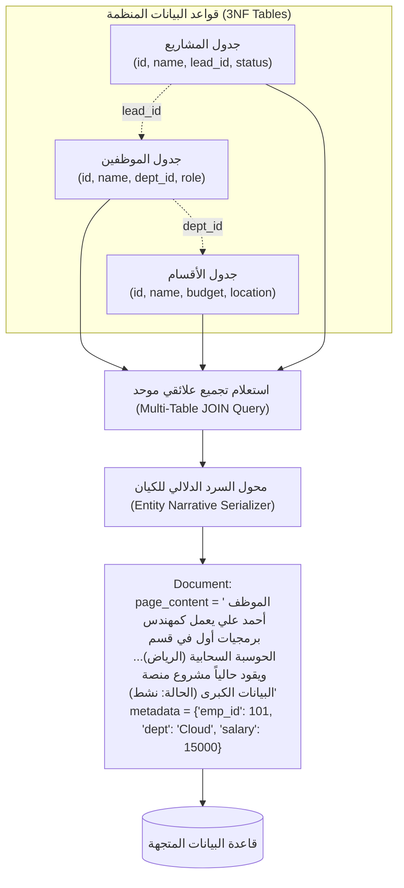

# ربط واستخراج قواعد البيانات العلائقية (Relational SQL Databases Ingestion & Denormalization)
### Architectural & Implementation Guide (`docs/01-ingestion/10-sql-databases.md`)

تحتفظ قواعد البيانات العلائقية (`Relational SQL Databases: PostgreSQL, MySQL, SQLite`) بأثمن وأدق بيانات المؤسسات. ومع ذلك، فإن طبيعة تصميم قواعد البيانات العلائقية القائمة على قواعد التطبيع القياسية (**Third Normal Form - 3NF**) تتناقض ظاهرياً مع متطلبات الـ RAG:
* **قواعد البيانات العلائقية**: تجزئ البيانات وتوزعها عمداً عبر عشرات الجداول الصغيرة لتجنب التكرار وتسهيل التحديثات (مثل فصل جدول الموظفين عن جدول الأقسام وجدول المشاريع).
* **منظومة الـ RAG**: تحتاج إلى فقرات نصية متكاملة ذاتية الاكتفاء (`Self-Contained Chunks`) تحتوي على القصة الكاملة للكيان في مكان واحد ليتمكن نموذج التضمين من فهمها دون الحاجة للبحث في 5 جداول منفصلة.

---

## 1. المعمارية الهندسية لربط الجداول واستخراج الوثائق الدلالية



---

## 2. حل معضلة التطبيع: استعلام فك التطبيع العلائقي (`Denormalization Query`)

إذا قمنا باستخراج جدول الموظفين بمفرده، فسيكون النص الناتج: `"أحمد علي، قسم 4، مشروع 12"`. هذا النص ضعيف دلالياً لأن نموذج التضمين لا يعرف ما هو القسم 4 وما هو المشروع 12.  
الحل الهندسي هو تنفيذ استعلام تجميعي يدمج الأسماء الصريحة عبر المفاتيح الأجنبية (`Foreign Keys`):

```sql
SELECT 
    e.id AS employee_id,
    e.name AS employee_name,
    e.role AS job_title,
    e.salary,
    d.name AS department_name,
    d.location AS department_location,
    p.name AS project_name,
    p.status AS project_status
FROM employees e
JOIN departments d ON e.department_id = d.id
LEFT JOIN projects p ON e.id = p.lead_employee_id
```

---

## 3. الكود التطبيقي: خط استخراج قواعد البيانات وتحويل السجلات لوثائق (SQL to Document Ingestion)

يوضح الكود التالي بناء قاعدة بيانات SQLite تجريبية، وتنفيذ استعلام الربط، وصياغة كل سجل في وثيقة سردية موثقة ببيانات وصفية رقمية:

```python
import sqlite3
from typing import List, Dict, Any
from langchain_core.documents import Document

def init_mock_enterprise_database(db_conn: sqlite3.Connection) -> None:
    """Create normalized relational tables and insert test records."""
    cursor = db_conn.cursor()
    cursor.executescript("""
        CREATE TABLE departments (
            id INTEGER PRIMARY KEY,
            name TEXT NOT NULL,
            location TEXT NOT NULL
        );

        CREATE TABLE employees (
            id INTEGER PRIMARY KEY,
            name TEXT NOT NULL,
            role TEXT NOT NULL,
            salary REAL NOT NULL,
            department_id INTEGER,
            FOREIGN KEY (department_id) REFERENCES departments (id)
        );

        CREATE TABLE projects (
            id INTEGER PRIMARY KEY,
            name TEXT NOT NULL,
            status TEXT NOT NULL,
            lead_id INTEGER,
            FOREIGN KEY (lead_id) REFERENCES employees (id)
        );

        INSERT INTO departments VALUES (1, 'Cloud Infrastructure', 'Riyadh');
        INSERT INTO departments VALUES (2, 'AI & Robotics', 'Dubai');

        INSERT INTO employees VALUES (101, 'Ahmed Ali', 'Lead Cloud Architect', 18500.0, 1);
        INSERT INTO employees VALUES (102, 'Sara Hassan', 'Principal AI Researcher', 22000.0, 2);

        INSERT INTO projects VALUES (501, 'NextGen Enterprise Data Lake', 'Active', 101);
        INSERT INTO projects VALUES (502, 'Vision RAG Assistant', 'In_Progress', 102);
    """)
    db_conn.commit()


def extract_sql_entities(db_conn: sqlite3.Connection) -> List[Document]:
    """Execute denormalizing JOIN query and serialize entities into Documents."""
    query = """
        SELECT 
            e.id AS employee_id,
            e.name AS employee_name,
            e.role AS job_title,
            e.salary,
            d.name AS department_name,
            d.location AS department_location,
            p.name AS project_name,
            p.status AS project_status
        FROM employees e
        JOIN departments d ON e.department_id = d.id
        LEFT JOIN projects p ON e.id = p.lead_id
    """
    cursor = db_conn.cursor()
    cursor.execute(query)
    rows = cursor.fetchall()

    documents = []
    for r in rows:
        emp_id, name, role, salary, dept, loc, proj, p_status = r
        
        # Construct self-contained natural language narrative
        content = (
            f"Employee Record: {name} works as {role} in the {dept} department located in {loc}. "
            f"Currently leading project '{proj}' with execution status '{p_status}'."
        )

        metadata = {
            "source": "sql://enterprise_crm",
            "employee_id": emp_id,
            "department": dept,
            "location": loc,
            "salary": float(salary),
            "project": proj,
            "project_status": p_status
        }
        documents.append(Document(page_content=content, metadata=metadata))

    return documents


# Demonstration
if __name__ == "__main__":
    conn = sqlite3.connect(":memory:")
    init_mock_enterprise_database(conn)
    
    docs = extract_sql_entities(conn)
    print(f"[*] Ingested {len(docs)} relational entities into Document objects:\n")
    for d in docs:
        print(f"Content: {d.page_content}")
        print(f"Metadata: {d.metadata}\n")
    conn.close()
```

---

## 4. الممارسات الهندسية الفضلى لربط قواعد البيانات

1. **الاستخراج الدوري الدفعي (`Batch Syncing via CDC`)**: في قواعد البيانات الضخمة التي تحتوي على ملايين السجلات، استخدم تقنية `Change Data Capture (CDC)` مثل Debezium لاستخراج السجلات المعدلة أو المضافة حديثاً فقط بدلاً من إعادة قراءة قاعدة البيانات بالكامل.
2. **عزل الصلاحيات واستبعاد الحقول الحساسة**: تأكد دائماً من استبعاد أرقام الحسابات البنكية، كلمات المرور، أو بطاقات الائتمان من استعلام الـ SQL الموجه لمنظومة الـ RAG، وتثبيت مستويات الصلاحية في الميتاداتا.
