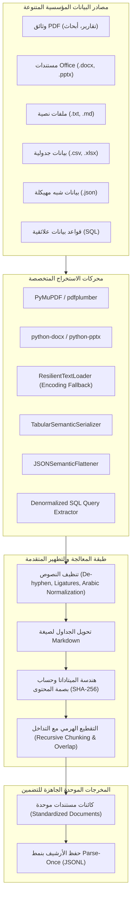

# المرحلة 01: معالجة واستيعاب البيانات (Data Ingestion & Parsing)
### Comprehensive Architectural Guide (`docs/01-ingestion/`)

تمثل هذه المرحلة حجر الأساس لمنظومة الـ RAG، حيث تركز على كيفية استيراد وتحليل وتطهير وتجزئة مختلف أنواع مصادر البيانات المؤسسية (غير المهيكلة، شبه المهيكلة، والمهيكلة) وتحويلها إلى كائنات مستندات قياسية مهيأة للفهرسة والبحث الدلالي، مع ترسيخ مبدأ **التركيز على المعنى والهدف الهندسي المدعوم بالأكواد التنفيذية**.

---

## 🏛️ مخطط المعمارية الشاملة لخط استيعاب البيانات (Ingestion Architecture)

---

## فهرس الأدلة المعمارية والمفاهيمية للمرحلة

| الرقم | المفهوم والمعنى الهندسي | الوثيقة المعمارية (`docs/`) | الكود التطبيقي المدمج |
| :---: | :--- | :--- | :--- |
| **01** | **إدارة بيئة العمل والتحكم في الاعتماديات عبر UV** | [`01-environment-setup.md`](./01-environment-setup.md) | أداة فحص واختبار صحة بيئة الـ RAG (`check_rag_environment`) |
| **02** | **بنية كائن المستند وهندسة البيانات الوصفية** | [`02-document-structure.md`](./02-document-structure.md) | منشئ المستندات مع التدقيق الأمني وحساب البصمة الرقمية |
| **03** | **قراءة الملفات النصية واستراتيجيات الترميز** | [`03-text-loaders.md`](./03-text-loaders.md) | محمل نصوص ذكي مع Fallback متعدد للترميز والتحميل الكسول |
| **04** | **استراتيجيات تقطيع النصوص وهندسة التداخل** | [`04-text-splitting.md`](./04-text-splitting.md) | مقارنة عملية بين التقطيع الهرمي والتقطيع بالأحرف والتوكنز |
| **05** | **أساسيات قراءة ملفات الـ PDF والمقارنة الهندسية** | [`05-pdf-parsing.md`](./05-pdf-parsing.md) | مقارنة حية بين محركات استخراج الـ PDF (PyMuPDF vs PyPDF) |
| **06** | **معالجة التحديات المتقدمة في الـ PDF وتنظيف النصوص** | [`06-pdf-advanced-issues.md`](./06-pdf-advanced-issues.md) | محرك فك الوصلات والرموز المدمجة وتطبيع النصوص العربية |
| **07** | **معالجة مستندات الأوفيس: وورد وعروض الباوربوينت** | [`07-word-documents.md`](./07-word-documents.md) | مستخرج DOCX مع تحويل الجداول لـ Markdown ومستخرج شرائح PPTX |
| **08** | **معالجة البيانات الجدولية: ملفات CSV وإكسل** | [`08-csv-excel.md`](./08-csv-excel.md) | محول الجداول إلى وثائق سردية ذات ميتاداتا رقمية مهيكلة |
| **09** | **معالجة بيانات JSON شبه المهيكلة** | [`09-json-processing.md`](./09-json-processing.md) | مسطح كائنات الـ JSON المتداخلة ومحول سجلات الأحداث |
| **10** | **ربط واستخراج قواعد البيانات العلائقية** | [`10-sql-databases.md`](./10-sql-databases.md) | استعلام فك التطبيع العلائقي (JOIN) وتحويل السجلات لوثائق |
| **دليل** | **الدليل الشامل المرجعي لخط إدخال البيانات** | [`STAGE_01_INGESTION_GUIDE.md`](./STAGE_01_INGESTION_GUIDE.md) | الدليل التراكمي الشامل لكافة أدوات ومعامل المرحلة الأولى |

---

## القواعد الهندسية الصارمة للمرحلة (Engineering Principles)

1. **مبدأ Parse Once to JSON**: استخرج المستندات المعقدة مرة واحدة فقط واحفظها بصيغة JSON/JSONL موحدة؛ لا تعد استخراج ملفات الـ PDF و Word في كل تشغيل.
2. **التمثيل المزدوج (`Dual Representation`)**: احفظ النص المنظف الطبيعي في `page_content` للـ LLM، واحفظ النص المطبع الخالي من التشكيل والزوائد في `metadata["search_text"]` للبحث المعجمي السريع.
3. **عدم إهدار العلاقات الجدولية**: لا تستخرج الجداول كنصوص مسطحة؛ حولها دائماً لجداول Markdown أو لسرد دلالي يحافظ على علاقة كل رقم برأس عموده واسم صفه.
