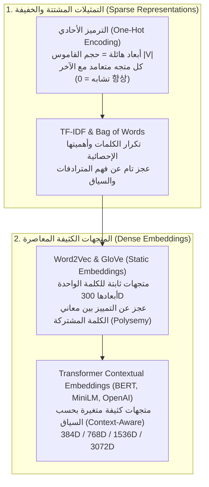

# 01 - مقدمة في التضمينات وفضاء المتجهات (Introduction to Vector Embeddings)

تُمثل **التضمينات الدلالية (`Vector Embeddings`)** حجر الأساس والمدخل الرياضي الوحيد الذي يُمكّن الحواسيب والخوارزميات من "فهم" المعنى البشري المجرد. فالنماذج الحاسوبية بطبيعتها آلات جبر خطي تتعامل مع الأرقام والمصفوفات، ولا تفهم الحروف والكلمات كمعانٍ قائمة بذاتها.

إذا أردنا لمنظومة `RAG` أن تبحث عن إجابة سؤال المستخدم بذكاء، فلا يمكننا الاعتماد على مجرد البحث عن الكلمات المتطابقة حرفياً (`Keyword Matching`)، بل نحتاج إلى إسقاط النصوص في **فضاء هندسي مستمر متعدد الأبعاد (`Continuous Latent Vector Space`)** بحيث تتجاور الأفكار المتشابهة دلالياً وتتباعد الأفكار المتنافرة.

---

## 1. التطور التاريخي: من التمثيلات الخفيفة إلى المتجهات الكثيفة

---

## 2. المقارنة الرياضية بين التمثيلات المشتتة والكثيفة

| وجه المقارنة | التمثيلات المشتتة (`Sparse: One-Hot / BM25`) | التضمينات الكثيفة (`Dense Embeddings: Transformers`) |
| :--- | :--- | :--- |
| **عدد الأبعاد ($d$)** | ضخم جداً ويساوي حجم القاموس الكامل ($|V| \approx 50,000 - 500,000$) | ثابت ومتوسط الحجم ($d \in [384, 3072]$) |
| **طبيعة القيم** | أصفار شبه كاملة (أكثر من 99.9% من الخلايا قيمتها صفر) | أعداد حقيقية عائمة مستمرة ($\mathbf{v} \in \mathbb{R}^d$ وجميع الخلايا غير صفرية) |
| **فهم الترادف الدلالي** | مستحيل (كلمة "سيارة" متعامدة هندسياً 100% مع "مركبة" والضرب الداخلي بينهما صفر) | ممتاز ("سيارة" و "مركبة" متقاربان جداً بزاوية حادة) |
| **الحساسية للسياق** | منعدمة (الكلمة تمثل بنفس الرقم بغض النظر عن موقعها) | ديناميكية (كلمة "بنك" في "بنك الدم" تختلف متجهياً عن "بنك الائتمان") |
| **استهلاك الذاكرة والحوسبة** | فهارس معكوسة خفيفة على القرص | تتطلب قواعد بيانات متجهة وفهارس `ANN` متخصصة |

---

## 3. الهندسة الخطية للفضاء الكامن (`Latent Space Geometry`)

الميزة الاستثنائية للتضمينات الكثيفة هي أن العلاقات الدلالية بين الكلمات والمفاهيم تتحول إلى **إزاحات متجهة متوازية (`Vector Arithmetic`)**:

$$\vec{v}(\text{"King"}) - \vec{v}(\text{"Man"}) + \vec{v}(\text{"Woman"}) \approx \vec{v}(\text{"Queen"})$$

وكذلك في العلاقات الجغرافية واللغوية:
$$\vec{v}(\text{"Paris"}) - \vec{v}(\text{"France"}) + \vec{v}(\text{"Japan"}) \approx \vec{v}(\text{"Tokyo"})$$

هذا الانتظام الخطي يعني أن الفضاء الرياضي يتعلم المفاهيم الدلالية المجردة (مثل الجنس، والعاصمة، وصيغ الجمع، ونبرة الحديث) كمتجهات اتجاهية داخل الفضاء الكامن $\mathbb{R}^d$.

---

## 4. خط أنابيب استخراج التضمين من نماذج المحولات (Transformer Embedding Pipeline)

كيف يتحول مقطع نصي مكون من 100 كلمة إلى متجه واحد بطول 384 أو 1536 رقماً؟

### أ. التجميع بمتوسط الإشارات (`Mean Pooling`):
تخرج مصفوفة الحالات المخفية من المحول بأبعاد $L \times d$ (حيث $L$ طول الرموز و $d$ البعد الكامن). نقوم بحساب المتوسط الرياضي لمتجهات الرموز الصالحة مع تطبيق قناع الانتباه (`Attention Mask` $m_i \in \{0, 1\}$) لاستبعاد رموز الحشو (`Padding`):

$$\mathbf{v}_{\text{pooled}} = \frac{\sum_{i=1}^L m_i \cdot \mathbf{h}_i}{\sum_{i=1}^L m_i}$$

### ب. التطبيع الإقليدي (`L2 Normalization`):
نقوم بقسمة المتجه على معياره الإقليدي لتحويله إلى متجه وحدة ($\|\mathbf{v}\|_2 = 1$):
$$\mathbf{v}_{\text{normalized}} = \frac{\mathbf{v}}{\sqrt{\sum_{j=1}^d v_j^2}}$$

هذه الخطوة ضرورية جداً لأنها تجعل حساب تشابه جيب التمام (`Cosine Similarity`) مجرد حاصل ضرب قياسي فائق السرعة (`Dot Product`).

---

## 5. مصفوفة المفاضلة في أبعاد نماذج التضمين (Dimensionality Trade-offs)

| عدد الأبعاد ($d$) | نماذج شهيرة | استهلاك الذاكرة لكل 1M متجه | دقة التمييز الدلالي | سرعة البحث | الاستخدام المثالي |
| :--- | :--- | :--- | :--- | :--- | :--- |
| **384D** | `all-MiniLM-L6-v2` | $\approx 1.5\text{ GB}$ | ممتازة للمهام العامة والبحث المباشر | فائقة جداً | الأنظمة التي تعمل محلياً ومحدودة الموارد |
| **768D** | `bge-base-en`, `BERT` | $\approx 3.0\text{ GB}$ | عالية جداً | سريعة | المؤسسات ذات الوثائق الفنية المتخصصة |
| **1024D** | `bge-large-en`, `E5-Mistral` | $\approx 4.0\text{ GB}$ | فائقة في فهم المصطلحات المركبة | متوسطة | الأبحاث العلمية والوثائق الطبية والقانونية |
| **1536D / 3072D** | OpenAI `text-embedding-3-*` | $\approx 6.0\text{ GB} - 12\text{ GB}$ | استثنائية مع دعم تعدد اللغات | معتدلة (تتطلب تسريع GPU/AVX) | التطبيقات السحابية متعددة اللغات الشاملة |

---

## 6. أسئلة المقابلات الهندسية (Senior AI Interview Questions)

### س1: ما هي مشكلة "لعنة الأبعاد" (`Curse of Dimensionality`) في فضاءات المتجهات الكبيرة، وكيف تؤثر على البحث الدلالي؟
**الإجابة:** 
عندما يرتفع عدد الأبعاد $d$ إلى قيم ضخمة جداً (أكثر من 10,000 بُعد):
1. تصبح المسافات الإقليدية بين أي نقطتين عشوائيتين متقاربة جداً وتتلاشى الفروق النسبية بين الجار الأقرب والجار الأبعد:
   $$\lim_{d \to \infty} \frac{\text{dist}_{\max} - \text{dist}_{\min}}{\text{dist}_{\min}} \to 0$$
2. يصبح البحث الخطي بطيئاً جداً، وتنهار كفاءة هياكل البيانات التقليدية (مثل `k-d trees`).
3. **الحل في الـ RAG**: الاعتماد على فضاءات متوسطة الأبعاد ($d \in [384, 1536]$)، واستخدام خوارزميات الفهرسة التقريبية مثل `HNSW`، وتطبيق تقنيات تقليص الأبعاد مثل `PCA` أو تمثيلات ماتريوشكا (`Matryoshka Embeddings`).

### س2: لماذا لا نستخدم مخرجات الرمز الأخير أو الرمز الأول `[CLS]` مباشرة دون Mean Pooling في نماذج مثل MiniLM؟
**الإجابة:**
تم تدريب رمز `[CLS]` في نموذج BERT الأصلي لمهمة تصنيف النصوص الثنائية (`NSP / Sequence Classification`). أثبتت أبحاث `Sentence-BERT` (Reimers et al., 2019) أن استخدام متجه `[CLS]` وحده لتمثيل جملة كاملة يعطي تمثيلات دلالية سيئة جداً تكاد تكون أسوأ من مجرد حساب متوسط متجهات الكلمات القديمة مثل GloVe.  
في المقابل، فإن **`Mean Pooling`** يقوم بتجميع إشارات الانتباه الذاتي لجميع رموز الجملة مما يعكس السياق الشامل للنص بأكمله بدقة متفوقة.
