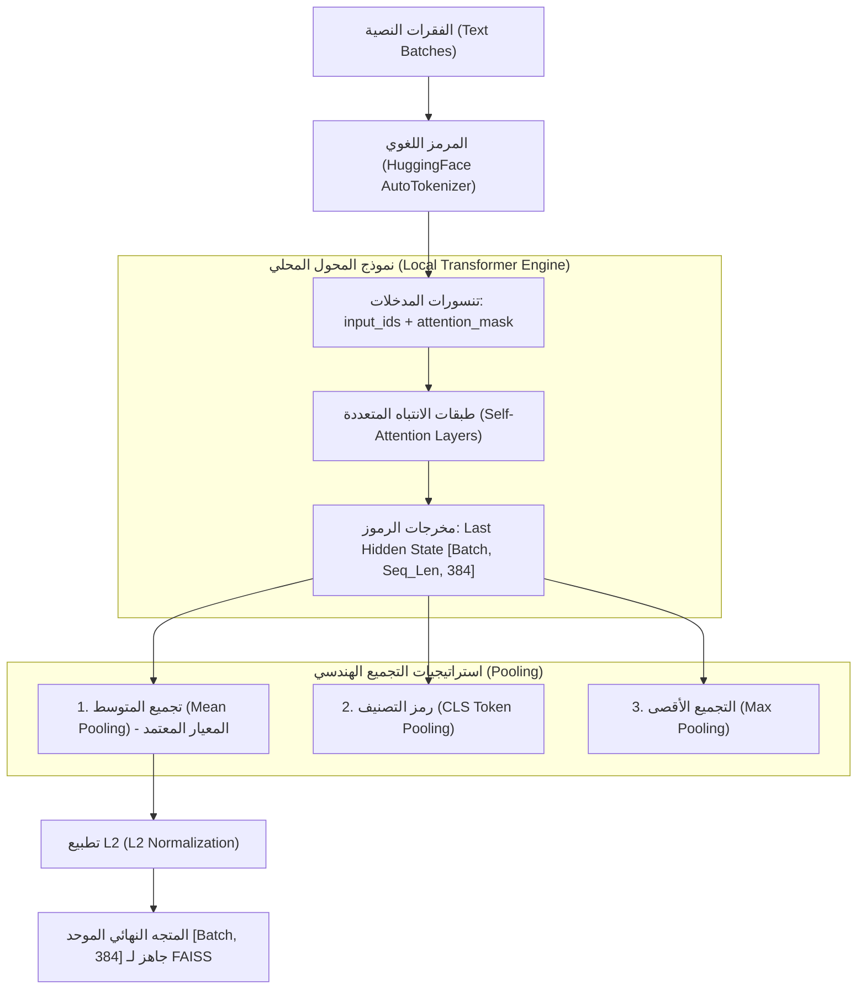

# 03 - نماذج التضمين المحلية عبر HuggingFace (HuggingFace Local Embeddings)

في تطبيقات الـ RAG المؤسسية الحساسة (مثل القطاعات المصرفية، الطبية، والهيئات الحكومية)، تفرض تشريعات حماية البيانات الصارمة (مثل `GDPR`, `HIPAA`, و `PCI-DSS`) حظر إرسال وثائق وسجلات العملاء إلى واجهات برمجية سحابية خارجية (`Third-Party APIs`).  

هنا يبرز دور **نماذج التضمين مفتوحة المصدر (`Open-Weight Embedding Models`)** المتاحة عبر مستودع `HuggingFace` ومكتبة `Sentence-Transformers`. تتيح هذه النماذج تشغيل كامل عمليات التضمين محلياً داخل مراكز بيانات المؤسسة دون أي اتصال خارجي بالإنترنت، وبصفر تكلفة اشتراكات أو رسوم استهلاك.

---

## 1. مخطط تدفق التضمين المحلي وتجميع الرموز (Local Pooling Pipeline)



---

## 2. دراسة متعمقة لنموذج `all-MiniLM-L6-v2` (المعيار الصناعي الخفيف)

يُعد نموذج **`sentence-transformers/all-MiniLM-L6-v2`** النموذج الأكثر انتشاراً واعتماداً في بيئات التطوير والاختبار والإنتاج خفيف الموارد للأسباب التالية:
* **الأصل المعماري**: نسخة مقطرة ومضغوطة (`Distilled Model`) من نموذج BERT، مطورة لتقليل استهلاك الذاكرة دون التضحية بالدقة الدلالية.
* **المواصفات التقنية**:
  * عدد الطبقات: 6 طبقات محول (`Transformer Layers`).
  * بعد الفضاء الكامن ($d$): **384 بُعداً**.
  * عدد المعاملات (`Parameters`): **22.7 مليون معامل** فقط (مقارنة بـ 110 مليون في BERT-base).
  * حجم ملف الأوزان على القرص: **حوالي 90 ميجابايت**.
  * الإنتاجية الحسابية: أكثر من **14,200 جملة في الثانية** على كرت شاشة V100، وعشرات الجمل في الثانية على المعالجات العادية (`CPU`).

---

## 3. أشهر نماذج التضمين على مؤشر MTEB العالمي

لوحة صدارة تقييم التضمينات النصية الضخمة (**Massive Text Embedding Benchmark - MTEB**) هي المرجع القياسي لتقييم كفاءة النماذج عبر مهام الاسترجاع، التصنيف، وإعادة الترتيب:

| اسم النموذج | الشركة / الجهة المطورة | عدد الأبعاد ($d$) | أقصى نافذة سياق | الأداء على MTEB Retrieval | الميزة التنافسية |
| :--- | :--- | :--- | :--- | :--- | :--- |
| **`all-MiniLM-L6-v2`** | `Sentence-Transformers` | 384 | 256 توكن | 41.95 (جيد) | فائق السرعة، خفيف جداً، صفر استهلاك للرام |
| **`bge-small-en-v1.5`** | `BAAI (Beijing AI)` | 384 | 512 توكن | 49.11 (ممتاز) | أفضل توازن بين السرعة والدقة في فئة 384D |
| **`bge-large-en-v1.5`** | `BAAI` | 1024 | 512 توكن | 54.29 (فائق) | دقة متناهية تتفوق على نماذج تجارية كثيرة |
| **`multilingual-e5-large`** | `Microsoft Research` | 1024 | 512 توكن | 51.50 (متعدد اللغات) | دعم استثنائي للغة العربية وأكثر من 100 لغة |
| **`nomic-embed-text-v1.5`** | `Nomic AI` | 768 (مرن) | 8192 توكن | 52.80 (سياق طويل) | يدعم تمثيلات ماتريوشكا ونافذة سياق 8k |

---

## 4. التنفيذ البرمجي المعتمد في LangChain مع HuggingFace

لضمان عمل الكود محلياً دون أي اعتماد على سيرفرات خارجية أو مفاتيح API، نستخدم مكتبة `langchain_huggingface`:

```python
from langchain_huggingface import HuggingFaceEmbeddings
import torch

# الكشف التلقائي عن تسريع كروت الشاشة GPU أو المعالج CPU
device = "cuda" if torch.cuda.is_available() else "cpu"

embeddings = HuggingFaceEmbeddings(
    model_name="sentence-transformers/all-MiniLM-L6-v2",
    model_kwargs={"device": device},
    encode_kwargs={
        "normalize_embeddings": True,  # تطبيع المتجهات تلقائياً لحساب Cosine بـ Dot Product
        "batch_size": 64               # التضمين على دفعات لتحقيق أقصى استغلال للمعالج
    }
)

# اختبار التضمين
vector = embeddings.embed_query("ما هي معمارية الـ RAG؟")
print(f"طول المتجه: {len(vector)} بعداً. المعيار الإقليدي: {sum(x**2 for x in vector):.4f}")
```

---

## 5. استراتيجيات تسريع التضمين المحلي في الإنتاج (Optimization)

عند تضمين ملايين الوثائق داخل الشركة، يمكن مضاعفة سرعة الاستدلال حتى $5\times$ إلى $10\times$ عبر:
1. **المعالجة على دفعات متوازية (`Batching`)**: تمرير 64 أو 128 وثيقة دفعة واحدة بدلاً من التكرار التسلسلي بحلقة `for`.
2. **الدقة النصفية المختلطة (`FP16 Mixed Precision`)**: استخدام `torch.float16` بدلاً من `float32`، مما يقلل استهلاك ذاكرة الـ VRAM إلى النصف ويضاعف سرعة نوى التنسور (`Tensor Cores`).
3. **التكميم والتسريع بمحرك ONNX Runtime (`Quantization to INT8`)**: تحويل النموذج إلى أوزان ثنائية البايت ليعمل على معالجات السيرفرات العادية (`CPU`) بسرعة تقارب كروت الشاشة.

---

## 6. أسئلة المقابلات الهندسية (Senior AI Interview Questions)

### س1: ما الفارق الدلالي بين دالة `embed_documents` ودالة `embed_query` في مكتبات LangChain ولماذا تفصلهما نماذج BGE و E5؟
**الإجابة:** 
* في نماذج التضمين القديمة المتماثلة (`Symmetric Search`)، كان السؤال والوثيقة يعاملان بنفس الطريقة تماماً.
* في النماذج الحديثة غير المتماثلة (`Asymmetric Retrieval: BGE, E5`)، يختلف السؤال (القصير والاستفهامي) عن الوثيقة (الطويلة والتقريرية).  
لذلك تتطلب نماذج مثل `bge` إضافة بادئة توجيهية (`Instruction Prefix`) للاستعلام:
  ```python
  # في استعلام المستخدم فقط:
  query_prefix = "Represent this sentence for searching relevant passages: "
  ```
  بينما تخزن الوثائق بدون بادئة.  
  تفصل LangChain بين `embed_query` (لإضافة البادئة التوجيهية وتعديل السياق) وبين `embed_documents` (لتضمين الوثائق الخام بكفاءة دفعية).

### س2: متى تقرر كمهندس ذكاء اصطناعي التخلي عن النماذج السحابية (مثل OpenAI) والاعتماد حصرياً على HuggingFace المحلي؟
**الإجابة:**
1. **متطلبات السيادة على البيانات والامتثال (`Data Sovereignty & Privacy`)**: عند التعامل مع بيانات خاضعة لسرية المحامين، أو سجلات المرضى الطبية، أو أسرار الدفاع الوطني التي يحظر خروجها من شبكة الـ Intranet.
2. **اقتصاديات الحجم الكبير (`High-Volume Economics`)**: إذا كان النظام يضمن مئات الملايين من الوثائق شهرياً، تصبح تكلفة شراء أو استئجار خادم GPU محلي أرخص بعشرات المرات من دفع فواتير شهرية متجددة للـ APIs.
3. **الحماية من انقطاع الخدمة والـ Rate Limits**: التضمين المحلي يعمل بلا قيود حصص (Rate Limits) ولا يتأثر بتعطل خوادم المزودين الخارجيين.
