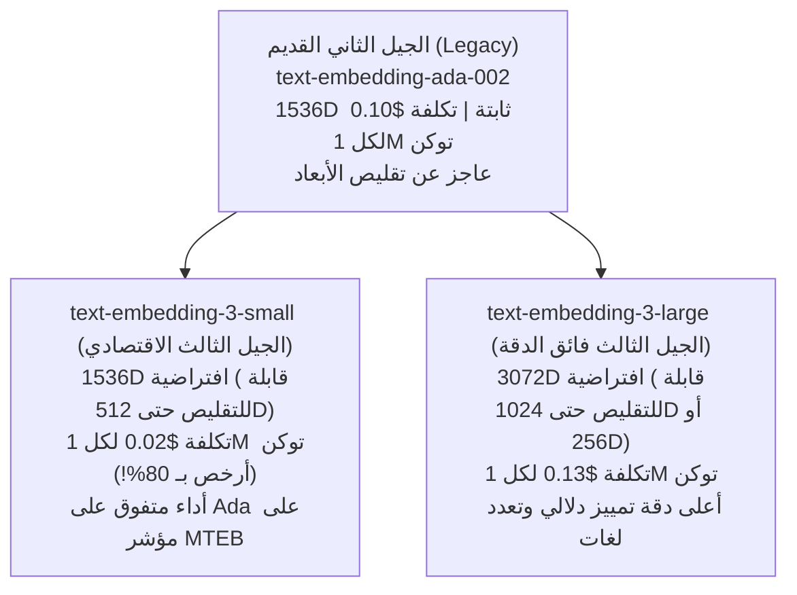
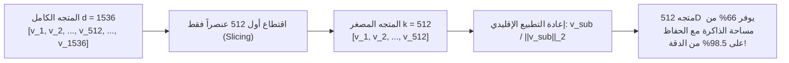

# 04 - نماذج التضمين التجارية وتقنية ماتريوشكا (Commercial Embeddings & Matryoshka)

تُمثل نماذج التضمين التجارية المدارة سحابياً (`Commercial Cloud Embedding APIs`)، وعلى رأسها نماذج شركة `OpenAI` و `Cohere` و `Google Vertex AI`، الخيار الأكثر اعتماداً لدى الشركات الناشئة والمؤسسات الساعية لسرعة الإطلاق (`Fast Time-to-Market`) دون الحاجة لإدارة خوادم حوسبة محلية أو صيانة كروت شاشة (`GPU Orchestration`).

في الجيل الثالث من نماذج OpenAI (`text-embedding-3`)، تم تقديم ابتكار رياضي ثوري يُعرف بـ **تعلم تمثيلات ماتريوشكا (`Matryoshka Representation Learning - MRL`)**، والذي يحل معضلة التكلفة وتضخم حجم قواعد البيانات المتجهة.

---

## 1. عائلة نماذج التضمين من OpenAI: مقارنة الأجيال



---

## 2. تقنية تمثيلات ماتريوشكا الرياضية (Matryoshka Representation Learning - MRL)

سُميت التقنية تيمناً بالدمية الروسية الشهيرة **"ماتريوشكا"** (الدمى المتداخلة داخل بعضها البعض):



### أ. كيف تعمل التقنية أثناء تدريب النموذج؟
في النماذج التقليدية، تتوزع المعلومات الدلالية بشكل عشوائي عبر كافة أبعاد المتجه (من البعد 1 إلى 1536). إذا قمت بحذف آخر 1000 بعد، ينهار المتجه ويفقد معناه تماماً.

أما في تدريب **MRL** (Kusupati et al., NeurIPS 2022)، يتم تدريب النموذج بدالة خسارة هرمية متعددة الفروع (`Multi-Scale Loss Function`):
$$\mathcal{L}_{\text{MRL}} = \sum_{m \in \{64, 128, 256, 512, 1024, 1536\}} \lambda_m \cdot \mathcal{L}_{\text{Contrastive}}(\mathbf{v}_{1:m})$$

هذا يجبر النموذج على **تركيز أهم المفاهيم الدلالية الجوهرية في الأبعاد الأولى** للمتجه، بينما تخصص الأبعاد اللاحقة للتفاصيل الفنية الدقيقة!

### ب. الكود البرمجي لتقليص الأبعاد عبر OpenAI API:
```python
from langchain_openai import OpenAIEmbeddings

# تقليص المتجه من 1536 بعداً إلى 512 بعداً برمجياً
embeddings_512 = OpenAIEmbeddings(
    model="text-embedding-3-small",
    dimensions=512  # تقليص استهلاك الرام بنسبة 66%!
)

vector = embeddings_512.embed_query("تطبيق البحث الدلالي في قطاع البنوك")
print(f"طول المتجه بعد تقنية ماتريوشكا: {len(vector)} بعداً.")
```

---

## 3. الأثر الهندسي لتقنية MRL على تكاليف البنية التحتية

| المعيار | `text-embedding-ada-002` | `text-embedding-3-small` (1536D) | `text-embedding-3-small` (512D عبر MRL) |
| :--- | :--- | :--- | :--- |
| **عدد الأبعاد** | 1536 | 1536 | **512 (انخفاض 66%)** |
| **حجم فهرس 10M متجه في RAM** | $\approx 61.4\text{ GB}$ | $\approx 61.4\text{ GB}$ | **$\approx 20.5\text{ GB}$ فقط!** |
| **تكلفة خادم قاعدة البيانات شهرياً** | $\approx \$450 / \text{mo}$ | $\approx \$450 / \text{mo}$ | **$\approx \$150 / \text{mo}$ (توفير \$3,600 سنوياً!)** |
| **دقة الاسترجاع على MTEB** | 61.0% | 62.3% | **61.6% (فقدان 0.7% فقط من الدقة!)** |
| **زمن استجابة البحث (Latency)** | $45\text{ms}$ | $45\text{ms}$ | **$18\text{ms}$ (أسرع بأكثر من ضعفين!)** |

---

## 4. المقارنة الهندسية الشاملة: النماذج المحلية مقابل السحابية

| المعيار | نماذج HuggingFace المحلية (`MiniLM / BGE`) | نماذج السحابة التجارية (`OpenAI / Cohere`) |
| :--- | :--- | :--- |
| **الخصوصية والأمان** | **مطلقة 100% (تعمل داخل شبكة الشركة المنعزلة)** | البيانات ترسل لخوادم خارجية خاضعة لسياسات المزود |
| **تكلفة الاستدعاء المباشر** | **صفر دولار (\$0 per API call)** | رسوم لكل مليون رمز (\$0.02 إلى \$0.13) |
| **تكلفة البنية التحتية** | تتطلب خوادم مجهزة بمعالجات قوية أو GPU | صفر بنية تحتية (Serverless API) |
| **إدارة الأحمال والحصص (Rate Limits)** | لا توجد حدود (تعتمد على قوة خوادمك فقط) | قيود على عدد الطلبات في الدقيقة (RPM / TPM) |
| **دعم تعدد اللغات (Multilingual)** | يتطلب نماذج محددة (مثل `e5-multilingual`) | **فائق ومدمج افتراضياً لأكثر من 100 لغة** |
| **الصيانة والتحديثات** | يدوية على مهندس الذكاء الاصطناعي | مدارة وتلقائية من مزود الخدمة |

---

## 5. أسئلة المقابلات الهندسية (Senior AI Interview Questions)

### س1: كيف تستغل تقنية MRL لبناء معمارية بحث على مرحلتين فائقة السرعة (`Two-Stage Adaptive Search`)؟
**الإجابة:** 
1. **المرحلة الأولى (Fast Candidate Generation)**: نقتطع أول 256 بعداً فقط من المتجهات ونفهرسها في ذاكرة الرام السريعة. عندما يصل استعلام المستخدم، نجري بحث $k$-NN سريعاً جداً لاسترجاع أفضل 100 مرشح في أجزاء من الميلي ثانية.
2. **المرحلة الثانية (Precision Reranking)**: نأتي بالمتجهات الكاملة (1536 أو 3072 بعداً) لأول 100 مرشح فقط من التخزين البارد (`SSD / S3`)، ونعيد حساب المسافة الدقيقة لاختيار أفضل 5 فقرات لتقديمها للـ LLM.  
*النتيجة*: الحصول على سرعة فضاء 256D مع دقة الفضاء الكامل 1536D!

### س2: ما هي استراتيجيات التعامل الدفاعي مع أخطاء `RateLimitError (429)` عند تضمين مستندات ضخمة عبر OpenAI API؟
**الإجابة:**
1. **التراجع الأسي شبه العشوائي (`Exponential Backoff with Jitter`)**: إعادة المحاولة بانتظار $2^n \pm \text{random}$ ثانية لتفادي اصطدام المحاولات المتزامنة.
2. **تقسيم الحزم الذكي (`Chunk Batching`)**: حساب عدد التوكنز مسبقاً وتجميع الوثائق بحيث لا تتجاوز الدفعة الواحدة 8,000 توكن وتظل تحت حد `TPM`.
3. **التضمين غير المتزامن الموزع (`Async / Semaphore Throttling`)**: استخدام `asyncio.Semaphore(max_concurrent=10)` لتقييد عدد الطلبات المتزامنة الصادرة للـ API.
