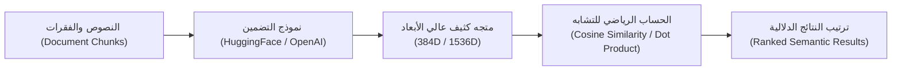

# المرحلة 02: التضمينات وفضاء المتجهات (Vector Embeddings)
### Comprehensive Architectural Guide (`docs/02-vector-embeddings/`)

المرحلة الثانية في مسار RAG Mastery، وتغطي **القسم السادس من الكورس (Section 6: Vector Embeddings - المحاضرات 19 إلى 23)**.

تهتم هذه المرحلة بتحويل النصوص والوثائق (`Document Chunks`) إلى متجهات عددية كثيفة (`Dense Vectors`) في فضاء رياضي متعدد الأبعاد، بحيث تعبر الزاوية والمسافة بين المتجهات عن درجة التشابه الدلالي في المعنى الحقيقي.

---

## 1. الأساس الرياضي للمتجهات والتشابه الدلالي

### أ. تشابه جيب التمام (Cosine Similarity)
يقيس الزاوية $\theta$ بين المتجهين $\mathbf{u}$ و $\mathbf{v}$ بغض النظر عن طولهما (المعيار الأكثر استخداماً في الـ RAG):
$$\text{Cosine Similarity}(\mathbf{u}, \mathbf{v}) = \cos(\theta) = \frac{\mathbf{u} \cdot \mathbf{v}}{\|\mathbf{u}\| \|\mathbf{v}\|} = \frac{\sum_{i=1}^{d} u_i v_i}{\sqrt{\sum_{i=1}^{d} u_i^2} \sqrt{\sum_{i=1}^{d} v_i^2}}$$
* القيمة $1.0$: تطابق تام في الاتجاه والمعنى.
* القيمة $0.0$: تعامد تام (انعدام الصلة الدلالية).
* القيمة $-1.0$: تضاد تام في الاتجاه.

### ب. الجداء الداخلي السريع (Dot Product on Normalized Vectors)
عند تطبيع المتجهات مسبقاً بحيث تصبح متجهات وحدة ($\|\mathbf{u}\| = 1$ و $\|\mathbf{v}\| = 1$)، يتحول حساب تشابه جيب التمام إلى جداء داخلي مباشر:
$$\text{Cosine Similarity}(\mathbf{u}, \mathbf{v}) = \mathbf{u} \cdot \mathbf{v} = \sum_{i=1}^{d} u_i v_i$$
وهو ما يتيح لقواعد بيانات الفيكتورز إجراء ملايين المقارنات في أجزاء من الثانية باستخدام تسريع الـ BLAS والـ AVX.

---

## 2. المعمارية العامة للمرحلة

---

## 3. فهرس موضوعات ومشاريع المرحلة

| الرقم | عنوان المشروع البرمجي | المحاضرة المقابلة | الشرح المعماري (`docs/`) | الكود المرجعي (`stages/`) | معمل التجربة (`playground/`) | الحالة |
| :---: | :--- | :---: | :---: | :---: | :---: | :---: |
| 01 | **مقدمة في التضمينات وفضاء المتجهات** | Lecture 19 | [شرح الدرس 01](#1-الأساس-الرياضي-للمتجهات-والتشابه-الدلالي) | [`stages/02/.../01-...ipynb`](../../stages/02-vector-embeddings/01-intro-to-embeddings/01-intro-to-embeddings.ipynb) | [`playground/02/.../01-...ipynb`](../../playground/02-vector-embeddings/01-intro-to-embeddings.ipynb) | [x] مكتمل |
| 02 | **التمثيل البصري للتضمينات وحساب جيب التمام** | Lecture 20 | [شرح الدرس 02](#أ-تشابه-جيب-التمام-cosine-similarity) | [`stages/02/.../02-...ipynb`](../../stages/02-vector-embeddings/02-visualization-cosine-similarity/02-visualization-cosine-similarity.ipynb) | [`playground/02/.../02-...ipynb`](../../playground/02-vector-embeddings/02-visualization-and-similarity.ipynb) | [x] مكتمل |
| 03 | **إنشاء التضمينات بنماذج HuggingFace** | Lecture 21 | [شرح الدرس 03](#ب-الجداء-الداخلي-السريع-dot-product-on-normalized-vectors) | [`stages/02/.../03-...ipynb`](../../stages/02-vector-embeddings/03-huggingface-embeddings/03-huggingface-embeddings.ipynb) | [`playground/02/.../03-...ipynb`](../../playground/02-vector-embeddings/03-huggingface-embeddings.ipynb) | [x] مكتمل |
| 04 | **تضمينات OpenAI والبحث الدلالي العملي** | Lectures 22 & 23 | [شرح الدرس 04](#2-المعمارية-العامة-للمرحلة) | [`stages/02/.../04-...ipynb`](../../stages/02-vector-embeddings/04-openai-embeddings/04-openai-embeddings.ipynb) | [`playground/02/.../04-...ipynb`](../../playground/02-vector-embeddings/04-openai-and-semantic-search.ipynb) | [x] مكتمل |

---

## 4. المعايير المعتمدة في ملفات المرحلة
* **`stages/`**: كود Senior نقي باللغة الإنجليزية، خلو تام من الإيموجي، توثيق دقيق للأبعاد وتطبيع المتجهات، وفحوصات تأكيد صارمة (`Assertions`) مسبقة التنفيذ.
* **`playground/`**: كشكول تجارب إنساني مريح باللغة العربية البسيطة يتيح اختبار الكلمات والمترادفات وملاحظة التقارب والتباعد الرياضي بحرية.
