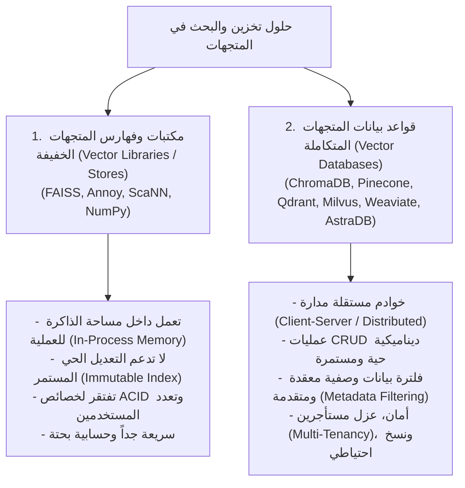
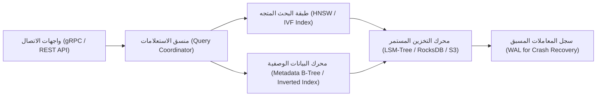

# 01 - مقارنة فهارس المتجهات وقواعد بيانات المتجهات (Vector Stores vs Vector Databases)

عند بناء تطبيقات الـ RAG، كثيراً ما يُستخدم مصطلحا **"فهرس المتجهات" (`Vector Index / Vector Store / Library`)** و **"قاعدة بيانات المتجهات" (`Vector Database`)** كأنهما مترادفان، بينما يمثلان في هندسة النظم مستويين معماريين مختلفين تماماً من حيث التعقيد، والقدرة التشغيلية، وملاءمة بيئات الإنتاج.

---

## 1. شجرة التصنيف المعماري لحلول تخزين المتجهات

---

## 2. جدول المقارنة الهندسية الشاملة

| المعيار الهندسي | مكتبات وفهارس المتجهات (`Vector Libraries: FAISS, Annoy`) | قواعد بيانات المتجهات (`Vector Databases: Pinecone, Qdrant`) |
| :--- | :--- | :--- |
| **طبيعة المعمارية** | مكتبة برمجية داخل كود التطبيق (`In-Process Library`) | خادم مستقل أو خدمة سحابية موزعة (`Distributed Service`) |
| **التخزين والاستمرارية (`Persistence`)** | في الذاكرة الحية (`RAM`)، وتتطلب حفظ واسترجاع الملفات يدوياً | حفظ دائم مستمر وتلقائي على القرص أو السحابة (`WAL Logs`) |
| **العمليات الديناميكية (`CRUD`)** | صعبة ومكلفة (حذف أو تعديل متجه يتطلب غالباً إعادة بناء الفهرس) | **عمليات إضافة، تعديل، وحذف لحظية دون توقف الفهرس** |
| **فلترة الميتا-داتا (`Metadata Filtering`)** | بدائية جداً أو تتطلب تصفية برمجية يدوية بعد البحث (`Post-Filtering`) | **فلترة مسبقة مدمجة وسريعة جداً عبر فهارس ثانوية مهيكلة** |
| **التوسع الأفقي (`Horizontal Scaling`)** | محدود بقدرة ذاكرة السيرفر الفردي (`Single Node Limits`) | **توسع موزّع عبر عُقد متعددة وتجزئة البيانات (`Sharding`)** |
| **التحكم بالوصول والأمان (`RBAC`)** | منعدم (البيانات مشاعة للعملية البرمجية) | حوكمة كاملة، تشفير أثناء الراحة والنقل، وعزل المستأجرين |
| **استهلاك الموارد والتكلفة** | **صفر تكلفة إضافية، خفيفة جداً، ومثالية للتطوير** | تتطلب بنية تحتية أو اشتراكات سحابية شهرية |

---

## 3. التشريح الداخلي لمكتبة فهارس المتجهات (Vector Library)

تركز مكتبات مثل **`FAISS` (المطورة من Meta AI)** على هدف واحد محدد بعناية: **تحقيق أقصى سرعة ممكنة في حساب المسافات الإقليدية والجداء الداخلي بين ملايين المتجهات**.
* تُخزن المتجهات كمصفوفة متصلة من الأرقام العائمة (`Contiguous C-Arrays of float32`).
* تستغل مكتبات الجبر الخطي فائقة الكفاءة (`BLAS / LAPACK`) وتعليمات معالجات Intel و AMD الحديثة (`AVX-512 / FMA`).
* **حدودها الهندسية**: لا تهتم المكتبة بإدارة المستخدمين، ولا تعرف شيئاً عن عناوين الـ IP أو اتصالات الشبكة، ولا توفر سجلات تتبع العمليات (`Write-Ahead Logs`). إذا توقف السيرفر فجأة دون حفظ الفهرس على القرص، تُفقد كافة البيانات.

---

## 4. التشريح الداخلي لقاعدة بيانات المتجهات المتكاملة (Vector Database)

قاعدة بيانات المتجهات لا تكتفي بضم خوارزمية الفهرسة (مثل `HNSW`)، بل تبني حولها منظومة قواعد بيانات مؤسسية متكاملة تتكون من:

1. **محرك البيانات الوصفية المزدوج**: فهرسة النصوص والتواريخ والأرقام في فهارس شجرية (`B-Trees`) متزامنة لحظياً مع فهارس المتجهات.
2. **سجل المعاملات المسبق (`Write-Ahead Logging - WAL`)**: لضمان عدم ضياع أي متجه عند حدوث انهيار مفاجئ في النظام (`Crash Resilience`).
3. **التكرار والنسخ الاحتياطي (`Replication & High Availability`)**: توزيع البيانات على عدة خوادم (`Replicas`) لضمان استمرار الخدمة عند سقوط خادم معين بنسبة إتاحة $99.99\%$.

---

## 5. مصفوفة اتخاذ القرار الهندسي (Architectural Decision Matrix)

| حالة الاستخدام المؤسسي | الخيار الهندسي الموصى به | المبرر التقني |
| :--- | :--- | :--- |
| **نماذج أولية سريعة وتجارب معملية (`POC / MVP`)** | `ChromaDB` (محلي) أو `FAISS` | سرعة إطلاق خيالية، صفر إعدادات، وعمل مباشر في بايثون |
| **تطبيقات حافة أو أجهزة مدمجة (`Edge Devices / Mobile`)** | `FAISS` أو `SQLite-VSS` | بصمة ذاكرة ضئيلة جداً ولا تتطلب اتصالاً بالإنترنت |
| **وثائق ثابتة لا تتغير (مثل أرشفة كتب أو مقالات علمية)** | `FAISS IndexFlatIP` أو `Annoy` | فهرس ثابت مضغوط يوفر استجابة فائقة السرعة |
| **منصة RAG مؤسسية ضخمة بملايين الاستعلامات وتحديثات يومية** | `Pinecone` سحابي أو `Qdrant / Milvus` | دعم كامل لـ CRUD، توسع أفقي، وعزل بيانات العملاء |

---

## 6. أسئلة المقابلات الهندسية (Senior AI Interview Questions)

### س1: لماذا تفشل فهارس المتجهات البسيطة مثل FAISS في سيناريو الـ "Multi-Tenant RAG" الذي يخدم آلاف الشركات في نفس الوقت؟
**الإجابة:** 
1. **انعدام عزل المستأجرين برمجياً (`No Native Namespaces`)**: في FAISS، توضع كافة المتجهات في فضاء مصفوفي واحد. للبحث لشركة محددة، تضطر إما لإنشاء ملف FAISS مستقل لكل شركة (مما يؤدي لتضخم آلاف الملفات وإدارة شاقة للملفات المفتوحة `File Descriptors`)، أو البحث الشامل ثم الفلترة بالـ ID (وهو بطيء وغير آمن وقد يسبب تسريب بيانات بين العملاء).
2. **قواعد بيانات المتجهات الحديثة** (مثل Pinecone و Qdrant) تدعم ميزة **`Namespaces / Partitions`** المدمجة، حيث يتم عزل بيانات كل مستأجر منطقياً وفهرستها بشكل مستقل مع ضمانات أمنية صارمة على مستوى المحرك.

### س2: كيف تؤثر متطلبات الامتثال لحق النسيان (`GDPR Right to be Forgotten`) على اختيارك بين FAISS وقواعد المتجهات؟
**الإجابة:**
يفرض قانون GDPR حذف بيانات المستخدم الشخصية فور طلب ذلك.  
في مكتبات مثل `FAISS`، عملية حذف متجه معين (`Index.remove_ids`) إما غير مدعومة في بعض أنواع الفهارس المعقدة (مثل IVF-PQ)، أو تتطلب إعادة بناء وإعادة تدريب الفهرس بالكامل (`Re-indexing`)، وهي عملية باهظة حسابياً.  
في المقابل، صُممت قواعد بيانات المتجهات الحقيقية لتدعم الحذف الفوري عبر المعرف (`Soft & Hard Delete via Document ID`) خلال أجزاء من الميلي ثانية مع تحديث تلقائي لهياكل البيانات.
