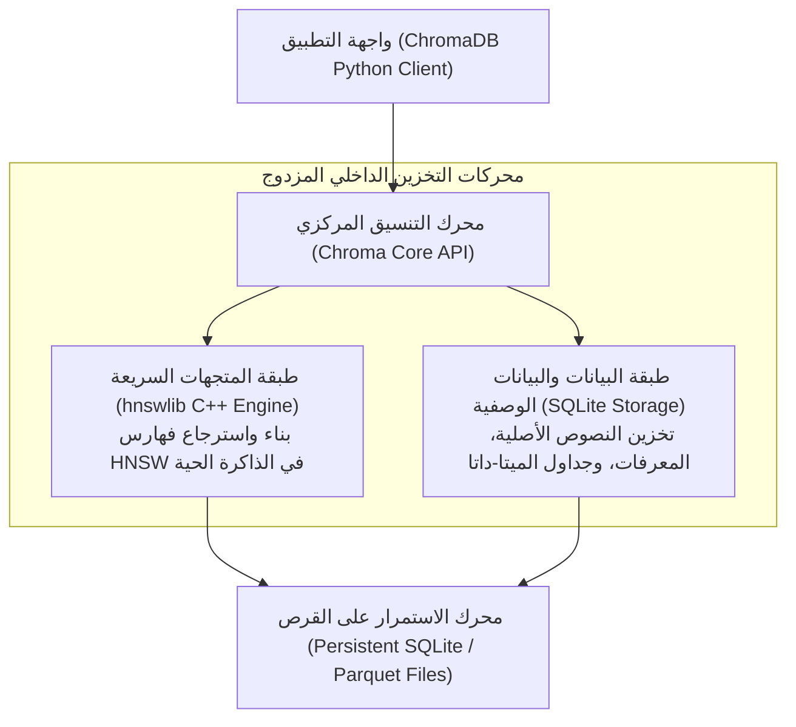

# 02 - بناء نظام RAG متكامل باستخدام ChromaDB (Traditional RAG with ChromaDB)

تُعد قاعدة بيانات **`ChromaDB`** الخيار مفتوح المصدر الأكثر شعبية وتفضيلاً لدى مجتمع مطوري الذكاء الاصطناعي لبناء نماذج أولية وتطبيقات إنتاجية متوسطة الحجم. صُممت ChromaDB من البداية لتكون **"AI-Native"**، أي موجهة خصيصاً لتسهيل تخزين المستندات، واسترجاع المتجهات، وربطها بسلاسة مع النماذج اللغوية الكبيرة (`LLMs`).

---

## 1. المعمارية الداخلية لقاعدة بيانات ChromaDB

تعتمد ChromaDB في جوهرها المعماري على مزيج هندسي متكامل من ثلاث طبقات متخصصة:



* **طبقة المتجهات (`hnswlib`)**: مكتبة مكتوبة بلغة C++ فائقة الأداء، تتولى بناء الرسوم البيانية الهرمية (`Hierarchical Navigable Small World - HNSW`) لإجراء عمليات البحث التقريبي `ANN` في أجزاء من الميلي ثانية.
* **طبقة البيانات الوصفية (`SQLite`)**: قاعدة بيانات علائقية داخلية تتولى إدارة الميتا-داتا، المعرفات الفريدة، والربط الحتمي بين المتجه والنص الأصلي.

---

## 2. أوضاع التشغيل المعمارية لـ ChromaDB

| وضع التشغيل | كود التهيئة | آلية العمل | متى نختاره؟ |
| :--- | :--- | :--- | :--- |
| **الذاكرة الحية (`In-Memory Mode`)** | `client = chromadb.Client()` | حفظ كافة المتجهات في ذاكرة الرام؛ تختفي البيانات بمجرد إغلاق البرنامج | الاختبارات السريعة ووحدات الفحص الآلي (`Unit Tests`) |
| **التخزين الدائم الموضعي (`Persistent Mode`)** | `client = chromadb.PersistentClient(path="./chroma_db")` | حفظ الفهارس والميتا-داتا في مجلد محلي على القرص الصلب | **التطبيقات المحلية والمشاريع الفردية وأنظمة سطح المكتب** |
| **خادم العميل (`Client-Server Mode`)** | `client = chromadb.HttpClient(host="localhost", port=8000)` | تشغيل Chroma كخادم Docker مستقل والتواصل معه عبر بروتوكول HTTP/REST | الخدمات المصغرة (`Microservices`) والأنظمة السحابية متعددة الحاويات |

---

## 3. هيكلية التخزين والمجموعات (`Chroma Collections`)

تعامل ChromaDB البيانات عبر مفهوم **المجموعات (`Collections`)**، وهي المقابل لمفهوم "الجدول" في قواعد البيانات التقليدية.  
يتكون كل سجل داخل المجموعة من 4 عناصر أساسية:
1. `ids`: معرف فريد لكل قطعة نصية (`UUID` أو نصي).
2. `documents`: النص الأصلي للقطعة (`page_content`).
3. `embeddings`: المتجه العددي الكثيف (إذا لم تمرره، تحسبه Chroma تلقائياً).
4. `metadatas`: قاموس مرن للبيانات الوصفية للفلترة والتتبع.

```python
import chromadb
from langchain_chroma import Chroma
from langchain_huggingface import HuggingFaceEmbeddings

# 1. تهيئة نموذج التضمين المحلي
embeddings = HuggingFaceEmbeddings(model_name="sentence-transformers/all-MiniLM-L6-v2")

# 2. إنشاء قاعدة Chroma دائمة
vector_store = Chroma(
    collection_name="company_knowledge_base",
    embedding_function=embeddings,
    persist_directory="./chroma_db"
)
```

---

## 4. خط المعالجة المتكامل عبر لغة تعبير لانج تشين (Traditional LCEL RAG)

يوضح الكود التالي بناء مسار RAG تقليدي متكامل يربط الاسترجاع من ChromaDB مع نموذج التوليد فائق السرعة عبر `Groq`:

```python
from langchain_core.prompts import ChatPromptTemplate
from langchain_core.runnables import RunnablePassthrough
from langchain_core.output_parsers import StrOutputParser
from langchain_groq import ChatGroq

# 1. إعداد المسترجع مع تصفية الميتا-داتا
retriever = vector_store.as_retriever(
    search_type="similarity",
    search_kwargs={"k": 3}
)

# 2. بناء قالب البرومبت المقيد
prompt = ChatPromptTemplate.from_template(
    "أنت مساعد خبير. أجب عن السؤال التالي بالاعتماد فقط على السياق المرفق:\n\n"
    "السياق:\n{context}\n\n"
    "السؤال: {question}\n\n"
    "الإجابة الموثقة:"
)

# 3. تهيئة نموذج التوليد
llm = ChatGroq(model="qwen/qwen3.8-27b", temperature=0.0)

# 4. دمج السلسلة عبر LCEL
def format_docs(docs):
    return "\n\n".join(d.page_content for d in docs)

rag_chain = (
    {"context": retriever | format_docs, "question": RunnablePassthrough()}
    | prompt
    | llm
    | StrOutputParser()
)

# 5. الاستدعاء والتوليد
answer = rag_chain.invoke("ما هي سياسة الإجازات الرسمية للشركة؟")
print(answer)
```

---

## 5. العمليات الديناميكية: التحديث والحذف وإدارة الذاكرة

على عكس الفهارس الثابتة، تتيح ChromaDB تحديث المستندات وحذفها ديناميكياً:

* **التحديث أو الإدراج الذكي (`Upsert`)**:
  إذا كان المعرف `id` موجوداً، يتم تحديث المتجه والنص، وإذا كان جديداً، يتم إدراجه:
  ```python
  vector_store.add_documents(new_documents, ids=["doc_101", "doc_102"])
  ```
* **الحذف الصريح بالمعرف (`Delete`)**:
  ```python
  vector_store.delete(ids=["doc_101"])
  ```
* **تصفية الميتا-داتا أثناء الاستعلام (`Metadata Filtering`)**:
  ```python
  results = vector_store.similarity_search(
      query="شروط الترقية",
      k=2,
      filter={"department": "Engineering"}
  )
  ```

---

## 6. أسئلة المقابلات الهندسية (Senior AI Interview Questions)

### س1: ما هو المقياس الافتراضي لحساب المسافة في ChromaDB، وكيف تغيره إلى Cosine Similarity؟
**الإجابة:** 
المقياس الافتراضي في ChromaDB هو مربع المسافة الإقليدية (`Squared L2 Distance: l2`).  
لتغييره إلى تشابه جيب التمام (`Cosine Similarity`) أو الجداء الداخلي (`Inner Product`)، يجب تمرير إعداد الميتا-داتا الخاص بالمجموعة أثناء إنشائها:
```python
collection = client.create_collection(
    name="my_collection",
    metadata={"hnsw:space": "cosine"}  # الخيارات: "cosine", "l2", "ip"
)
```
في حالة اختيار `"cosine"`، تحسب ChromaDB مسافة جيب التمام $D = 1 - \cos(\theta)$ حيث القيمة الأقرب للصفر تعني التطابق التام.

### س2: ما هي حدود التوسع (`Scalability Bottlenecks`) لقاعدة بيانات ChromaDB في بيئات الإنتاج الكبرى؟
**الإجابة:**
1. **الاعتماد على SQLite للتخزين المحلي**: لا يتحمل SQLite معدلات كتابة متزامنة هائلة من آلاف المستخدمين في نفس الوقت بسبب قفل قاعدة البيانات (`Database Locking on Writes`).
2. **استهلاك الذاكرة العشوائية لـ HNSW**: تحتفظ خوارزمية HNSW بالرسم البياني بالكامل داخل الذاكرة الحية (`RAM`). عند تجاوز 10 ملايين متجه عالي الأبعاد، يتطلب السيرفر ذاكرة RAM ضخمة ومكلفة جداً.
3. **الحل عند التوسع المليوني**: الانتقال إلى قواعد بيانات متجهة موزعة ومصممة للتوسع الأفقي الحقيقي مثل **Pinecone** أو **Qdrant Distributed** أو **Milvus**.
