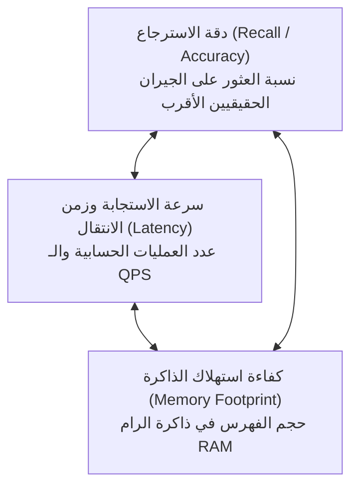
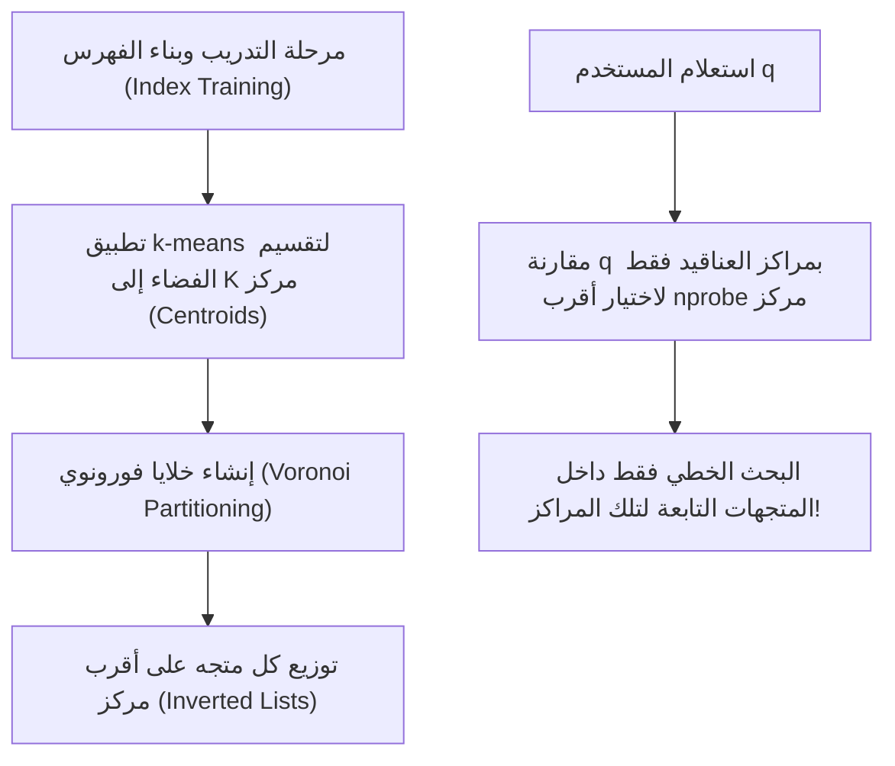
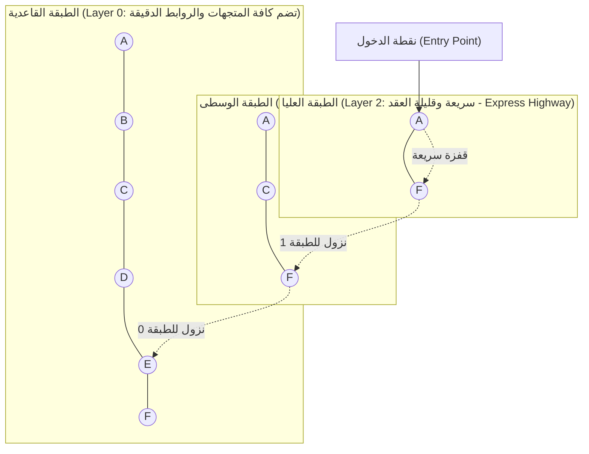
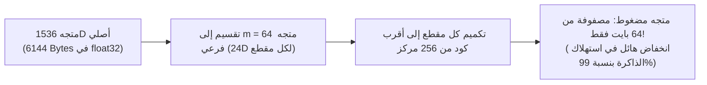

# 03 - خوارزميات الفهرسة الحسابية: HNSW و IVF و PQ (Vector Indexing Algorithms)

تُمثل خوارزميات الفهرسة والبحث التقريبي عن أقرب الجيران (**Approximate Nearest Neighbors - ANN**) القلب النابض لأي محرك متجهات في العالم.  

في قواعد البيانات الصغيرة (أقل من 50,000 متجه)، يمكن حساب المسافة بين استعلام المستخدم وكافة المتجهات واحداً تلو الآخر عبر البحث الخطي المباشر (**Exact Flat / Brute-Force Search**) بتعقيد زمني $\mathcal{O}(N \cdot d)$. ولكن عندما تتضخم قاعدة البيانات إلى **ملايين أو مليارات المتجهات**، يستغرق البحث الخطي ثوانٍ طويلة، وتنهار استجابة النظام بالكامل.

من هنا طوّر علماء الرياضيات وعلوم الحاسوب ثلاث عائلات كبرى من خوارزميات الفهرسة التقريبية: **`IVF`**، و **`HNSW`**، و **`PQ`**.

---

## 1. مثلث المقايضة الهندسي لخوارزميات الفهرسة (The Trade-Off Triangle)

* **لا توجد خوارزمية مثالية لكل شيء**:
  * إذا أردت دقة 100% وسرعة فائقة ➔ ستدفع تكلفة باهظة في استهلاك ذاكرة الرام (`HNSW`).
  * إذا أردت توفير 95% من مساحة الرام ➔ ستضحي بـ 2% إلى 5% من دقة الاسترجاع عبر التكميم (`PQ`).
  * إذا أردت فهرسة سريعة بدون استهلاك وقت بناء ضخم ➔ ستختار التقسيم العنقودي (`IVF`).

---

## 2. خوارزمية الفهرس المعكوس للملفات (Inverted File Index - IVF)

### آلية العمل الهندسية:
تعتمد `IVF` على فكرة **"فرّق تسُد"** عبر تقسيم الفضاء المتجهي عالي الأبعاد إلى عدد $K$ من العناقيد المكانية (`Voronoi Cells`) باستخدام خوارزمية $k$-means:

### المعاملات الحاكمة:
* **$K$ (عدد العناقيد `nlist`)**: يحدد عدد المناطق التي ينقسم إليها الفضاء (مثلاً $K = \sqrt{N}$ أو $K = 4\sqrt{N}$).
* **`nprobe` (عمق البحث)**: عدد المراكز الأقرب التي يتم فحص المتجهات التابعة لها أثناء الاستعلام.
  * إذا كان $\text{nprobe} = 1$: بحث فائق السرعة، ولكن إذا وقع المتجه المطلوب عند حافة خلية مجاورة، سيفقده الفهرس.
  * كلما زاد $\text{nprobe}$، ارتفعت الدقة (`Recall`) على حساب زيادة طفيفة في زمن البحث.
* **التعقيد الزمني للاستعلام**:
  $$\mathcal{O}\left( K \cdot d + \frac{N}{K} \cdot \text{nprobe} \cdot d \right)$$

---

## 3. خوارزمية الرسوم البيانية الهرمية (HNSW: Hierarchical Navigable Small World)

تُعد خوارزمية **`HNSW`** (Malkov & Yashunin, 2018) **المعيار الذهبي المطلق (Gold Standard)** والأكثر استخداماً في جميع قواعد بيانات المتجهات الحديثة (Pinecone, Chroma, Qdrant, Weaviate).

### الأصل الرياضي:
تدمج الخوارزمية بين مفهومين عبقريين:
1. **ظاهرة العوالم الصغيرة (`Small World Graphs`)**: فرضية الست درجات من التباعد (Milgram's 6 Degrees of Separation)، حيث يمكن الوصول لأي نقطة في الشبكة عبر عدد قليل جداً من القفزات.
2. **قوائم التخطي الهرمية (`Skip Lists`)**: تسريع البحث في القوائم المترابطة ببناء طبقات علوية سريعة.

### آلية التنقل الهرمي:
1. يبدأ البحث في **الطبقة العليا الشفافة** التي تحتوي على روابط سريعة طويلة المدى (`Long-Range Highway Links`)، ليقترب من المنطقة العامة للمتجه في قفزة واحدة.
2. يهبط المؤشر إلى **الطبقات الأدنى** تدريجياً لتقليص نطاق البحث (`Zooming In`).
3. ينتهي في **الطبقة القاعدية (Layer 0)** التي تحتوي على كافة المتجهات، ليجري بحثاً دقيقاً بين الجيران الأقرب.
* **التعقيد الزمني**: يحقق تعقيداً لوغاريتمياً مذهلاً $\mathcal{O}(\log N)$ مع نسبة دقة استرجاع تتجاوز **98% إلى 99%**.

### المعاملات الحرجة لضبط HNSW:
* **$M$ (الحد الأقصى للروابط لكل عقدة)**: عادة بين 16 و 64. زيادة $M$ ترفع الدقة لكنها تزيد استهلاك الذاكرة.
* **`efConstruction` (عمق البحث أثناء بناء الفهرس)**: يحدد جودة الروابط عند تدريب الفهرس (مثلاً 100 إلى 200).
* **`efSearch` (عمق البحث أثناء الاستعلام)**: يحدد عدد المرشحين المفحوصين لحظياً (مثلاً 32 إلى 128).

---

## 4. خوارزمية التكميم الاتجاهي (Product Quantization - PQ)

إذا كانت قاعدة البيانات تحتوي على 100 مليون متجه، وكل متجه طوله 1536 رقماً بنظام `float32` (ما يعادل 6 كيلوبايت لكل متجه):
$$\text{Memory} = 100,000,000 \times 6,144 \text{ bytes} \approx 614 \text{ Gigabytes of RAM!}$$
تكلفة تشغيل سيرفر بذاكرة 600 جيجابايت باهظة جداً. هنا يأتي دور **`Product Quantization (PQ)`** لضغط المتجهات بنسبة **تصل إلى 95% إلى 98%**!

### آلية التكميم وتقطيع الفضاء:
1. **تفكيك المتجه الأصلي**: يقسم المتجه $\mathbf{v} \in \mathbb{R}^d$ إلى $m$ متجهات فرعية متساوية الطول (مثلاً $m = 64$).
2. **بناء قواميس الرموز (`Codebooks`)**: يتم تطبيق $k$-means على كل فضاء فرعي لتوليد 256 مركزاً فقط.
3. **التمثيل ببايت واحد**: بما أن المراكز عددها 256، يمكن تمثيل كل متجه فرعي برقم بايت واحد (`1 Byte: uint8: 0 - 255`).
4. **النتيجة المذهلة**: يتحول المتجه الأصلي من 6144 بايت إلى **64 بايت فقط**!

---

## 5. مصفوفة المفاضلة الشاملة لخوارزميات الفهرسة

| الخوارزمية | سرعة الاستعلام (Query Latency) | دقة الاسترجاع (Recall) | استهلاك الذاكرة (RAM) | سرعة بناء الفهرس | متى نختارها في الإنتاج؟ |
| :--- | :--- | :--- | :--- | :--- | :--- |
| **`Flat Index`** | بطيئة ($\mathcal{O}(N)$) | **100% (قطعية)** | منخفض (المتجهات كما هي) | لحظية (صفر وقت تدريب) | أقل من 50,000 متجه |
| **`IVF-Flat`** | سريعة جداً | جيدة جداً (90% - 95%) | منخفض | سريعة | ملايين المتجهات مع ميزانية رام محدودة |
| **`HNSW`** | **فائقة ($\mathcal{O}(\log N)$)** | **استثنائية (98% - 99.5%)** | **مرتفع جداً ($\approx 1.5\times$ حجم البيانات)** | بطيئة نسبياً | **المعيار الذهبي عندما تكون الدقة هي الأولوية الأولى** |
| **`IVF-PQ`** | فائقة جداً | متوسطة (80% - 90%) | **ضئيل للغاية (توفير 95% من الرام)** | تتطلب تدريباً أولياً | عشرات ومئات الملايين من المتجهات بميزانية منخفضة |
| **`HNSW-PQ`** | فائقة | عالية جداً (92% - 96%) | متوسط | متوسطة | أفضل توازن للأنظمة المليونية فائقة السرعة |

---

## 6. أسئلة المقابلات الهندسية (Senior AI Interview Questions)

### س1: ما الفارق الجوهري بين حساب المسافة المتماثل (SDC) وغير المتماثل (ADC) في Product Quantization؟
**الإجابة:** 
* **`Symmetric Distance Computation (SDC)`**: يتم تكميم كل من استعلام المستخدم والوثيقة المخزنة إلى أكواد PQ، ثم حساب المسافة التقريبية بين الكودين. يعاني من خطأ تكميم مزدوج ودقة منخفضة.
* **`Asymmetric Distance Computation (ADC)`**: يترك استعلام المستخدم كمتجه مستمر دقيق (`float32 Query Vector`) دون أي تكميم، ويقارن مباشرة بالأكواد المضغوطة للوثائق عبر جداول المسافات المحسوبة مسبقاً (`Precomputed Distance Lookup Tables`).  
*تعتمد كافة أنظمة الإنتاج على ADC* لأنه يعطي دقة استرجاع أعلى بكثير دون أي زيادة في استهلاك الذاكرة.

### س2: متى تقرر ضبط المعامل `efSearch` في خوارزمية HNSW لقيم كبيرة أثناء الاستعلام؟
**الإجابة:**
يتحكم معامل `efSearch` بحجم قائمة المرشحين في الذاكرة أثناء التنقل بين عقد الرسم البياني:
* نرفعه (مثلاً من 32 إلى 128 أو 256) في التطبيقات الطبية والقانونية التي تتطلب استرجاعاً فائق الدقة (`High Recall`) ولا تقبل تفويت أي مستند جوهري، مع قبول زيادة طفيفة في زمن الاستجابة (من 5ms إلى 15ms).
* نخفضه في التطبيقات الحية فائقة التردد (مثل التوصيات الفورية ومحركات الألعاب) لتقليل زمن الاستجابة إلى أدنى حد ممكن.
