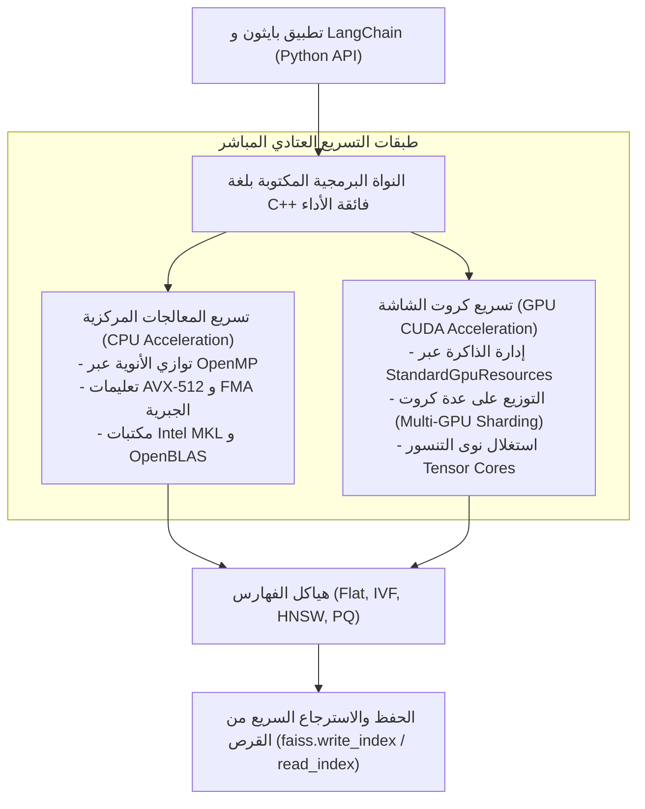

# 04 - الفهرسة عالية الأداء عبر مكتبة FAISS (High-Performance Vector Indexing with FAISS)

تُعد مكتبة **`FAISS (Facebook AI Similarity Search)`**، المطورة من قِبل مختبرات أبحاث الذكاء الاصطناعي في شركة Meta، المعيار الصناعي المرجعي والمحرك البرمجي الأكثر كفاءة وسرعة على الإطلاق للبحث عن التشابه في فضاءات المتجهات الكثيفة، مع قدرة مثبتة على التعامل مع **مليارات المتجهات (`Billion-Scale Search`)**.

---

## 1. المعمارية الهندسية لمكتبة FAISS وتكامل الأجهزة



---

## 2. أشهر أنواع الفهارس في FAISS وخصائصها

### أ. الفهرس الخطي الصارم (`IndexFlatL2` و `IndexFlatIP`):
* لا يحتاج لأي تدريب مسبق (`No Training Required`).
* يحسب المسافة الدقيقة بين المتجهات دون أي تقريب (دقة 100%).
* مثالي لقواعد البيانات الصغيرة (أقل من 50,000 متجه).

### ب. فهرس التقسيم العنقودي (`IndexIVFFlat`):
* يتطلب مرحلة تدريب (`index.train(vectors)`) لحساب مراكز خلايا فورونوي عبر $k$-means.
* يتطلب استخدام `IndexIDMap` لربط المتجهات بمعرفاتها الأصلية.
* يقلص عدد الحسابات بمقدار $10\times$ إلى $50\times$.

### ج. فهرس الرسوم البيانية الهرمية (`IndexHNSWFlat`):
* يوفر أعلى سرعة استجابة واسترجاع شبه قطعي ($>98\%$) بتعقيد لوغاريتمى $\mathcal{O}(\log N)$.
* لا يتطلب تدريباً مسبقاً، بل يبني الروابط مباشرة أثناء الإضافة.

### د. الفهرس التكميمي المضغوط (`IndexIVFPQ`):
* يجمع بين التقسيم العنقودي `IVF` والضغط التكميمي `PQ`.
* يضغط مساحة الذاكرة بنسبة 95% ومناسب للمجموعات المليونية.

---

## 3. التنفيذ البرمجي المباشر بلغة بايثون و LangChain

### أ. بناء الفهرس واسترجاع المتجهات محلياً:
```python
import numpy as np
import faiss
from langchain_community.vectorstores import FAISS
from langchain_huggingface import HuggingFaceEmbeddings

# 1. تهيئة نموذج التضمين
embeddings = HuggingFaceEmbeddings(model_name="sentence-transformers/all-MiniLM-L6-v2")

# 2. إنشاء فهرس FAISS من المستندات
docs = ["تعتمد منظومة RAG على استرجاع المستندات", "تستخدم FAISS خوارزميات HNSW و IVF"]
vector_store = FAISS.from_texts(texts=docs, embedding=embeddings)

# 3. الاستعلام واسترجاع النتائج مع درجات المسافة
query = "كيف تعمل مكتبة FAISS؟"
results_with_scores = vector_store.similarity_search_with_score(query, k=2)

for doc, score in results_with_scores:
    print(f"المستند: {doc.page_content} | درجة المسافة: {score:.4f}")
```

### ب. حفظ الفهرس على القرص واستعادته (`Serialization & Persistence`):
تتميز FAISS بقدرتها على تجميد الفهرس وتصديره لملف ثنائي فائق السرعة دون أي فقدان:
```python
# حفظ الفهرس محلياً
vector_store.save_local("./faiss_index_store")

# إعادة تحميل الفهرس في جلسة أخرى بلحظات
loaded_vector_store = FAISS.load_local(
    folder_path="./faiss_index_store",
    embeddings=embeddings,
    allow_dangerous_deserialization=True
)
print("تم استرجاع فهرس FAISS بنجاح.")
```

---

## 4. مقارنة FAISS مع مخزن الذاكرة البسيط (InMemoryVectorStore)

| المعيار | `InMemoryVectorStore` (مصفوفة بايثون عادية) | مكتبة `FAISS` (المطورة من Meta) |
| :--- | :--- | :--- |
| **لغة التنفيذ** | كود بايثون مع مكتبة NumPy البسيطة | نواة C++ مجمعة ومحسنة بتعليمات الأجهزة |
| **خوارزميات الفهرسة** | بحث خطي مباشر Brute-Force فقط | تدعم أكثر من 30 خوارزمية وفهرس هجين (HNSW, IVF, PQ) |
| **دعم كروت الشاشة GPU** | غير مدعوم نهائياً | **دعم استثنائي فائق لـ NVIDIA CUDA و Multi-GPU** |
| **السعة القصوى الفعالة** | بضعة آلاف من المتجهات فقط | **مئات الملايين وحتى مليارات المتجهات** |
| **الاستخدام المثالي** | اختبارات سريعة أثناء بناء النماذج | النظم الإنتاجية، المحركات البحثية، ومراكز البيانات الكبرى |

---

## 5. أسئلة المقابلات الهندسية (Senior AI Interview Questions)

### س1: ما هو دور كائن `IndexIDMap` في مكتبة FAISS ولماذا تحتاجه الفهارس المتقدمة؟
**الإجابة:** 
في فهارس FAISS الأساسية (مثل `IndexFlatL2` و `IndexIVFFlat`)، يتم تعيين معرفات المتجهات تلقائياً وبشكل تسلسلي من $0$ إلى $N-1$.  
إذا كنت تريد ربط كل متجه بمعرفه المؤسسي الحقيقي (مثل رقم الموظف `emp_991` أو معرف الوثيقة في قاعدة البيانات `UUID`)، فإن الفهرس الأساسي لا يقبل إلا مصفوفات رقمية متصلة.  
هنا يأتي دور **`IndexIDMap`** (أو `IndexIDMap2`) كغلاف وسيط (`Wrapper`) يحتفظ بجدول تطابق ثنائي يربط المعرفات الرقمية المخصصة للمستخدم بالمتجهات الداخلية، ويسمح بالبحث والحذف بالمعرفات الصريحة.

### س2: كيف تنقل فهرس FAISS ليعمل على كارت الشاشة GPU، وما هي القيود التي يجب الانتباه لها؟
**الإجابة:**
1. **طريقة النقل**:
   ```python
   import faiss
   res = faiss.StandardGpuResources() # تخصيص موارد الذاكرة
   cpu_index = faiss.IndexFlatL2(384)
   gpu_index = faiss.index_cpu_to_gpu(res, 0, cpu_index) # نقله للكرت رقم 0
   ```
2. **القيود الهندسية**:
   * **محدودية ذاكرة الـ VRAM**: كروت الشاشة تمتلك ذاكرة أضيق بكثير من ذاكرة السيرفر العادية (مثلاً 24GB إلى 80GB). إذا زاد حجم الفهرس عن مساحة VRAM، سينهار النظام بخطأ `CUDA OOM`.
   * **تكلفة نقل البيانات (PCIe Bottleneck)**: نقل المتجهات من ذاكرة النظام إلى الـ GPU يستهلك وقتاً؛ لذا فإن استخدام كروت الشاشة يكون مجدياً فقط عندما تكون حزم الاستعلامات كبيرة وضخمة (`Batched Queries`) وليست استعلامات فردية متباعدة.
