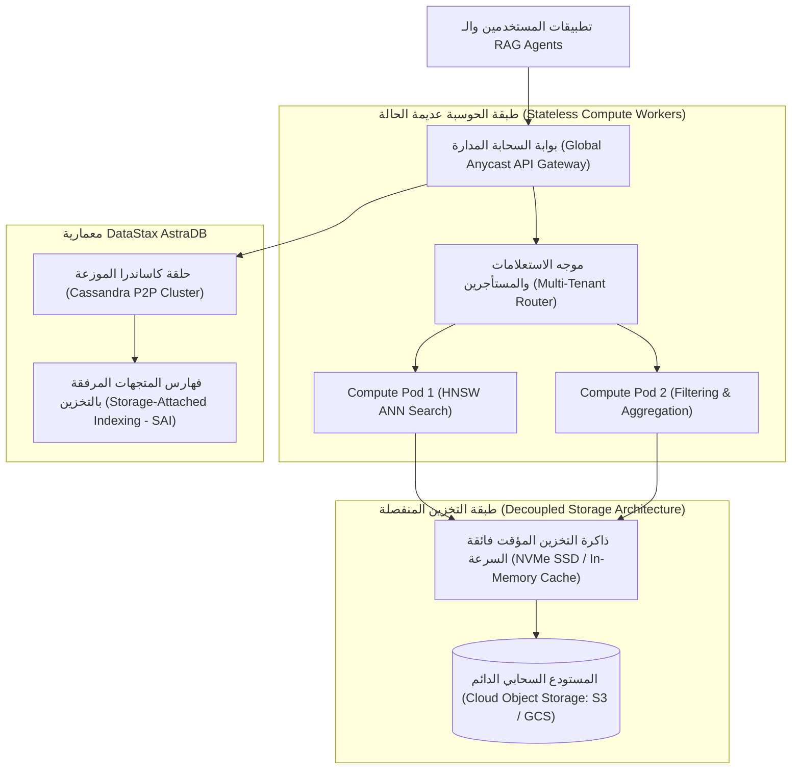

# 05 - قواعد البيانات السحابية الموزعة: Pinecone و AstraDB (Cloud-Native Vector Databases)

عندما تنتقل تطبيقات الـ RAG من مجرد مشاريع فردية أو خوادم محلية إلى منصات مؤسسية تخدم **ملايين المستخدمين المتزامنين (`Enterprise Multi-Tenant Scale`)**، تصبح إدارة قواعد البيانات الموضعية (مثل Chroma أو FAISS) عبئاً تشغيلياً هائلاً (`High Operational Overhead`).  

يتطلب العمل في الإنتاج حلولاً سحابية مدارة بالكامل (**Fully-Managed Cloud-Native Vector Databases**) توفر التوسع التلقائي (`Auto-Scaling`)، والتوزيع الجغرافي عبر القارات، والنسخ الاحتياطي اللحظي، وضمانات استمرارية الخدمة بنسبة $99.99\%$.

يقدم هذا الدليل تشريحاً معمارياً لاثنين من أبرز رواد هذا المجال: **`Pinecone`** و **`DataStax AstraDB`**.

---

## 1. المعمارية الهندسية لقواعد البيانات السحابية الموزعة



---

## 2. دراسة متعمقة: معمارية Pinecone (Serverless vs Pod-Based)

تُعد شركة **`Pinecone`** الرائدة في ابتكار قواعد البيانات المتجهة السحابية وتوفر نموذجين معماريين رئيسيين:

### أ. المعمارية الموزعة المعتمدة على الحاويات (`Pod-Based`):
* يحصل العميل على حاويات مخصصة (`Dedicated Kubernetes Pods`) بموارد محددة من الذاكرة والـ CPU.
* **الميزة**: زمن استجابة منخفض جداً وشديد الثبات ($< 20\text{ms}$).
* **العيب**: تكلفة شهرية ثابتة تعمل طوال الوقت حتى لو لم تكن هناك استعلامات.

### ب. المعمارية عديمة الخوادم (`Serverless Architecture` - الجيل الحديث):
* تعتمد على **فصل طبقة الحوسبة عن طبقة التخزين (`Decoupled Compute & Storage`)**:
  * تخزن المتجهات والفهارس بتكلفة زهيدة جداً على مخازن الكائنات السحابية مثل Amazon S3.
  * يتم استدعاء خوادم الحوسبة لحظة ورود الاستعلام، وتخزين أكثر الفهارس طلباً في ذاكرة كاش محلية سريعة (`Blob Caching`).
* **الأثر الاقتصادي**: انخفاض التكلفة بما يصل إلى **80% إلى 90%** مع الدفع فقط مقابل عدد الاستعلامات وحجم البيانات الفعلي.
* **عزل المستأجرين عبر مساحات الأسماء (`Namespaces`)**:
  تسمح Pinecone بتقسيم الفهرس الواحد إلى آلاف مساحات الأسماء المنعزلة:
  ```python
  retriever = vectorstore.as_retriever(
      search_kwargs={"namespace": f"user_org_{tenant_id}", "k": 3}
  )
  ```

---

## 3. دراسة متعمقة: معمارية DataStax AstraDB (المبنية على Apache Cassandra)

تعتمد **`DataStax AstraDB`** على محرك قاعدة البيانات الموزعة الأسطورية **`Apache Cassandra`**، والمشهورة بقدرتها على تحمل انهيار أي خادم دون توقف العمل نهائياً (`Masterless Peer-to-Peer Architecture`).

### الميزات الاستثنائية لـ AstraDB في الـ RAG:
1. **الفهارس المرفقة بالتخزين (`Storage-Attached Indexing - SAI`)**:
   بدلاً من إنشاء محرك متجهات منفصل، تم دمج محرك البحث المتجه (المبني على خوارزميات HNSW و Lucene) مباشرة داخل جداول كاساندرا.
2. **دمج البيانات متعددة النماذج (`Multi-Model Integration`)**:
   يمكن حفظ نصوص المستندات، والبيانات الجدولية التقليدية، وسجلات JSON، ومتجهات التضمين في نفس السطر داخل قاعدة البيانات، مما يلغي الحاجة للربط بين عدة أنظمة مختلفة.
3. **التكرار متعدد المناطق الجغرافية (`Multi-Region High Availability`)**:
   تزامن البيانات تلقائياً بين قارات العالم لضمان استجابة سريعة للمستخدمين أينما كانوا.

---

## 4. نمط التعامل الدفاعي والمحاكاة الاحتياطية (Graceful Mock & Fallback)

في بيئات التطوير والاختبار، قد لا تتوفر مفاتيح الاعتماد السحابية (`API Keys`) لجميع المطورين أو خوادم الـ CI/CD. التزاماً بمعايير الكود الاحترافي الصارمة، يجب على النظام الكشف الديناميكي عن المفاتيح والتحول التلقائي للمحاكاة المحلية:

```python
import os
from langchain_community.vectorstores import InMemoryVectorStore, FAISS
from langchain_huggingface import HuggingFaceEmbeddings

def get_production_vector_store(embeddings, documents):
    pinecone_key = os.getenv("PINECONE_API_KEY")
    astradb_token = os.getenv("ASTRA_DB_APPLICATION_TOKEN")
    
    if pinecone_key:
        from langchain_pinecone import PineconeVectorStore
        print("الاتصال بقاعدة بيانات Pinecone السحابية المدارة...")
        return PineconeVectorStore.from_documents(documents, embeddings, index_name="rag-production")
    elif astradb_token:
        from langchain_astradb import AstraDBVectorStore
        print("الاتصال بقاعدة بيانات AstraDB الموزعة...")
        return AstraDBVectorStore.from_documents(documents, embeddings, collection_name="rag_collection")
    else:
        print("تنبيه: المفاتيح السحابية غير متوفرة. التحول تلقائياً إلى فهرس محلي في الذاكرة (Local Fallback)...")
        return FAISS.from_documents(documents, embeddings)
```

---

## 5. مصفوفة المقارنة الهندسية لقواعد البيانات السحابية المدارة

| المعيار | `Pinecone Serverless` | `DataStax AstraDB` | `Qdrant Cloud` | `Weaviate Cloud` |
| :--- | :--- | :--- | :--- | :--- |
| **المحرك الأساسي** | محرك متجهات مخصص C++ مغلق المصدر | محرك Apache Cassandra الموزع | محرك Qdrant بلغة Rust فائق السرعة | محرك Weaviate بلغة Go الهجين |
| **نموذج التسعير** | Pay-as-you-go بناءً على القراءة والكتابة | استهلاك السعة والحوسبة (Usage-Based) | حجز موارد العقد (Nodes / Clusters) | استهلاك الاستعلامات والمساحة |
| **عزل المستأجرين** | مساحات أسماء مدمجة (`Namespaces`) | مجموعات بيانات متعددة (`Keyspaces`) | تقسيم الفهارس والمجموعات | تقسيم المستأجرين (`Multi-Tenancy API`) |
| **البحث الهجين (Dense + Sparse)** | **مدعوم أصلياً (Sparse-Dense Vectors)** | مدعوم عبر استعلامات SAI | **مدعوم بقوة عبر فهارس BM25 المدمجة** | مدعوم عبر البحث الهجين المدمج |
| **أفضل سيناريو استخدام** | تطبيقات الـ RAG السحابية السريعة والحديثة | المؤسسات التي تمتلك بيانات ضخمة وتطبيقات كاساندرا | البحث الهجين المتقدم مع فلترة دقيقة | الرسوم المعرفية وتطبيقات الويب الدلالية |

---

## 6. أسئلة المقابلات الهندسية (Senior AI Interview Questions)

### س1: ما الفارق المعماري بين نمط "Namespaces" في Pinecone ونمط "Separate Indexes" عند خدمة آلاف الشركات؟
**الإجابة:** 
* **`Separate Indexes` (إنشاء فهرس لكل شركة)**: يفرض قيوداً تشغيلية قاسية؛ فمعظم المنصات السحابية تضع حداً أقصى لعدد الفهارس في الحساب الواحد، كما أن لكل فهرس كلفة حوسبة وذاكرة مخصصة تؤدي لهدر الموارد (`Resource Fragmentation`).
* **`Namespaces` (مساحات الأسماء)**: يتم الاحتفاظ بكافة البيانات في فهرس مادي واحد، ولكن يتم عزل المتجهات منطقياً داخل مساحات أسماء مشفرة. عند البحث، يقيد الموجه الاستعلام بمساحة اسم العميل فقط، مما يمنح عزلاً أمنياً صارماً، بدون أي هدر للموارد ومع إمكانية خدمة مئات الآلاف من المستأجرين بتكلفة واحدة موحدة.

### س2: كيف تؤثر بنية Cassandra في AstraDB على استمرارية الخدمة ومقاومة الأعطال مقارنة بالخوادم الفردية؟
**الإجابة:**
تعتمد كاساندرا على معمارية النظير للنظير (`Masterless Architecture`)، حيث لا توجد عقدة رئيسية مفردة يمكن أن يتسبب سقوطها في توقف النظام (`No Single Point of Failure`).  
يتم تكرار كل متجه وبياناته الوصفية تلقائياً عبر عامل تكرار (`Replication Factor = 3`) على ثلاث عُقد مختلفة. إذا احترق أو انقطع اتصال أحد السيرفرات، يوجه منسق الاستعلامات الطلب فوراً إلى العقدة البديلة دون أن يشعر المستخدم بأي انقطاع أو تأخير في الخدمة.
