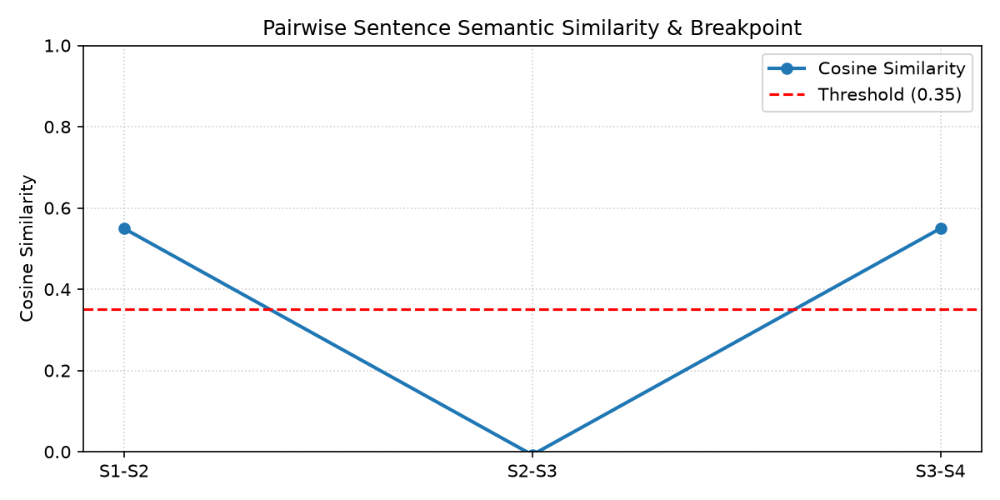

# الدرس 01: أساسيات وخوارزمية التقطيع الدلالي المتقدم
### Semantic Chunking Fundamentals & Breakpoint Architecture (Lecture 37)

---

## 1. قصور التقطيع الحجمي الثابت (The Failure of Fixed-Size Chunking)

في مسارات الـ RAG التقليدية، يتم تجزئة النصوص باستخدام خوارزميات تعتمد على عداد الحروف والرموز مثل `RecursiveCharacterTextSplitter`.
رغم بساطة هذه الطريقة وسرعتها الحسابية ($O(N)$)، إلا أنها تعاني من علل معمارية خطيرة في بيئات الإنتاج:

### أ. تمزيق الأفكار والسياق (Semantic Mutilation)
إذا بدأت الفكرة عند الحرف رقم 420 واكتملت عند الحرف 580 ضمن نافذة تقطيع قدرها 500 حرف، يتم شطر الفكرة إلى نصفين في قطعتين منفصلتين. النتيجة هي أن كلاً من القطعتين لا يحمل سياقاً كافياً لتمكين المسترجع (`Retriever`) من فهم السؤال والإجابة عليه بدقة.

### ب. تشتت المتجهات وتلوث السياق (Vector Smearing & Contextual Contamination)
عندما يدمج التقطيع الحجمي موضوعين متباينين داخل نفس القطعة (مثل انتهاء شرح برمجي عن الذكاء الاصطناعي وبداية فقرة عن معالم سياحية في باريس لمجرد اكتمال الـ 500 حرف)، فإن المتجه الكثيف الناتج (`Dense Embedding`) يمثل متوسطاً رياضياً مشوشاً لا يعبر بدقة عن أي من الموضوعين في فضاء المتجهات.

### ج. جمود الحجم (Inflexible Granularity)
الأفكار البسيطة يتم حشوها بنصوص غير لازمة، بينما الأفكار المعقدة والمترابطة يتم بترها عشوائياً.

---

## 2. فلسفة التقطيع الدلالي (Semantic Chunking Philosophy)

يعتمد التقطيع الدلالي على مبدأ أن **المعنى الرياضي واكتمال الفكرة هما الحاكمان الوحيدان لحدود القطعة**، وليس عدد الحروف.
تتميز القطع الناتجة بثلاث خصائص هندسية:
1. **مستقلة بذاتها (Self-Contained)**: كل قطعة تمثل قضية أو فكرة مكتملة يمكن استيعابها وفهمها بمفردها.
2. **عالية التركيز الدلالي (Contextually Dense)**: ترتفع نسبة الإشارة إلى التشويش (`Signal-to-Noise Ratio`) إلى أقصى حد ممكن داخل مخزن المتجهات.
3. **مفصولة منطقياً (Logically Separated)**: حدود القطع تقع حصراً عند نقاط الانعطاف الدلالي (`Semantic Inflection Points / Breakpoints`).

---

## 3. الخوارزمية الرياضية خطوة بخطوة

تتكون خوارزمية التقطيع الدلالي من أربع خطوات منهجية متتابعة:

### المرحلة 1: التجزئة اللغوية (Document Segmentation)
يتم تقسيم النص الخام إلى جمل مستقلة ونقية باستخدام تعبيرات منتظمة تفصل عند نهايات الجمل:
```python
sentences = [s.strip() for s in re.split(r"(?<=[.!?])\s+", text) if s.strip()]
```

### المرحلة 2: توليد المتجهات الكثيفة (Sentence Embeddings)
يتم تمرير كل جملة $S_i$ إلى موديل التضمين لتوليد متجهها الكثيف $E_i \in \mathbb{R}^d$:
$$E_i = \text{Embed}(S_i)$$

### المرحلة 3: قياس التشابه الزوجي للجمل المتجاورة (Pairwise Cosine Similarity)
يتم قياس زاوية التشابه بين كل جملة $S_i$ والجملة التالية لها مباشرة $S_{i+1}$:
$$\text{Sim}(E_i, E_{i+1}) = \frac{E_i \cdot E_{i+1}}{\|E_i\| \|E_{i+1}\|}$$

### المرحلة 4: رصد نقاط الانفصال والدمج (Breakpoint Detection & Grouping)
- إذا كان $\text{Sim}(E_i, E_{i+1}) \ge \text{Threshold}$: تستمر الجملتان داخل نفس القطعة الدلالية.
- إذا انخفض التشابه بشكل حاد $\text{Sim}(E_i, E_{i+1}) < \text{Threshold}$: يعتبر هذا الموضع نقطة انفصال دلالي (`Breakpoint`)، حيث يتم قفل القطعة الحالية وبدء قطعة جديدة.

---

## 4. التحليل البياني لمنحنى التشابه (Similarity Curve Analysis)

عند تمثيل درجات التشابه بيانياً، نلاحظ استقرار المنحنى عند القيم المرتفعة طالما يستمر نفس السياق، ثم حدوث هبوط حاد شبه عمودي (`Cliff Drop`) عند الانتقال من موضوع لآخر (كما حدث عند الانتقال من الحديث عن أدوات لانج تشين إلى برج إيفل في باريس):



---

## 5. مراجع التنفيذ البرمجي
- **الكود النموذجي المرجعي المكتمل**: [`stages/04-advanced-chunking/01-semantic-chunking-fundamentals/01-semantic-chunking-fundamentals.ipynb`](../../stages/04-advanced-chunking/01-semantic-chunking-fundamentals/01-semantic-chunking-fundamentals.ipynb)
- **معمل التدريب والتطبيق العملي**: [`playground/04-advanced-chunking/01-semantic-chunking-fundamentals.ipynb`](../../playground/04-advanced-chunking/01-semantic-chunking-fundamentals.ipynb)
