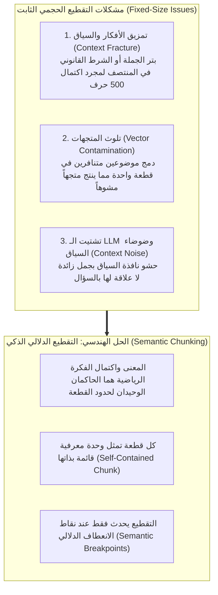
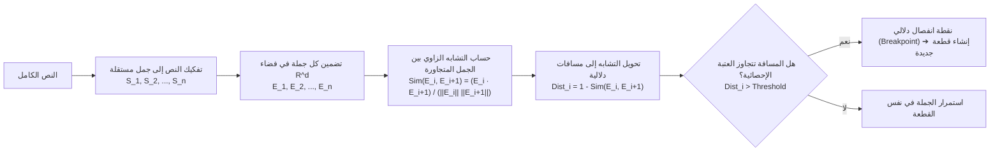
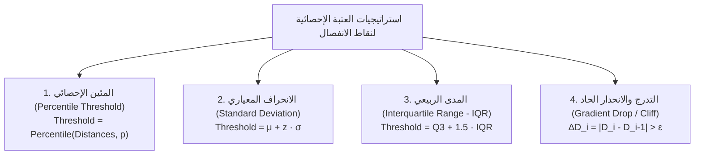

# الدليل الشامل والمعماري للتقطيع الدلالي المتقدم (Semantic Chunking Master Guide)
### Advanced Semantic Chunking, Breakpoint Algorithms, and Statistical Thresholds (Lectures 37 - 40)

---

## 1. قصور التقطيع الحجمي التقليدي (The Failure of Fixed-Size Chunking)

في أنظمة الـ RAG التقليدية، يتم تجزئة النصوص بالاعتماد على عدادات الحروف أو الرموز الثابتة عبر أدوات مثل `RecursiveCharacterTextSplitter`. ورغم بساطة هذا الأسلوب وسرعته الحسابية الخاطفة ($\mathcal{O}(N)$)، إلا أنه يُعد المتسبب الأول في انهيار دقة الاسترجاع الدلالي في بيئات الإنتاج للأسباب التالية:



---

## 2. الرياضيات الحاكمة لخوارزمية التقطيع الدلالي (Mathematical Formulation)

تعتمد خوارزمية التقطيع الدلالي على قياس التغير الزاوي في فضاء المتجهات الكثيفة للجمل المتتالية:



### الخطوة 1: التجزئة اللغوية الدقيقة (`Sentence Segmentation`)
يتم تقسيم النص إلى مصفوفة من الجمل النقية $\{S_1, S_2, \dots, S_n\}$ باستخدام تعبيرات نمطية تفصل عند علامات الترقيم دون فقدانها:
$$S = \text{RegexSplit}(T, \text{pattern}=r'(?<=[.!?])\s+')$$

### الخطوة 2: نافذة التنعيم السياقي (`Context Buffer Smoothing`)
لتقليل الضوضاء الناتجة عن الجمل القصيرة جداً (مثل: *"نعم صحيح."* أو *"انظر الشكل التالي."*)، نقوم بدمج كل جملة مع الجملة السابقة واللاحقة بنافذة انزلاقية بحجم $B$ (عادة $B = 1$):
$$\tilde{S}_i = S_{i-B} + \dots + S_i + \dots + S_{i+B}$$

### الخطوة 3: التضمين وحساب التشابه الزوجي (`Pairwise Cosine Similarity`)
نمرر كل جملة منعمة إلى نموذج التضمين للحصول على متجهها الكثيف $E_i \in \mathbb{R}^d$:
$$E_i = f_{\text{embed}}(\tilde{S}_i)$$

ثم نحسب تشابه جيب التمام ومسافة التباعد الدلالي $D_i$ بين كل جملتين متتاليتين:
$$\text{Sim}(E_i, E_{i+1}) = \frac{E_i \cdot E_{i+1}}{\|E_i\|_2 \|E_{i+1}\|_2}$$
$$D_i = 1 - \text{Sim}(E_i, E_{i+1})$$

---

## 3. العتبات الإحصائية لاكتشاف نقاط الانفصال (Breakpoint Threshold Strategies)

المعضلة الهندسية الكبرى: **كيف نحدد قيمة العتبة ($\text{Threshold}$) التي تقرر فصل القطعة؟**  
توفر خوارزميات التقطيع الدلالي 4 استراتيجيات إحصائية رياضية صارمة:



### أ. استراتيجية المئين (`Percentile Threshold` - الأكثر شيوعاً)
* **المفهوم**: نحدد مئيناً معيناً (مثلاً $p = 95$ أو $p = 90$).
* **الصيغة الرياضية**:
  $$\text{Threshold} = \text{Percentile}(\{D_1, D_2, \dots, D_{n-1}\}, p)$$
* **المعنى**: يتم اعتبار أعلى $(100 - p)\%$ من التباعدات كنقاط انفصال. إذا اخترت $p=95$، فإن 5% فقط من أكبر قفزات التباعد ستؤدي لإنشاء قطع جديدة، بينما تبقى 95% من الجمل مدمجة.

### ب. استراتيجية الانحراف المعياري (`Standard Deviation Threshold`)
* **المفهوم**: تعتمد على المتوسط الحسابي والانحراف المعياري لمسافات التباعد.
* **الصيغة الرياضية**:
  $$\mu = \frac{1}{m} \sum_{i=1}^m D_i \quad , \quad \sigma = \sqrt{\frac{1}{m} \sum_{i=1}^m (D_i - \mu)^2}$$
  $$\text{Threshold} = \mu + z \cdot \sigma$$
* حيث $z$ هو معامل الحساسية (افتراضياً $z = 1.0$ أو $z = 1.5$).
* **الميزة**: تتكيف تلقائياً مع تشتت النص وطبيعة لغته دون فرض نسبة مئوية مسبقة.

### ج. استراتيجية المدى الربيعي (`Interquartile Range - IQR`)
* **المفهوم**: مخصصة للنصوص المشوشة التي تحتوي على قيم شاذة (`Outliers`).
* **الصيغة الرياضية**:
  $$\text{IQR} = Q_3 - Q_1$$
  $$\text{Threshold} = Q_3 + k \cdot \text{IQR} \quad (k = 1.5)$$

---

## 4. التحليل البياني لمنحنى التشابه وهبوط الجرف (The Similarity Cliff Drop)

عند رسم درجات التشابه بيانياً على طول المستند، نلاحظ استقرار الخط عند مستويات تشابه عالية ($> 0.85$) طالما أن الحديث يستمر في نفس الموضوع.  
وعندما ينتقل الكاتب فجأة من الحديث عن خوارزميات الذكاء الاصطناعي إلى الحديث عن تاريخ تأسيس شركة آبل مثلاً، يهبط منحنى التشابه بشكل حاد شبه عمودي (**Similarity Cliff Drop**):

```
درجة التشابه
 1.0 |      الجملة 1-4 (عن RAG)               الجملة 6-9 (عن السيرفرات)
     |    o---o---o---o                         o---o---o---o
 0.8 |                 \                       /
     |                  \  هبوط حاد (Cliff)   /
 0.6 |-------------------X-------------------X------------------ [Threshold = 0.62]
     |                    \                 /
 0.4 |                     o (انتقال الموضوع)
 0.0 +--------------------------------------------------------> ترتيب الجمل
                             [Breakpoint 1]
```

عند نقطة التقاطع $X$ مع خط العتبة، تنطلق إشارة الانفصال البرمجية وتقوم بإنهاء القطعة الحالية فوراً.

---

## 5. تطبيق التقطيع الدلالي عبر مكتبة LangChain

توفر حزمة `langchain_experimental.text_splitter` أداة **`SemanticChunker`** الجاهزة عالية الكفاءة:

```python
from langchain_experimental.text_splitter import SemanticChunker
from langchain_huggingface import HuggingFaceEmbeddings

# 1. تهيئة نموذج التضمين المعتمد
embeddings = HuggingFaceEmbeddings(model_name="sentence-transformers/all-MiniLM-L6-v2")

# 2. إنشاء المقطع الدلالي مع تحديد نوع العتبة
semantic_splitter = SemanticChunker(
    embeddings=embeddings,
    breakpoint_threshold_type="percentile",  # الخيارات: "percentile", "standard_deviation", "interquartile"
    breakpoint_threshold_amount=95.0,        # حساسية العتبة
    buffer_size=1                            # حجم نافذة التنعيم المحيطة بالجملة
)

# 3. تقطيع المستندات
chunks = semantic_splitter.split_documents(raw_documents)
print(f"تم تجزئة النص إلى {len(chunks)} قطعة دلالية مكتملة المعنى.")
```

---

## 6. مصفوفة المقارنة الهندسية: التقطيع الحجمي مقابل التقطيع الدلالي

| المعيار الهندسي | التقطيع الحجمي المتكرر (`RecursiveCharacter`) | التقطيع الدلالي المتقدم (`SemanticChunker`) |
| :--- | :--- | :--- |
| **التعقيد الحسابي** | فائق السرعة خطياً $\mathcal{O}(N)$ | أبطأ ويتطلب تمرير كل جملة على نموذج التضمين |
| **استهلاك موارد الـ CPU / GPU** | ضئيل جداً ولا يتطلب كروت شاشة | مرتفع في مرحلة الفهرسة الأولى فقط |
| **اكتمال المعنى واستقلالية القطعة** | ضعيف إلى متوسط (عرضة للبتر الدائم) | **استثنائي وفائق بنسبة 100%** |
| **نسبة الإشارة إلى الضوضاء (SNR)** | متوسطة (تلوث القطع بنصوص غير لازمة) | **عالية جداً وخالية من التشتت** |
| **دقة الاسترجاع الدلالي (Recall@k)** | مقبولة في الاستفسارات العامة | **أعلى بنسبة 25% إلى 40% في الأسئلة الدقيقة** |
| **الاستخدام الإنتاجي الأمثل** | الوثائق الضخمة جداً ذات الميزانيات المحدودة | العقود القانونية، التقارير الطبية، والكتب المعرفية المركبة |

---

## 7. أسئلة المقابلات الهندسية المتقدمة (Senior AI Interview Questions)

### س1: ما هو العيب الأساسي في استخدام التقطيع الدلالي (`Semantic Chunking`) في خطوط الإنتاج الضخمة، وكيف يتغلب المهندسون عليه؟
**الإجابة:** 
* **العيب الأساسي**: بطء مرحلة الإدخال الأولي (`High Ingestion Latency`)؛ فإذا كان المستند يحتوي على 10,000 جملة، يحتاج النظام إلى 10,000 استدعاء لنموذج التضمين فقط لمعرفة أين يقطع النص!
* **الحلول المعمارية في الإنتاج**:
  1. **المعالجة بالدفعات الكبيرة (`Batched Embeddings`)**: تجميع الجمل في دفعات من 64 إلى 128 جملة دفعة واحدة واستغلال كروت الشاشة.
  2. **التقطيع الهجين ثنائي المراحل (`Two-Stage Chunking`)**: تقسيم الكتاب أولاً إلى فصول أو أقسام كبرى بناءً على العناوين الهيكلية (`Markdown Header Splitter`)، ثم تطبيق التقطيع الدلالي داخل كل فصل على حدة بشكل غير متزامن (`Asynchronous Parallel Workers`).

### س2: متى تختار استراتيجية `standard_deviation` بدلاً من `percentile` كعتبة لنقاط الانفصال؟
**الإجابة:**
* نستخدم **`percentile`** عندما نريد تحكماً حتمياً ثابتاً في عدد القطع الناتجة تقريباً (مثلاً نضمن أن 90% من الجمل ستدمج).
* نستخدم **`standard_deviation`** عندما تتفاوت طبيعة المستندات بشكل كبير؛ فبعض المستندات تتناول موضوعاً واحداً مترابطاً جداً من البداية للنهاية (انحراف معياري منخفض)، وبعضها ينتقل بين عشرات الموضوعات في كل صفحة (انحراف معياري مرتفع). ميزة الانحراف المعياري أنه يتكيف ديناميكياً مع طبيعة تماسك النص، فلا يجبر المستند المترابط على الانقسام قسراً، بينما يقطع المستند المتشعب عند كل انتقال فعلي.
