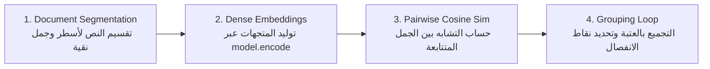

# الدرس 02: بناء محرك التقطيع الدلالي بلغة بايثون
### Practical Semantic Chunking Engine in Pure Python (Lecture 38)

---

## 1. الفلسفة المعمارية للدرس

في هذا الدرس، يتم الانتقال من مجرد فهم الفكرة الرياضية إلى بناء **محرك برمجي كامل للتقطيع الدلالي من الصفر بلغة بايثون**، باستخدام مكتبات مفتوحة المصدر وخفيفة لتفادي أي تكاليف استدعاء APIs خارجية:
1. `sentence-transformers`: لتحميل موديل التضمين المحلي `all-MiniLM-L6-v2` (384 بعداً).
2. `scikit-learn`: لاستخدام دالة `cosine_similarity` لحساب زوايا التشابه بين متجهات الجمل.
3. `numpy`: لإجراء العمليات المصفوفية الرياضية بكفاءة عالية.

---

## 2. المراحل الأربع لبناء المحرك البرمجي



### الخطوة 1: تجزئة النص الخام (Document Segmentation)
يتم تقسيم النص الخام إلى جمل مستقلة مع إزالة الفراغات والمسافات البيضاء الزائدة (`strip`):
```python
sentences = [s.strip() for s in text.split("\n") if s.strip()]
```

### الخطوة 2: التضمين المحلي السريع (Local Sentence Embeddings)
يتم استدعاء موديل `all-MiniLM-L6-v2` محلياً لتوليد مصفوفة المتجهات:
```python
embeddings = model.encode(sentences)
```

### الخطوة 3: حساب مصفوفة التشابه الزوجي المتتالي (Pairwise Cosine Similarity)
يتم المرور بحلقة لحساب درجة التشابه بين كل جملة $S_i$ والجملة السابقة لها $S_{i-1}$:
```python
sim = cosine_similarity([embeddings[i - 1]], [embeddings[i]])[0][0]
```

### الخطوة 4: حلقة التجميع الدلالي والقطع بالعتبة (Semantic Grouping Loop)
تتبع الخوارزمية المنطق التالي:
1. تهيئة القطعة الأولى: `current_chunk = [sentences[0]]`.
2. الدوران من الجملة الثانية حتى نهاية القائمة:
   - إذا كان `sim >= threshold`: تدمج الجملة مع القطعة الحالية `current_chunk.append(sentences[i])`.
   - إذا كان `sim < threshold`: تحفظ القطعة السابقة وتبدأ قطعة جديدة:
     ```python
     chunks.append(" ".join(current_chunk))
     current_chunk = [sentences[i]]
     ```
3. إضافة القطعة الأخيرة عند اكتمال الحلقة:
   ```python
   if current_chunk:
       chunks.append(" ".join(current_chunk))
   ```

---

## 3. دراسة أثر ضبط العتبة (Threshold Tuning Analysis)

تم اختبار الخوارزمية على النص النموذجي للمحاضرة الذي يحتوي على 5 جمل:
- الجمل 1 و 2 و 3: تتناول إطار لانج تشين ومكونات الذكاء الاصطناعي.
- الجملتان 4 و 5: تتناولان برج إيفل وفرنسا وقطاع السياحة.

### النتائج الحسابية الفعلية لدرجات التشابه:
* **بين الجملة 1 و 2:** `0.8248` (ترابط عالي جداً).
* **بين الجملة 2 و 3:** `0.4487` (ترابط متوسط يذكر السلاسل والذاكرة).
* **بين الجملة 3 و 4:** `0.0225` (انهيار دلالي حاد شبه منعدم - نقطة انفصال واضحة).
* **بين الجملة 4 و 5:** `0.3776` (ترابط متوسط حول فرنسا وباريس).

### مقارنة أثر العتبات:
| قيمة العتبة (`Threshold`) | عدد القطع الناتجة | سلوك التقطيع | التقييم الهندسي |
| :---: | :---: | :--- | :--- |
| **`0.70` (عتبة محكمة)** | 4 قطع | `Chunk 1`: الجملتان 1 و 2.<br>`Chunk 2`: الجملة 3 منفردة.<br>`Chunk 3`: الجملة 4 منفردة.<br>`Chunk 4`: الجملة 5 منفردة. | عالي التحديد والدقة، لكنه يفتت الأفكار المترابطة أحياناً. |
| **`0.35` (عتبة متوازنة)** | قطعتان فقط | `Chunk 1`: الجمل 1 و 2 و 3 (سياق الذكاء الاصطناعي كاملاً).<br>`Chunk 2`: الجملتان 4 و 5 (سياق فرنسا كاملاً). | مثالي لأنظمة الـ RAG لتزويد الموديل بسياق فكرة متكامل ومغلق. |

---

## 4. مراجع التنفيذ البرمجي
- **الكود النموذجي المرجعي المكتمل**: [`stages/04-advanced-chunking/02-semantic-chunking-python/02-semantic-chunking-python.ipynb`](../../stages/04-advanced-chunking/02-semantic-chunking-python/02-semantic-chunking-python.ipynb)
- **معمل التدريب والتطبيق العملي**: [`playground/04-advanced-chunking/02-semantic-chunking-python.ipynb`](../../playground/04-advanced-chunking/02-semantic-chunking-python.ipynb)
