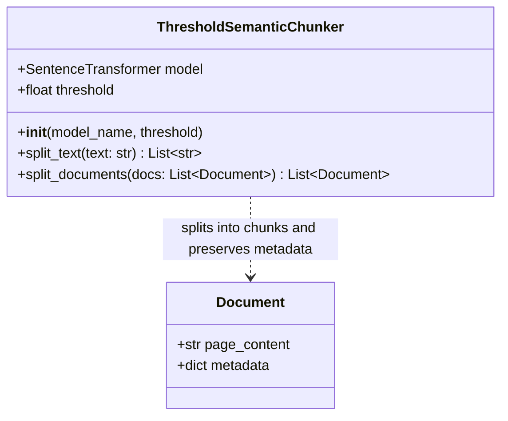
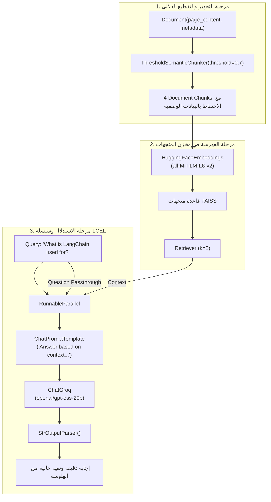

# الدرس 03: بناء مسار RAG كامل مدمج به كلاس التقطيع المعياري
### Building an End-to-End RAG Pipeline with Custom Modular Semantic Chunker (Lecture 39)

---

## 1. الدوافع الهندسية والانتقال للبرمجة المعيارية (Modular Coding)

في بيئات الإنتاج الحقيقية (`Production`)، لا يمكن الاعتماد على دوال متفرقة أو أكواد إجرائية غير مجمعة.
تتطلب المعمارية السليمة:
1. **تغليف منطق التقطيع (`Encapsulation`)**: وضع منطق حساب المتجهات والتشابه داخل كلاس بايثون موحد: `ThresholdSemanticChunker`.
2. **التوافق التام مع منظومة لانج تشين (`LangChain Compatibility`)**: قبول وإخراج كائنات وثائق لانج تشين (`langchain_core.documents.Document`).
3. **الحفاظ على البيانات الوصفية (`Metadata Preservation`)**: نقل وحفظ الـ `metadata` (مثل اسم الملف، الصفحة، الكاتب، التاريخ) من الوثيقة الأصلية إلى جميع القطع الدلالية الناتجة عنها لضمان دقة التتبع في مرحلة الاسترجاع.

---

## 2. التصميم المعماري لكلاس `ThresholdSemanticChunker`

### وظائف الدوال الرئيسية داخل الكلاس:
* **دالة البناء `__init__(model_name, threshold)`**:
  - تقوم بتهيئة موديل التضمين المحلي (`all-MiniLM-L6-v2`).
  - تحديد العتبة الحاكمة للفصل (افتراضياً 0.7).
* **دالة `split_text(text: str) -> List[str]`**:
  - تتولى التقطيع اللغوي للنص الخام، حساب التضمينات، والمرور بحلقة التشابه الزوجي بالعتبة لإرجاع قائمة النصوص المقطوعة.
* **دالة `split_documents(docs: List[Document]) -> List[Document]`**:
  - تدور على كل كائن `Document` في القائمة المدخلة.
  - تستدعي `split_text` على الـ `page_content`.
  - تنشئ كائنات `Document` جديدة لكل قطعة مع عمل نسخة مستقلة من البيانات الوصفية الأصلية (`doc.metadata.copy()`).

---

## 3. معمارية مسار الـ RAG الكامل بتعبيرات `LCEL`

---

## 4. اعتبارات الإنتاج والـ Trade-offs

1. **عزل السياق وانعدام الهلوسة**:
   - عند سؤال المسار عن استخدامات لانج تشين، قام المسترجع بجلب قطعتي الذكاء الاصطناعي فقط، وتجاهل تماماً قطعتي برج إيفل وفرنسا، مما أنتج إجابة مثالية خالية من أي شوائب خارجية.
2. **استخدام الموديلات المحلية الخفيفة**:
   - تم استخدام موديل `all-MiniLM-L6-v2` محلياً لتشغيل كل من الـ Chunker ومخزن `FAISS`، مما وفر سرعة استجابة فائقة وانعدام تكلفة استدعاء الـ APIs في مرحلة الـ Ingestion.
3. **سرعة الاستدلال عبر Groq**:
   - استخدام بوابات Groq وفر استجابة شبه فورية للنماذج اللغوية الكبيرة مع تحكم كامل بدرجة الحرارة (`temperature=0.4`) لتقليل الهلوسة وضمان الالتزام بالسياق المسترجع.

---

## 5. مراجع التنفيذ البرمجي
- **الكود النموذجي المرجعي المكتمل**: [`stages/04-advanced-chunking/03-building-rag-semantic-chunker/03-building-rag-semantic-chunker.ipynb`](../../stages/04-advanced-chunking/03-building-rag-semantic-chunker/03-building-rag-semantic-chunker.ipynb)
- **معمل التدريب والتطبيق العملي**: [`playground/04-advanced-chunking/03-building-rag-semantic-chunker.ipynb`](../../playground/04-advanced-chunking/03-building-rag-semantic-chunker.ipynb)
