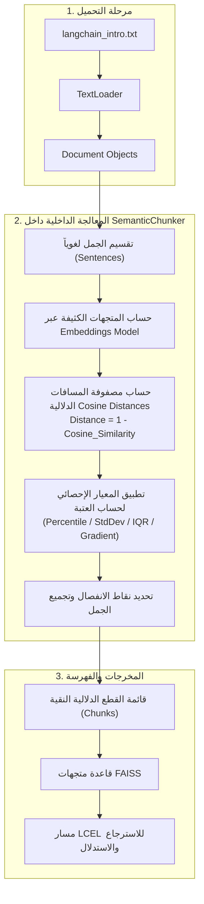

# الدرس 04: التقطيع الدلالي الجاهز باستخدام مكتبة LangChain
### Built-in Semantic Chunking with LangChain & Threshold Strategies (Lecture 40)

---

## 1. الدوافع المعمارية للدرس

في المحاضرات السابقة (37، 38، 39)، قمنا ببناء خوارزمية التقطيع الدلالي يدوياً من الصفر، وحساب زوايا التشابه الزوجي، وكتابة كلاس معياري مخصص.
في هذا الدرس، ننتقل إلى دراسة واستخدام **الأداة الرسمية الجاهزة المدمجة في منظومة لانج تشين**: `SemanticChunker` من حزمة `langchain_experimental.text_splitter`.

الهدف هو فهم:
- كيف تطبق لانج تشين خوارزمية التقطيع الدلالي داخلياً.
- معايير تحديد عتبات الانفصال الإحصائية (`Breakpoint Threshold Strategies`).
- بناء مسار RAG متكامل وفق التحدي والتكليف المطروح في ختام المحاضرة.

---

## 2. المعمارية الداخلية لأداة `SemanticChunker`

### كيف تحسب لانج تشين نقاط الانفصال؟
على عكس مقارنة التشابه المباشرة ($\text{Sim} \ge \text{Threshold}$)، تستخدم أداة لانج تشين **المسافة الدلالية (`Cosine Distance`)**:
$$\text{Distance}(E_{i-1}, E_i) = 1 - \text{Cosine Similarity}(E_{i-1}, E_i)$$

كلما زاد التباين بين جملتين، ارتفعت المسافة واقتربت من 1. وتبحث الخوارزمية عن المسافات الشاذة أو المرتفعة جداً لوضع نقطة الانفصال (`Breakpoint`).

---

## 3. استراتيجيات العتبات الإحصائية (`Breakpoint Threshold Types`)

توفر أداة `SemanticChunker` أربعة خيارات متقدمة لحساب العتبة ديناميكياً بناءً على طبيعة المستند:

| نوع العتبة (`breakpoint_threshold_type`) | القيمة الافتراضية | آلية العمل الرياضية | متى يُفضل استخدامها؟ |
| :--- | :---: | :--- | :--- |
| **`percentile` (الافتراضي)** | `95` | يتم حساب مصفوفة المسافات بين كافة الجمل، وأي مسافة تقع فوق النسبة المئوية 95% تعتبر نقطة فصل. | مثالية للمستندات متعددة الموضوعات التي تحتوي على فواصل حادة وواضحة بين الفقرات. |
| **`standard_deviation`** | `1.25` | يتم حساب المتوسط الحسابي والانحراف المعياري للمسافات: $\text{Threshold} = \mu + (1.25 \times \sigma)$. | تناسب النصوص التقنية ذات السياق المتجانس نسبياً لرصد التغيرات الشاذة فقط. |
| **`interquartile` (IQR)** | `1.5` | يعتمد على المدى الربيعي: $\text{Threshold} = Q_3 + (1.5 \times \text{IQR})$. | ممتازة للوثائق المعرضة للضوضاء الإحصائية وتمنع التأثر بالقيم المتطرفة الشاذة. |
| **`gradient`** | تلقائي | يبحث عن نقاط الانعطاف الرياضية في ميل منحنى المسافات المتراكمة. | مناسبة للنصوص الطويلة ذات التدفق السردي المتدرج. |

---

## 4. المقارنة الهندسية: الكود المخصص مقابل أداة لانج تشين

| وجه المقارنة | محرك التقطيع المخصص (`ThresholdSemanticChunker`) | أداة لانج تشين (`SemanticChunker`) |
| :--- | :--- | :--- |
| **معيار الفصل** | عتبة تشابه ثابتة يحددها المطور يدوياً ($\text{Sim} \ge \text{Threshold}$) | عتبات إحصائية ديناميكية تتكيف مع المسافات داخل المستند |
| **حساب المسافة** | تشابه جيب التمام المباشر ($\text{Cosine Similarity}$) | مسافة جيب التمام ($1 - \text{Cosine Similarity}$) |
| **الاعتمادية الخارجية** | كود نقي يعتمد على مكتبات ML القياسية | تتطلب حزمة `langchain-experimental` |
| **المرونة** | تحكم كامل في منطق الجمع والحلقات | جاهزة للاستخدام المباشر بسطرين كود |

---

## 5. مراجع التنفيذ البرمجي
- **الكود النموذجي المرجعي المكتمل**: [`stages/04-advanced-chunking/04-semantic-chunking-langchain/04-semantic-chunking-langchain.ipynb`](../../stages/04-advanced-chunking/04-semantic-chunking-langchain/04-semantic-chunking-langchain.ipynb)
- **معمل التدريب والتطبيق العملي**: [`playground/04-advanced-chunking/04-semantic-chunking-langchain.ipynb`](../../playground/04-advanced-chunking/04-semantic-chunking-langchain.ipynb)
