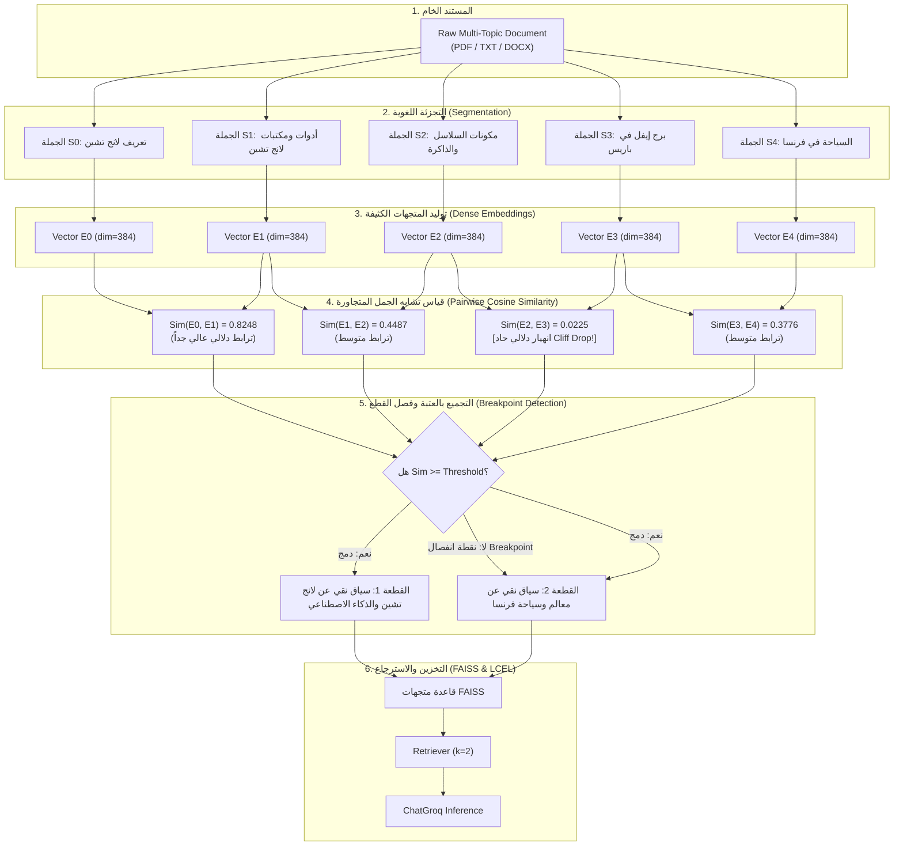

# المرحلة 04: تقنيات التقطيع الدلالي المتقدم
### Advanced Semantic Chunking Architecture (`docs/04-advanced-chunking/`)

تغطي هذه المرحلة بالكامل **القسم الثامن من الكورس (Section 8: Advanced Chunking And Preprocessing Techniques - المحاضرات 37 إلى 40)**.

تتناول هذه المرحلة الانتقال المعماري من التقطيع الحجمي الثابت القائم على عداد الحروف والرموز (`Fixed-Size Splitting`) إلى **التقطيع الدلالي الذكي (`Semantic Chunking`)** القائم على قياس اكتمال الأفكار واستمرار المعنى الرياضي بين الجمل.

---

## فهرس موضوعات المرحلة

| الرقم | عنوان الدرس النظري | المحاضرة المقابلة | الملف التوثيقي | الكود النموذجي (`stages/`) | معمل التجربة (`playground/`) |
| :---: | :--- | :---: | :---: | :---: | :---: |
| 01 | **أساسيات وخوارزمية التقطيع الدلالي ونقاط الانفصال** | Lecture 37 | [`01-semantic-chunking-fundamentals.md`](./01-semantic-chunking-fundamentals.md) | [`stages/04/.../01-...ipynb`](../../stages/04-advanced-chunking/01-semantic-chunking-fundamentals/01-semantic-chunking-fundamentals.ipynb) | [`playground/04/.../01-...ipynb`](../../playground/04-advanced-chunking/01-semantic-chunking-fundamentals.ipynb) |
| 02 | **بناء محرك التقطيع الدلالي بلغة بايثون من الصفر** | Lecture 38 | [`02-semantic-chunking-python.md`](./02-semantic-chunking-python.md) | [`stages/04/.../02-...ipynb`](../../stages/04-advanced-chunking/02-semantic-chunking-python/02-semantic-chunking-python.ipynb) | [`playground/04/.../02-...ipynb`](../../playground/04-advanced-chunking/02-semantic-chunking-python.ipynb) |
| 03 | **بناء مسار RAG كامل مدمج به كلاس التقطيع المعياري** | Lecture 39 | [`03-building-rag-semantic-chunker.md`](./03-building-rag-semantic-chunker.md) | [`stages/04/.../03-...ipynb`](../../stages/04-advanced-chunking/03-building-rag-semantic-chunker/03-building-rag-semantic-chunker.ipynb) | [`playground/04/.../03-...ipynb`](../../playground/04-advanced-chunking/03-building-rag-semantic-chunker.ipynb) |
| 04 | **التقطيع الدلالي الجاهز باستخدام مكتبة LangChain** | Lecture 40 | `04-semantic-chunking-langchain.md` | قيد العمل | قيد العمل |

---

## المعمارية العامة للتقطيع الدلالي (Semantic Chunking Architecture)

---

## المقارنة الهندسية: التقطيع الحجمي مقابل التقطيع الدلالي

| معيار المقارنة | التقطيع الحجمي الثابت (`RecursiveCharacterTextSplitter`) | التقطيع الدلالي المتقدم (`Semantic Chunking`) |
| :--- | :--- | :--- |
| **أساس التقطيع** | عدد الحروف أو التوكنز الثابت (مثلاً 500 حرف) | درجة الترابط الدلالي وانتقال موضوع الفكرة |
| **سلامة السياق** | منخفضة جداً؛ قد يتم قطع الفكرة في منتصفها | ممتازة؛ كل قطعة تحتوي على فكرة مكتملة ومستقلة |
| **نقاء المتجهات (Signal-to-Noise)** | مشوش؛ يدمج موضوعات مختلفة في نفس المتجه | نقي 100%؛ المتجه يمثل معنى واحداً واضحاً ومحدداً |
| **التكلفة والسرعة في الـ Ingestion** | فوري وبدون أي تكلفة حسابية ($O(N)$) | يتطلب حساب متجهات التضمين للجمل أولاً |
| **أثر الإنتاج على الـ RAG** | احتمالية هلوسة واسترجاع سياق مشتت وغير متصل | استرجاع فائق الدقة وانعدام الهلوسة الناتجة عن تشتت السياق |
