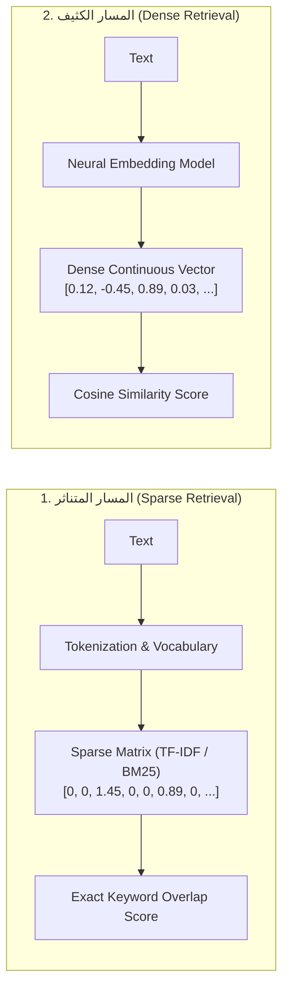

# الدرس 01: دمج المصفوفات الكثيفة والمتناثرة (الأسس الرياضية والنظرية)
### Combining Dense and Sparse Matrix Representation (Lecture 41)

---

## 1. الدوافع الهندسية للبحث الهجين (Why Pure Semantic Search Fails)

في المراحل السابقة من الـ RAG، اعتمدنا بالكامل على **البحث الكثيف الدلالي (`Dense Semantic Search`)** عبر تحويل النصوص إلى متجهات متصلة وحساب تشابه جيب التمام.

ورغم قوة البحث الدلالي في فهم السياق والمترادفات، إلا أنه يعاني في بيئات الإنتاج من ثغرات قاتلة:
1. **معضلة الألفاظ الدقيقة والأسماء (Keyword & Entity Mismatch)**:
   - إذا كان المستخدم يبحث عن رقم قطعة غيار محدد (`SKU-48192-X`) أو كود خطأ برمجي (`ERR_HTTP2_PROTOCOL_ERROR`) أو اسم شخص نادر، فإن نماذج التضمين الدلالية قد تخلط بينه وبين أكواد أخرى مشابهة دلالياً، وتفشل في التطابق الحرفي المطلوب.
2. **فقدان الدقة في المصطلحات المتخصصة**:
   - في المجالات الطبية والقانونية، استبدال كلمة بأخرى مرادفة قد يغير الحكم القانوني أو التشخيص الطبي بالكامل.

من هنا ظهرت ضرورة **البحث الهجين (`Hybrid Search`)** الذي يدمج بين:
- **البحث المتناثر (`Sparse Search`)**: للمطابقة الحرفية الصارمة للكلمات والرموز.
- **البحث الكثيف (`Dense Search`)**: لفهم المعنى الضمني والسياق اللغوي العام.

---

## 2. المقارنة الرياضية بين المسارين

### أولاً: المسار المتناثر (Sparse Retrieval)
- **المفهوم**: تحويل كل وثيقة إلى متجه في فضاء حجمه يساوي حجم القاموس اللغوي بأكمله ($|V|$).
- **المصفوفة المتناثرة (`Sparse Matrix`)**: تتكون بنسبة 99% من الأصفار، ولا تحتوي على أرقام إلا في مواقع الكلمات الموجودة فعلياً في النص.
- **أشهر الخوارزميات**:
  1. **حقيبة الكلمات (`Bag of Words - BoW`)**: عد تكرار كل كلمة.
  2. **التردد اللفظي العكسي (`TF-IDF`)**:
     $$\text{TF}(t, d) = \frac{f_{t,d}}{\sum_{t' \in d} f_{t',d}}$$
     $$\text{IDF}(t, D) = \log \frac{N}{|\{d \in D : t \in d\}|}$$
     $$\text{TF-IDF}(t, d, D) = \text{TF}(t, d) \times \text{IDF}(t, D)$$
  3. **خوارزمية `BM25`**: النسخة الأحدث والأكثر نضجاً من TF-IDF والمستخدمة في محركات البحث العالمية (Elasticsearch و Lucene).

### ثانياً: المسار الكثيف (Dense Retrieval)
- **المفهوم**: تمثيل النص بمتجه كثيف صغير وثابت الطول (مثلاً 384 أو 1536 بعداً)، حيث كل بعد يحتوي على رقم عشري يعبر عن ميزة دلالية في فضاء التضمين.
- **مقياس القياس**: تشابه جيب التمام (`Cosine Similarity`):
  $$\text{Cosine Similarity}(u, v) = \frac{u \cdot v}{\|u\| \|v\|}$$

---

## 3. معادلة الدمج الموزون (The Hybrid Fusion Equation)

لدمج قوة المسارين في درجة تقييم نهائية واحدة قابلة للترتيب، نستخدم معادلة الدمج الخطي الموزون (`Convex Combination`):

$$\text{Score}_{\text{hybrid}}(q, d) = \alpha \cdot \text{Score}_{\text{dense}}(q, d) + (1 - \alpha) \cdot \text{Score}_{\text{sparse}}(q, d)$$

حيث:
* $\text{Score}_{\text{dense}}(q, d) \in [0, 1]$: درجة التشابه الدلالي الناتجة عن البحث الكثيف.
* $\text{Score}_{\text{sparse}}(q, d) \in [0, 1]$: درجة المطابقة اللفظية الناتجة عن خوارزمية TF-IDF أو BM25 (بعد تطبيعها).
* $\alpha \in [0.0, 1.0]$: معامل الموازنة (`Weighting Factor`):
  * **$\alpha = 1.0$**: بحث كثيف دلالي بحت (`Pure Dense Search`).
  * **$\alpha = 0.0$**: بحث متناثر لفظي بحت (`Pure Keyword Search`).
  * **$\alpha = 0.5$**: توازن متساوٍ 50/50 بين المعنى والتطابق الحرفي.

---

## 4. المحاكاة الحسابية لمثال المحاضرة (Numerical Walkthrough)

نفترض وجود ثلاث وثائق في قاعدة البيانات:
* **الوثيقة 1 ($D_1$)**: `"LangChain helps build LLM apps."`
* **الوثيقة 2 ($D_2$)**: `"Pinecone is used for vector search."`
* **الوثيقة 3 ($D_3$)**: `"Eiffel Tower is in Paris."`

**استعلام المستخدم ($q$)**: `"build application using LLM"`

### جدول درجات التطابق الحسابية:

| الوثيقة | درجة البحث الكثيف ($\text{Score}_{\text{dense}}$) | درجة البحث المتناثر ($\text{Score}_{\text{sparse}}$) | الدرجة الهجينة ($\alpha = 0.5$) | الترتيب النهائي |
| :---: | :---: | :---: | :---: | :---: |
| **$D_1$** | `0.85` (معنى مرتبط جداً بالـ LLMs) | `0.60` (تطابق لفظي لكلمتي build و LLM) | $0.5(0.85) + 0.5(0.60) = \mathbf{0.725}$ | **الأول (الفائز)** |
| **$D_2$** | `0.40` (سياق عام عن قواعد المتجهات) | `0.00` (لا يوجد أي تطابق لفظي) | $0.5(0.40) + 0.5(0.00) = \mathbf{0.200}$ | الثاني |
| **$D_3$** | `0.10` (سياق جغرافي غير مرتبط) | `0.00` (لا يوجد أي تطابق لفظي) | $0.5(0.10) + 0.5(0.00) = \mathbf{0.050}$ | الثالث |

### الملاحظة المعمارية:
الوثيقة $D_1$ فازت بجدارة لأنها جمعت بين ميزتين معاً:
1. فهم الموديل أنها تتناول بناء تطبيقات الذكاء الاصطناعي (دلالياً).
2. وجود تطابق فعلي للكلمات المفتاحية المذكورة في السؤال (`build` و `LLM`).

---

## 5. مراجع التنفيذ البرمجي
- **الكود النموذجي المرجعي المكتمل**: [`stages/05-hybrid-search-and-retrieval/01-combining-dense-and-sparse/01-combining-dense-and-sparse.ipynb`](../../stages/05-hybrid-search-and-retrieval/01-combining-dense-and-sparse/01-combining-dense-and-sparse.ipynb)
- **معمل التدريب والتطبيق العملي**: [`playground/05-hybrid-search-and-retrieval/01-combining-dense-and-sparse.ipynb`](../../playground/05-hybrid-search-and-retrieval/01-combining-dense-and-sparse.ipynb)
