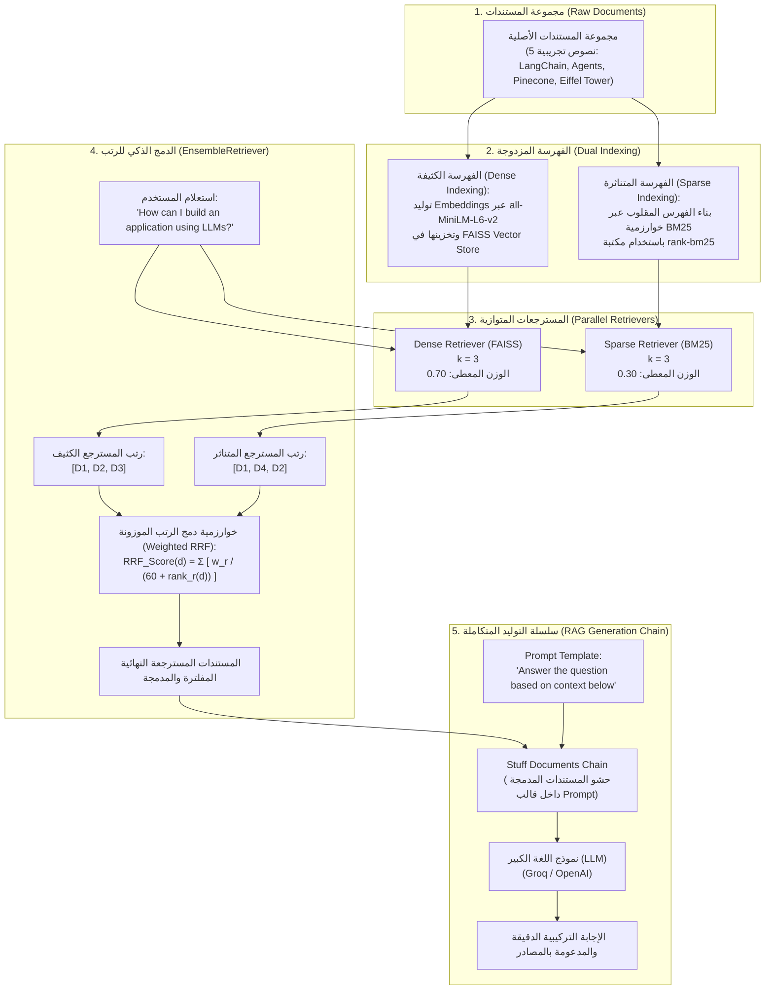

# المحاضرة 42: تطبيق المسترجع الهجين باستخدام مكتبة LangChain
### Hybrid Search Implementation with LangChain (`BM25Retriever` + `FAISS` + `EnsembleRetriever`)

---

## 1. النظرة العامة والهدف المعماري (Architectural Overview)

في المحاضرة السابقة (المحاضرة 41)، قمنا ببناء مفهوم البحث الهجين برمجياً من الصفر عن طريق حساب مصفوفات `TF-IDF` ومصفوفات الـ `Embeddings`، ودمج درجات التشابه عبر المعادلة المحدبة المباشرة.

في هذه المحاضرة، ننتقل إلى **المستوى المعماري للإنتاج باستخدام مكتبة `LangChain`**، حيث نتعلم كيفية بناء مسار استرجاع هجين متكامل (`Hybrid RAG Pipeline`) يجمع بين:
1. **المسترجع الكثيف (`Dense Retriever`)**: معتمد على قاعدة بيانات الفيكتورز `FAISS` ونموذج التضمين `HuggingFaceEmbeddings`.
2. **المسترجع المتناثر (`Sparse Retriever`)**: معتمد على خوارزمية `BM25` عبر `BM25Retriever` (دون الحاجة لتشغيل مجمع `Elasticsearch` معقد).
3. **طبقة الدمج الموزون (`EnsembleRetriever`)**: لدمج نتائج المسترجعين باستخدام خوارزمية **دمج الرتب العكسية (`Reciprocal Rank Fusion - RRF`)**.
4. **سلسلة التوليد المدعومة بالاسترجاع (`End-to-End Retrieval Chain`)**: باستخدام `create_stuff_documents_chain` و `create_retrieval_chain` لصياغة الإجابة النهائية بالاعتماد على السياق المدمج.

---

## 2. المخطط المعماري لمنظومة الاسترجاع الهجين في LangChain



---

## 3. الأساس الرياضي: كيف تختلف درجات التشابه ولماذا نستخدم RRF؟

### 3.1 معضلة مقارنة الدرجات المباشرة (Incomparable Raw Scores)
عند دمج مسترجع كثيف مع مسترجع متناثر، نواجه تحدياً رياضياً خطيراً:
* درجات التشابه الكثيف (`Cosine Similarity`) محصورة في المجال $[-1, 1]$ أو $[0, 1]$.
* درجات خوارزمية `BM25` أو `TF-IDF` هي أرقام مفتوحة غير محدودة علياً ($[0, \infty)$) وتعتمد على طول المستند وتكرار الكلمات، فقد تكون $2.5$ في مستند وتصل إلى $34.8$ في مستند آخر.

جمع الدرجات الخام مباشرة بدون معايرة إحصائية يُميل الكفة تماماً لصالح المسترجع المتناثر ويفسد الدقة.

---

### 3.2 خوارزمية Okapi BM25 تحت المجهر
تُعد خوارزمية `BM25` التطور الرياضي الأحدث لـ `TF-IDF`؛ حيث تعالج مشكلة تضخم الدرجة عند تكرار الكلمة دون حدود (`Term Frequency Saturation`):

$$\text{Score}_{\text{BM25}}(D, Q) = \sum_{i=1}^{N} \text{IDF}(q_i) \cdot \frac{f(q_i, D) \cdot (k_1 + 1)}{f(q_i, D) + k_1 \cdot \left(1 - b + b \cdot \frac{|D|}{\text{avgdl}}\right)}$$

حيث:
* $f(q_i, D)$: تردد الكلمة $q_i$ داخل المستند $D$.
* $|D|$: طول المستند الحالي (عدد الكلمات).
* $\text{avgdl}$: متوسط أطوال كافة المستندات في المستودع (`Average Document Length`).
* $k_1$: معامل تشبع تردد الكلمات (يُضبط عادة بين $1.2$ و $2.0$). يمنع كلمة تكررت 100 مرة من الحصول على درجة تعادل 100 ضعف كلمة تكررت مرة واحدة.
* $b$: معامل تسوية طول المستند (يُضبط عادة عند $0.75$). يُعاقب المستندات الطويلة التي تضم كلمات كثيرة بالصدفة.
* $\text{IDF}(q_i)$: مقلوب تردد الوثيقة لتفضيل الكلمات النادرة:
$$\text{IDF}(q_i) = \ln \left( \frac{N - n(q_i) + 0.5}{n(q_i) + 0.5} + 1 \right)$$

---

### 3.3 خوارزمية دمج الرتب العكسية (Reciprocal Rank Fusion - RRF) في EnsembleRetriever
لحسم مشكلة اختلاف المقاييس، تعتمد `LangChain` في أداة `EnsembleRetriever` خوارزمية **`Reciprocal Rank Fusion (RRF)`**:

$$\text{RRF\_Score}(d \in D) = \sum_{r \in \mathcal{R}} \frac{w_r}{c + \text{rank}_r(d)}$$

حيث:
* $\mathcal{R}$: مجموعة المسترجعات المشاركة (المسترجع الكثيف والمسترجع المتناثر).
* $w_r$: الوزن النسبي للمسترجع $r$ (مثلاً: $w_{\text{dense}} = 0.7$ و $w_{\text{sparse}} = 0.3$).
* $\text{rank}_r(d)$: ترتيب المستند $d$ في قائمة نتائج المسترجع $r$ (المركز 1، المركز 2، ...إلخ).
* $c$: ثابت التنعيم (`Smoothing Constant`، وقيمته الافتراضية في `LangChain` هي $60$). وظيفته تقليل أثر الفروق الكبيرة بين المراكز الأولى وضمان استقرار التوزيع.

**ميزة الـ RRF:** خوارزمية مستقلة تماماً عن وحدة قياس درجات المسترجعات، لأنها تعتمد حصراً على **الترتيب (`Rank Position`)** وليس على الدرجة العددية الخام.

---

## 4. تشريح الكود ومكونات خط العمل (Code Component Analysis)

### 4.1 بناء الفهرس المتناثر عبر `BM25Retriever`
```python
from langchain_community.retrievers import BM25Retriever

# إنشاء مسترجع BM25 في الذاكرة دون الحاجة لمحرك بحث خارجي
sparse_retriever = BM25Retriever.from_documents(documents)
sparse_retriever.k = 3
```
* **آلية العمل:** يقوم `BM25Retriever` بتقسيم المستندات إلى كلمات (`Tokens`)، وحساب مصفوفة الترددات و $\text{IDF}$ داخلياً بالاعتماد على حزمة `rank-bm25`.

---

### 4.2 بناء الفهرس الكثيف عبر `FAISS`
```python
from langchain_community.vectorstores import FAISS
from langchain_huggingface import HuggingFaceEmbeddings

embeddings = HuggingFaceEmbeddings(model_name="all-MiniLM-L6-v2")
vectorstore = FAISS.from_documents(documents, embeddings)
dense_retriever = vectorstore.as_retriever(search_kwargs={"k": 3})
```
* **آلية العمل:** يتم تحويل النصوص إلى متجهات بـ 384 بعداً، وتخزينها في فهرس `FAISS IndexFlatL2` أو `IndexFlatIP` لإجراء بحث دلالي فائق السرعة عبر المسافة الإقليدية أو الجداء الداخلي.

---

### 4.3 الدمج الموزون عبر `EnsembleRetriever`
```python
from langchain.retrievers import EnsembleRetriever

hybrid_retriever = EnsembleRetriever(
    retrievers=[dense_retriever, sparse_retriever],
    weights=[0.7, 0.3]
)
```
* **تحديد الأوزان (`Weights`)**:
  * الوزن $[0.7, 0.3]$ يعني منح 70% من الأهمية للتشابه الدلالي العميق و 30% للمطابقة الحرفية للكلمات المفتاحية.
  * يُنصح بزيادة وزن المتناثر ($[0.4, 0.6]$) في حالات البحث عن أرقام قطع الغيار، الأكواد البرمجية، أو الأسماء المعرفة بدقة.

---

### 4.4 بناء سلسلة الـ RAG الكاملة (`Full RAG Retrieval Chain`)
```python
from langchain_core.prompts import ChatPromptTemplate
from langchain.chains.combine_documents import create_stuff_documents_chain
from langchain.chains import create_retrieval_chain

prompt = ChatPromptTemplate.from_template("""Answer the question based on the context below:
Context:
{context}

Question:
{input}
""")

document_chain = create_stuff_documents_chain(llm, prompt)
rag_chain = create_retrieval_chain(hybrid_retriever, document_chain)

response = rag_chain.invoke({"input": "How can I build an application using LLMs?"})
```
* السلسلة تبدأ باستدعاء `hybrid_retriever` للحصول على أفضل المستندات.
* تقوم `create_stuff_documents_chain` بدمج النصوص المسترجعة في متغير `{context}`.
* يُرسل القالب إلى النموذج اللغوي لصياغة إجابة مدعومة بالسياق المدمج.

---

## 5. المقارنة المعمارية الشاملة بين خيارات الاسترجاع

| وجه المقارنة | `Dense Retriever` (FAISS) | `Sparse Retriever` (BM25) | `Ensemble Retriever` (Hybrid) |
| :--- | :--- | :--- | :--- |
| **نوع الفهرسة** | متجهات عددية كثيفة (384/1536 بُعداً) | فهرس مقلوب للكلمات المفتاحية (`Inverted Index`) | الجمع بين الفهرسين وتنسيق الرتب |
| **فهم المترادفات والنية** | ممتاز جداً | معدوم (يبحث عن اللفظ فقط) | ممتاز (بفضل الفرع الكثيف) |
| **الكلمات التقنية والأكواد** | ضعيف (قد يعامل الكود كنص عشوائي) | فائق الدقة (يطابق الرمز بالضبط) | فائق الدقة (بفضل فرع BM25) |
| **الاستهلاك الحسابي** | يتطلب بطاقة رسومية أو معالجة مكثفة للـ Embeddings | خفيف وسريع جداً على المعالج المركزي (CPU) | يجمع استهلاك الاثنين بالتوازي |
| **طريقة دمج الدرجات** | `Cosine Similarity` أو `L2 Distance` | دالة ترجيح احتمالية `BM25` | خوارزمية دمج الرتب العكسية (`RRF`) |

---

## 6. الخلاصة الهندسية والتوصيات الإنتاجية

1. **لا تعتمد على الفيكتورز وحدها في الأنظمة الحساسة**: إدخال `BM25Retriever` عبر `EnsembleRetriever` هو أسرع وأرخص طريقة لسد ثغرات البحث الدلالي في المصطلحات الخاصة بالمجال (`Domain-Specific Terms`).
2. **استقرار الـ RRF**: استخدام دمج الرتب يجنبك مشاكل المعايرة العددية والتطبيع (`Score Normalization`) التي قد تفشل عند تغير أطوال المستندات.
3. **الضبط الديناميكي للأوزان**: إذا كان استعلام المستخدم يحتوي على علامات تنصيص أو أرقام معرفات (`IDs`)، يمكن للوكيل الذكي تعديل أوزان `EnsembleRetriever` برمجياً لصالح الـ `Sparse Retriever`.
