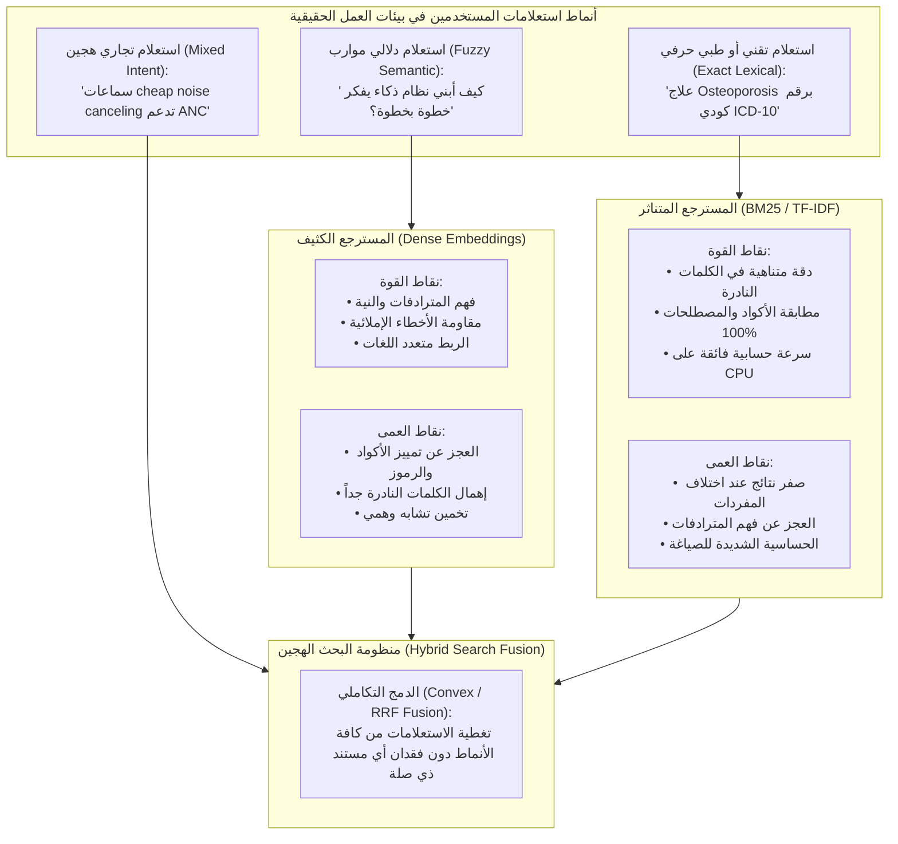

# المحاضرة 43: فوائد وحالات استخدام البحث الهجين في بيئات الإنتاج
### Benefits and Enterprise Use Cases of Combining Dense and Sparse Search

---

## 1. النظرة العامة والهدف الهندسي (Executive Overview)

في المحاضرتين السابقتين (41 و 42)، قمنا بدراسة الأساس الرياضي لدمج المصفوفات الكثيفة والمتناثرة، وبناء خط استرجاع هجين متكامل باستخدام `EnsembleRetriever` ومكتبة `LangChain`.

تأتي هذه المحاضرة للإجابة على السؤال المعماري الأهم في بيئات الإنتاج:  
**لماذا تنفق الشركات الكبرى موارد إضافية لتشغيل فهرسين متوازيين (كثيف ومتناثر) بدلاً من الاكتفاء بنموذج الـ Embeddings الحديث؟ وما هي القيمة العددية والنوعية التي يقدمها البحث الهجين؟**

البحث الهجين (`Hybrid Search`) ليس مجرد رفاهية تقنية، بل هو **صمام الأمان الهندسي (`Fail-Safe Mechanism`)** الذي يمنع ظاهرة "عمى النماذج الدلالية" ويقضي على هلوسة الاسترجاع (`Retrieval Hallucination`).

---

## 2. ثنائية استرجاع المعلومات: نقاط القوة والعمى المتبادل



---

## 3. الفوائد الهندسية الست للبحث الهجين (The 6 Core Pillars)

### 3.1 تعظيم نسبة الاستدعاء الشامل (Boost Recall)
* **المفهوم:** الاستدعاء (`Recall`) يقيس قدرة النظام على العثور على **جميع** المستندات ذات الصلة بالسؤال دون إغفال أي منها.
* **آلية التعظيم:**
  * إذا سأل موظف عن كود خطأ معين مثل `ERR_DB_CONN_TIMEOUT`، فإن المسترجع الكثيف قد يفشل لأن المتجه الخاص بالكود لا يعبر عن دلالة واضحة في الفضاء الهندسي، بينما يلتقطه `BM25` فوراً في المركز الأول.
  * إذا سأل موظف عن "إجراءات التظلم والشكاوى"، وكتبت الوثيقة الرسمية "آليات رفع النزاعات الإدارية"، فإن `BM25` يعطي درجة صفر لانعدام الكلمات المشتركة، بينما يلتقطها المسترجع الكثيف بفضل التشابه الاتجاهي للـ `Embeddings`.
  * **النتيجة:** دمج المسترجعين يضمن عدم سقوط أي مستند حيوي من قائمة النتائج المسترجعة.

---

### 3.2 معالجة المترادفات وإعادة الصياغة (Handling Synonyms & Rephrasing)
* في اللغة الطبيعية، توجد آلاف الطرق للتعبير عن نفس المعنى:
  * استعلام: `"create app"` $\longleftrightarrow$ المستند: `"build system"`.
  * استعلام: `"medical diagnosis"` $\longleftrightarrow$ المستند: `"clinical evaluation"`.
* المسترجع الكثيف يتفوق في رصد الترادف المفاهيمي (`Conceptual Equivalence`).
* وفي الوقت نفسه، يضمن `BM25` الاحتفاظ بالمطابقة اللفظية الصريحة للكلمات المحورية التي يجب عدم استبدالها بمترادفات تقريبية (مثل أسماء البرمجيات: `LangChain`, `Docker`).

---

### 3.3 متانة الاسترجاع وتنوع أساليب المستخدمين (Retrieval Robustness)
المستخدمون ليسوا شريحة واحدة متجانسة:
1. **المستخدم المبتدئ / العامي (`Novice User`)**: يكتب استعلامات طويلة، وصفية، ومحشوة بالأسئلة السردية (مثال: "ما هي الطريقة المناسبة لجعل الروبوت يقرأ ملفات الـ PDF؟").
2. **المستخدم الخبير / التقني (`Power User`)**: يكتب كلمات مفتاحية مقتضبة، رموز دوال، أو وسوم بحث (مثال: `PyPDFLoader chunk_overlap`).

النظام الكثيف يخدم المبتدئ بامتياز، والنظام المتناثر يخدم الخبير بدقة.  
**البحث الهجين يجعل تطبيق الـ RAG مستقراً ومتيناً بغض النظر عن أسلوب صياغة المستخدم.**

---

### 3.4 الترجيح الدقيق للكلمات النادرة والمصطلحات الحساسة (Lexical Importance)
في النماذج اللغوية الكثيفة، يتم تمثيل الكلمات في فضاء متصل، مما قد يؤدي أحياناً إلى "ابتلاع" الكلمات النادرة داخل السياق العام للمستند.

في خوارزمية `BM25`، تُعامل الكلمات النادرة بقيمة $\text{IDF}$ هائلة:
$$\text{IDF}(q_i) = \ln \left( \frac{N - n(q_i) + 0.5}{n(q_i) + 0.5} + 1 \right)$$
* إذا وردت كلمة نادرة مثل مرض `Osteoporosis` (هشاشة العظام) في مستندين فقط من أصل 100,000 مستند، فإن وزن $\text{IDF}$ الخاص بها يرتفع بشدة، مما يضمن صعود المستند الحاوي على الكلمة إلى قمة الترتيب مباشرة.
* هذه الخاصية حاسمة في الأنظمة الطبية، القانونية، والمالية حيث كلمة واحدة نادرة قد تغير معنى البند التعاقدي أو التشخيص بالكامل.

---

### 3.5 ردم الفجوة بين أنواع المستندات غير المتجانسة (Document Diversity Bridge)
في كبرى الشركات، تحتوي قاعدة البيانات المعرفية على خليط متنافر:
* **مستندات مهيكلة بدقة (`Structured Docs`)**: تقارير رسمية، وثائق `API`، وبنود عقود قانونية.
* **مستندات غير مهيكلة وعامية (`Informal / Loose Docs`)**: محادثات `Slack`، تذاكر دعم فني (`Zendesk Tickets`)، ومسودات اجتماعات.

البحث المتناثر يتفوق في المستندات المهيكلة الغنية بالمصطلحات الفنية، بينما يتفوق البحث الكثيف في استخلاص المعنى من النصوص العامية الحرة. البحث الهجين يقوم بمواءمة النوعين في فضاء استرجاع موحد.

---

### 3.6 القابلية للضبط الهندسي والتحكم في الموازين (Dynamic Weight Tunability)
يوفر معامل الدمج المحدب $\alpha$ مرونة هندسية كاملة للتحكم في سلوك النظام:
$$\text{Score}_{\text{Hybrid}} = \alpha \cdot \text{Score}_{\text{Dense}} + (1 - \alpha) \cdot \text{Score}_{\text{Sparse}}$$

```
  [البحث الحرفي BM25]                                             [البحث الدلالي Dense]
  α = 0.0                      α = 0.3              α = 0.7                      α = 1.0
  ├──────────────────────────────┼────────────────────┼────────────────────────────┤
  مطابقة أكواد وأرقام قطع غيار   أنظمة قانونية وطبية    استعلامات عامة وأسئلة شائعة    أسئلة فلسفية وإبداعية
```

يمكن حتى بناء **وكيل ذكي (`Router Agent`)** يفحص استعلام المستخدم:  
إذا احتوى الاستعلام على أرقام أو كلمات محصورة بين علامتي تنصيص، يقوم الوكيل تلقائياً بخفض $\alpha$ إلى $0.2$ لتغليب البحث المتناثر، وإذا كان الاستعلام سؤالاً إنشائياً طويلاً يرفع $\alpha$ إلى $0.85$.

---

## 4. جدول المقارنة التجريبية: أداء المحركات في السيناريوهات الصعبة

| نوع الاستعلام وحالته | البحث الكثيف فقط (`Dense-Only`) | البحث المتناثر فقط (`Sparse-Only`) | البحث الهجين (`Hybrid Search`) | التفسير الهندسي |
| :--- | :--- | :--- | :--- | :--- |
| **استعلام ترادف دلالي بحت**<br>`"build thinking machines"`<br>المستند: `"creating AI reasoning models"` | **ناجح (ترتيب #1)** | **فاشل (ترتيب 0)**<br>(انعدام الكلمات المشتركة) | **ناجح (ترتيب #1)** | الكثيف يوفر الدلالة والمتناثر لا يعيق النتيجة لغياب الكلمات. |
| **استعلام رمز دالة أو خطأ برمجي**<br>`"IndexFlatIP L2_distance"` | **ضعيف (ترتيب متأخر)**<br>(الرمز غير مفهوم دلالياً) | **ناجح جداً (ترتيب #1)**<br>(مطابقة تامة للمعرّف) | **ناجح جداً (ترتيب #1)** | المتناثر يرفع المستند للقمة بفضل الـ IDF المرتفع للرمز. |
| **استعلام تجاري هجين**<br>`"cheap noise canceling headphones"`<br>المستند: `"affordable ANC earbuds"` | **متوسط**<br>(التقط cheap/affordable لكن أضاع ANC) | **متوسط**<br>(التقط ANC أو headphones وأضاع الرابط) | **ممتاز (ترتيب #1)** | الكثيف ربط cheap بـ affordable والمتناثر أكد مطابقة ANC. |
| **استعلام يحتوي على خطأ إملائي**<br>`"LanggChain retreivers"` | **ناجح**<br>(المتجهات تتحمل الأخطاء الخفيفة) | **فاشل**<br>(فشل مطابقة الكلمة المحرفة) | **ناجح** | المتجه الكثيف أنقذ الاستعلام رغم فشل الفهرس المقلوب. |

---

## 5. أشهر مجالات الاستخدام الإنتاجي (Production Use Cases)

1. **محركات التجارة الإلكترونية وكتالوجات المنتجات (`E-Commerce Catalog Search`)**:
   * المستخدم يكتب: "شاحن سريع للايفون 15".
   * النظام يربط دلالياً بين "سريع" و "Fast Charging / 20W PD"، بينما يطابق حرفياً رقم الموديل "iPhone 15".
2. **الأنظمة القانونية والامتثال المؤسسي (`Legal & Compliance QA`)**:
   * البحث في نصوص القوانين يتطلب مطابقة رقم المادة الدستورية بدقة متناهية (`Article 402-B`) بالتوازي مع فهم التفسير القانوني للمظلمة.
3. **الدعم الفني وتوثيق واجهات البرمجة (`Developer Documentation & API QA`)**:
   * المطور يكتب: "كيف أرسل رسالة فورية؟"
   * المستند يحتوي على: `client.chat.postMessage(channel, text)`.
   * يدمج البحث الهجين بين السؤال الإنساني العام وأسماء الدوال البرمجية الحرفية.
4. **المساعدات الطبية والسريرية (`Clinical QA`)**:
   * البحث عن أعراض الأمراض يتطلب مطابقة رموز التصنيف الدولي للأمراض (`ICD-10 Codes`) مع الوصف السريري المكتوب بلغة المريض.

---

## 6. الخلاصة المعمارية

* البحث الكثيف يمنح نظام الـ RAG **الذكاء والمرونة اللغوية (`Semantic Intelligence`)**.
* البحث المتناثر يمنح نظام الـ RAG **الدقة والمصداقية الحرفية (`Lexical Precision`)**.
* دمجهما معاً هو المعيار القياسي الذهبي (`Industry Gold Standard`) لبناء أنظمة بحث مؤسسية خالية من الهلوسة وعالية الاعتمادية.
