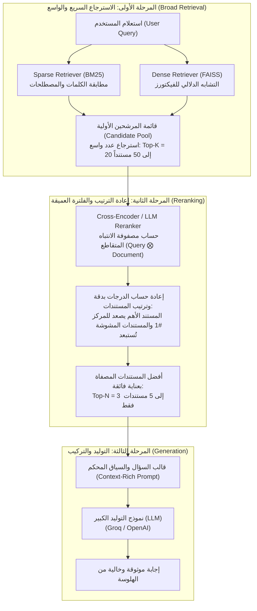

# المحاضرة 44: استراتيجية إعادة الترتيب للبحث الهجين
### Reranking Hybrid Search Strategy (The Three-Stage RAG Architecture)

---

## 1. النظرة العامة والتحول المعماري (Architectural Overview)

في المحاضرات السابقة (41، 42، و 43)، ركزنا على تحسين مرحلة الاسترجاع الأولية من خلال دمج البحث الكثيف (`Dense Retrieval`) والبحث المتناثر (`Sparse Retrieval - BM25`) عبر الدمج الموزون ورتب `RRF`.

ورغم قوة البحث الهجين، إلا أن أنظمة الإنتاج الحقيقية تواجه تحدياً كبيراً:
* المسترجعات السريعة (سواء كانت فهارس فيكتورز تقريبية مثل `FAISS / HNSW` أو فهارس مقلوبة مثل `BM25`) صُممت للسرعة الفائقة ($O(1)$ إلى $O(\log N)$)، حيث تفحص ملايين المستندات في أجزاء من الثانية.
* هذه السرعة تأتي على حساب **عمق الفهم الدلالي التفاعلي (`Cross-Attention`)**؛ إذ يتم تمثيل السؤال كمتجه مستقل والمستند كمتجه مستقل دون أن يرى أحدهما الآخر أثناء حساب التضمينات.
* النتيجة: قد تحتوي المستندات الـ 10 المسترجعة أولياً على الإجابة المطلوبة، لكنها مدفونة في المركز 7 أو 8، بينما تتصدر المراكز الأولى مستندات تحتوي على كلمات متشابهة ظاهرياً ولكنها أقل صلة بالمغزى الحقيقي للسؤال.

هنا تأتي **استراتيجية إعادة الترتيب (`Reranking Strategy`)** لتعيد هيكلة خط الـ RAG بالكامل.

---

## 2. التحول من معمارية المرحلتين إلى معمارية المراحل الثلاث

```
[المعمارية التقليدية: Two-Stage RAG Pipeline]
  User Query ──► [Fast Retriever (Dense / Sparse)] ──► Top-K (Raw Order) ──► [LLM Generation]
  (مشكلة: المستندات الأقل دقة قد تتصدر السياق وتسبب الهلوسة)

                                  ▼
[المعمارية الحديثة: Three-Stage Enterprise RAG Pipeline]
  User Query ──► 1. Fast Retrieval (Top-50) ──► 2. Cross-Encoder Reranker (Top-3) ──► 3. LLM Generation
                 (استرجاع واسع وسريع)          (إعادة تقييم وترتيب دقيق وعميق)         (توليد عالي الدقة)
```



---

## 3. المقارنة الهندسية: Bi-Encoder مقابل Cross-Encoder

لفهم سبب قوة الـ Reranker، يجب فهم الفرق المعماري بين النموذجين:

```
[Bi-Encoder Architecture - يُستخدم في الاسترجاع الأولي]
  Query    ──► [Transformer Encoder A] ──► Vector Q ──┐
                                                        ├─► Cosine Similarity (Dot Product)
  Document ──► [Transformer Encoder B] ──► Vector D ──┘
  (المشكلة: انعدام التفاعل بين كلمات السؤال وكلمات المستند أثناء التشفير)

-----------------------------------------------------------------------------------------

[Cross-Encoder Architecture - يُستخدم في الـ Reranker]
  [Query + Document] ──► [Single Transformer Encoder with Full Self-Attention] ──► Relevance Score [0, 1]
  (الميزة: كل كلمة في السؤال ترى وتتفاعل مع كل كلمة في المستند عبر Attention Layers)
```

| وجه المقارنة المعماري | المشفر الثنائي (`Bi-Encoder`) | المشفر المتقاطع (`Cross-Encoder / Reranker`) |
| :--- | :--- | :--- |
| **آلية المعالجة** | تشفير السؤال والمستند بشكل منفصل تماماً | إدخال الزوج `[Query, Document]` معاً في نفس النموذج |
| **مستوى التفاعل (`Attention`)** | انعدام التفاعل بين الكلمات (`Zero Cross-Attention`) | تفاعل كامل بين كل كلمة في السؤال والمستند (`Full Attention`) |
| **السرعة الحسابية** | فائقة جداً (مليارات التضمينات تُفحص في أجزاء من الثانية) | أبطأ نسبياً وتتطلب موارد حوسبة أعلى لكل زوج مستندات |
| **قابلية الفهرسة المسبقة** | ممكنة (تُحسب متجهات المستندات مسبقاً وتُخزن في الفيكتور داتابيس) | غير ممكنة (يجب حساب الدرجة في الوقت الفعلي مع السؤال اللحظي) |
| **الدقة والتقاط الفروق الدقيقة** | جيدة للاستدعاء العام (`Recall`) | استثنائية للدقة العالية (`Precision`) والترتيب |
| **الدور داخل خط الـ RAG** | **المرحلة الأولى**: تصفية ملايين المستندات إلى العشرات | **المرحلة الثانية**: تصفية العشرات إلى أفضل 3 أو 5 مستندات |

---

## 4. كيف تعمل عملية إعادة الترتيب رياضياً ومنطقياً؟

1. **الاسترجاع الأولي الواسع (`Initial Fetch`)**:
   يقوم المسترجع السريع (`Hybrid Retriever`) باسترجاع قائمة مرشحة بحجم $K_1$ (مثلاً: $K_1 = 10$ مستندات):
   $$\mathcal{D}_{\text{initial}} = [D_1, D_2, D_3, D_4, D_5, D_6, D_7, D_8, D_9, D_10]$$
   قد يكون ترتيب هذه المستندات متأثراً بتشابه سطحي أو كلمات شائعة مكررة.

2. **تسجيل النقاط المتقاطع (`Cross-Scoring`)**:
   يتم تمرير كل زوج $(Q, D_i)$ إلى نموذج إعادة الترتيب لحساب درجة الصلة الحقيقية:
   $$s_i = \text{Score}_{\text{Reranker}}(Q, D_i) \quad \forall D_i \in \mathcal{D}_{\text{initial}}$$

3. **إعادة الترتيب والقطع (`Reorder & Truncate`)**:
   يتم فرز المستندات تنازلياً حسب $s_i$، واختيار أفضل $K_2$ مستنداً فقط (حيث $K_2 \ll K_1$، مثلاً $K_2 = 3$):
   $$\mathcal{D}_{\text{final}} = \text{Top-}K_2(\text{SortDesc}(\mathcal{D}_{\text{initial}}, s))$$

**مثال واقعي على إعادة الترتيب:**
* المستند $D_5$ كان في المركز الخامس في الفهرس الأولي لأنه لم يتطابق مع السؤال بالكلمات الحرفية، ولكنه يحتوي على صلب الإجابة الطبية الدقيقة.
* بعد فحص الـ `Cross-Encoder`، ترتفع درجة $D_5$ ويصعد إلى **المركز الأول (#1)**.
* المستند $D_1$ الذي كان متصدراً لاحتوائه على كلمات عامة مكررة تنخفض درجته ويتراجع للمركز السادس ويتم استبعاده.

---

## 5. الفوائد المؤسسية لإضافة الـ Reranker في بيئات الإنتاج

1. **حل مشكلة "الضياع في المنتصف" (`Mitigating Lost in the Middle`)**:
   * أثبتت الأبحاث أن النماذج اللغوية (`LLMs`) تنتبه جيداً للوثائق الموجودة في أول سياق النص وآخره، وتهمل الوثائق الواقعة في المنتصف.
   * وضع المستند الأكثر صلة في المرتبة الأولى عبر الـ `Reranker` يضمن قراءة الـ LLM للمعلومة المحورية فوراً.
2. **ضغط نافذة السياق وتوفير التكلفة (`Context Compression & Cost Saving`)**:
   * بدلاً من تمرير 15 مستنداً طويلاً إلى الـ LLM ودفع تكلفة آلاف التوكنز في كل طلب، نمرر أفضل 3 مستندات فائقة الدقة فقط.
3. **تقليل الهلوسة وتعظيم دقة الإجابة (`Hallucination Reduction`)**:
   * تنقية السياق من المستندات المشوشة وغير المتطابقة يمنع تضارب المعلومات داخل الـ LLM ويجعل المخرجات مركزة ودقيقة.

---

## 6. الخلاصة والتسلسل للمحاضرة القادمة

* **المحاضرة 44**: أصلت المفهوم النظري والمعماري لإعادة الترتيب وفصلت بين دور الـ `Bi-Encoder` كمرشح واسع والـ `Cross-Encoder` كمصنف دقيق.
* **المحاضرة 45 (التطبيق العملي)**: سنقوم بتطبيق خوارزميات الـ Reranking برمجياً داخل مستودعنا باستخدام نماذج إعادة الترتيب المعتمدة (مثل `FlashRank` أو `CrossEncoder`) ودمجها مع `LangChain`.
